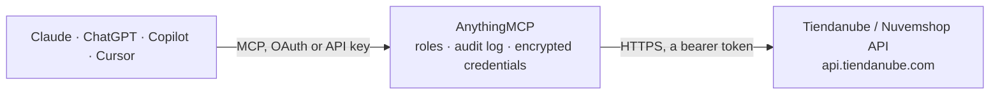

<!-- Generated by scripts/export-github-catalog.mjs in the anythingmcp-website repository. Do not edit by hand. -->

# Tiendanube / Nuvemshop MCP connector

Tiendanube (Nuvemshop in Brazil) online stores: store info, products, variants and stock, product images, categories, orders and fulfillment orders, customers, abandoned checkouts, coupons and webhooks. The AnythingMCP connector gives Claude, ChatGPT, Microsoft Copilot, Cursor and Gemini 26 MCP tools for Tiendanube / Nuvemshop: 15 read and 11 can change data.

**Category:** [E-commerce](../e-commerce.md) · **Tools:** 26 · **Setup guide:** [anythingmcp.com](https://anythingmcp.com/guides/tiendanube-to-mcp) · [Deutsch](https://anythingmcp.com/de/guides/tiendanube-to-mcp) · [Italiano](https://anythingmcp.com/it/guides/tiendanube-to-mcp) · [Español](https://anythingmcp.com/es/guides/tiendanube-to-mcp) · [日本語](https://anythingmcp.com/ja/guides/tiendanube-to-mcp) · [Русский](https://anythingmcp.com/ru/guides/tiendanube-to-mcp) · [中文](https://anythingmcp.com/zh/guides/tiendanube-to-mcp)

## Start without code

No installation and no terminal: AnythingMCP Cloud runs the Tiendanube / Nuvemshop connector for you, operated by helpcode.ai in Frankfurt, Germany.

1. **Click the button above** and create an account or sign in. The Tiendanube / Nuvemshop connector opens, ready to install.
2. **Paste the API key or token from your Tiendanube / Nuvemshop account.** Every click is in the [step-by-step guide](https://anythingmcp.com/guides/tiendanube-to-mcp).
3. **Click Install.** AnythingMCP shows the address of your MCP server.
4. **Add that address to your assistant:** [Claude](https://anythingmcp.com/guides/connect-tiendanube-to-claude) · [ChatGPT](https://anythingmcp.com/guides/connect-tiendanube-to-chatgpt) · [Microsoft Copilot](https://anythingmcp.com/guides/connect-tiendanube-to-copilot) · [Cursor](https://anythingmcp.com/guides/connect-tiendanube-to-cursor) · [Gemini CLI](https://anythingmcp.com/guides/connect-tiendanube-to-gemini) · [Meta Muse](https://anythingmcp.com/guides/connect-tiendanube-to-muse).
5. **Ask your first question**, for example: *Show me order 2026-0897 with customer, payment_status and total.*

Prefer help with the setup? [Talk to us](https://anythingmcp.com/contact).

## How it works

- **The AI client** speaks MCP (Streamable HTTP) to AnythingMCP and only sees tool names, descriptions and results. It never gets the Tiendanube / Nuvemshop credentials.
- **AnythingMCP** checks the client's role, builds the call from the tool definition, adds the credentials (a bearer token), calls Tiendanube / Nuvemshop, logs the call and returns the result.
- **Tiendanube / Nuvemshop** sees an ordinary API client with the rights of the account the credentials belong to.

## Tools

| Tool | What it does | Access |
|---|---|---|
| [`tiendanube_get_store`](#tiendanube_get_store) | Get the store's settings: name, languages and main language, currency, country, contact e-mail, domains and plan. | read |
| [`tiendanube_list_products`](#tiendanube_list_products) | List products with their variants (price, stock, SKU), images, categories and visibility. | read |
| [`tiendanube_get_product`](#tiendanube_get_product) | Get one product by id with names and descriptions per language, variants with price, promotional price, stock and SKU, images, categories, tags, SEO fields… | read |
| [`tiendanube_get_product_by_sku`](#tiendanube_get_product_by_sku) | Find the product that has a variant with the given SKU and return it with all its variants. | read |
| [`tiendanube_create_product`](#tiendanube_create_product) | Create a product with its variants, images and categories. | write |
| [`tiendanube_update_product`](#tiendanube_update_product) | Update product-level fields: name, description, categories, tags, brand, visibility, SEO title and description. | write |
| [`tiendanube_delete_product`](#tiendanube_delete_product) | Delete a product with all its variants and images from the store. | write |
| [`tiendanube_list_variants`](#tiendanube_list_variants) | List the variants of one product with id, attribute values, price, promotional price, cost, stock, SKU, weight and dimensions. | read |
| [`tiendanube_update_variant`](#tiendanube_update_variant) | Update one variant: price, promotional price, cost, stock, SKU or weight. | write |
| [`tiendanube_update_stock`](#tiendanube_update_stock) | Change the stock of one variant or of all variants of a product: replace it with a value, or add / remove a quantity. | write |
| [`tiendanube_list_product_images`](#tiendanube_list_product_images) | List the images of one product with image id, URL (src), position (1 is the main image) and alt text. | read |
| [`tiendanube_add_product_image`](#tiendanube_add_product_image) | Add an image to a product, either from a public URL (src) or from a Base64-encoded file (attachment with filename); send one of the two. | write |
| [`tiendanube_update_product_image`](#tiendanube_update_product_image) | Change an existing product image: its position (1 makes it the main image), its alt text, or replace the picture with a new URL while keeping the image id. | write |
| [`tiendanube_delete_product_image`](#tiendanube_delete_product_image) | Remove one image from a product. | write |
| [`tiendanube_list_categories`](#tiendanube_list_categories) | List the store's product categories with names per language, handle, parent and subcategory ids. | read |
| [`tiendanube_list_orders`](#tiendanube_list_orders) | List orders, newest first, with number, customer, products, totals, payment and shipping status. | read |
| [`tiendanube_get_order`](#tiendanube_get_order) | Get one order by id with customer and addresses, line items, discounts and coupons, totals, payment details, shipping option and tracking, and its… | read |
| [`tiendanube_list_fulfillment_orders`](#tiendanube_list_fulfillment_orders) | List the fulfillment orders of an order: the shipments it is split into, with origin location, items, shipping carrier, tracking info and status. | read |
| [`tiendanube_close_order`](#tiendanube_close_order) | Close (archive) an order once it is handled. | write |
| [`tiendanube_open_order`](#tiendanube_open_order) | Reopen a closed order so it shows among open orders again. | write |
| [`tiendanube_cancel_order`](#tiendanube_cancel_order) | Cancel an order. | write |
| [`tiendanube_list_customers`](#tiendanube_list_customers) | List customers with name, e-mail, phone, identification, addresses, total spent and last order id. | read |
| [`tiendanube_get_customer`](#tiendanube_get_customer) | Get one customer by id with contact details, billing and shipping addresses, accepted marketing, total spent and the id of the last order. | read |
| [`tiendanube_list_abandoned_checkouts`](#tiendanube_list_abandoned_checkouts) | List abandoned checkouts: carts where the buyer entered contact details but did not pay, with products, totals, contact and the recovery URL. | read |
| [`tiendanube_list_coupons`](#tiendanube_list_coupons) | List discount coupons with code, type (percentage, absolute, shipping), value, validity dates, usage count and limits. | read |
| [`tiendanube_list_webhooks`](#tiendanube_list_webhooks) | List the webhooks registered by this app on the store, with id, event (order/created, product/updated...) and target URL. | read |

## Tool reference

Every parameter as the AI client sees it in `tools/list`. Source: [`packages/backend/src/adapters/br/tiendanube.json`](../../../packages/backend/src/adapters/br/tiendanube.json).

### `tiendanube_get_store`

Get the store's settings: name, languages and main language, currency, country, contact e-mail, domains and plan. No parameters; use it first to check the connection and learn the store languages.

**Access:** read · **Call:** `GET /store`

No parameters.

### `tiendanube_list_products`

List products with their variants (price, stock, SKU), images, categories and visibility. Filter by text, category, stock range, dates or visibility. 30 per page by default, up to 200.

**Access:** read · **Call:** `GET /products`

| Parameter | Type | Required | Description |
|---|---|---|---|
| `q` | string | no | Text to find in product names, tags or SKUs. |
| `ids` | string | no | Comma-separated product ids, up to 30. |
| `category_id` | integer | no | Only products in this category (from tiendanube_list_categories). |
| `visibility` | string | no | visible, unlisted or hidden; several comma-separated. |
| `min_stock` | integer | no | Only products with at least this stock. |
| `max_stock` | integer | no | Only products with at most this stock, e.g. 0 for sold-out items. |
| `created_at_min` | string | no | Created on or after, ISO 8601. |
| `created_at_max` | string | no | Created on or before, ISO 8601. |
| `updated_at_min` | string | no | Updated on or after, ISO 8601. |
| `updated_at_max` | string | no | Updated on or before, ISO 8601. |
| `sort_by` | `user` \| `price-ascending` \| `price-descending` \| `alpha-ascending` \| `alpha-descending` \| `created-at-ascending` \| `created-at-descending` \| `best-selling` | no | Sort order. |
| `fields` | string | no | Comma-separated fields to return, e.g. id,name,variants. |
| `page` | integer | no | Page number, starting at 1. |
| `per_page` | integer | no | Results per page, up to 200. Default 30. |

### `tiendanube_get_product`

Get one product by id with names and descriptions per language, variants with price, promotional price, stock and SKU, images, categories, tags, SEO fields and visibility.

**Access:** read · **Call:** `GET /products/{product_id}`

| Parameter | Type | Required | Description |
|---|---|---|---|
| `product_id` | integer | yes | Product id from tiendanube_list_products. |

### `tiendanube_get_product_by_sku`

Find the product that has a variant with the given SKU and return it with all its variants. Use it when an order line, a supplier list or a spreadsheet gives you a SKU.

**Access:** read · **Call:** `GET /products/sku/{sku}`

| Parameter | Type | Required | Description |
|---|---|---|---|
| `sku` | string | yes | Variant SKU, exactly as stored. |

### `tiendanube_create_product`

Create a product with its variants, images and categories. Names and descriptions take a string or an object per language. Returns the new product with its id and variant ids.

**Access:** write · **Call:** `POST /products`

| Parameter | Type | Required | Description |
|---|---|---|---|
| `name` | object | yes | Name per language, e.g. {"es": "Remera", "pt": "Camiseta"}. |
| `description` | object | no | HTML description per language. |
| `variants` | object[] | no | Variants: [{"price": "19.90", "stock": 10, "sku": "ABC-1", "values": [{"es": "M"}]}]. Values match attributes. |
| `attributes` | object[] | no | Up to 3 variant attributes, e.g. [{"es": "Talle"}]. |
| `images` | object[] | no | Images by URL: [{"src": "https://..."}]. Up to 9 here. |
| `categories` | integer[] | no | Category ids. |
| `tags` | string | no | Comma-separated tags. |
| `brand` | string | no | Brand name. |
| `visibility` | `visible` \| `unlisted` \| `hidden` | no | Visibility in the storefront. |
| `free_shipping` | boolean | no | Eligible for free shipping. |
| `requires_shipping` | boolean | no | false for digital products. |

### `tiendanube_update_product`

Update product-level fields: name, description, categories, tags, brand, visibility, SEO title and description. Prices and stock are on variants: use tiendanube_update_variant or tiendanube_update_stock.

**Access:** write · **Call:** `PUT /products/{product_id}`

| Parameter | Type | Required | Description |
|---|---|---|---|
| `product_id` | integer | yes | Product id. |
| `name` | object | no | Name per language. |
| `description` | object | no | HTML description per language. |
| `categories` | integer[] | no | Category ids (replaces the list). |
| `tags` | string | no | Comma-separated tags (replaces them). |
| `brand` | string | no | Brand name. |
| `visibility` | `visible` \| `unlisted` \| `hidden` | no | Visibility in the storefront. |
| `seo_title` | object | no | SEO title per language, up to 70 characters. |
| `seo_description` | object | no | SEO description per language, up to 320 characters. |

### `tiendanube_delete_product`

Delete a product with all its variants and images from the store. This cannot be undone; to take a product offline temporarily set its visibility to hidden instead.

**Access:** write · **Call:** `DELETE /products/{product_id}`

| Parameter | Type | Required | Description |
|---|---|---|---|
| `product_id` | integer | yes | Product id. |

### `tiendanube_list_variants`

List the variants of one product with id, attribute values, price, promotional price, cost, stock, SKU, weight and dimensions. Use it to get variant ids before changing price or stock.

**Access:** read · **Call:** `GET /products/{product_id}/variants`

| Parameter | Type | Required | Description |
|---|---|---|---|
| `product_id` | integer | yes | Product id. |
| `page` | integer | no | Page number, starting at 1. |
| `per_page` | integer | no | Results per page, up to 200. |

### `tiendanube_update_variant`

Update one variant: price, promotional price, cost, stock, SKU or weight. Only the fields passed change. Money values are strings with two decimals.

**Access:** write · **Call:** `PUT /products/{product_id}/variants/{variant_id}`

| Parameter | Type | Required | Description |
|---|---|---|---|
| `product_id` | integer | yes | Product id. |
| `variant_id` | integer | yes | Variant id from tiendanube_list_variants. |
| `price` | string | no | New price, e.g. "19.90". |
| `promotional_price` | string | no | Sale price, or null to remove it. |
| `cost` | string | no | Cost price. |
| `stock` | integer | no | New stock; omit to keep it. |
| `sku` | string | no | New SKU. |
| `weight` | string | no | Weight in kg, e.g. "0.350". |

### `tiendanube_update_stock`

Change the stock of one variant or of all variants of a product: replace it with a value, or add / remove a quantity. Returns the updated variants. Removing more than available leaves 0.

**Access:** write · **Call:** `POST /products/{product_id}/variants/stock`

| Parameter | Type | Required | Description |
|---|---|---|---|
| `product_id` | integer | yes | Product id. |
| `action` | `replace` \| `variation` | yes | replace sets the stock to value; variation adds value (negative removes). |
| `value` | integer | yes | New stock for replace, or the quantity to add or remove for variation. |
| `variant_id` | integer | no | Only this variant; omit to change all variants of the product. |

### `tiendanube_list_product_images`

List the images of one product with image id, URL (src), position (1 is the main image) and alt text. Use it to get an image id before changing or removing an image.

**Access:** read · **Call:** `GET /products/{product_id}/images`

| Parameter | Type | Required | Description |
|---|---|---|---|
| `product_id` | integer | yes | Product id. |
| `since_id` | integer | no | Only images with an id after this one. |
| `src` | string | no | Only the image with this URL. |
| `position` | integer | no | Only the image at this position. |
| `fields` | string | no | Comma-separated fields to return, e.g. id,src,position. |
| `page` | integer | no | Page number, starting at 1. |
| `per_page` | integer | no | Results per page, up to 200. |

### `tiendanube_add_product_image`

Add an image to a product, either from a public URL (src) or from a Base64-encoded file (attachment with filename); send one of the two. position 1 makes it the main image. A product holds at most 250 images. Changes the live store: show the product and image to the user and get a yes first.

**Access:** write · **Call:** `POST /products/{product_id}/images`

| Parameter | Type | Required | Description |
|---|---|---|---|
| `product_id` | integer | yes | Product id. |
| `src` | string | no | Public URL of the image, e.g. https://example.com/photo.jpg. |
| `attachment` | string | no | The image encoded as a Base64 string, instead of src. |
| `filename` | string | no | File name for attachment, e.g. photo.jpg. |
| `position` | integer | no | Position in the product's image list; 1 is the main image. Omit to add it at the end. |
| `alt` | object,string | no | Alt text for search engines and screen readers. Like other texts it can be an object keyed by language, e.g. {"es": "Remera azul", "pt": "Camiseta azul"}; send it in the shape tiendanube_list_product_images returns it. |

### `tiendanube_update_product_image`

Change an existing product image: its position (1 makes it the main image), its alt text, or replace the picture with a new URL while keeping the image id. Only the fields passed change. Show the change to the user and get a yes first.

**Access:** write · **Call:** `PUT /products/{product_id}/images/{image_id}`

| Parameter | Type | Required | Description |
|---|---|---|---|
| `product_id` | integer | yes | Product id. |
| `image_id` | integer | yes | Image id from tiendanube_list_product_images. |
| `position` | integer | no | New position; 1 is the main image. |
| `alt` | object,string | no | Alt text for search engines and screen readers. Like other texts it can be an object keyed by language, e.g. {"es": "Remera azul", "pt": "Camiseta azul"}; send it in the shape tiendanube_list_product_images returns it. |
| `src` | string | no | Public URL of a replacement picture. |

### `tiendanube_delete_product_image`

Remove one image from a product. This cannot be undone; the picture has to be uploaded again to restore it. Installed switched off.

**Access:** write · **Call:** `DELETE /products/{product_id}/images/{image_id}`

| Parameter | Type | Required | Description |
|---|---|---|---|
| `product_id` | integer | yes | Product id. |
| `image_id` | integer | yes | Image id from tiendanube_list_product_images. |

### `tiendanube_list_categories`

List the store's product categories with names per language, handle, parent and subcategory ids. Use the ids to filter products or assign categories.

**Access:** read · **Call:** `GET /categories`

| Parameter | Type | Required | Description |
|---|---|---|---|
| `parent_id` | integer | no | Only children of this category. |
| `page` | integer | no | Page number, starting at 1. |
| `per_page` | integer | no | Results per page, up to 200. |

### `tiendanube_list_orders`

List orders, newest first, with number, customer, products, totals, payment and shipping status. Filter by status, dates, totals or a search text. 30 per page by default, up to 200.

**Access:** read · **Call:** `GET /orders`

| Parameter | Type | Required | Description |
|---|---|---|---|
| `status` | `any` \| `open` \| `closed` \| `cancelled` | no | Order state. Default any. |
| `payment_status` | `any` \| `pending` \| `authorized` \| `paid` \| `abandoned` \| `refunded` \| `voided` | no | Payment state. |
| `shipping_status` | `any` \| `unpacked` \| `unfulfilled` \| `fulfilled` | no | Shipping state; unfulfilled means not shipped. |
| `channels` | `form` \| `store` \| `api` \| `meli` \| `pos` | no | Sales channel: storefront, draft (form), API, Mercado Libre or point of sale. |
| `q` | string | no | Order number, or text in the customer name or e-mail. |
| `customer_ids` | string | no | Comma-separated customer ids. |
| `created_at_min` | string | no | Created on or after, ISO 8601, e.g. 2026-09-01T00:00:00-03:00. |
| `created_at_max` | string | no | Created on or before, ISO 8601. |
| `updated_at_min` | string | no | Updated on or after, ISO 8601. |
| `updated_at_max` | string | no | Updated on or before, ISO 8601. |
| `total_min` | number | no | Minimum order total. |
| `total_max` | number | no | Maximum order total. |
| `fields` | string | no | Comma-separated fields to return, e.g. id,number,total,created_at. |
| `page` | integer | no | Page number, starting at 1. |
| `per_page` | integer | no | Results per page, up to 200. Default 30. |

### `tiendanube_get_order`

Get one order by id with customer and addresses, line items, discounts and coupons, totals, payment details, shipping option and tracking, and its open/closed/cancelled state.

**Access:** read · **Call:** `GET /orders/{order_id}`

| Parameter | Type | Required | Description |
|---|---|---|---|
| `order_id` | integer | yes | Order id (not the order number) from tiendanube_list_orders. |

### `tiendanube_list_fulfillment_orders`

List the fulfillment orders of an order: the shipments it is split into, with origin location, items, shipping carrier, tracking info and status. Use it to follow the delivery of an order.

**Access:** read · **Call:** `GET /orders/{order_id}/fulfillment-orders`

| Parameter | Type | Required | Description |
|---|---|---|---|
| `order_id` | integer | yes | Order id. |

### `tiendanube_close_order`

Close (archive) an order once it is handled. A closed order can be reopened with tiendanube_open_order. Returns the updated order.

**Access:** write · **Call:** `POST /orders/{order_id}/close`

| Parameter | Type | Required | Description |
|---|---|---|---|
| `order_id` | integer | yes | Order id. |

### `tiendanube_open_order`

Reopen a closed order so it shows among open orders again. Does not work on cancelled orders. Returns the updated order.

**Access:** write · **Call:** `POST /orders/{order_id}/open`

| Parameter | Type | Required | Description |
|---|---|---|---|
| `order_id` | integer | yes | Order id. |

### `tiendanube_cancel_order`

Cancel an order. By default the customer is e-mailed and the stock is put back; set email or restock to false to avoid that. Cannot be undone.

**Access:** write · **Call:** `POST /orders/{order_id}/cancel`

| Parameter | Type | Required | Description |
|---|---|---|---|
| `order_id` | integer | yes | Order id. |
| `reason` | `customer` \| `inventory` \| `fraud` \| `other` | no | Why the order is cancelled. |
| `email` | boolean | no | Notify the customer. Default true. |
| `restock` | boolean | no | Return the items to stock. Default true. |

### `tiendanube_list_customers`

List customers with name, e-mail, phone, identification, addresses, total spent and last order id. Search by text or exact e-mail, filter by dates. 30 per page by default, up to 200.

**Access:** read · **Call:** `GET /customers`

| Parameter | Type | Required | Description |
|---|---|---|---|
| `q` | string | no | Text in the customer name, e-mail or identification (CPF/DNI). |
| `email` | string | no | Exact e-mail address. |
| `created_at_min` | string | no | Created on or after, ISO 8601. |
| `created_at_max` | string | no | Created on or before, ISO 8601. |
| `updated_at_min` | string | no | Updated on or after, ISO 8601. |
| `page` | integer | no | Page number, starting at 1. |
| `per_page` | integer | no | Results per page, up to 200. |

### `tiendanube_get_customer`

Get one customer by id with contact details, billing and shipping addresses, accepted marketing, total spent and the id of the last order.

**Access:** read · **Call:** `GET /customers/{customer_id}`

| Parameter | Type | Required | Description |
|---|---|---|---|
| `customer_id` | integer | yes | Customer id from tiendanube_list_customers or an order. |

### `tiendanube_list_abandoned_checkouts`

List abandoned checkouts: carts where the buyer entered contact details but did not pay, with products, totals, contact and the recovery URL. Use it for cart recovery follow-ups.

**Access:** read · **Call:** `GET /checkouts`

| Parameter | Type | Required | Description |
|---|---|---|---|
| `created_at_max` | string | no | Created on or before, ISO 8601. |
| `updated_at_max` | string | no | Updated on or before, ISO 8601. |
| `page` | integer | no | Page number, starting at 1. |
| `per_page` | integer | no | Results per page, up to 200. |

### `tiendanube_list_coupons`

List discount coupons with code, type (percentage, absolute, shipping), value, validity dates, usage count and limits. Filter by code, status or validity.

**Access:** read · **Call:** `GET /coupons`

| Parameter | Type | Required | Description |
|---|---|---|---|
| `q` | string | no | Coupon code to look for. |
| `valid` | boolean | no | true for coupons usable today. |
| `status` | `activated` \| `deactivated` | no | Coupon status. |
| `page` | integer | no | Page number, starting at 1. |
| `per_page` | integer | no | Results per page, up to 200. |

### `tiendanube_list_webhooks`

List the webhooks registered by this app on the store, with id, event (order/created, product/updated...) and target URL. Only the app's own webhooks are visible.

**Access:** read · **Call:** `GET /webhooks`

| Parameter | Type | Required | Description |
|---|---|---|---|
| `event` | string | no | Only this event, e.g. order/paid. |
| `page` | integer | no | Page number, starting at 1. |
| `per_page` | integer | no | Results per page, up to 200. |

## Run it yourself

AnythingMCP is open source (AGPL-3.0). [Run it with Docker](../../../README.md#run-it-yourself), open **Connectors → Store**, pick **Tiendanube / Nuvemshop** and enter `TIENDANUBE_STORE_ID`, `TIENDANUBE_ACCESS_TOKEN`, then add your MCP server URL to the AI client.

[← E-commerce connectors](../e-commerce.md) · [All categories](../README.md)
