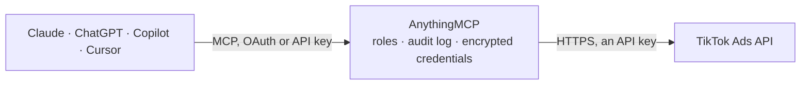

<!-- Generated by scripts/export-github-catalog.mjs in the anythingmcp-website repository. Do not edit by hand. -->

# TikTok Ads MCP connector

Let your AI analyse your TikTok ads: spend, impressions, clicks and conversions by campaign, ad group, ad, day or audience, plus campaigns, Smart+ campaigns, audiences, pixels and the creative library. The AnythingMCP connector gives Claude, ChatGPT, Microsoft Copilot, Cursor and Gemini 20 MCP tools for TikTok Ads: 16 read and 4 can change data.

**Category:** [Advertising](../advertising.md) · **Tools:** 20 · **Setup guide:** [anythingmcp.com](https://anythingmcp.com/guides/tiktok-ads-to-mcp) · [Deutsch](https://anythingmcp.com/de/guides/tiktok-ads-to-mcp) · [Italiano](https://anythingmcp.com/it/guides/tiktok-ads-to-mcp) · [Español](https://anythingmcp.com/es/guides/tiktok-ads-to-mcp) · [日本語](https://anythingmcp.com/ja/guides/tiktok-ads-to-mcp) · [Русский](https://anythingmcp.com/ru/guides/tiktok-ads-to-mcp) · [中文](https://anythingmcp.com/zh/guides/tiktok-ads-to-mcp)

## Start without code

No installation and no terminal: AnythingMCP Cloud runs the TikTok Ads connector for you, operated by helpcode.ai in Frankfurt, Germany.

1. **Click the button above** and create an account or sign in. The TikTok Ads connector opens, ready to install.
2. **Paste the API key or token from your TikTok Ads account.** Every click is in the [step-by-step guide](https://anythingmcp.com/guides/tiktok-ads-to-mcp).
3. **Click Install.** AnythingMCP shows the address of your MCP server.
4. **Add that address to your assistant:** [Claude](https://anythingmcp.com/guides/connect-tiktok-ads-to-claude) · [ChatGPT](https://anythingmcp.com/guides/connect-tiktok-ads-to-chatgpt) · [Microsoft Copilot](https://anythingmcp.com/guides/connect-tiktok-ads-to-copilot) · [Cursor](https://anythingmcp.com/guides/connect-tiktok-ads-to-cursor) · [Gemini CLI](https://anythingmcp.com/guides/connect-tiktok-ads-to-gemini) · [Meta Muse](https://anythingmcp.com/guides/connect-tiktok-ads-to-muse).
5. **Ask your first question**, for example: *What's the status, budget and creation date for campaign 'Autumn Sale DE' (look for that exact name)?*

Prefer help with the setup? [Talk to us](https://anythingmcp.com/contact).

## How it works

- **The AI client** speaks MCP (Streamable HTTP) to AnythingMCP and only sees tool names, descriptions and results. It never gets the TikTok Ads credentials.
- **AnythingMCP** checks the client's role, builds the call from the tool definition, adds the credentials (an API key), calls TikTok Ads, logs the call and returns the result.
- **TikTok Ads** sees an ordinary API client with the rights of the account the credentials belong to.

## Tools

| Tool | What it does | Access |
|---|---|---|
| [`tiktok_ads_list_authorized_advertisers`](#tiktok_ads_list_authorized_advertisers) | List every ad account (advertiser_id and name) the access token was authorized for. | read |
| [`tiktok_ads_get_advertiser_info`](#tiktok_ads_get_advertiser_info) | Read the configured ad account: name, company, status, currency, timezone, country, balance and more. | read |
| [`tiktok_ads_list_campaigns`](#tiktok_ads_list_campaigns) | List the campaigns of the ad account: id, name, objective, budget mode and budget, operation and secondary status, creation time. | read |
| [`tiktok_ads_list_smart_plus_campaigns`](#tiktok_ads_list_smart_plus_campaigns) | List the Upgraded Smart+ campaigns of the ad account (TikTok's automated campaign type), which tiktok_ads_list_campaigns may not show in full. | read |
| [`tiktok_ads_list_ad_groups`](#tiktok_ads_list_ad_groups) | List the ad groups of the ad account (TikTok's name for ad sets): campaign, budget, schedule, bidding, optimization goal, placements, targeting and status. | read |
| [`tiktok_ads_list_ads`](#tiktok_ads_list_ads) | List the ads of the ad account: ad group and campaign, ad text, call to action, landing page, video_id or image_ids, identity and status. | read |
| [`tiktok_ads_get_report`](#tiktok_ads_get_report) | Run a synchronous performance report: spend, impressions, clicks, conversions and more, per campaign, ad group, ad, day or audience breakdown, for a date… | read |
| [`tiktok_ads_list_custom_audiences`](#tiktok_ads_list_custom_audiences) | List the custom and lookalike audiences of the ad account: id, name, type, size (cover_num), whether it is valid for ads and when it expires. | read |
| [`tiktok_ads_get_custom_audiences`](#tiktok_ads_get_custom_audiences) | Read up to 100 custom audiences in detail, with their rules, source and recent history. | read |
| [`tiktok_ads_list_saved_audiences`](#tiktok_ads_list_saved_audiences) | List the saved audiences (stored targeting presets) of the ad account. | read |
| [`tiktok_ads_list_pixels`](#tiktok_ads_list_pixels) | List the TikTok Pixels of the ad account with their code, setup mode and events. | read |
| [`tiktok_ads_get_pixel_event_stats`](#tiktok_ads_get_pixel_event_stats) | Count the events pixels received per event type over a date range of at most 30 days (UTC): a quick check that tracking works. | read |
| [`tiktok_ads_get_videos`](#tiktok_ads_get_videos) | Read up to 60 videos of the ad account's creative library by video_id (from tiktok_ads_list_ads): file name, duration, size, format and a preview link. | read |
| [`tiktok_ads_search_videos`](#tiktok_ads_search_videos) | Search the videos of the ad account's creative library, newest first. | read |
| [`tiktok_ads_get_images`](#tiktok_ads_get_images) | Read up to 100 images of the ad account's creative library by image id: file name, size, format and URL. | read |
| [`tiktok_ads_list_identities`](#tiktok_ads_list_identities) | List the identities ads can run under: custom identities and the TikTok accounts linked to the ad account or its Business Center. | read |
| [`tiktok_ads_update_campaign_status`](#tiktok_ads_update_campaign_status) | Turn campaigns on (ENABLE, starts spending) or pause them (DISABLE). | write |
| [`tiktok_ads_update_ad_group_status`](#tiktok_ads_update_ad_group_status) | Turn ad groups on (ENABLE, starts spending) or pause them (DISABLE). | write |
| [`tiktok_ads_update_ad_status`](#tiktok_ads_update_ad_status) | Turn ads on (ENABLE, starts spending) or pause them (DISABLE). | write |
| [`tiktok_ads_update_campaign_budget`](#tiktok_ads_update_campaign_budget) | Change the budget of a campaign that has its own budget (budget_mode BUDGET_MODE_DAY, BUDGET_MODE_DYNAMIC_DAILY_BUDGET or BUDGET_MODE_TOTAL), in the account… | write |

## Tool reference

Every parameter as the AI client sees it in `tools/list`. Source: [`packages/backend/src/adapters/intl/tiktok-ads.json`](../../../packages/backend/src/adapters/intl/tiktok-ads.json).

### `tiktok_ads_list_authorized_advertisers`

List every ad account (advertiser_id and name) the access token was authorized for. Needs TIKTOK_ADS_APP_ID and TIKTOK_ADS_APP_SECRET, which TikTok asks for on this one call.

**Access:** read · **Call:** `GET /oauth2/advertiser/get/`

No parameters.

### `tiktok_ads_get_advertiser_info`

Read the configured ad account: name, company, status, currency, timezone, country, balance and more. A quick check that the token and TIKTOK_ADS_ADVERTISER_ID work.

**Access:** read · **Call:** `GET /advertiser/info/`

| Parameter | Type | Required | Description |
|---|---|---|---|
| `fields` | string | no | Optional JSON array of fields, e.g. ["name","status","currency","timezone","balance"]. Leave empty for all fields. |

### `tiktok_ads_list_campaigns`

List the campaigns of the ad account: id, name, objective, budget mode and budget, operation and secondary status, creation time.

**Access:** read · **Call:** `GET /campaign/get/`

| Parameter | Type | Required | Description |
|---|---|---|---|
| `filtering` | string | no | Optional JSON object to filter by, e.g. {"campaign_ids":["1800..."]}, {"primary_status":"STATUS_DELIVERY_OK"} (also STATUS_DISABLE, STATUS_DELETE, STATUS_ALL; deleted ones are left out by default), {"objective_type":"TRAFFIC"}, {"campaign_name":"spring"}, {"creation_filter_start_time":"2026-10-01 00:00:00"}. |
| `fields` | string | no | Optional JSON array of the fields to return, e.g. ["campaign_id","campaign_name","budget"]. Leave empty for all fields. |
| `page` | integer | no | Page number, from 1 (default 1). page_info.total_page in the answer says how many there are. |
| `page_size` | integer | no | Results per page, 1 to 1000 (default 50). |

### `tiktok_ads_list_smart_plus_campaigns`

List the Upgraded Smart+ campaigns of the ad account (TikTok's automated campaign type), which tiktok_ads_list_campaigns may not show in full. Not available on the sandbox host.

**Access:** read · **Call:** `GET /smart_plus/campaign/get/`

| Parameter | Type | Required | Description |
|---|---|---|---|
| `filtering` | string | no | Optional JSON object to filter by, e.g. {"campaign_ids":["1800..."]}, {"primary_status":"STATUS_DELIVERY_OK"}, {"objective_type":"WEB_CONVERSIONS"}, {"campaign_name":"spring"}. |
| `fields` | string | no | Optional JSON array of the fields to return, e.g. ["campaign_id","campaign_name","budget"]. Leave empty for all fields. |
| `page` | integer | no | Page number, from 1 (default 1). page_info.total_page in the answer says how many there are. |
| `page_size` | integer | no | Results per page, 1 to 1000 (default 50). |

### `tiktok_ads_list_ad_groups`

List the ad groups of the ad account (TikTok's name for ad sets): campaign, budget, schedule, bidding, optimization goal, placements, targeting and status.

**Access:** read · **Call:** `GET /adgroup/get/`

| Parameter | Type | Required | Description |
|---|---|---|---|
| `filtering` | string | no | Optional JSON object to filter by, e.g. {"campaign_ids":["1800..."]}, {"adgroup_ids":["1800..."]}, {"primary_status":"STATUS_DELIVERY_OK"} (deleted ones are left out by default), {"adgroup_name":"retargeting"}. |
| `fields` | string | no | Optional JSON array of the fields to return, e.g. ["adgroup_id","adgroup_name","campaign_id","budget"]. Leave empty for all fields. |
| `page` | integer | no | Page number, from 1 (default 1). page_info.total_page in the answer says how many there are. |
| `page_size` | integer | no | Results per page, 1 to 1000 (default 50). |

### `tiktok_ads_list_ads`

List the ads of the ad account: ad group and campaign, ad text, call to action, landing page, video_id or image_ids, identity and status.

**Access:** read · **Call:** `GET /ad/get/`

| Parameter | Type | Required | Description |
|---|---|---|---|
| `filtering` | string | no | Optional JSON object to filter by, e.g. {"adgroup_ids":["1800..."]}, {"campaign_ids":["1800..."]}, {"ad_ids":["1800..."]}, {"primary_status":"STATUS_DELIVERY_OK"} (deleted ones are left out by default). |
| `fields` | string | no | Optional JSON array of the fields to return, e.g. ["ad_id","ad_name","adgroup_id","operation_status"]. Leave empty for all fields. |
| `page` | integer | no | Page number, from 1 (default 1). page_info.total_page in the answer says how many there are. |
| `page_size` | integer | no | Results per page, 1 to 1000 (default 50). |

### `tiktok_ads_get_report`

Run a synchronous performance report: spend, impressions, clicks, conversions and more, per campaign, ad group, ad, day or audience breakdown, for a date range or the lifetime. One row per combination of dimensions in list[], each with dimensions and metrics.

**Access:** read · **Call:** `GET /report/integrated/get/`

| Parameter | Type | Required | Description |
|---|---|---|---|
| `start_date` | string | no | First day, YYYY-MM-DD, in the ad account's timezone. Required unless query_lifetime is true. |
| `end_date` | string | no | Last day, YYYY-MM-DD. The range may span at most 365 days, 30 with the stat_time_day dimension and one day with stat_time_hour. |
| `dimensions` | string | no | JSON array of dimensions (default ["campaign_id"]): at most one ID dimension (advertiser_id, campaign_id, adgroup_id, ad_id) and at most one time dimension (stat_time_day, stat_time_hour); BASIC also takes country_code. With report_type AUDIENCE: age, gender, country_code, platform, ac, language, placement and more. |
| `metrics` | string | no | JSON array of metrics (default ["spend","impressions","clicks","ctr","cpc","cpm","reach","conversion","cost_per_conversion","conversion_rate"]). Also campaign_name, adgroup_name, ad_name, currency, frequency, video_play_actions, video_watched_2s, video_watched_6s, average_video_play, likes, comments, shares, follows, profile_visits, complete_payment, complete_payment_roas, total_complete_payment_rate, real_time_conversion and more. |
| `data_level` | `AUCTION_ADVERTISER` \| `AUCTION_CAMPAIGN` \| `AUCTION_ADGROUP` \| `AUCTION_AD` | no | AUCTION_CAMPAIGN (default), AUCTION_ADGROUP, AUCTION_AD or AUCTION_ADVERTISER; it must match the ID dimension. |
| `report_type` | `BASIC` \| `AUDIENCE` | no | BASIC (default) for performance, AUDIENCE for breakdowns by age, gender, country and similar. |
| `query_lifetime` | boolean | no | true for lifetime totals instead of start_date and end_date (BASIC only). |
| `filtering` | string | no | Optional JSON array of filters, e.g. [{"field_name":"campaign_ids","filter_type":"IN","filter_value":"[\"1800...\"]"}]. filter_value is itself a JSON string. |
| `order_field` | string | no | Optional metric to sort by, e.g. spend. |
| `order_type` | `ASC` \| `DESC` | no | DESC (default) or ASC. |
| `enable_total_metrics` | boolean | no | true to add total_metrics, the sum over all rows (BASIC only). |
| `page` | integer | no | Page number, from 1 (default 1). page_info.total_page in the answer says how many there are. |
| `page_size` | integer | no | Results per page, 1 to 1000 (default 100). |

### `tiktok_ads_list_custom_audiences`

List the custom and lookalike audiences of the ad account: id, name, type, size (cover_num), whether it is valid for ads and when it expires.

**Access:** read · **Call:** `GET /dmp/custom_audience/list/`

| Parameter | Type | Required | Description |
|---|---|---|---|
| `custom_audience_ids` | string | no | Optional JSON array of up to 100 audience ids to restrict the list to. |
| `page` | integer | no | Page number, from 1 (default 1). page_info.total_page in the answer says how many there are. |
| `page_size` | integer | no | Results per page, 1 to 100 (default 50). |

### `tiktok_ads_get_custom_audiences`

Read up to 100 custom audiences in detail, with their rules, source and recent history.

**Access:** read · **Call:** `GET /dmp/custom_audience/get/`

| Parameter | Type | Required | Description |
|---|---|---|---|
| `custom_audience_ids` | string | yes | JSON array of audience ids, e.g. ["123456"]. |

### `tiktok_ads_list_saved_audiences`

List the saved audiences (stored targeting presets) of the ad account.

**Access:** read · **Call:** `GET /dmp/saved_audience/list/`

| Parameter | Type | Required | Description |
|---|---|---|---|
| `saved_audience_ids` | string | no | Optional JSON array of saved audience ids. |
| `page` | integer | no | Page number, from 1 (default 1). page_info.total_page in the answer says how many there are. |
| `page_size` | integer | no | Results per page, 1 to 100 (default 50). |

### `tiktok_ads_list_pixels`

List the TikTok Pixels of the ad account with their code, setup mode and events.

**Access:** read · **Call:** `GET /pixel/list/`

| Parameter | Type | Required | Description |
|---|---|---|---|
| `pixel_id` | string | no | Optional: only this pixel. |
| `name` | string | no | Optional: pixels whose name contains this text. |
| `page` | integer | no | Page number, from 1 (default 1). page_info.total_page in the answer says how many there are. |
| `page_size` | integer | no | Results per page, 1 to 20 (default 20). |

### `tiktok_ads_get_pixel_event_stats`

Count the events pixels received per event type over a date range of at most 30 days (UTC): a quick check that tracking works.

**Access:** read · **Call:** `GET /pixel/event/stats/`

| Parameter | Type | Required | Description |
|---|---|---|---|
| `pixel_ids` | string | yes | JSON array of up to 10 pixel ids, e.g. ["C1234567890"]. |
| `start_date` | string | yes | First day, YYYY-MM-DD. |
| `end_date` | string | yes | Last day, YYYY-MM-DD. |

### `tiktok_ads_get_videos`

Read up to 60 videos of the ad account's creative library by video_id (from tiktok_ads_list_ads): file name, duration, size, format and a preview link.

**Access:** read · **Call:** `GET /file/video/ad/info/`

| Parameter | Type | Required | Description |
|---|---|---|---|
| `video_ids` | string | yes | JSON array of video ids, e.g. ["v10033g50000..."]. |

### `tiktok_ads_search_videos`

Search the videos of the ad account's creative library, newest first.

**Access:** read · **Call:** `GET /file/video/ad/search/`

| Parameter | Type | Required | Description |
|---|---|---|---|
| `filtering` | string | no | Optional JSON object, e.g. {"video_ids":["v10033g..."]}, {"material_ids":["7012..."]}, {"video_name":"summer"}. |
| `page` | integer | no | Page number, from 1 (default 1). page_info.total_page in the answer says how many there are. |
| `page_size` | integer | no | Results per page, 1 to 100 (default 20). |

### `tiktok_ads_get_images`

Read up to 100 images of the ad account's creative library by image id: file name, size, format and URL.

**Access:** read · **Call:** `GET /file/image/ad/info/`

| Parameter | Type | Required | Description |
|---|---|---|---|
| `image_ids` | string | yes | JSON array of image ids. |

### `tiktok_ads_list_identities`

List the identities ads can run under: custom identities and the TikTok accounts linked to the ad account or its Business Center.

**Access:** read · **Call:** `GET /identity/get/`

| Parameter | Type | Required | Description |
|---|---|---|---|
| `identity_type` | `CUSTOMIZED_USER` \| `AUTH_CODE` \| `TT_USER` \| `BC_AUTH_TT` | no | Optional: CUSTOMIZED_USER, AUTH_CODE, TT_USER or BC_AUTH_TT. Leave empty for all identities. |
| `identity_authorized_bc_id` | string | no | Business Center id, required with BC_AUTH_TT. |
| `page` | integer | no | Page number, from 1 (default 1). page_info.total_page in the answer says how many there are. |
| `page_size` | integer | no | Results per page, 1 to 100 (default 50). |

### `tiktok_ads_update_campaign_status`

Turn campaigns on (ENABLE, starts spending) or pause them (DISABLE). Acts at once: name the campaigns and the new status and get a yes from the user first. Installed switched off.

**Access:** write · **Call:** `POST /campaign/status/update/`

| Parameter | Type | Required | Description |
|---|---|---|---|
| `campaign_ids` | string[] | yes | Campaign ids, up to 20. |
| `operation_status` | `ENABLE` \| `DISABLE` | yes | ENABLE to start delivery (it spends money), DISABLE to pause it. |

### `tiktok_ads_update_ad_group_status`

Turn ad groups on (ENABLE, starts spending) or pause them (DISABLE). Acts at once: name the ad groups and the new status and get a yes from the user first. Installed switched off.

**Access:** write · **Call:** `POST /adgroup/status/update/`

| Parameter | Type | Required | Description |
|---|---|---|---|
| `adgroup_ids` | string[] | yes | Ad group ids, up to 20. |
| `operation_status` | `ENABLE` \| `DISABLE` | yes | ENABLE to start delivery (it spends money), DISABLE to pause it. |

### `tiktok_ads_update_ad_status`

Turn ads on (ENABLE, starts spending) or pause them (DISABLE). Acts at once: name the ads and the new status and get a yes from the user first. Installed switched off.

**Access:** write · **Call:** `POST /ad/status/update/`

| Parameter | Type | Required | Description |
|---|---|---|---|
| `ad_ids` | string[] | yes | Ad ids, up to 20. |
| `operation_status` | `ENABLE` \| `DISABLE` | yes | ENABLE to start delivery (it spends money), DISABLE to pause it. |

### `tiktok_ads_update_campaign_budget`

Change the budget of a campaign that has its own budget (budget_mode BUDGET_MODE_DAY, BUDGET_MODE_DYNAMIC_DAILY_BUDGET or BUDGET_MODE_TOTAL), in the account currency as a decimal amount (50 = 50.00). The new budget must be at least TikTok's minimum and at least 105% of what the campaign has already spent. Acts at once: state the campaign, the current and the new budget and get a yes from the user first. Installed switched off.

**Access:** write · **Call:** `POST /campaign/update/`

| Parameter | Type | Required | Description |
|---|---|---|---|
| `campaign_id` | string | yes | The campaign id. |
| `budget` | number | yes | The new budget in the account currency, e.g. 50 for 50.00. |

## Run it yourself

AnythingMCP is open source (AGPL-3.0). [Run it with Docker](../../../README.md#run-it-yourself), open **Connectors → Store**, pick **TikTok Ads** and enter `TIKTOK_ADS_API_HOST`, `TIKTOK_ADS_ACCESS_TOKEN`, `TIKTOK_ADS_ADVERTISER_ID`, then add your MCP server URL to the AI client.

[← Advertising connectors](../advertising.md) · [All categories](../README.md)
