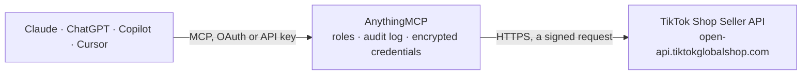

<!-- Generated by scripts/export-github-catalog.mjs in the anythingmcp-website repository. Do not edit by hand. -->

# TikTok Shop Seller MCP connector

Let your AI work with your TikTok shop: orders with buyer notes and addresses, products, stock, warehouses, shipping labels and tracking, returns and settlements, with shipping, product, stock and … The AnythingMCP connector gives Claude, ChatGPT, Microsoft Copilot, Cursor and Gemini 35 MCP tools for TikTok Shop Seller: 24 read and 11 can change data.

**Category:** [E-commerce](../e-commerce.md) · **Tools:** 35 · **Setup guide:** [anythingmcp.com](https://anythingmcp.com/guides/tiktok-shop-to-mcp) · [Deutsch](https://anythingmcp.com/de/guides/tiktok-shop-to-mcp) · [Italiano](https://anythingmcp.com/it/guides/tiktok-shop-to-mcp) · [Español](https://anythingmcp.com/es/guides/tiktok-shop-to-mcp) · [日本語](https://anythingmcp.com/ja/guides/tiktok-shop-to-mcp) · [Русский](https://anythingmcp.com/ru/guides/tiktok-shop-to-mcp) · [中文](https://anythingmcp.com/zh/guides/tiktok-shop-to-mcp)

## Start without code

No installation and no terminal: AnythingMCP Cloud runs the TikTok Shop Seller connector for you, operated by helpcode.ai in Frankfurt, Germany.

1. **Click the button above** and create an account or sign in. The TikTok Shop Seller connector opens, ready to install.
2. **Paste the API key or token from your TikTok Shop Seller account.** Every click is in the [step-by-step guide](https://anythingmcp.com/guides/tiktok-shop-to-mcp).
3. **Click Install.** AnythingMCP shows the address of your MCP server.
4. **Add that address to your assistant:** [Claude](https://anythingmcp.com/guides/connect-tiktok-shop-to-claude) · [ChatGPT](https://anythingmcp.com/guides/connect-tiktok-shop-to-chatgpt) · [Microsoft Copilot](https://anythingmcp.com/guides/connect-tiktok-shop-to-copilot) · [Cursor](https://anythingmcp.com/guides/connect-tiktok-shop-to-cursor) · [Gemini CLI](https://anythingmcp.com/guides/connect-tiktok-shop-to-gemini) · [Meta Muse](https://anythingmcp.com/guides/connect-tiktok-shop-to-muse).
5. **Ask your first question**, for example: *Where is order 576481290337182940 for Lena Hartmann? She says it hasn't arrived yet and wants the carrier and the last scan.*

Prefer help with the setup? [Talk to us](https://anythingmcp.com/contact).

## How it works

- **The AI client** speaks MCP (Streamable HTTP) to AnythingMCP and only sees tool names, descriptions and results. It never gets the TikTok Shop Seller credentials.
- **AnythingMCP** checks the client's role, builds the call from the tool definition, adds the credentials (a signed request), calls TikTok Shop Seller, logs the call and returns the result.
- **TikTok Shop Seller** sees an ordinary API client with the rights of the account the credentials belong to.

## Tools

| Tool | What it does | Access |
|---|---|---|
| [`tiktok_shop_get_authorized_shops`](#tiktok_shop_get_authorized_shops) | List the shops this connector's authorization covers: id, name, region (GB, US, DE...), seller type and shop code. | read |
| [`tiktok_shop_search_orders`](#tiktok_shop_search_orders) | Search the shop's orders, newest first, up to 100 per page, filtered by status, creation or update time, shipping type or buyer. | read |
| [`tiktok_shop_get_orders`](#tiktok_shop_get_orders) | Read up to 50 orders by id: status, line items (product, SKU id, seller SKU, variant name, price), buyer message and seller note, recipient name, phone and… | read |
| [`tiktok_shop_get_order_price_detail`](#tiktok_shop_get_order_price_detail) | Price breakdown of one order: subtotal, shipping fee, seller and platform discounts, taxes, and what the buyer paid, per order and per line item. | read |
| [`tiktok_shop_search_products`](#tiktok_shop_search_products) | Search the shop's products, up to 100 per page, by status, seller SKU, SKU id, or creation or update time. | read |
| [`tiktok_shop_get_product`](#tiktok_shop_get_product) | Read one product in full: title, description, category, brand, images (with their uri, reusable when creating or editing), attributes, package size and… | read |
| [`tiktok_shop_get_inventory`](#tiktok_shop_get_inventory) | Stock of up to 100 products or 600 SKUs: available quantity per SKU and per warehouse. | read |
| [`tiktok_shop_recommend_category`](#tiktok_shop_recommend_category) | Suggest the leaf category for a new product from its title (and optionally description and images). | read |
| [`tiktok_shop_get_categories`](#tiktok_shop_get_categories) | The categories this shop may list in, with id, parent id, name, whether it is a leaf and its permission status. | read |
| [`tiktok_shop_get_category_attributes`](#tiktok_shop_get_category_attributes) | The attributes of a leaf category: product attributes (material, country of origin...) and sales attributes (colour, size), with their value lists and which… | read |
| [`tiktok_shop_get_category_rules`](#tiktok_shop_get_category_rules) | The listing rules of a leaf category: required certifications, size chart, package dimensions, product identifier codes and cash on delivery. | read |
| [`tiktok_shop_get_brands`](#tiktok_shop_get_brands) | Brands available to the shop, optionally for one category and by name prefix, with whether the shop is authorized to sell them. | read |
| [`tiktok_shop_list_warehouses`](#tiktok_shop_list_warehouses) | The shop's warehouses (sales and return), with id, name, address, type and whether one is the default. | read |
| [`tiktok_shop_get_delivery_options`](#tiktok_shop_get_delivery_options) | The delivery options of a warehouse (standard, express...), with their ids and limits. | read |
| [`tiktok_shop_get_shipping_providers`](#tiktok_shop_get_shipping_providers) | The carriers of a delivery option, with the shipping_provider_id that tracking updates need (Royal Mail, Evri, DPD and so on in the UK). | read |
| [`tiktok_shop_search_packages`](#tiktok_shop_search_packages) | Search packages, up to 50 per page, by status and creation or update time: package id, order ids, status, carrier and tracking number. | read |
| [`tiktok_shop_get_package`](#tiktok_shop_get_package) | Read one package: orders and line items in it, status, delivery option (SEND_BY_SELLER means you ship and add tracking yourself), carrier, tracking number,… | read |
| [`tiktok_shop_get_package_handover_time_slots`](#tiktok_shop_get_package_handover_time_slots) | Pickup and drop-off options for a package that ships with a TikTok shipping label: available pickup slots and whether drop-off is possible. | read |
| [`tiktok_shop_get_shipping_document`](#tiktok_shop_get_shipping_document) | Get a download link for a package's shipping label, packing slip or both (PDF, A6 or A5; or the label as PNG), to print. | read |
| [`tiktok_shop_get_order_tracking`](#tiktok_shop_get_order_tracking) | The carrier's tracking events of an order's shipment, newest first, with time and description. | read |
| [`tiktok_shop_search_returns`](#tiktok_shop_search_returns) | Search return and refund requests by order, status, type or time, 10 to 50 per page: return id, order, type (REFUND, RETURN_AND_REFUND, REPLACEMENT),… | read |
| [`tiktok_shop_search_cancellations`](#tiktok_shop_search_cancellations) | Search order cancellation requests by order, status or time: cancel id, order, who asked, reason, status and items. | read |
| [`tiktok_shop_get_statements`](#tiktok_shop_get_statements) | The shop's settlement statements (daily payouts), with revenue, fees, adjustments, settlement amount and payment status, in a time window. | read |
| [`tiktok_shop_get_order_transactions`](#tiktok_shop_get_order_transactions) | The settlement of one order: revenue, each fee and commission, shipping costs, taxes and the amount settled to the seller. | read |
| [`tiktok_shop_upload_product_image`](#tiktok_shop_upload_product_image) | Upload an image to TikTok Shop from a public link, for use in a product (gallery, variant, description, size chart or certification). | write |
| [`tiktok_shop_ship_package`](#tiktok_shop_ship_package) | Arrange shipment of a package. | write |
| [`tiktok_shop_mark_package_shipped`](#tiktok_shop_mark_package_shipped) | Mark an order (or some of its line items) as shipped with your own carrier and send the tracking number to the buyer: for orders you ship yourself (shipping… | write |
| [`tiktok_shop_update_order_shipping_info`](#tiktok_shop_update_order_shipping_info) | Correct the tracking number or carrier of an order already marked as shipped (shipping type SELLER). | write |
| [`tiktok_shop_create_product`](#tiktok_shop_create_product) | Create a product, listed after TikTok's review or kept as a draft (save_mode AS_DRAFT). | write |
| [`tiktok_shop_edit_product`](#tiktok_shop_edit_product) | Replace a product with a full new version: every field left out is removed, SKUs left out are deleted. | write |
| [`tiktok_shop_partial_edit_product`](#tiktok_shop_partial_edit_product) | Change only the fields given (title, description, images, attributes, package, brand, SKUs): everything else stays. | write |
| [`tiktok_shop_update_inventory`](#tiktok_shop_update_inventory) | Set the stock of one or more SKUs of a product, per warehouse. | write |
| [`tiktok_shop_update_price`](#tiktok_shop_update_price) | Set the price of one or more SKUs of an active product. | write |
| [`tiktok_shop_activate_products`](#tiktok_shop_activate_products) | Put deactivated products back on sale (they may go through review again). | write |
| [`tiktok_shop_deactivate_products`](#tiktok_shop_deactivate_products) | Take products off sale: buyers can no longer see or order them until they are activated again. | write |

## Tool reference

Every parameter as the AI client sees it in `tools/list`. Source: [`packages/backend/src/adapters/intl/tiktok-shop.json`](../../../packages/backend/src/adapters/intl/tiktok-shop.json).

### `tiktok_shop_get_authorized_shops`

List the shops this connector's authorization covers: id, name, region (GB, US, DE...), seller type and shop code. Start here to check the connection. The connector uses one of them (TIKTOK_SHOP_SHOP_ID, else the first).

**Access:** read · **Call:** `GET /authorization/202309/shops`

No parameters.

### `tiktok_shop_search_orders`

Search the shop's orders, newest first, up to 100 per page, filtered by status, creation or update time, shipping type or buyer. Returns full orders (line items, buyer message, recipient address, packages). Page with page_token while next_page_token is set.

**Access:** read · **Call:** `POST /order/202309/orders/search`

| Parameter | Type | Required | Description |
|---|---|---|---|
| `order_status` | `UNPAID` \| `ON_HOLD` \| `AWAITING_SHIPMENT` \| `PARTIALLY_SHIPPING` \| `AWAITING_COLLECTION` \| `IN_TRANSIT` \| `DELIVERED` \| `COMPLETED` \| `CANCELLED` | no | Only orders in this status. |
| `create_time_ge` | integer | no | Created at or after. Unix time in seconds. |
| `create_time_lt` | integer | no | Created before. Unix time in seconds. |
| `update_time_ge` | integer | no | Updated at or after. Unix time in seconds. |
| `update_time_lt` | integer | no | Updated before. Unix time in seconds. |
| `shipping_type` | `TIKTOK` \| `SELLER` \| `TIKTOK_DIGITAL` | no | TIKTOK (TikTok shipping label) or SELLER (you ship, own carrier). |
| `buyer_user_id` | string | no | Only this buyer's orders. |
| `is_buyer_request_cancel` | boolean | no | Only orders whose buyer asked to cancel. |
| `page_size` | integer | yes | Orders per page, 1 to 100. |
| `page_token` | string | no | Leave out for the first page; then next_page_token from the previous answer. |
| `sort_field` | `create_time` \| `update_time` | no | Sort by create_time (default) or update_time. |
| `sort_order` | `ASC` \| `DESC` | no | DESC (default) or ASC. |

### `tiktok_shop_get_orders`

Read up to 50 orders by id: status, line items (product, SKU id, seller SKU, variant name, price), buyer message and seller note, recipient name, phone and address, payment totals, shipping provider, tracking number and packages.

**Access:** read · **Call:** `GET /order/202507/orders`

| Parameter | Type | Required | Description |
|---|---|---|---|
| `ids` | string | yes | Order ids separated by commas, 1 to 50, e.g. 576461413038785752,576461413038785753. |

### `tiktok_shop_get_order_price_detail`

Price breakdown of one order: subtotal, shipping fee, seller and platform discounts, taxes, and what the buyer paid, per order and per line item.

**Access:** read · **Call:** `GET /order/202407/orders/{order_id}/price_detail`

| Parameter | Type | Required | Description |
|---|---|---|---|
| `order_id` | string | yes | Order id. |

### `tiktok_shop_search_products`

Search the shop's products, up to 100 per page, by status, seller SKU, SKU id, or creation or update time. Returns product id, title, status and SKUs with price and stock. Page with page_token while next_page_token is set.

**Access:** read · **Call:** `POST /product/202502/products/search`

| Parameter | Type | Required | Description |
|---|---|---|---|
| `status` | `ALL` \| `DRAFT` \| `PENDING` \| `FAILED` \| `ACTIVATE` \| `SELLER_DEACTIVATED` \| `PLATFORM_DEACTIVATED` \| `FREEZE` \| `DELETED` | no | Product status, default ALL. |
| `seller_skus` | string[] | no | Only products with these seller SKU codes. |
| `sku_ids` | string[] | no | Only products with these SKU ids (up to 10). |
| `create_time_ge` | integer | no | Created at or after. Unix time in seconds. |
| `create_time_le` | integer | no | Created at or before. Unix time in seconds. |
| `update_time_ge` | integer | no | Updated at or after. Unix time in seconds. |
| `update_time_le` | integer | no | Updated at or before. Unix time in seconds. |
| `category_version` | `v1` \| `v2` | no | Category tree: v1 (3 levels, every market except the US) or v2 (7 levels, US). Default: the shop's tree. |
| `page_size` | integer | yes | Products per page, 1 to 100. |
| `page_token` | string | no | Leave out for the first page; then next_page_token from the previous answer. |

### `tiktok_shop_get_product`

Read one product in full: title, description, category, brand, images (with their uri, reusable when creating or editing), attributes, package size and weight, audit status, and every SKU with seller SKU, variant attributes, price and stock per warehouse.

**Access:** read · **Call:** `GET /product/202309/products/{product_id}`

| Parameter | Type | Required | Description |
|---|---|---|---|
| `product_id` | string | yes | Product id. |
| `return_under_review_version` | boolean | no | For a live product sent back to review after an edit: true returns the version under review, false (default) the live one. |
| `locale` | string | no | BCP-47 locale for category and attribute names, e.g. en-GB, de-DE, en-US. Default: the shop's locale. |

### `tiktok_shop_get_inventory`

Stock of up to 100 products or 600 SKUs: available quantity per SKU and per warehouse. If both lists are given, sku_ids wins.

**Access:** read · **Call:** `POST /product/202309/inventory/search`

| Parameter | Type | Required | Description |
|---|---|---|---|
| `product_ids` | string[] | no | Product ids, up to 100. |
| `sku_ids` | string[] | no | SKU ids, up to 600. |

### `tiktok_shop_recommend_category`

Suggest the leaf category for a new product from its title (and optionally description and images). Returns the category path with ids; use the leaf id in tiktok_shop_create_product.

**Access:** read · **Call:** `POST /product/202309/categories/recommend`

| Parameter | Type | Required | Description |
|---|---|---|---|
| `product_title` | string | yes | The product title. |
| `description` | string | no | Product description. |
| `images` | object[] | no | Images already uploaded. |
| `category_version` | `v1` \| `v2` | no | Category tree: v1 (3 levels, every market except the US) or v2 (7 levels, US). Default: the shop's tree. |
| `locale` | string | no | BCP-47 locale for category and attribute names, e.g. en-GB, de-DE, en-US. Default: the shop's locale. |

### `tiktok_shop_get_categories`

The categories this shop may list in, with id, parent id, name, whether it is a leaf and its permission status. Filter with keyword. Products go in leaf categories only.

**Access:** read · **Call:** `GET /product/202309/categories`

| Parameter | Type | Required | Description |
|---|---|---|---|
| `keyword` | string | no | Only categories whose name contains this word. |
| `category_version` | `v1` \| `v2` | no | Category tree: v1 (3 levels, every market except the US) or v2 (7 levels, US). Default: the shop's tree. |
| `locale` | string | no | BCP-47 locale for category and attribute names, e.g. en-GB, de-DE, en-US. Default: the shop's locale. |

### `tiktok_shop_get_category_attributes`

The attributes of a leaf category: product attributes (material, country of origin...) and sales attributes (colour, size), with their value lists and which ones are mandatory.

**Access:** read · **Call:** `GET /product/202309/categories/{category_id}/attributes`

| Parameter | Type | Required | Description |
|---|---|---|---|
| `category_id` | string | yes | Leaf category id. |
| `category_version` | `v1` \| `v2` | no | Category tree: v1 (3 levels, every market except the US) or v2 (7 levels, US). Default: the shop's tree. |
| `locale` | string | no | BCP-47 locale for category and attribute names, e.g. en-GB, de-DE, en-US. Default: the shop's locale. |

### `tiktok_shop_get_category_rules`

The listing rules of a leaf category: required certifications, size chart, package dimensions, product identifier codes and cash on delivery.

**Access:** read · **Call:** `GET /product/202309/categories/{category_id}/rules`

| Parameter | Type | Required | Description |
|---|---|---|---|
| `category_id` | string | yes | Leaf category id. |
| `category_version` | `v1` \| `v2` | no | Category tree: v1 (3 levels, every market except the US) or v2 (7 levels, US). Default: the shop's tree. |
| `locale` | string | no | BCP-47 locale for category and attribute names, e.g. en-GB, de-DE, en-US. Default: the shop's locale. |

### `tiktok_shop_get_brands`

Brands available to the shop, optionally for one category and by name prefix, with whether the shop is authorized to sell them.

**Access:** read · **Call:** `GET /product/202309/brands`

| Parameter | Type | Required | Description |
|---|---|---|---|
| `category_id` | string | no | Only brands available in this category. |
| `brand_name` | string | no | Only brands whose name starts with this text. |
| `is_authorized` | boolean | no | Only brands the shop is authorized to sell. |
| `category_version` | `v1` \| `v2` | no | Category tree: v1 (3 levels, every market except the US) or v2 (7 levels, US). Default: the shop's tree. |
| `page_size` | integer | yes | Brands per page, 1 to 100. |
| `page_token` | string | no | Leave out for the first page; then next_page_token from the previous answer. |

### `tiktok_shop_list_warehouses`

The shop's warehouses (sales and return), with id, name, address, type and whether one is the default. Warehouse ids are needed for stock updates and new SKUs.

**Access:** read · **Call:** `GET /logistics/202309/warehouses`

No parameters.

### `tiktok_shop_get_delivery_options`

The delivery options of a warehouse (standard, express...), with their ids and limits. Use an id with tiktok_shop_get_shipping_providers.

**Access:** read · **Call:** `GET /logistics/202309/warehouses/{warehouse_id}/delivery_options`

| Parameter | Type | Required | Description |
|---|---|---|---|
| `warehouse_id` | string | yes | Warehouse id from tiktok_shop_list_warehouses. |

### `tiktok_shop_get_shipping_providers`

The carriers of a delivery option, with the shipping_provider_id that tracking updates need (Royal Mail, Evri, DPD and so on in the UK).

**Access:** read · **Call:** `GET /logistics/202309/delivery_options/{delivery_option_id}/shipping_providers`

| Parameter | Type | Required | Description |
|---|---|---|---|
| `delivery_option_id` | string | yes | Delivery option id from tiktok_shop_get_delivery_options, or from an order (delivery_option_id). |

### `tiktok_shop_search_packages`

Search packages, up to 50 per page, by status and creation or update time: package id, order ids, status, carrier and tracking number. Page with page_token.

**Access:** read · **Call:** `POST /fulfillment/202309/packages/search`

| Parameter | Type | Required | Description |
|---|---|---|---|
| `package_status` | `PROCESSING` \| `FULFILLING` \| `COMPLETED` \| `CANCELLED` | no | Only packages in this status. |
| `create_time_ge` | integer | no | Created at or after. Unix time in seconds. |
| `create_time_lt` | integer | no | Created before. Unix time in seconds. |
| `update_time_ge` | integer | no | Updated at or after. Unix time in seconds. |
| `update_time_lt` | integer | no | Updated before. Unix time in seconds. |
| `page_size` | integer | yes | Packages per page, 1 to 50. |
| `page_token` | string | no | Leave out for the first page; then next_page_token from the previous answer. |
| `sort_field` | `create_time` \| `update_time` \| `order_pay_time` | no | Sort by create_time, update_time or order_pay_time. |
| `sort_order` | `ASC` \| `DESC` | no | DESC (default) or ASC. |

### `tiktok_shop_get_package`

Read one package: orders and line items in it, status, delivery option (SEND_BY_SELLER means you ship and add tracking yourself), carrier, tracking number, handover method and pickup slot.

**Access:** read · **Call:** `GET /fulfillment/202309/packages/{package_id}`

| Parameter | Type | Required | Description |
|---|---|---|---|
| `package_id` | string | yes | Package id (from an order's packages, or tiktok_shop_search_packages). |

### `tiktok_shop_get_package_handover_time_slots`

Pickup and drop-off options for a package that ships with a TikTok shipping label: available pickup slots and whether drop-off is possible. Use before tiktok_shop_ship_package.

**Access:** read · **Call:** `GET /fulfillment/202309/packages/{package_id}/handover_time_slots`

| Parameter | Type | Required | Description |
|---|---|---|---|
| `package_id` | string | yes | Package id. |

### `tiktok_shop_get_shipping_document`

Get a download link for a package's shipping label, packing slip or both (PDF, A6 or A5; or the label as PNG), to print. The link expires after a while: fetch a new one rather than storing it.

**Access:** read · **Call:** `GET /fulfillment/202309/packages/{package_id}/shipping_documents`

| Parameter | Type | Required | Description |
|---|---|---|---|
| `package_id` | string | yes | Package id. |
| `document_type` | `SHIPPING_LABEL` \| `PACKING_SLIP` \| `SHIPPING_LABEL_AND_PACKING_SLIP` \| `SHIPPING_LABEL_PICTURE` \| `HAZMAT_LABEL` | yes | SHIPPING_LABEL, PACKING_SLIP, SHIPPING_LABEL_AND_PACKING_SLIP, SHIPPING_LABEL_PICTURE (PNG) or HAZMAT_LABEL. |
| `document_size` | `A6` \| `A5` | no | A6 (default) or A5, for PDF documents. |

### `tiktok_shop_get_order_tracking`

The carrier's tracking events of an order's shipment, newest first, with time and description.

**Access:** read · **Call:** `GET /fulfillment/202309/orders/{order_id}/tracking`

| Parameter | Type | Required | Description |
|---|---|---|---|
| `order_id` | string | yes | Order id. |

### `tiktok_shop_search_returns`

Search return and refund requests by order, status, type or time, 10 to 50 per page: return id, order, type (REFUND, RETURN_AND_REFUND, REPLACEMENT), status, reason, amounts and items.

**Access:** read · **Call:** `POST /return_refund/202602/returns/search`

| Parameter | Type | Required | Description |
|---|---|---|---|
| `order_ids` | string[] | no | Only returns of these orders. |
| `return_ids` | string[] | no | Only these returns. |
| `return_status` | string[] | no | Statuses, e.g. RETURN_OR_REFUND_REQUEST_PENDING, AWAITING_BUYER_SHIP, BUYER_SHIPPED_ITEM, REFUND_OR_RETURN_REQUEST_REJECT, RETURN_OR_REFUND_REQUEST_SUCCESS, RETURN_OR_REFUND_REQUEST_CANCEL, RETURN_OR_REFUND_REQUEST_COMPLETE. |
| `return_types` | string[] | no | Types: REFUND, RETURN_AND_REFUND, REPLACEMENT. |
| `create_time_ge` | integer | no | Created at or after. Unix time in seconds. |
| `create_time_lt` | integer | no | Created before. Unix time in seconds. |
| `update_time_ge` | integer | no | Updated at or after. Unix time in seconds. |
| `update_time_lt` | integer | no | Updated before. Unix time in seconds. |
| `page_size` | integer | no | Results per page, 10 to 50. |
| `page_token` | string | no | Leave out for the first page; then next_page_token from the previous answer. |
| `sort_field` | `create_time` \| `update_time` | no | Sort by create_time (default) or update_time. |
| `sort_order` | `ASC` \| `DESC` | no | ASC (default) or DESC. |

### `tiktok_shop_search_cancellations`

Search order cancellation requests by order, status or time: cancel id, order, who asked, reason, status and items.

**Access:** read · **Call:** `POST /return_refund/202602/cancellations/search`

| Parameter | Type | Required | Description |
|---|---|---|---|
| `order_ids` | string[] | no | Only cancellations of these orders. |
| `cancel_ids` | string[] | no | Only these cancellations. |
| `cancel_status` | string[] | no | Statuses, e.g. CANCELLATION_REQUEST_PENDING, CANCELLATION_REQUEST_SUCCESS, CANCELLATION_REQUEST_CANCEL, CANCELLATION_REQUEST_COMPLETE. |
| `create_time_ge` | integer | no | Created at or after. Unix time in seconds. |
| `create_time_lt` | integer | no | Created before. Unix time in seconds. |
| `update_time_ge` | integer | no | Updated at or after. Unix time in seconds. |
| `update_time_lt` | integer | no | Updated before. Unix time in seconds. |
| `page_size` | integer | no | Results per page. |
| `page_token` | string | no | Leave out for the first page; then next_page_token from the previous answer. |
| `sort_field` | `create_time` \| `update_time` | no | Sort by create_time or update_time. |
| `sort_order` | `ASC` \| `DESC` | no | ASC or DESC. |

### `tiktok_shop_get_statements`

The shop's settlement statements (daily payouts), with revenue, fees, adjustments, settlement amount and payment status, in a time window.

**Access:** read · **Call:** `GET /finance/202309/statements`

| Parameter | Type | Required | Description |
|---|---|---|---|
| `statement_time_ge` | integer | no | Generated at or after. Unix time in seconds. |
| `statement_time_lt` | integer | no | Generated before. Unix time in seconds. |
| `payment_status` | `PAID` \| `FAILED` \| `PROCESSING` | no | PAID, FAILED or PROCESSING. |
| `page_size` | integer | no | Statements per page, 1 to 100. |
| `page_token` | string | no | Leave out for the first page; then next_page_token from the previous answer. |
| `sort_order` | `ASC` \| `DESC` | no | ASC or DESC. |
| `sort_field` | `statement_time` | yes | Always statement_time. |

### `tiktok_shop_get_order_transactions`

The settlement of one order: revenue, each fee and commission, shipping costs, taxes and the amount settled to the seller.

**Access:** read · **Call:** `GET /finance/202501/orders/{order_id}/statement_transactions`

| Parameter | Type | Required | Description |
|---|---|---|---|
| `order_id` | string | yes | Order id. |

### `tiktok_shop_upload_product_image`

Upload an image to TikTok Shop from a public link, for use in a product (gallery, variant, description, size chart or certification). Returns the image uri to pass to tiktok_shop_create_product or the edit tools. JPG, PNG, WEBP, HEIC or BMP, up to 10 MB; gallery images 300 to 4000 px a side. Does not change any listing on its own.

**Access:** write · **Call:** `POST /product/202309/images/upload`

| Parameter | Type | Required | Description |
|---|---|---|---|
| `image_url` | string | yes | Public HTTPS link to the image. |
| `use_case` | `MAIN_IMAGE` \| `ATTRIBUTE_IMAGE` \| `DESCRIPTION_IMAGE` \| `CERTIFICATION_IMAGE` \| `SIZE_CHART_IMAGE` | no | What the image is for, default MAIN_IMAGE. |

### `tiktok_shop_ship_package`

Arrange shipment of a package. With a TikTok shipping label: choose PICKUP (with a slot from tiktok_shop_get_package_handover_time_slots) or DROP_OFF. When you ship yourself (delivery option SEND_BY_SELLER): pass self_shipment with tracking number and shipping_provider_id; the buyer sees it. Installed switched off. Confirm with the user first.

**Access:** write · **Call:** `POST /fulfillment/202309/packages/{package_id}/ship`

| Parameter | Type | Required | Description |
|---|---|---|---|
| `package_id` | string | yes | Package id. |
| `handover_method` | `PICKUP` \| `DROP_OFF` | no | PICKUP or DROP_OFF (TikTok shipping label). |
| `pickup_slot` | object | no | Pickup slot for PICKUP. |
| `self_shipment` | object | no | Only when you ship yourself. |

### `tiktok_shop_mark_package_shipped`

Mark an order (or some of its line items) as shipped with your own carrier and send the tracking number to the buyer: for orders you ship yourself (shipping type SELLER). Creates the package. Installed switched off. Confirm the order, items, carrier and tracking number with the user first.

**Access:** write · **Call:** `POST /fulfillment/202610/orders/{order_id}/packages`

| Parameter | Type | Required | Description |
|---|---|---|---|
| `order_id` | string | yes | Order id. |
| `tracking_number` | string | yes | Carrier tracking number, 4 to 50 letters, digits, hyphens, underscores or dots. |
| `shipping_provider_id` | string | yes | Carrier id from tiktok_shop_get_shipping_providers. |
| `order_line_list` | object[] | no | Only these line items; leave out to ship the whole order. |

### `tiktok_shop_update_order_shipping_info`

Correct the tracking number or carrier of an order already marked as shipped (shipping type SELLER). The buyer sees the change. Installed switched off. Confirm with the user first.

**Access:** write · **Call:** `POST /fulfillment/202309/orders/{order_id}/shipping_info/update`

| Parameter | Type | Required | Description |
|---|---|---|---|
| `order_id` | string | yes | Order id. |
| `tracking_number` | string | yes | New tracking number. |
| `shipping_provider_id` | string | yes | Carrier id from tiktok_shop_get_shipping_providers. |

### `tiktok_shop_create_product`

Create a product, listed after TikTok's review or kept as a draft (save_mode AS_DRAFT). Needs a leaf category, gallery images uploaded with tiktok_shop_upload_product_image, the SKUs with price and stock per warehouse, and the mandatory attributes of the category (tiktok_shop_get_category_attributes, tiktok_shop_get_category_rules). Returns the product and SKU ids. Installed switched off. Show the user the full product first and confirm.

**Access:** write · **Call:** `POST /product/202309/products`

| Parameter | Type | Required | Description |
|---|---|---|---|
| `title` | string | yes | Product title. |
| `description` | string | yes | Description in HTML (p, img, ul, ol, li, br, strong, b, i, em, u, h1 to h4, table). Images inside must be uploaded with use_case DESCRIPTION_IMAGE. |
| `category_id` | string | yes | Leaf category id (tiktok_shop_recommend_category or tiktok_shop_get_categories). |
| `category_version` | `v1` \| `v2` | no | Category tree: v1 (3 levels, every market except the US) or v2 (7 levels, US). Default: the shop's tree. |
| `brand_id` | string | no | Brand id from tiktok_shop_get_brands; leave out for no brand. |
| `main_images` | object[] | yes | Gallery images, the first is the cover; up to 9. |
| `skus` | object[] | yes | The SKUs (variants), up to 100. |
| `product_attributes` | object[] | no | Product attributes from tiktok_shop_get_category_attributes (brand-independent facts such as material). Mandatory ones depend on the category. |
| `package_weight` | object | no | Package weight. |
| `package_dimensions` | object | no | Package dimensions. |
| `is_cod_allowed` | boolean | no | Offer cash on delivery, where the market supports it. |
| `external_product_id` | string | no | Id of this product in another system of yours. |
| `save_mode` | `LISTING` \| `AS_DRAFT` | no | LISTING (submit for review and list, default) or AS_DRAFT (keep as a draft). |
| `idempotency_key` | string | no | Any unique string; repeating a request with the same key does not create a second product. |

### `tiktok_shop_edit_product`

Replace a product with a full new version: every field left out is removed, SKUs left out are deleted. Read it with tiktok_shop_get_product first and send it back whole with the changes. A live product goes back to review. Prefer tiktok_shop_partial_edit_product for small changes. Installed switched off. Confirm with the user first.

**Access:** write · **Call:** `PUT /product/202509/products/{product_id}`

| Parameter | Type | Required | Description |
|---|---|---|---|
| `product_id` | string | yes | Product id. |
| `title` | string | yes | Product title. |
| `description` | string | yes | Description in HTML (p, img, ul, ol, li, br, strong, b, i, em, u, h1 to h4, table). Images inside must be uploaded with use_case DESCRIPTION_IMAGE. |
| `category_id` | string | yes | Leaf category id (tiktok_shop_recommend_category or tiktok_shop_get_categories). |
| `category_version` | `v1` \| `v2` | no | Category tree: v1 (3 levels, every market except the US) or v2 (7 levels, US). Default: the shop's tree. |
| `brand_id` | string | no | Brand id from tiktok_shop_get_brands; leave out for no brand. |
| `main_images` | object[] | yes | Gallery images, the first is the cover; up to 9. |
| `skus` | object[] | yes | The SKUs (variants), up to 100. |
| `product_attributes` | object[] | no | Product attributes from tiktok_shop_get_category_attributes (brand-independent facts such as material). Mandatory ones depend on the category. |
| `package_weight` | object | no | Package weight. |
| `package_dimensions` | object | no | Package dimensions. |
| `is_cod_allowed` | boolean | no | Offer cash on delivery, where the market supports it. |
| `external_product_id` | string | no | Id of this product in another system of yours. |
| `save_mode` | `LISTING` \| `AS_DRAFT` | no | LISTING (submit for review and list, default) or AS_DRAFT (keep as a draft). |

### `tiktok_shop_partial_edit_product`

Change only the fields given (title, description, images, attributes, package, brand, SKUs): everything else stays. For skus, send the complete list with ids from tiktok_shop_get_product; a live product may go back to review. Use tiktok_shop_update_inventory and tiktok_shop_update_price for stock and price alone. Installed switched off. Confirm with the user first.

**Access:** write · **Call:** `POST /product/202509/products/{product_id}/partial_edit`

| Parameter | Type | Required | Description |
|---|---|---|---|
| `product_id` | string | yes | Product id. |
| `title` | string | no | Product title. |
| `description` | string | no | Description in HTML (p, img, ul, ol, li, br, strong, b, i, em, u, h1 to h4, table). Images inside must be uploaded with use_case DESCRIPTION_IMAGE. |
| `category_id` | string | no | Leaf category id (tiktok_shop_recommend_category or tiktok_shop_get_categories). |
| `brand_id` | string | no | Brand id from tiktok_shop_get_brands; leave out for no brand. |
| `main_images` | object[] | no | Gallery images, the first is the cover; up to 9. |
| `skus` | object[] | no | The SKUs (variants), up to 100. |
| `product_attributes` | object[] | no | Product attributes from tiktok_shop_get_category_attributes (brand-independent facts such as material). Mandatory ones depend on the category. |
| `package_weight` | object | no | Package weight. |
| `package_dimensions` | object | no | Package dimensions. |
| `is_cod_allowed` | boolean | no | Offer cash on delivery, where the market supports it. |
| `external_product_id` | string | no | Id of this product in another system of yours. |
| `save_mode` | `LISTING` \| `AS_DRAFT` | no | LISTING (submit for review and list, default) or AS_DRAFT (keep as a draft). |

### `tiktok_shop_update_inventory`

Set the stock of one or more SKUs of a product, per warehouse. Overwrites the current figure and goes live at once. List every warehouse the SKU is stored in. Installed switched off. Confirm product, SKU, warehouse and new quantity with the user first.

**Access:** write · **Call:** `POST /product/202309/products/{product_id}/inventory/update`

| Parameter | Type | Required | Description |
|---|---|---|---|
| `product_id` | string | yes | Product id. |
| `skus` | object[] | yes | SKUs of this product with their new stock. |

### `tiktok_shop_update_price`

Set the price of one or more SKUs of an active product. Goes live at once; it does not go through product review. Installed switched off. Confirm product, SKU and new price with the user first.

**Access:** write · **Call:** `POST /product/202309/products/{product_id}/prices/update`

| Parameter | Type | Required | Description |
|---|---|---|---|
| `product_id` | string | yes | Product id. |
| `skus` | object[] | yes | SKUs of this product with their new price. |

### `tiktok_shop_activate_products`

Put deactivated products back on sale (they may go through review again). Installed switched off. Confirm the products with the user first.

**Access:** write · **Call:** `POST /product/202309/products/activate`

| Parameter | Type | Required | Description |
|---|---|---|---|
| `product_ids` | string[] | yes | Product ids. |

### `tiktok_shop_deactivate_products`

Take products off sale: buyers can no longer see or order them until they are activated again. Installed switched off. Confirm the products with the user first.

**Access:** write · **Call:** `POST /product/202309/products/deactivate`

| Parameter | Type | Required | Description |
|---|---|---|---|
| `product_ids` | string[] | yes | Product ids. |

## Run it yourself

AnythingMCP is open source (AGPL-3.0). [Run it with Docker](../../../README.md#run-it-yourself), open **Connectors → Store**, pick **TikTok Shop Seller**, then add your MCP server URL to the AI client.

[← E-commerce connectors](../e-commerce.md) · [All categories](../README.md)
