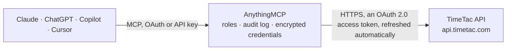

<!-- Generated by scripts/export-github-catalog.mjs in the anythingmcp-website repository. Do not edit by hand. -->

# TimeTac MCP connector

TimeTac time and attendance for DACH teams: time trackings, users, projects, tasks, absences, departments and the live attendance overview. The AnythingMCP connector gives Claude, ChatGPT, Microsoft Copilot, Cursor and Gemini 7 MCP tools for TimeTac, all read-only.

**Category:** [Time Tracking](../time-tracking.md) · **Tools:** 7 · **Setup guide:** [anythingmcp.com](https://anythingmcp.com/guides/timetac-to-mcp) · [Deutsch](https://anythingmcp.com/de/guides/timetac-to-mcp) · [Italiano](https://anythingmcp.com/it/guides/timetac-to-mcp) · [Español](https://anythingmcp.com/es/guides/timetac-to-mcp) · [日本語](https://anythingmcp.com/ja/guides/timetac-to-mcp) · [Русский](https://anythingmcp.com/ru/guides/timetac-to-mcp) · [中文](https://anythingmcp.com/zh/guides/timetac-to-mcp)

## Start without code

No installation and no terminal: AnythingMCP Cloud runs the TimeTac connector for you, operated by helpcode.ai in Frankfurt, Germany.

1. **Click the button above** and create an account or sign in. The TimeTac connector opens, ready to install.
2. **Sign in with your TimeTac account** when AnythingMCP asks. The first time, an admin creates a small app in the TimeTac developer console. Every click is in the [step-by-step guide](https://anythingmcp.com/guides/timetac-to-mcp).
3. **Click Install.** AnythingMCP shows the address of your MCP server.
4. **Add that address to your assistant:** [Claude](https://anythingmcp.com/guides/connect-timetac-to-claude) · [ChatGPT](https://anythingmcp.com/guides/connect-timetac-to-chatgpt) · [Microsoft Copilot](https://anythingmcp.com/guides/connect-timetac-to-copilot) · [Cursor](https://anythingmcp.com/guides/connect-timetac-to-cursor) · [Gemini CLI](https://anythingmcp.com/guides/connect-timetac-to-gemini) · [Meta Muse](https://anythingmcp.com/guides/connect-timetac-to-muse).
5. **Ask your first question**, for example: *Show me personnel number, department and active state for user Eva König in account mittelstadt-elektro*

Prefer help with the setup? [Talk to us](https://anythingmcp.com/contact).

## How it works

- **The AI client** speaks MCP (Streamable HTTP) to AnythingMCP and only sees tool names, descriptions and results. It never gets the TimeTac credentials.
- **AnythingMCP** checks the client's role, builds the call from the tool definition, adds the credentials (an OAuth 2.0 access token, refreshed automatically), calls TimeTac, logs the call and returns the result.
- **TimeTac** sees an ordinary API client with the rights of the account the credentials belong to.

## Tools

| Tool | What it does | Access |
|---|---|---|
| [`timetac_list_users`](#timetac_list_users) | List the users in the TimeTac account with their name, personnel number, department and active state. | read |
| [`timetac_list_time_trackings`](#timetac_list_time_trackings) | Read time trackings in a date range: start, end, duration, the user and the task booked against. | read |
| [`timetac_list_projects`](#timetac_list_projects) | List projects with their client, target duration and done state, so a time tracking can be attributed to a piece of work. | read |
| [`timetac_list_tasks`](#timetac_list_tasks) | List tasks — the things users actually clock onto — with the project they belong to (mother_id) and whether they are done. | read |
| [`timetac_list_absences`](#timetac_list_absences) | List absences (holiday, sick leave, special leave) with their type, date range and approval state, for the roster view. | read |
| [`timetac_list_departments`](#timetac_list_departments) | List the departments configured in the account, so users and reports can be grouped the way the org chart does. | read |
| [`timetac_get_live_status`](#timetac_get_live_status) | Read the live attendance overview (userStatusOverview): per user whether a time tracking is running, on which task and project, and current absences. | read |

## Tool reference

Every parameter as the AI client sees it in `tools/list`. Source: [`packages/backend/src/adapters/de/timetac.json`](../../../packages/backend/src/adapters/de/timetac.json).

### `timetac_list_users`

List the users in the TimeTac account with their name, personnel number, department and active state. The quickest check that the OAuth client works.

**Access:** read · **Call:** `GET /users/read/`

| Parameter | Type | Required | Description |
|---|---|---|---|
| `filter` | string | no | Query-string filter on the resource's fields, passed verbatim, e.g. `active=1&department_id=3`. Operators via _op__<field>: eq, gt, gteq, lt, lteq, in (pipe list), betw (pipe range), like. |
| `limit` | number | no | Maximum rows to return (default 100). |
| `offset` | number | no | Rows to skip, for paging. |
| `order_by` | string | no | Field name to sort by. |
| `sort_direction` | `ASC` \| `DESC` | no | Sort direction. |

### `timetac_list_time_trackings`

Read time trackings in a date range: start, end, duration, the user and the task booked against. This is the core reporting query.

**Access:** read · **Call:** `GET /timeTrackings/read/`

| Parameter | Type | Required | Description |
|---|---|---|---|
| `filter` | string | no | Query-string filter on the resource's fields, passed verbatim, e.g. `_op__start_time=betw&start_time=2026-09-01 00:00:00\|2026-09-30 23:59:59&user_id=5`. Operators via _op__<field>: eq, gt, gteq, lt, lteq, in (pipe list), betw (pipe range), like. |
| `limit` | number | no | Maximum rows to return (default 100). |
| `offset` | number | no | Rows to skip, for paging. |
| `order_by` | string | no | Field name to sort by. |
| `sort_direction` | `ASC` \| `DESC` | no | Sort direction. |

### `timetac_list_projects`

List projects with their client, target duration and done state, so a time tracking can be attributed to a piece of work.

**Access:** read · **Call:** `GET /projects/read/`

| Parameter | Type | Required | Description |
|---|---|---|---|
| `filter` | string | no | Query-string filter on the resource's fields, passed verbatim, e.g. `is_done=0&client_id=4`. Operators via _op__<field>: eq, gt, gteq, lt, lteq, in (pipe list), betw (pipe range), like. |
| `limit` | number | no | Maximum rows to return (default 100). |
| `offset` | number | no | Rows to skip, for paging. |
| `order_by` | string | no | Field name to sort by. |
| `sort_direction` | `ASC` \| `DESC` | no | Sort direction. |

### `timetac_list_tasks`

List tasks — the things users actually clock onto — with the project they belong to (mother_id) and whether they are done.

**Access:** read · **Call:** `GET /tasks/read/`

| Parameter | Type | Required | Description |
|---|---|---|---|
| `filter` | string | no | Query-string filter on the resource's fields, passed verbatim, e.g. `mother_id=12&is_done=0`. Operators via _op__<field>: eq, gt, gteq, lt, lteq, in (pipe list), betw (pipe range), like. |
| `limit` | number | no | Maximum rows to return (default 100). |
| `offset` | number | no | Rows to skip, for paging. |
| `order_by` | string | no | Field name to sort by. |
| `sort_direction` | `ASC` \| `DESC` | no | Sort direction. |

### `timetac_list_absences`

List absences (holiday, sick leave, special leave) with their type, date range and approval state, for the roster view.

**Access:** read · **Call:** `GET /absences/read/`

| Parameter | Type | Required | Description |
|---|---|---|---|
| `filter` | string | no | Query-string filter on the resource's fields, passed verbatim, e.g. `user_id=5&_op__from_date=gteq&from_date=2026-09-01`. Operators via _op__<field>: eq, gt, gteq, lt, lteq, in (pipe list), betw (pipe range), like. |
| `limit` | number | no | Maximum rows to return (default 100). |
| `offset` | number | no | Rows to skip, for paging. |
| `order_by` | string | no | Field name to sort by. |
| `sort_direction` | `ASC` \| `DESC` | no | Sort direction. |

### `timetac_list_departments`

List the departments configured in the account, so users and reports can be grouped the way the org chart does.

**Access:** read · **Call:** `GET /departments/read/`

| Parameter | Type | Required | Description |
|---|---|---|---|
| `filter` | string | no | Query-string filter on the resource's fields, passed verbatim, e.g. `active=1`. Operators via _op__<field>: eq, gt, gteq, lt, lteq, in (pipe list), betw (pipe range), like. |
| `limit` | number | no | Maximum rows to return (default 100). |
| `offset` | number | no | Rows to skip, for paging. |
| `order_by` | string | no | Field name to sort by. |
| `sort_direction` | `ASC` \| `DESC` | no | Sort direction. |

### `timetac_get_live_status`

Read the live attendance overview (userStatusOverview): per user whether a time tracking is running, on which task and project, and current absences. Answers 'who is working right now'.

**Access:** read · **Call:** `GET /userStatusOverview/read/`

| Parameter | Type | Required | Description |
|---|---|---|---|
| `filter` | string | no | Query-string filter on the resource's fields, passed verbatim, e.g. `department_id=3&is_running=1`. Operators via _op__<field>: eq, gt, gteq, lt, lteq, in (pipe list), betw (pipe range), like. |
| `limit` | number | no | Maximum rows to return (default 100). |
| `offset` | number | no | Rows to skip, for paging. |
| `order_by` | string | no | Field name to sort by. |
| `sort_direction` | `ASC` \| `DESC` | no | Sort direction. |

## Run it yourself

AnythingMCP is open source (AGPL-3.0). [Run it with Docker](../../../README.md#run-it-yourself), open **Connectors → Store**, pick **TimeTac** and enter `TIMETAC_ACCOUNT`, `TIMETAC_CLIENT_ID`, `TIMETAC_CLIENT_SECRET`, then add your MCP server URL to the AI client.

[← Time Tracking connectors](../time-tracking.md) · [All categories](../README.md)
