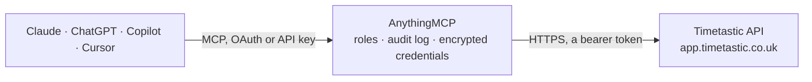

<!-- Generated by scripts/export-github-catalog.mjs in the anythingmcp-website repository. Do not edit by hand. -->

# Timetastic MCP connector

Manage Timetastic (PTO / annual leave tracking) users, holidays, departments, leave types from any AI agent. 8 tools, Bearer token. The AnythingMCP connector gives Claude, ChatGPT, Microsoft Copilot, Cursor and Gemini 8 MCP tools for Timetastic: 5 read and 3 can change data.

**Category:** [Time Tracking](../time-tracking.md) · **Tools:** 8 · **Setup guide:** [anythingmcp.com](https://anythingmcp.com/guides/timetastic-to-mcp) · [Deutsch](https://anythingmcp.com/de/guides/timetastic-to-mcp) · [Italiano](https://anythingmcp.com/it/guides/timetastic-to-mcp) · [Español](https://anythingmcp.com/es/guides/timetastic-to-mcp) · [日本語](https://anythingmcp.com/ja/guides/timetastic-to-mcp) · [Русский](https://anythingmcp.com/ru/guides/timetastic-to-mcp) · [中文](https://anythingmcp.com/zh/guides/timetastic-to-mcp)

## Start without code

No installation and no terminal: AnythingMCP Cloud runs the Timetastic connector for you, operated by helpcode.ai in Frankfurt, Germany.

1. **Click the button above** and create an account or sign in. The Timetastic connector opens, ready to install.
2. **Paste the API key or token from your Timetastic account.** Every click is in the [step-by-step guide](https://anythingmcp.com/guides/timetastic-to-mcp).
3. **Click Install.** AnythingMCP shows the address of your MCP server.
4. **Add that address to your assistant:** [Claude](https://anythingmcp.com/guides/connect-timetastic-to-claude) · [ChatGPT](https://anythingmcp.com/guides/connect-timetastic-to-chatgpt) · [Microsoft Copilot](https://anythingmcp.com/guides/connect-timetastic-to-copilot) · [Cursor](https://anythingmcp.com/guides/connect-timetastic-to-cursor) · [Gemini CLI](https://anythingmcp.com/guides/connect-timetastic-to-gemini) · [Meta Muse](https://anythingmcp.com/guides/connect-timetastic-to-muse).
5. **Ask your first question**, for example: *What's Maria Lopez's Timetastic user record and current annual allowance and remaining days? email maria.lopez@northbridgeconsulting.ltd*

Prefer help with the setup? [Talk to us](https://anythingmcp.com/contact).

## How it works

- **The AI client** speaks MCP (Streamable HTTP) to AnythingMCP and only sees tool names, descriptions and results. It never gets the Timetastic credentials.
- **AnythingMCP** checks the client's role, builds the call from the tool definition, adds the credentials (a bearer token), calls Timetastic, logs the call and returns the result.
- **Timetastic** sees an ordinary API client with the rights of the account the credentials belong to.

## Tools

| Tool | What it does | Access |
|---|---|---|
| [`timetastic_list_users`](#timetastic_list_users) | List all users (employees) in the account. | read |
| [`timetastic_get_user`](#timetastic_get_user) | Get one user with leave allowance, department, manager. | read |
| [`timetastic_create_user`](#timetastic_create_user) | Create an employee. | write |
| [`timetastic_list_holidays`](#timetastic_list_holidays) | List holiday (leave) requests. | read |
| [`timetastic_create_holiday`](#timetastic_create_holiday) | Create a leave request. | write |
| [`timetastic_decide_holiday`](#timetastic_decide_holiday) | Approve or decline a pending holiday request. | write |
| [`timetastic_list_departments`](#timetastic_list_departments) | List departments. | read |
| [`timetastic_list_leave_types`](#timetastic_list_leave_types) | List configured leave types (Annual leave, Sickness, etc.). | read |

## Tool reference

Every parameter as the AI client sees it in `tools/list`. Source: [`packages/backend/src/adapters/intl/timetastic.json`](../../../packages/backend/src/adapters/intl/timetastic.json).

### `timetastic_list_users`

List all users (employees) in the account.

**Access:** read · **Call:** `GET /users`

| Parameter | Type | Required | Description |
|---|---|---|---|
| `active_only` | boolean | no | If true, exclude archived users. |

### `timetastic_get_user`

Get one user with leave allowance, department, manager.

**Access:** read · **Call:** `GET /users/{user_id}`

| Parameter | Type | Required | Description |
|---|---|---|---|
| `user_id` | integer | yes | User ID. |

### `timetastic_create_user`

Create an employee.

**Access:** write · **Call:** `POST /users`

| Parameter | Type | Required | Description |
|---|---|---|---|
| `firstname` | string | yes | First name. |
| `surname` | string | yes | Surname. |
| `email` | string | yes | Email. |
| `department_id` | integer | no | Department ID. |
| `annual_allowance` | number | no | Days of leave per year. |
| `start_date` | string | no | Employment start (YYYY-MM-DD). |

### `timetastic_list_holidays`

List holiday (leave) requests. Filter by date range, status, user, department.

**Access:** read · **Call:** `GET /holidays`

| Parameter | Type | Required | Description |
|---|---|---|---|
| `start` | string | no | YYYY-MM-DD. |
| `end` | string | no | YYYY-MM-DD. |
| `user_id` | integer | no | Filter by user. |
| `department_id` | integer | no | Filter by department. |
| `status` | string | no | Approved, Declined, Pending, Cancelled. |

### `timetastic_create_holiday`

Create a leave request.

**Access:** write · **Call:** `POST /holidays`

| Parameter | Type | Required | Description |
|---|---|---|---|
| `user_id` | integer | yes | User ID. |
| `start_date` | string | yes | YYYY-MM-DD. |
| `start_type` | string | no | Morning, Afternoon, Fullday. |
| `end_date` | string | yes | YYYY-MM-DD. |
| `end_type` | string | no | Morning, Afternoon, Fullday. |
| `leave_type` | string | no | Annual leave, Sickness, ... (must match a configured type). |
| `reason` | string | no | Free-text. |

### `timetastic_decide_holiday`

Approve or decline a pending holiday request.

**Access:** write · **Call:** `POST /holidays/{holiday_id}/decision`

| Parameter | Type | Required | Description |
|---|---|---|---|
| `holiday_id` | integer | yes | Holiday request ID. |
| `decision` | string | yes | Approved or Declined. |
| `reason` | string | no | Optional decline reason. |

### `timetastic_list_departments`

List departments.

**Access:** read · **Call:** `GET /departments`

No parameters.

### `timetastic_list_leave_types`

List configured leave types (Annual leave, Sickness, etc.).

**Access:** read · **Call:** `GET /leavetypes`

No parameters.

## Run it yourself

AnythingMCP is open source (AGPL-3.0). [Run it with Docker](../../../README.md#run-it-yourself), open **Connectors → Store**, pick **Timetastic** and enter `TIMETASTIC_API_TOKEN`, then add your MCP server URL to the AI client.

[← Time Tracking connectors](../time-tracking.md) · [All categories](../README.md)
