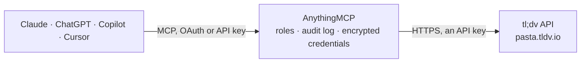

<!-- Generated by scripts/export-github-catalog.mjs in the anythingmcp-website repository. Do not edit by hand. -->

# tl;dv MCP connector

Let your AI read your tl;dv meeting recordings: find meetings from Google Meet, Zoom and Teams, read the AI notes, topics and full transcripts, and with your confirmation import a recording from a link. The AnythingMCP connector gives Claude, ChatGPT, Microsoft Copilot, Cursor and Gemini 6 MCP tools for tl;dv: 5 read and 1 can change data.

**Category:** [Productivity](../productivity.md) · **Tools:** 6 · **Setup guide:** [anythingmcp.com](https://anythingmcp.com/guides/tldv-to-mcp) · [Deutsch](https://anythingmcp.com/de/guides/tldv-to-mcp) · [Italiano](https://anythingmcp.com/it/guides/tldv-to-mcp) · [Español](https://anythingmcp.com/es/guides/tldv-to-mcp) · [日本語](https://anythingmcp.com/ja/guides/tldv-to-mcp) · [Русский](https://anythingmcp.com/ru/guides/tldv-to-mcp) · [中文](https://anythingmcp.com/zh/guides/tldv-to-mcp)

## Start without code

No installation and no terminal: AnythingMCP Cloud runs the tl;dv connector for you, operated by helpcode.ai in Frankfurt, Germany.

1. **Click the button above** and create an account or sign in. The tl;dv connector opens, ready to install.
2. **Paste the API key or token from your tl;dv account.** Every click is in the [step-by-step guide](https://anythingmcp.com/guides/tldv-to-mcp).
3. **Click Install.** AnythingMCP shows the address of your MCP server.
4. **Add that address to your assistant:** [Claude](https://anythingmcp.com/guides/connect-tldv-to-claude) · [ChatGPT](https://anythingmcp.com/guides/connect-tldv-to-chatgpt) · [Microsoft Copilot](https://anythingmcp.com/guides/connect-tldv-to-copilot) · [Cursor](https://anythingmcp.com/guides/connect-tldv-to-cursor) · [Gemini CLI](https://anythingmcp.com/guides/connect-tldv-to-gemini) · [Meta Muse](https://anythingmcp.com/guides/connect-tldv-to-muse).
5. **Ask your first question**, for example: *Find the tl;dv meeting for client onboarding with Nordic Solar AS on 2026-07-15*

Prefer help with the setup? [Talk to us](https://anythingmcp.com/contact).

## How it works

- **The AI client** speaks MCP (Streamable HTTP) to AnythingMCP and only sees tool names, descriptions and results. It never gets the tl;dv credentials.
- **AnythingMCP** checks the client's role, builds the call from the tool definition, adds the credentials (an API key), calls tl;dv, logs the call and returns the result.
- **tl;dv** sees an ordinary API client with the rights of the account the credentials belong to.

## Tools

| Tool | What it does | Access |
|---|---|---|
| [`tldv_list_meetings`](#tldv_list_meetings) | List the meetings recorded with tl;dv that the API key's user can export, newest first: id, name, date, duration in seconds, organizer, invitees and the… | read |
| [`tldv_get_meeting`](#tldv_get_meeting) | Read one tl;dv meeting: name, date, duration in seconds, organizer, invitees, the template used, the link in tl;dv, and the phone number and your own… | read |
| [`tldv_get_notes`](#tldv_get_notes) | Read tl;dv's AI meeting notes: the notes in Markdown, the topics with their summaries, and each note with the second of the recording it refers to. | read |
| [`tldv_get_transcript`](#tldv_get_transcript) | Read what was said in a meeting, lines 1 to 700: each line is [start second, speaker, text]. | read |
| [`tldv_get_transcript_more`](#tldv_get_transcript_more) | Read lines 701 to 1400 of a long meeting's transcript, each line [start second, speaker, text], after tldv_get_transcript showed totalLines over 700. | read |
| [`tldv_import_meeting`](#tldv_import_meeting) | Import a recording into tl;dv from a public link to an mp3, mp4, wav, m4a, mkv, mov, avi, wma or flac file, so tl;dv transcribes it and writes notes. | write |

## Tool reference

Every parameter as the AI client sees it in `tools/list`. Source: [`packages/backend/src/adapters/intl/tldv.json`](../../../packages/backend/src/adapters/intl/tldv.json).

### `tldv_list_meetings`

List the meetings recorded with tl;dv that the API key's user can export, newest first: id, name, date, duration in seconds, organizer, invitees and the link in tl;dv. Search by name, filter by date range, internal or external meetings, or only meetings the user took part in. Pages of up to 100. Read-only.

**Access:** read · **Call:** `GET /v1alpha1/meetings`

| Parameter | Type | Required | Description |
|---|---|---|---|
| `query` | string | no | Words to search for in the meeting names. |
| `from` | string | no | Only meetings from this date or date-time, e.g. 2026-10-01 or 2026-10-01T08:00:00Z. |
| `to` | string | no | Only meetings up to this date or date-time. |
| `only_participated` | boolean | no | true: only meetings the user took part in. Default false. |
| `meeting_type` | `internal` \| `external` | no | internal (everyone from the same organisation) or external (at least one outside participant). Default: both. |
| `page` | integer | no | Page number, starting at 1. The answer says how many pages there are. |
| `limit` | integer | no | Meetings per page, 1 to 100 (default 20). |

### `tldv_get_meeting`

Read one tl;dv meeting: name, date, duration in seconds, organizer, invitees, the template used, the link in tl;dv, and the phone number and your own reference fields when it was imported with them. Read-only.

**Access:** read · **Call:** `GET /v1alpha1/meetings/{meeting_id}`

| Parameter | Type | Required | Description |
|---|---|---|---|
| `meeting_id` | string | yes | Meeting id from tldv_list_meetings (24 characters, letters a to f and digits). |

### `tldv_get_notes`

Read tl;dv's AI meeting notes: the notes in Markdown, the topics with their summaries, and each note with the second of the recording it refers to. Read-only.

**Access:** read · **Call:** `GET /v1alpha1/meetings/{meeting_id}/notes`

| Parameter | Type | Required | Description |
|---|---|---|---|
| `meeting_id` | string | yes | Meeting id from tldv_list_meetings (24 characters, letters a to f and digits). |

### `tldv_get_transcript`

Read what was said in a meeting, lines 1 to 700: each line is [start second, speaker, text]. totalLines tells how long the transcript is; when it is over 700, read the rest with tldv_get_transcript_more. tl;dv only returns finished transcripts. Read-only.

**Access:** read · **Call:** `GET /v1alpha1/meetings/{meeting_id}/transcript`

| Parameter | Type | Required | Description |
|---|---|---|---|
| `meeting_id` | string | yes | Meeting id from tldv_list_meetings (24 characters, letters a to f and digits). |

### `tldv_get_transcript_more`

Read lines 701 to 1400 of a long meeting's transcript, each line [start second, speaker, text], after tldv_get_transcript showed totalLines over 700. tl;dv sends no further pages: for longer meetings rely on tldv_get_notes. Read-only.

**Access:** read · **Call:** `GET /v1alpha1/meetings/{meeting_id}/transcript`

| Parameter | Type | Required | Description |
|---|---|---|---|
| `meeting_id` | string | yes | Meeting id from tldv_list_meetings (24 characters, letters a to f and digits). |

### `tldv_import_meeting`

Import a recording into tl;dv from a public link to an mp3, mp4, wav, m4a, mkv, mov, avi, wma or flac file, so tl;dv transcribes it and writes notes. Creates a new meeting in the account: confirm the link and the name with the user before calling it and wait for their yes. Returns a job id; the meeting shows up in tldv_list_meetings once processed. dry_run checks the request without importing.

**Access:** write · **Call:** `POST /v1alpha1/meetings/import`

| Parameter | Type | Required | Description |
|---|---|---|---|
| `url` | string | yes | Public link that downloads the media file directly. |
| `name` | string | yes | Name of the new meeting. |
| `happened_at` | string | no | When the meeting took place, as 2026-10-01T09:30:00.000Z (with milliseconds). Default: now. |
| `participants` | string[] | no | Email addresses of the people in the recording. |
| `dry_run` | boolean | no | true: only check the request, import nothing. |

## Run it yourself

AnythingMCP is open source (AGPL-3.0). [Run it with Docker](../../../README.md#run-it-yourself), open **Connectors → Store**, pick **tl;dv** and enter `TLDV_API_KEY`, then add your MCP server URL to the AI client.

[← Productivity connectors](../productivity.md) · [All categories](../README.md)
