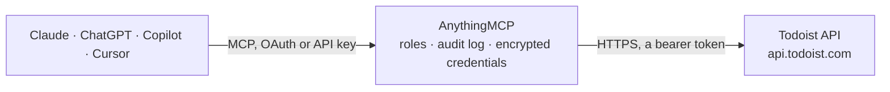

<!-- Generated by scripts/export-github-catalog.mjs in the anythingmcp-website repository. Do not edit by hand. -->

# Todoist MCP connector

Drive Todoist (personal/team task manager) from any AI agent: projects, tasks, comments, labels, sections. 12 tools, Bearer token auth, REST API v2. The AnythingMCP connector gives Claude, ChatGPT, Microsoft Copilot, Cursor and Gemini 12 MCP tools for Todoist: 5 read and 7 can change data.

**Category:** [Project Management](../project-management.md) · **Tools:** 12 · **Setup guide:** [anythingmcp.com](https://anythingmcp.com/guides/todoist-to-mcp) · [Deutsch](https://anythingmcp.com/de/guides/todoist-to-mcp) · [Italiano](https://anythingmcp.com/it/guides/todoist-to-mcp) · [Español](https://anythingmcp.com/es/guides/todoist-to-mcp) · [日本語](https://anythingmcp.com/ja/guides/todoist-to-mcp) · [Русский](https://anythingmcp.com/ru/guides/todoist-to-mcp) · [中文](https://anythingmcp.com/zh/guides/todoist-to-mcp)

## Start without code

No installation and no terminal: AnythingMCP Cloud runs the Todoist connector for you, operated by helpcode.ai in Frankfurt, Germany.

1. **Click the button above** and create an account or sign in. The Todoist connector opens, ready to install.
2. **Paste the API key or token from your Todoist account.** Every click is in the [step-by-step guide](https://anythingmcp.com/guides/todoist-to-mcp).
3. **Click Install.** AnythingMCP shows the address of your MCP server.
4. **Add that address to your assistant:** [Claude](https://anythingmcp.com/guides/connect-todoist-to-claude) · [ChatGPT](https://anythingmcp.com/guides/connect-todoist-to-chatgpt) · [Microsoft Copilot](https://anythingmcp.com/guides/connect-todoist-to-copilot) · [Cursor](https://anythingmcp.com/guides/connect-todoist-to-cursor) · [Gemini CLI](https://anythingmcp.com/guides/connect-todoist-to-gemini) · [Meta Muse](https://anythingmcp.com/guides/connect-todoist-to-muse).
5. **Ask your first question**, for example: *What's the project id and URL for project Accounts Receivable 2026?*

Prefer help with the setup? [Talk to us](https://anythingmcp.com/contact).

## How it works

- **The AI client** speaks MCP (Streamable HTTP) to AnythingMCP and only sees tool names, descriptions and results. It never gets the Todoist credentials.
- **AnythingMCP** checks the client's role, builds the call from the tool definition, adds the credentials (a bearer token), calls Todoist, logs the call and returns the result.
- **Todoist** sees an ordinary API client with the rights of the account the credentials belong to.

## Tools

| Tool | What it does | Access |
|---|---|---|
| [`todoist_get_projects`](#todoist_get_projects) | List all projects the user can access. | read |
| [`todoist_create_project`](#todoist_create_project) | Create a new project. | write |
| [`todoist_get_active_tasks`](#todoist_get_active_tasks) | List active (non-completed) tasks with filters. | read |
| [`todoist_get_task`](#todoist_get_task) | Fetch a single task by ID. | read |
| [`todoist_create_task`](#todoist_create_task) | Create a task. | write |
| [`todoist_update_task`](#todoist_update_task) | Update a task. | write |
| [`todoist_complete_task`](#todoist_complete_task) | Mark a task as completed. | write |
| [`todoist_reopen_task`](#todoist_reopen_task) | Reopen a previously-completed task. | write |
| [`todoist_delete_task`](#todoist_delete_task) | Permanently delete a task. | write |
| [`todoist_get_comments`](#todoist_get_comments) | List comments on a project OR a task. | read |
| [`todoist_create_comment`](#todoist_create_comment) | Add a comment to a project or task. | write |
| [`todoist_get_labels`](#todoist_get_labels) | List the user's personal labels. | read |

## Tool reference

Every parameter as the AI client sees it in `tools/list`. Source: [`packages/backend/src/adapters/intl/todoist.json`](../../../packages/backend/src/adapters/intl/todoist.json).

### `todoist_get_projects`

List all projects the user can access. Each project has id, name, color, parent_id, order, comment_count, is_shared, is_favorite, is_inbox_project, url.

**Access:** read · **Call:** `GET /projects`

No parameters.

### `todoist_create_project`

Create a new project. Required: name. Color names: berry_red, red, orange, yellow, olive_green, lime_green, green, mint_green, teal, sky_blue, light_blue, blue, grape, violet, lavender, magenta, salmon, charcoal, grey, taupe.

**Access:** write · **Call:** `POST /projects`

| Parameter | Type | Required | Description |
|---|---|---|---|
| `name` | string | yes | Project name. |
| `parent_id` | string | no | Parent project ID (nest as sub-project). |
| `color` | string | no | Color name (see description). |
| `is_favorite` | boolean | no | Add to favorites. |
| `view_style` | string | no | list (default) or board (Kanban view). |

### `todoist_get_active_tasks`

List active (non-completed) tasks with filters. The `filter` parameter is powerful — use Todoist filter syntax like 'today', 'overdue', 'p1 & @home', 'due before: +7 days'.

**Access:** read · **Call:** `GET /tasks`

| Parameter | Type | Required | Description |
|---|---|---|---|
| `project_id` | string | no | Filter by project ID. |
| `section_id` | string | no | Filter by section ID. |
| `label` | string | no | Filter by label name. |
| `filter` | string | no | Todoist filter string, e.g. 'today', 'overdue', '@work & p1', 'due before: +7 days'. |
| `ids` | string | no | Comma-separated specific task IDs. |

### `todoist_get_task`

Fetch a single task by ID.

**Access:** read · **Call:** `GET /tasks/{taskId}`

| Parameter | Type | Required | Description |
|---|---|---|---|
| `taskId` | string | yes | Task ID. |

### `todoist_create_task`

Create a task. Required: content. Use due_string for natural-language dates ('tomorrow 9am', 'every monday'). Set parent_id to create a subtask.

**Access:** write · **Call:** `POST /tasks`

| Parameter | Type | Required | Description |
|---|---|---|---|
| `content` | string | yes | Task content (the title). Supports Markdown links. |
| `description` | string | no | Longer description (Markdown). |
| `project_id` | string | no | Target project ID. Defaults to Inbox. |
| `section_id` | string | no | Section within the project. |
| `parent_id` | string | no | Make this a subtask of the given task ID. |
| `order` | integer | no | Order within the parent. |
| `labels` | any[] | no | Array of label names (auto-creates labels if new). |
| `priority` | integer | no | 1-4. 4 = highest (UI P1). |
| `due_string` | string | no | Natural language: 'tomorrow at 9am', 'every monday', 'in 3 days'. Required for recurring tasks. |
| `due_date` | string | no | YYYY-MM-DD. |
| `due_datetime` | string | no | ISO 8601 with timezone. |
| `due_lang` | string | no | Language for due_string parsing (en, de, fr, ru, ja, etc.). |
| `assignee_id` | string | no | User ID — only valid for shared projects. |
| `duration` | integer | no | Duration in minutes (for time-blocking). |
| `duration_unit` | string | no | minute or day. |

### `todoist_update_task`

Update a task. To move it to a different project, use the dedicated todoist_move_task tool.

**Access:** write · **Call:** `POST /tasks/{taskId}`

| Parameter | Type | Required | Description |
|---|---|---|---|
| `taskId` | string | yes | Task ID. |
| `content` | string | no | New content. |
| `description` | string | no | New description. |
| `labels` | any[] | no | Replace labels. |
| `priority` | integer | no | 1-4. |
| `due_string` | string | no | Natural-language date. |
| `due_date` | string | no | YYYY-MM-DD. |
| `due_datetime` | string | no | ISO 8601. |
| `assignee_id` | string | no | Reassign (shared projects). |
| `duration` | integer | no | Duration minutes. |
| `duration_unit` | string | no | minute or day. |

### `todoist_complete_task`

Mark a task as completed. For recurring tasks, the next occurrence is auto-created.

**Access:** write · **Call:** `POST /tasks/{taskId}/close`

| Parameter | Type | Required | Description |
|---|---|---|---|
| `taskId` | string | yes | Task ID. |

### `todoist_reopen_task`

Reopen a previously-completed task.

**Access:** write · **Call:** `POST /tasks/{taskId}/reopen`

| Parameter | Type | Required | Description |
|---|---|---|---|
| `taskId` | string | yes | Task ID. |

### `todoist_delete_task`

Permanently delete a task. Irreversible.

**Access:** write · **Call:** `DELETE /tasks/{taskId}`

| Parameter | Type | Required | Description |
|---|---|---|---|
| `taskId` | string | yes | Task ID. |

### `todoist_get_comments`

List comments on a project OR a task. Provide either project_id or task_id.

**Access:** read · **Call:** `GET /comments`

| Parameter | Type | Required | Description |
|---|---|---|---|
| `project_id` | string | no | Project ID. |
| `task_id` | string | no | Task ID. |

### `todoist_create_comment`

Add a comment to a project or task. Required: content + one of (project_id, task_id).

**Access:** write · **Call:** `POST /comments`

| Parameter | Type | Required | Description |
|---|---|---|---|
| `task_id` | string | no | Task ID (mutually exclusive with project_id). |
| `project_id` | string | no | Project ID. |
| `content` | string | yes | Comment body (Markdown). |

### `todoist_get_labels`

List the user's personal labels. Each has id, name, color, order, is_favorite.

**Access:** read · **Call:** `GET /labels`

No parameters.

## Run it yourself

AnythingMCP is open source (AGPL-3.0). [Run it with Docker](../../../README.md#run-it-yourself), open **Connectors → Store**, pick **Todoist** and enter `TODOIST_API_TOKEN`, then add your MCP server URL to the AI client.

[← Project Management connectors](../project-management.md) · [All categories](../README.md)
