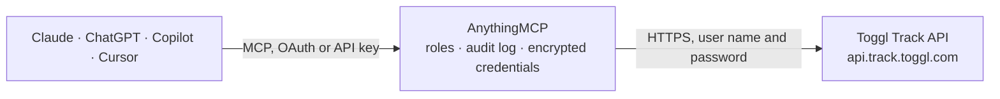

<!-- Generated by scripts/export-github-catalog.mjs in the anythingmcp-website repository. Do not edit by hand. -->

# Toggl Track MCP connector

Manage Toggl Track (time entries, projects, clients, tags, workspaces) from any AI agent. 9 tools, basic-auth with API token. The AnythingMCP connector gives Claude, ChatGPT, Microsoft Copilot, Cursor and Gemini 9 MCP tools for Toggl Track: 6 read and 3 can change data.

**Category:** [Time Tracking](../time-tracking.md) · **Tools:** 9 · **Setup guide:** [anythingmcp.com](https://anythingmcp.com/guides/toggl-track-to-mcp) · [Deutsch](https://anythingmcp.com/de/guides/toggl-track-to-mcp) · [Italiano](https://anythingmcp.com/it/guides/toggl-track-to-mcp) · [Español](https://anythingmcp.com/es/guides/toggl-track-to-mcp) · [日本語](https://anythingmcp.com/ja/guides/toggl-track-to-mcp) · [Русский](https://anythingmcp.com/ru/guides/toggl-track-to-mcp) · [中文](https://anythingmcp.com/zh/guides/toggl-track-to-mcp)

## Start without code

No installation and no terminal: AnythingMCP Cloud runs the Toggl Track connector for you, operated by helpcode.ai in Frankfurt, Germany.

1. **Click the button above** and create an account or sign in. The Toggl Track connector opens, ready to install.
2. **Paste the API key or token from your Toggl Track account.** Every click is in the [step-by-step guide](https://anythingmcp.com/guides/toggl-track-to-mcp).
3. **Click Install.** AnythingMCP shows the address of your MCP server.
4. **Add that address to your assistant:** [Claude](https://anythingmcp.com/guides/connect-toggl-track-to-claude) · [ChatGPT](https://anythingmcp.com/guides/connect-toggl-track-to-chatgpt) · [Microsoft Copilot](https://anythingmcp.com/guides/connect-toggl-track-to-copilot) · [Cursor](https://anythingmcp.com/guides/connect-toggl-track-to-cursor) · [Gemini CLI](https://anythingmcp.com/guides/connect-toggl-track-to-gemini) · [Meta Muse](https://anythingmcp.com/guides/connect-toggl-track-to-muse).
5. **Ask your first question**, for example: *Show time entries on 2026-10-14 with description containing INV-2026-047 in my default workspace*

Prefer help with the setup? [Talk to us](https://anythingmcp.com/contact).

## How it works

- **The AI client** speaks MCP (Streamable HTTP) to AnythingMCP and only sees tool names, descriptions and results. It never gets the Toggl Track credentials.
- **AnythingMCP** checks the client's role, builds the call from the tool definition, adds the credentials (user name and password), calls Toggl Track, logs the call and returns the result.
- **Toggl Track** sees an ordinary API client with the rights of the account the credentials belong to.

## Tools

| Tool | What it does | Access |
|---|---|---|
| [`toggl_track_me`](#toggl_track_me) | Get the authenticated user including default workspace ID, all workspaces, default project/tag. | read |
| [`toggl_track_list_workspaces`](#toggl_track_list_workspaces) | List workspaces the user belongs to. | read |
| [`toggl_track_list_clients`](#toggl_track_list_clients) | List clients in a workspace. | read |
| [`toggl_track_list_projects`](#toggl_track_list_projects) | List projects in a workspace. | read |
| [`toggl_track_get_current_entry`](#toggl_track_get_current_entry) | Return the currently running time entry (if any), else null. | read |
| [`toggl_track_list_time_entries`](#toggl_track_list_time_entries) | List time entries for the current user. | read |
| [`toggl_track_create_time_entry`](#toggl_track_create_time_entry) | Create a new time entry. | write |
| [`toggl_track_stop_time_entry`](#toggl_track_stop_time_entry) | Stop a running time entry. | write |
| [`toggl_track_delete_time_entry`](#toggl_track_delete_time_entry) | Delete a time entry permanently. | write |

## Tool reference

Every parameter as the AI client sees it in `tools/list`. Source: [`packages/backend/src/adapters/intl/toggl-track.json`](../../../packages/backend/src/adapters/intl/toggl-track.json).

### `toggl_track_me`

Get the authenticated user including default workspace ID, all workspaces, default project/tag. Use this first to find the workspace ID needed by other tools.

**Access:** read · **Call:** `GET /me`

| Parameter | Type | Required | Description |
|---|---|---|---|
| `with_related_data` | boolean | no | If true, include projects/clients/tags inline (heavier response). |

### `toggl_track_list_workspaces`

List workspaces the user belongs to.

**Access:** read · **Call:** `GET /me/workspaces`

No parameters.

### `toggl_track_list_clients`

List clients in a workspace.

**Access:** read · **Call:** `GET /workspaces/{workspace_id}/clients`

| Parameter | Type | Required | Description |
|---|---|---|---|
| `workspace_id` | integer | yes | Workspace ID. |

### `toggl_track_list_projects`

List projects in a workspace. Returns id, name, client_id, color, billable, active, estimated_hours, hourly_rate.

**Access:** read · **Call:** `GET /workspaces/{workspace_id}/projects`

| Parameter | Type | Required | Description |
|---|---|---|---|
| `workspace_id` | integer | yes | Workspace ID. |
| `active` | boolean | no | Filter active. |
| `billable` | boolean | no | Filter billable. |
| `name` | string | no | Filter by name substring. |

### `toggl_track_get_current_entry`

Return the currently running time entry (if any), else null.

**Access:** read · **Call:** `GET /me/time_entries/current`

No parameters.

### `toggl_track_list_time_entries`

List time entries for the current user. Filter by start/end date window. Returns each entry with id, description, project_id, billable, duration (seconds, negative for running), start/stop.

**Access:** read · **Call:** `GET /me/time_entries`

| Parameter | Type | Required | Description |
|---|---|---|---|
| `start_date` | string | no | ISO 8601 datetime or date. |
| `end_date` | string | no | ISO 8601 datetime or date. |
| `before` | string | no | ISO 8601: only entries with stop_time before this. |
| `since` | integer | no | UNIX timestamp; only entries modified after. |

### `toggl_track_create_time_entry`

Create a new time entry. Pass `duration: -1` + `start` (ISO 8601) to start a running timer; pass positive duration (seconds) + start to log a completed entry.

**Access:** write · **Call:** `POST /workspaces/{workspace_id}/time_entries`

| Parameter | Type | Required | Description |
|---|---|---|---|
| `workspace_id` | integer | yes | Workspace ID. |
| `description` | string | no | What you're working on. |
| `project_id` | integer | no | Project ID (optional). |
| `tags` | any[] | no | Array of tag name strings. |
| `start` | string | yes | ISO 8601 datetime with timezone. |
| `duration` | integer | yes | Seconds. -1 to start a running timer. |
| `billable` | boolean | no | Mark billable. |
| `created_with` | string | no | Client identifier (defaults to 'AnythingMCP'). |

### `toggl_track_stop_time_entry`

Stop a running time entry. Sets stop=now and converts duration to positive seconds.

**Access:** write · **Call:** `PATCH /workspaces/{workspace_id}/time_entries/{time_entry_id}/stop`

| Parameter | Type | Required | Description |
|---|---|---|---|
| `workspace_id` | integer | yes | Workspace ID. |
| `time_entry_id` | integer | yes | Time entry ID to stop. |

### `toggl_track_delete_time_entry`

Delete a time entry permanently.

**Access:** write · **Call:** `DELETE /workspaces/{workspace_id}/time_entries/{time_entry_id}`

| Parameter | Type | Required | Description |
|---|---|---|---|
| `workspace_id` | integer | yes | Workspace ID. |
| `time_entry_id` | integer | yes | Time entry ID. |

## Run it yourself

AnythingMCP is open source (AGPL-3.0). [Run it with Docker](../../../README.md#run-it-yourself), open **Connectors → Store**, pick **Toggl Track** and enter `TOGGL_API_TOKEN`, then add your MCP server URL to the AI client.

[← Time Tracking connectors](../time-tracking.md) · [All categories](../README.md)
