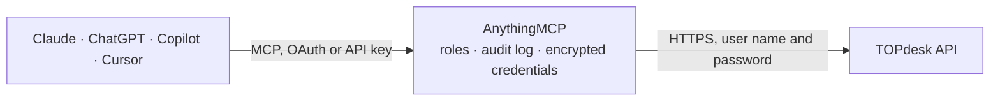

<!-- Generated by scripts/export-github-catalog.mjs in the anythingmcp-website repository. Do not edit by hand. -->

# TOPdesk MCP connector

TOPdesk ITSM: incidents, changes, assets, operators, persons and branches, with TOPdesk's FIQL query language for precise filtering. The AnythingMCP connector gives Claude, ChatGPT, Microsoft Copilot, Cursor and Gemini 10 MCP tools for TOPdesk: 9 read and 1 can change data.

**Category:** [IT Service Management](../itsm.md) · **Tools:** 10 · **Setup guide:** [anythingmcp.com](https://anythingmcp.com/guides/topdesk-to-mcp) · [Deutsch](https://anythingmcp.com/de/guides/topdesk-to-mcp) · [Italiano](https://anythingmcp.com/it/guides/topdesk-to-mcp) · [Español](https://anythingmcp.com/es/guides/topdesk-to-mcp) · [日本語](https://anythingmcp.com/ja/guides/topdesk-to-mcp) · [Русский](https://anythingmcp.com/ru/guides/topdesk-to-mcp) · [中文](https://anythingmcp.com/zh/guides/topdesk-to-mcp)

## Start without code

No installation and no terminal: AnythingMCP Cloud runs the TOPdesk connector for you, operated by helpcode.ai in Frankfurt, Germany.

1. **Click the button above** and create an account or sign in. The TOPdesk connector opens, ready to install.
2. **Paste the API key or token from your TOPdesk account.** Every click is in the [step-by-step guide](https://anythingmcp.com/guides/topdesk-to-mcp).
3. **Click Install.** AnythingMCP shows the address of your MCP server.
4. **Add that address to your assistant:** [Claude](https://anythingmcp.com/guides/connect-topdesk-to-claude) · [ChatGPT](https://anythingmcp.com/guides/connect-topdesk-to-chatgpt) · [Microsoft Copilot](https://anythingmcp.com/guides/connect-topdesk-to-copilot) · [Cursor](https://anythingmcp.com/guides/connect-topdesk-to-cursor) · [Gemini CLI](https://anythingmcp.com/guides/connect-topdesk-to-gemini) · [Meta Muse](https://anythingmcp.com/guides/connect-topdesk-to-muse).
5. **Ask your first question**, for example: *What's the current status, operator group and SLA target for incident INC-2026-3145?*

Prefer help with the setup? [Talk to us](https://anythingmcp.com/contact).

## How it works

- **The AI client** speaks MCP (Streamable HTTP) to AnythingMCP and only sees tool names, descriptions and results. It never gets the TOPdesk credentials.
- **AnythingMCP** checks the client's role, builds the call from the tool definition, adds the credentials (user name and password), calls TOPdesk, logs the call and returns the result.
- **TOPdesk** sees an ordinary API client with the rights of the account the credentials belong to.

## Tools

| Tool | What it does | Access |
|---|---|---|
| [`topdesk_get_version`](#topdesk_get_version) | Read the TOPdesk version this instance runs. | read |
| [`topdesk_list_incidents`](#topdesk_list_incidents) | List incidents with FIQL filtering. | read |
| [`topdesk_get_incident`](#topdesk_get_incident) | Read one incident by its TOPdesk number, with its caller, category, status, operator group, SLA target dates and request text. | read |
| [`topdesk_get_incident_progress`](#topdesk_get_incident_progress) | Read the progress trail of one incident: every action and memo in order, with author, timestamp and whether it is invisible to the caller. | read |
| [`topdesk_list_changes`](#topdesk_list_changes) | List change activities with their number, requester, status, planned dates and change type. | read |
| [`topdesk_list_persons`](#topdesk_list_persons) | List persons (the callers incidents are raised for) with their name, e-mail, branch and department. | read |
| [`topdesk_list_operators`](#topdesk_list_operators) | List operators (the staff who work the queue) with their name, e-mail and the operator groups they belong to. | read |
| [`topdesk_list_branches`](#topdesk_list_branches) | List branches — the sites or client organisations TOPdesk groups people and assets under — with their name, address and client reference number. | read |
| [`topdesk_search_assets`](#topdesk_search_assets) | Search the asset management module for configuration items by name or type, returning their id, name, template and status. | read |
| [`topdesk_create_incident`](#topdesk_create_incident) | Open a real incident in the live instance. | write |

## Tool reference

Every parameter as the AI client sees it in `tools/list`. Source: [`packages/backend/src/adapters/nl/topdesk.json`](../../../packages/backend/src/adapters/nl/topdesk.json).

### `topdesk_get_version`

Read the TOPdesk version this instance runs. No parameters and no module permission needed — the fastest proof that URL and application password are right.

**Access:** read · **Call:** `GET /version`

No parameters.

### `topdesk_list_incidents`

List incidents with FIQL filtering. `query=status==firstLine;closed==false` is the common 'what is open' shape; name the fields you want to keep the answer readable.

**Access:** read · **Call:** `GET /incidents`

| Parameter | Type | Required | Description |
|---|---|---|---|
| `query` | string | no | FIQL query, e.g. status==firstLine;closed==false. `;` is AND, `,` is OR. |
| `fields` | string | no | Comma-separated fields to return, e.g. id,number,briefDescription,status. |
| `pageSize` | number | no | Rows per page, 1-10000 (default 10). |
| `pageStart` | number | no | Rows to skip, for paging (default 0). |
| `sort` | string | no | Sort expression, field plus :asc or :desc, e.g. `creationDate:desc` or `targetDate:asc,creationDate:desc`. |

### `topdesk_get_incident`

Read one incident by its TOPdesk number, with its caller, category, status, operator group, SLA target dates and request text.

**Access:** read · **Call:** `GET /incidents/number/{number}`

| Parameter | Type | Required | Description |
|---|---|---|---|
| `number` | string | yes | Incident number as TOPdesk shows it, e.g. I 2609 123 (not the UUID). |

### `topdesk_get_incident_progress`

Read the progress trail of one incident: every action and memo in order, with author, timestamp and whether it is invisible to the caller.

**Access:** read · **Call:** `GET /incidents/id/{id}/progresstrail`

| Parameter | Type | Required | Description |
|---|---|---|---|
| `id` | string | yes | Incident UUID. |
| `page_size` | number | no | Entries per page, max 100. |
| `start` | number | no | Entries to skip, for paging. |

### `topdesk_list_changes`

List change activities with their number, requester, status, planned dates and change type. The change-management side of TOPdesk.

**Access:** read · **Call:** `GET /operatorChanges`

| Parameter | Type | Required | Description |
|---|---|---|---|
| `query` | string | no | FIQL query over change fields. |
| `pageSize` | number | no | Rows per page (default 1000, max 5000). |
| `pageStart` | number | no | Rows to skip, for paging (default 0). |

### `topdesk_list_persons`

List persons (the callers incidents are raised for) with their name, e-mail, branch and department. Filter with FIQL to find one before raising an incident.

**Access:** read · **Call:** `GET /persons`

| Parameter | Type | Required | Description |
|---|---|---|---|
| `query` | string | no | FIQL query, e.g. email==anna@example.com. |
| `fields` | string | no | Comma-separated fields to return. |
| `page_size` | number | no | Rows per page, max 100. |
| `start` | number | no | Rows to skip, for paging. |

### `topdesk_list_operators`

List operators (the staff who work the queue) with their name, e-mail and the operator groups they belong to.

**Access:** read · **Call:** `GET /operators`

| Parameter | Type | Required | Description |
|---|---|---|---|
| `query` | string | no | FIQL query over operator fields. |
| `page_size` | number | no | Rows per page, max 100. |
| `start` | number | no | Rows to skip, for paging. |

### `topdesk_list_branches`

List branches — the sites or client organisations TOPdesk groups people and assets under — with their name, address and client reference number. Not paged: filter with `query` to narrow it down.

**Access:** read · **Call:** `GET /branches`

| Parameter | Type | Required | Description |
|---|---|---|---|
| `query` | string | no | FIQL query over branch fields. |

### `topdesk_search_assets`

Search the asset management module for configuration items by name or type, returning their id, name, template and status.

**Access:** read · **Call:** `GET /assetmgmt/assets`

| Parameter | Type | Required | Description |
|---|---|---|---|
| `searchTerm` | string | no | Fragment matched against the asset name. |
| `templateName` | string | no | Restrict to one asset template, e.g. Laptop. |
| `pageSize` | number | no | Rows per page. |

### `topdesk_create_incident`

Open a real incident in the live instance. TOPdesk routes and notifies it according to the process configuration, so this is not a dry run.

**Access:** write · **Call:** `POST /incidents`

| Parameter | Type | Required | Description |
|---|---|---|---|
| `briefDescription` | string | yes | One-line summary, the incident's title (max 80 characters). |
| `callerId` | string | yes | UUID of a registered person (with the Caller box ticked on their card), from topdesk_list_persons. |
| `request` | string | no | Full request text. HTML is accepted. |
| `operatorGroup` | object | no | Operator group to route the incident to, as an object with its UUID: {"id": "<UUID>"}. Omit to let TOPdesk decide. |
| `category` | object | no | Category, as {"name": "<name as configured>"} or {"id": "<UUID>"} — one of the two, never both. |
| `entryType` | object | no | Entry type, as {"name": "E-mail"} (or Telefoon, Self Service Desk, …) or {"id": "<UUID>"} — one of the two, never both. |

## Run it yourself

AnythingMCP is open source (AGPL-3.0). [Run it with Docker](../../../README.md#run-it-yourself), open **Connectors → Store**, pick **TOPdesk** and enter `TOPDESK_URL`, `TOPDESK_USERNAME`, `TOPDESK_APP_PASSWORD`, then add your MCP server URL to the AI client.

[← IT Service Management connectors](../itsm.md) · [All categories](../README.md)
