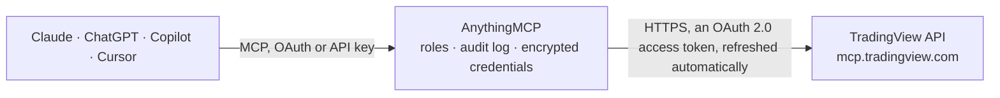

<!-- Generated by scripts/export-github-catalog.mjs in the anythingmcp-website repository. Do not edit by hand. -->

# TradingView MCP connector

Look up quotes, price history, technical ratings, fundamentals, news, filings and calendars, run the TradingView Screener and manage your watchlists and price alerts from Claude, ChatGPT or Copilot … The AnythingMCP connector gives Claude, ChatGPT, Microsoft Copilot, Cursor and Gemini 35 MCP tools for TradingView: 25 read and 10 can change data.

**Category:** [Finance](../finance.md) · **Tools:** 35 · **Setup guide:** [anythingmcp.com](https://anythingmcp.com/guides/tradingview-to-mcp) · [Deutsch](https://anythingmcp.com/de/guides/tradingview-to-mcp) · [Italiano](https://anythingmcp.com/it/guides/tradingview-to-mcp) · [Español](https://anythingmcp.com/es/guides/tradingview-to-mcp) · [日本語](https://anythingmcp.com/ja/guides/tradingview-to-mcp) · [Русский](https://anythingmcp.com/ru/guides/tradingview-to-mcp) · [中文](https://anythingmcp.com/zh/guides/tradingview-to-mcp)

## Start without code

No installation and no terminal: AnythingMCP Cloud runs the TradingView connector for you, operated by helpcode.ai in Frankfurt, Germany.

1. **Click the button above** and create an account or sign in. The TradingView connector opens, ready to install.
2. **Sign in with your TradingView account** when AnythingMCP asks. The first time, an admin creates a small app in the TradingView developer console. Every click is in the [step-by-step guide](https://anythingmcp.com/guides/tradingview-to-mcp).
3. **Click Install.** AnythingMCP shows the address of your MCP server.
4. **Add that address to your assistant:** [Claude](https://anythingmcp.com/guides/connect-tradingview-to-claude) · [ChatGPT](https://anythingmcp.com/guides/connect-tradingview-to-chatgpt) · [Microsoft Copilot](https://anythingmcp.com/guides/connect-tradingview-to-copilot) · [Cursor](https://anythingmcp.com/guides/connect-tradingview-to-cursor) · [Gemini CLI](https://anythingmcp.com/guides/connect-tradingview-to-gemini) · [Meta Muse](https://anythingmcp.com/guides/connect-tradingview-to-muse).
5. **Ask your first question**, for example: *Give me latest last price and percent change for NASDAQ:TSLA and NASDAQ:AAPL right now*

Prefer help with the setup? [Talk to us](https://anythingmcp.com/contact).

## How it works

- **The AI client** speaks MCP (Streamable HTTP) to AnythingMCP and only sees tool names, descriptions and results. It never gets the TradingView credentials.
- **AnythingMCP** checks the client's role, builds the call from the tool definition, adds the credentials (an OAuth 2.0 access token, refreshed automatically), calls TradingView, logs the call and returns the result.
- **TradingView** sees an ordinary API client with the rights of the account the credentials belong to.

## Tools

| Tool | What it does | Access |
|---|---|---|
| [`tradingview_list_watchlists`](#tradingview_list_watchlists) | List the signed-in user's TradingView watchlists with their ids and names. | read |
| [`tradingview_get_watchlist`](#tradingview_get_watchlist) | Get one watchlist and its symbols by id. | read |
| [`tradingview_get_active_watchlist`](#tradingview_get_active_watchlist) | Get the active watchlist with its symbols. | read |
| [`tradingview_create_watchlist`](#tradingview_create_watchlist) | Create a new watchlist in the user's TradingView account, optionally with a name and initial symbols. | write |
| [`tradingview_delete_watchlist`](#tradingview_delete_watchlist) | Delete a watchlist from the user's TradingView account. | write |
| [`tradingview_add_to_watchlist`](#tradingview_add_to_watchlist) | Add symbols to a watchlist. | write |
| [`tradingview_remove_from_watchlist`](#tradingview_remove_from_watchlist) | Remove symbols from a watchlist in the user's TradingView account. | write |
| [`tradingview_update_watchlist`](#tradingview_update_watchlist) | Rename a watchlist and/or change its description. | write |
| [`tradingview_get_ohlcv`](#tradingview_get_ohlcv) | Historical OHLCV bars for a symbol at an interval: an aggregate summary plus, unless summary is true, the raw bars [{t (unix seconds, UTC), o, h, l, c, v}]. | read |
| [`tradingview_get_economic_data`](#tradingview_get_economic_data) | Time series of an economic indicator such as ECONOMICS:USIRYY (US inflation rate): [{date, value}] with the released value, plus unit and scale where available. | read |
| [`tradingview_get_economic_symbols`](#tradingview_get_economic_symbols) | Catalog of the economic tickers tradingview_get_economic_data accepts. | read |
| [`tradingview_search_symbols`](#tradingview_search_symbols) | Turn a ticker or company name into TradingView symbols (EXCHANGE:TICKER) with a fuzzy search: symbol, description, type, exchange and logo id. | read |
| [`tradingview_get_symbol_data`](#tradingview_get_symbol_data) | Any TradingView screener columns for one symbol: stocks, ETFs, crypto, forex, futures, indices, bonds and government bond yields. | read |
| [`tradingview_run_screener`](#tradingview_run_screener) | Run the TradingView Screener with filters ({field: [min, max]} plus index, sector, industry and analyst_rating), sorting, presets and column choice. | read |
| [`tradingview_get_symbol_data_batch`](#tradingview_get_symbol_data_batch) | Quotes or screener columns for up to 50 symbols in one call. | read |
| [`tradingview_get_screener_columns`](#tradingview_get_screener_columns) | Catalog of the screener column names accepted by tradingview_get_symbol_data, tradingview_get_symbol_data_batch and tradingview_run_screener. | read |
| [`tradingview_get_technicals_rating`](#tradingview_get_technicals_rating) | Technical indicator snapshot for one symbol and timeframe: RSI, Stochastic K/D, CCI20, ADX, MACD, Momentum, AO, EMA and SMA 10 to 200, VWMA, HullMA9, plus… | read |
| [`tradingview_get_news`](#tradingview_get_news) | Latest news headlines for a symbol: id, title, published (unix), provider, urgency (1 top, 2 normal), story path, link, permission, related symbols and… | read |
| [`tradingview_get_news_story`](#tradingview_get_news_story) | Full text of a news story by the id from tradingview_get_news: description, short description, summary, permission, provider and copyright. | read |
| [`tradingview_get_forecasts`](#tradingview_get_forecasts) | Analyst consensus for a symbol: recommendation and score, buy, hold and sell distribution, price targets with upside_pct, EPS and revenue estimates. | read |
| [`tradingview_get_financials`](#tradingview_get_financials) | Current fundamentals of a symbol: P/E, P/B, margins, ROE and ROA, TTM revenue, net income, EBITDA and free cash flow, and year-over-year growth. | read |
| [`tradingview_get_financial_history`](#tradingview_get_financial_history) | Quarterly or annual history of fundamentals (revenue, gross profit, operating income, net income, free cash flow, EPS, EBITDA, total debt) with yoy_pct and… | read |
| [`tradingview_get_documents`](#tradingview_get_documents) | Filings and transcripts for a symbol (10-K, 10-Q, 8-K, earnings calls, presentations, press releases) with the view ids that tradingview_get_document_view… | read |
| [`tradingview_get_document_view`](#tradingview_get_document_view) | Text of one document view (summary or transcript) by the views[].id returned by tradingview_get_documents. | read |
| [`tradingview_get_earnings_calendar`](#tradingview_get_earnings_calendar) | Earnings dates for a list of symbols: per symbol only the next scheduled report and the most recent one, with consensus EPS and revenue for the next quarter. | read |
| [`tradingview_get_economic_calendar`](#tradingview_get_economic_calendar) | Macro events (CPI, GDP, rate decisions and more) filtered by country, currency, category and importance. | read |
| [`tradingview_get_dividends_calendar`](#tradingview_get_dividends_calendar) | Dividend data: ex-dates, amount, yield and payment date. | read |
| [`tradingview_create_alert`](#tradingview_create_alert) | Create a TradingView price alert on a symbol (price plus cross, cross_up, cross_down, greater or less). | write |
| [`tradingview_update_alert`](#tradingview_update_alert) | Change the message, name, expiration or notifications of an existing alert and restart it. | write |
| [`tradingview_delete_alert`](#tradingview_delete_alert) | Delete alerts by id, together with their fire history. | write |
| [`tradingview_stop_alerts`](#tradingview_stop_alerts) | Pause alerts without deleting them: id, history and settings are kept and tradingview_restart_alerts resumes them. | write |
| [`tradingview_restart_alerts`](#tradingview_restart_alerts) | Resume paused alerts without creating them again; id, history and settings stay as they were. | write |
| [`tradingview_list_alerts`](#tradingview_list_alerts) | List all of the user's alerts, active and inactive: alert_id, name, symbol, active, condition type, threshold, resolution and timestamps. | read |
| [`tradingview_get_alerts`](#tradingview_get_alerts) | Full settings of specific alerts by id, including the raw conditions, which you need to recreate an alert with changed conditions. | read |
| [`tradingview_get_alerts_log`](#tradingview_get_alerts_log) | Alert fire history: when each alert fired, with symbol, message and webhook delivery status. | read |

## Tool reference

Every parameter as the AI client sees it in `tools/list`. Source: [`packages/backend/src/adapters/intl/tradingview.json`](../../../packages/backend/src/adapters/intl/tradingview.json).

### `tradingview_list_watchlists`

List the signed-in user's TradingView watchlists with their ids and names. Start here before reading or changing a watchlist.

**Access:** read · **Call:** `list_watchlists /mcp`

No parameters.

### `tradingview_get_watchlist`

Get one watchlist and its symbols by id. Resolves the user's own watchlists and, as a fallback, watchlists other users shared publicly (opened on the site as /watchlists/{id}/); a shared watchlist of another user comes back with read_only=true and cannot be changed.

**Access:** read · **Call:** `get_watchlist /mcp`

| Parameter | Type | Required | Description |
|---|---|---|---|
| `watchlist_id` | string | yes | Numeric id of the watchlist (from tradingview_list_watchlists). |

### `tradingview_get_active_watchlist`

Get the active watchlist with its symbols. If no watchlist is active TradingView activates the first custom one, and if the user has none at all it creates a default one.

**Access:** read · **Call:** `get_active_watchlist /mcp`

No parameters.

### `tradingview_create_watchlist`

Create a new watchlist in the user's TradingView account, optionally with a name and initial symbols.

**Access:** write · **Call:** `create_watchlist /mcp`

| Parameter | Type | Required | Description |
|---|---|---|---|
| `name` | string | no | Name of the new watchlist (max 500 characters). |
| `symbols` | string[] | no | Initial symbols in EXCHANGE:TICKER format, e.g. NASDAQ:AAPL. |

### `tradingview_delete_watchlist`

Delete a watchlist from the user's TradingView account. This cannot be undone.

**Access:** write · **Call:** `delete_watchlist /mcp`

| Parameter | Type | Required | Description |
|---|---|---|---|
| `watchlist_id` | string | yes | Numeric id of the watchlist (from tradingview_list_watchlists). |

### `tradingview_add_to_watchlist`

Add symbols to a watchlist. A symbol that is already in the watchlist moves to the end.

**Access:** write · **Call:** `add_to_watchlist /mcp`

| Parameter | Type | Required | Description |
|---|---|---|---|
| `watchlist_id` | string | yes | Numeric id of the watchlist (from tradingview_list_watchlists). |
| `symbols` | string[] | yes | Symbols in EXCHANGE:TICKER format, e.g. NASDAQ:AAPL. |

### `tradingview_remove_from_watchlist`

Remove symbols from a watchlist in the user's TradingView account.

**Access:** write · **Call:** `remove_from_watchlist /mcp`

| Parameter | Type | Required | Description |
|---|---|---|---|
| `watchlist_id` | string | yes | Numeric id of the watchlist (from tradingview_list_watchlists). |
| `symbols` | string[] | yes | Symbols in EXCHANGE:TICKER format, e.g. NASDAQ:AAPL. |

### `tradingview_update_watchlist`

Rename a watchlist and/or change its description. At least one of name or description is required.

**Access:** write · **Call:** `update_watchlist /mcp`

| Parameter | Type | Required | Description |
|---|---|---|---|
| `watchlist_id` | string | yes | Numeric id of the watchlist (from tradingview_list_watchlists). |
| `name` | string | no | New name of the watchlist (max 500 characters). |
| `description` | string | no | New description of the watchlist. |

### `tradingview_get_ohlcv`

Historical OHLCV bars for a symbol at an interval: an aggregate summary plus, unless summary is true, the raw bars [{t (unix seconds, UTC), o, h, l, c, v}].

**Access:** read · **Call:** `get_ohlcv /mcp`

| Parameter | Type | Required | Description |
|---|---|---|---|
| `symbol` | string | yes | Symbol in EXCHANGE:TICKER format, e.g. NASDAQ:NVDA or BINANCE:BTCUSDT. |
| `interval` | `1m` \| `5m` \| `15m` \| `30m` \| `1h` \| `4h` \| `1D` \| `1W` \| `M` | no | Bar interval (default 1D). Use M for monthly. |
| `count` | integer | no | Number of bars, max 5000 (default 300). |
| `summary` | boolean | no | If true, return only the aggregate statistics, without the raw bars. |

### `tradingview_get_economic_data`

Time series of an economic indicator such as ECONOMICS:USIRYY (US inflation rate): [{date, value}] with the released value, plus unit and scale where available. Find valid tickers with tradingview_get_economic_symbols instead of guessing.

**Access:** read · **Call:** `get_economic_data /mcp`

| Parameter | Type | Required | Description |
|---|---|---|---|
| `symbol` | string | yes | Economic ticker ECONOMICS:<COUNTRY><INDICATOR>, e.g. ECONOMICS:USIRYY. |
| `date_from` | string | no | ISO date, start of the window (inclusive). |
| `date_to` | string | no | ISO date, end of the window (inclusive). |

### `tradingview_get_economic_symbols`

Catalog of the economic tickers tradingview_get_economic_data accepts. Without arguments: indicator categories with counts and every country code. With category or search: indicator codes and names; add country to get ready-to-use ECONOMICS:* tickers.

**Access:** read · **Call:** `get_economic_symbols /mcp`

| Parameter | Type | Required | Description |
|---|---|---|---|
| `country` | string | no | Two-letter country or region code, e.g. US, DE, EU, CN. When set, the result lists ready-to-use ECONOMICS:* tickers. |
| `category` | `gdp` \| `lbr` \| `prce` \| `hlth` \| `mny` \| `trd` \| `gov` \| `bsnss` \| `cnsm` \| `hse` \| `txs` \| `enrg` \| `clmt` | no | Return the indicators of one category. |
| `search` | string | no | Return indicators whose code or name contains this text (case-insensitive), e.g. inflation. |

### `tradingview_search_symbols`

Turn a ticker or company name into TradingView symbols (EXCHANGE:TICKER) with a fuzzy search: symbol, description, type, exchange and logo id. Use it first whenever the user names a company instead of a symbol.

**Access:** read · **Call:** `search_symbols /mcp`

| Parameter | Type | Required | Description |
|---|---|---|---|
| `query` | string | yes | Ticker, company name or description to search for. |
| `type_filter` | `stock` \| `etf` \| `bond` \| `forex` \| `index` \| `futures` \| `crypto` | no | Instrument type (default all). |

### `tradingview_get_symbol_data`

Any TradingView screener columns for one symbol: stocks, ETFs, crypto, forex, futures, indices, bonds and government bond yields. Use tradingview_get_screener_columns to find valid column names.

**Access:** read · **Call:** `get_symbol_data /mcp`

| Parameter | Type | Required | Description |
|---|---|---|---|
| `symbol` | string | yes | Symbol in EXCHANGE:TICKER format, e.g. NASDAQ:AAPL. |
| `columns` | string[] | no | TradingView screener columns to fetch (see tradingview_get_screener_columns). Default: name, description, close, change, change_abs, volume, market_cap_basic, price_earnings_ttm, sector, industry. |

### `tradingview_run_screener`

Run the TradingView Screener with filters ({field: [min, max]} plus index, sector, industry and analyst_rating), sorting, presets and column choice. Returns the rows and totalCount. Use tradingview_get_screener_columns to find valid column names for columns and filters.

**Access:** read · **Call:** `run_screener /mcp`

| Parameter | Type | Required | Description |
|---|---|---|---|
| `market` | string | no | Screener market (default america): america, crypto, forex, futures, bonds, cfd, uk, germany, india, japan and others. |
| `filters` | object | no | Filters as {field: [min, max]} (null for an open side) plus the keys index, sector, industry and analyst_rating, e.g. {"index": "S&P 500", "pe": [null, 15], "rsi": [null, 40], "div_yield": [2, null]}. |
| `sort_by` | string | no | Column to sort by (default volume). |
| `sort_order` | `asc` \| `desc` | no | Sort direction (default desc). |
| `limit` | integer | no | Maximum rows, up to 1000 (default 100). |
| `columns` | string[] | no | Screener columns to return. |
| `symbol_types` | string[] | no | Instrument types to include, e.g. ["stock"]. |
| `filter_preset` | `pullback_with_reversal` \| `breakout_with_volume` \| `oversold_healthy` \| `earnings_runup` \| `relative_strength` \| `new_highs` | no | Named preset. |
| `symbolset` | string[] | no | Explicit symbol universe, e.g. ["SYML:SP;SPX"]. |

### `tradingview_get_symbol_data_batch`

Quotes or screener columns for up to 50 symbols in one call. Symbols that cannot be resolved are listed in missing with a reason instead of zeros. When the screener backend fails (429 or 5xx) the result has success=false, or partial=true with warnings when only some markets failed: those symbols are unavailable, not unknown.

**Access:** read · **Call:** `get_symbol_data_batch /mcp`

| Parameter | Type | Required | Description |
|---|---|---|---|
| `symbols` | string[] | yes | Symbols in EXCHANGE:TICKER format, up to 50, deduplicated. |
| `columns` | string[] | no | TradingView screener columns to fetch (see tradingview_get_screener_columns). Default: name, description, close, change, change_abs, volume, market_cap_basic, price_earnings_ttm, sector, industry. |

### `tradingview_get_screener_columns`

Catalog of the screener column names accepted by tradingview_get_symbol_data, tradingview_get_symbol_data_batch and tradingview_run_screener. Without group or search: the groups with their column names. With group or search: descriptions and period or timeframe variants.

**Access:** read · **Call:** `get_screener_columns /mcp`

| Parameter | Type | Required | Description |
|---|---|---|---|
| `market` | `stock` \| `etf` \| `crypto` \| `bond` \| `all` | no | Limit the catalog to one market (default all). |
| `group` | string | no | Full details for one group, e.g. valuation, technicals, income_statement. |
| `search` | string | no | Full details for columns whose name or description contains this text (case-insensitive), e.g. margin. |

### `tradingview_get_technicals_rating`

Technical indicator snapshot for one symbol and timeframe: RSI, Stochastic K/D, CCI20, ADX, MACD, Momentum, AO, EMA and SMA 10 to 200, VWMA, HullMA9, plus the three TradingView recommendation aggregates (summary, moving averages, oscillators).

**Access:** read · **Call:** `get_technicals_rating /mcp`

| Parameter | Type | Required | Description |
|---|---|---|---|
| `symbol` | string | yes | Symbol in EXCHANGE:TICKER format, e.g. NASDAQ:AAPL. |
| `interval` | `1m` \| `5m` \| `15m` \| `30m` \| `1h` \| `2h` \| `4h` \| `1D` \| `1W` \| `1M` | no | Timeframe (default 1D). |

### `tradingview_get_news`

Latest news headlines for a symbol: id, title, published (unix), provider, urgency (1 top, 2 normal), story path, link, permission, related symbols and paywall flag. Paged with limit and offset; the result carries total_available and has_more (up to 200 headlines in total).

**Access:** read · **Call:** `get_news /mcp`

| Parameter | Type | Required | Description |
|---|---|---|---|
| `symbol` | string | yes | Symbol in EXCHANGE:TICKER format, e.g. NASDAQ:AAPL. |
| `lang` | `en` \| `ru` \| `de` \| `fr` \| `es` \| `pt` \| `it` \| `pl` \| `tr` \| `ar` \| `he` \| `ko` \| `ja` \| `vi` \| `th` \| `ms` \| `id` \| `zh-Hans` \| `zh-Hant` \| `ro` \| `en_IN` | no | Language code (default en). |
| `limit` | integer | no | Headlines per call, up to 200 (default 25). |
| `offset` | integer | no | Skip this many of the newest headlines to page back through older ones. |

### `tradingview_get_news_story`

Full text of a news story by the id from tradingview_get_news: description, short description, summary, permission, provider and copyright.

**Access:** read · **Call:** `get_news_story /mcp`

| Parameter | Type | Required | Description |
|---|---|---|---|
| `id` | string | yes | Story id in urn format from tradingview_get_news, e.g. urn:newsml:mtnewswires.com:20260810:A123:0. |
| `lang` | string | no | ISO 639-1 language code (default en). |
| `user_prostatus` | `pro` \| `non_pro` | no | Viewer plan status (default non_pro). |
| `user_country` | string | no | ISO country code of the viewer. |

### `tradingview_get_forecasts`

Analyst consensus for a symbol: recommendation and score, buy, hold and sell distribution, price targets with upside_pct, EPS and revenue estimates.

**Access:** read · **Call:** `get_forecasts /mcp`

| Parameter | Type | Required | Description |
|---|---|---|---|
| `symbol` | string | yes | Symbol in EXCHANGE:TICKER format, e.g. NASDAQ:AAPL. |

### `tradingview_get_financials`

Current fundamentals of a symbol: P/E, P/B, margins, ROE and ROA, TTM revenue, net income, EBITDA and free cash flow, and year-over-year growth. Optionally a subset of metrics and a reporting period.

**Access:** read · **Call:** `get_financials /mcp`

| Parameter | Type | Required | Description |
|---|---|---|---|
| `symbol` | string | yes | Symbol in EXCHANGE:TICKER format, e.g. NASDAQ:AAPL. |
| `metric` | string[] | no | Subset of metrics (aliases such as pe, roe, revenue, fcf, or raw TradingView columns); omit for the full set. |
| `period` | `fy` \| `fq` \| `ttm` \| `fh` \| `current` | no | Reporting period (default ttm). |

### `tradingview_get_financial_history`

Quarterly or annual history of fundamentals (revenue, gross profit, operating income, net income, free cash flow, EPS, EBITDA, total debt) with yoy_pct and period labels.

**Access:** read · **Call:** `get_financial_history /mcp`

| Parameter | Type | Required | Description |
|---|---|---|---|
| `symbol` | string | yes | Symbol in EXCHANGE:TICKER format, e.g. NASDAQ:AAPL. |
| `period` | `fq` \| `fy` | no | fq for quarterly (default), fy for annual. |
| `date_from` | string | no | ISO date, start of the reporting window. |
| `date_to` | string | no | ISO date, end of the reporting window. |

### `tradingview_get_documents`

Filings and transcripts for a symbol (10-K, 10-Q, 8-K, earnings calls, presentations, press releases) with the view ids that tradingview_get_document_view reads. Filters by category, event and event-date window, including past windows.

**Access:** read · **Call:** `get_documents /mcp`

| Parameter | Type | Required | Description |
|---|---|---|---|
| `symbol` | string | yes | Symbol in EXCHANGE:TICKER format, e.g. NASDAQ:AAPL. |
| `category` | `all` \| `annual_reports` \| `quarterly_reports` \| `interim_reports` \| `company_events` \| `insider_transactions` \| `transcripts` \| `presentations` \| `press_releases` \| `other` | no | Category (default all); 10-K, 10-Q and 8-K are accepted as aliases. |
| `event` | `earning` \| `corporate_event` | no | Event filter. |
| `start_date` | string | no | RFC 3339 start of the event-date window (inclusive). |
| `end_date` | string | no | RFC 3339 end of the event-date window (inclusive). |
| `limit` | integer | no | Maximum documents (default 20). |

### `tradingview_get_document_view`

Text of one document view (summary or transcript) by the views[].id returned by tradingview_get_documents. Pass the id exactly as returned; never build or edit one.

**Access:** read · **Call:** `get_document_view /mcp`

| Parameter | Type | Required | Description |
|---|---|---|---|
| `view_id` | string | yes | Document view id from tradingview_get_documents views[].id, verbatim. |

### `tradingview_get_earnings_calendar`

Earnings dates for a list of symbols: per symbol only the next scheduled report and the most recent one, with consensus EPS and revenue for the next quarter. It is not a history: for past quarters use tradingview_get_financial_history or tradingview_get_documents.

**Access:** read · **Call:** `get_earnings_calendar /mcp`

| Parameter | Type | Required | Description |
|---|---|---|---|
| `symbols` | string[] | yes | Symbols in EXCHANGE:TICKER format, e.g. NASDAQ:AAPL. |
| `date_from` | string | no | ISO date YYYY-MM-DD or RFC 3339 (default today). Only filters the two known dates per symbol. |
| `date_to` | string | no | ISO date YYYY-MM-DD or RFC 3339 (default today plus 180 days). |

### `tradingview_get_economic_calendar`

Macro events (CPI, GDP, rate decisions and more) filtered by country, currency, category and importance. Past windows work back to 2003-09-01; the forward window is about 31 days.

**Access:** read · **Call:** `get_economic_calendar /mcp`

| Parameter | Type | Required | Description |
|---|---|---|---|
| `countries` | string | no | Comma-separated two-letter country codes, plus regions such as EU (default US). |
| `currencies` | string | no | Comma-separated ISO currency codes, e.g. USD,JPY,EUR. |
| `category` | `gdp` \| `bonds` \| `business` \| `consumer` \| `goverment` \| `health` \| `housing` \| `labor` \| `money` \| `prices` \| `trade` \| `taxes` | no | Event category (default all). |
| `date_from` | string | no | UTC date or time, YYYY-MM-DD or RFC 3339 (default today 00:00). |
| `date_to` | string | no | UTC date or time (default today 23:59). |
| `min_importance` | integer | no | Minimum importance: -1 all (default), 0 medium and high, 1 high only. |

### `tradingview_get_dividends_calendar`

Dividend data: ex-dates, amount, yield and payment date. Either per symbol (symbols) or as a market screen over an ex-date window (market, date_from, date_to).

**Access:** read · **Call:** `get_dividends_calendar /mcp`

| Parameter | Type | Required | Description |
|---|---|---|---|
| `symbols` | string[] | no | Per-symbol mode: symbols in EXCHANGE:TICKER format. |
| `market` | string | no | Market screening mode, e.g. america. |
| `date_from` | string | no | ISO date, start of the ex-date window in screening mode (default now). |
| `date_to` | string | no | ISO date, end of the ex-date window in screening mode (default now plus 30 days). |
| `limit` | integer | no | Maximum rows in screening mode, up to 200 (default 50). |

### `tradingview_create_alert`

Create a TradingView price alert on a symbol (price plus cross, cross_up, cross_down, greater or less). Multi-condition and indicator alerts are rejected, and webhook alerts cannot be created over MCP. Returns alert_id and status "starting": TradingView starts the alert asynchronously, so check it with tradingview_list_alerts.

**Access:** write · **Call:** `create_alert /mcp`

| Parameter | Type | Required | Description |
|---|---|---|---|
| `symbol` | string | yes | Symbol in EXCHANGE:TICKER format, e.g. NASDAQ:AAPL. |
| `price` | number | no | Price threshold of the condition. |
| `condition` | `cross` \| `cross_up` \| `cross_down` \| `greater` \| `less` | no | Price condition (default cross). |
| `conditions` | object[] | no | Raw condition payload that replaces price and condition. Only a single price condition is accepted. |
| `message` | string | no | Message shown when the alert fires (max 4000 characters). |
| `name` | string | no | Alert name (max 300 characters). |
| `resolution` | string | no | Chart resolution the alert is evaluated on: 1, 60 (one hour), 1D and so on (default 1). |
| `expiration` | string | no | ISO expiration time (default now plus 30 days). |
| `auto_deactivate` | boolean | no | Switch the alert off after it fires once (default false). |
| `email` | boolean | no | Send an email when it fires (default false). |
| `mobile_push` | boolean | no | Send a mobile push notification when it fires (default true). |
| `popup` | boolean | no | Show a popup when it fires (default true). |

### `tradingview_update_alert`

Change the message, name, expiration or notifications of an existing alert and restart it. Symbol, conditions and timeframe cannot change (delete and create instead); alerts with a webhook can only be edited on tradingview.com. The restart is asynchronous: check the state with tradingview_list_alerts.

**Access:** write · **Call:** `update_alert /mcp`

| Parameter | Type | Required | Description |
|---|---|---|---|
| `alert_id` | integer | yes | Alert id from tradingview_create_alert or tradingview_list_alerts. |
| `message` | string | no | New message; omit to keep the current one. |
| `name` | string | no | New name; omit to keep the current one. |
| `expiration` | string | no | New ISO expiration; an empty string removes it (premium plans); omit to keep the current one. |
| `auto_deactivate` | boolean | no | New auto-deactivate flag; omit to keep. |
| `email` | boolean | no | New email flag; omit to keep. |
| `mobile_push` | boolean | no | New mobile push flag; omit to keep. |
| `popup` | boolean | no | New popup flag; omit to keep. |

### `tradingview_delete_alert`

Delete alerts by id, together with their fire history. This cannot be undone; to pause an alert use tradingview_stop_alerts instead.

**Access:** write · **Call:** `delete_alert /mcp`

| Parameter | Type | Required | Description |
|---|---|---|---|
| `alert_ids` | integer[] | yes | Alert ids from tradingview_list_alerts or tradingview_create_alert. |

### `tradingview_stop_alerts`

Pause alerts without deleting them: id, history and settings are kept and tradingview_restart_alerts resumes them.

**Access:** write · **Call:** `stop_alerts /mcp`

| Parameter | Type | Required | Description |
|---|---|---|---|
| `alert_ids` | integer[] | yes | Alert ids from tradingview_list_alerts or tradingview_create_alert. |

### `tradingview_restart_alerts`

Resume paused alerts without creating them again; id, history and settings stay as they were.

**Access:** write · **Call:** `restart_alerts /mcp`

| Parameter | Type | Required | Description |
|---|---|---|---|
| `alert_ids` | integer[] | yes | Alert ids from tradingview_list_alerts or tradingview_create_alert. |

### `tradingview_list_alerts`

List all of the user's alerts, active and inactive: alert_id, name, symbol, active, condition type, threshold, resolution and timestamps.

**Access:** read · **Call:** `list_alerts /mcp`

| Parameter | Type | Required | Description |
|---|---|---|---|
| `symbol` | string | no | Only alerts on this symbol (EXCHANGE:TICKER). |
| `active` | boolean | no | Only active (true) or inactive (false) alerts. |

### `tradingview_get_alerts`

Full settings of specific alerts by id, including the raw conditions, which you need to recreate an alert with changed conditions. Message and webhook URL are left out (a has_webhook flag is returned instead).

**Access:** read · **Call:** `get_alerts /mcp`

| Parameter | Type | Required | Description |
|---|---|---|---|
| `alert_ids` | integer[] | yes | Alert ids from tradingview_list_alerts or tradingview_create_alert. |

### `tradingview_get_alerts_log`

Alert fire history: when each alert fired, with symbol, message and webhook delivery status.

**Access:** read · **Call:** `get_alerts_log /mcp`

| Parameter | Type | Required | Description |
|---|---|---|---|
| `days` | integer | no | Look-back window in days (default 7). |
| `symbol` | string | no | Only alerts on this symbol (EXCHANGE:TICKER). |
| `limit` | integer | no | Maximum events, up to 2000 (default 100). |

## Run it yourself

AnythingMCP is open source (AGPL-3.0). [Run it with Docker](../../../README.md#run-it-yourself), open **Connectors → Store**, pick **TradingView**, then add your MCP server URL to the AI client.

[← Finance connectors](../finance.md) · [All categories](../README.md)
