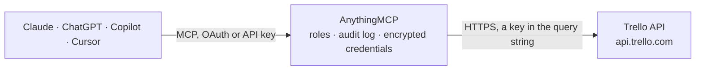

<!-- Generated by scripts/export-github-catalog.mjs in the anythingmcp-website repository. Do not edit by hand. -->

# Trello MCP connector

Drive Trello (Kanban boards) from any AI agent: boards, lists, cards, members, labels, checklists, attachments-by-URL. 13 tools. The AnythingMCP connector gives Claude, ChatGPT, Microsoft Copilot, Cursor and Gemini 13 MCP tools for Trello: 8 read and 5 can change data.

**Category:** [Project Management](../project-management.md) · **Tools:** 13 · **Setup guide:** [anythingmcp.com](https://anythingmcp.com/guides/trello-to-mcp) · [Deutsch](https://anythingmcp.com/de/guides/trello-to-mcp) · [Italiano](https://anythingmcp.com/it/guides/trello-to-mcp) · [Español](https://anythingmcp.com/es/guides/trello-to-mcp) · [日本語](https://anythingmcp.com/ja/guides/trello-to-mcp) · [Русский](https://anythingmcp.com/ru/guides/trello-to-mcp) · [中文](https://anythingmcp.com/zh/guides/trello-to-mcp)

## Start without code

No installation and no terminal: AnythingMCP Cloud runs the Trello connector for you, operated by helpcode.ai in Frankfurt, Germany.

1. **Click the button above** and create an account or sign in. The Trello connector opens, ready to install.
2. **Paste the API key or token from your Trello account.** Every click is in the [step-by-step guide](https://anythingmcp.com/guides/trello-to-mcp).
3. **Click Install.** AnythingMCP shows the address of your MCP server.
4. **Add that address to your assistant:** [Claude](https://anythingmcp.com/guides/connect-trello-to-claude) · [ChatGPT](https://anythingmcp.com/guides/connect-trello-to-chatgpt) · [Microsoft Copilot](https://anythingmcp.com/guides/connect-trello-to-copilot) · [Cursor](https://anythingmcp.com/guides/connect-trello-to-cursor) · [Gemini CLI](https://anythingmcp.com/guides/connect-trello-to-gemini) · [Meta Muse](https://anythingmcp.com/guides/connect-trello-to-muse).
5. **Ask your first question**, for example: *Show the Trello card for invoice INV-2026-042 and its due date and amount.*

Prefer help with the setup? [Talk to us](https://anythingmcp.com/contact).

## How it works

- **The AI client** speaks MCP (Streamable HTTP) to AnythingMCP and only sees tool names, descriptions and results. It never gets the Trello credentials.
- **AnythingMCP** checks the client's role, builds the call from the tool definition, adds the credentials (a key in the query string), calls Trello, logs the call and returns the result.
- **Trello** sees an ordinary API client with the rights of the account the credentials belong to.

## Tools

| Tool | What it does | Access |
|---|---|---|
| [`trello_get_me`](#trello_get_me) | Return the user the token belongs to: id, username, fullName, email, avatarUrl. | read |
| [`trello_list_my_boards`](#trello_list_my_boards) | List boards the user is a member of. | read |
| [`trello_get_board`](#trello_get_board) | Fetch a board with optional nested resources (lists/cards/labels/members) via inclusion params. | read |
| [`trello_get_board_lists`](#trello_get_board_lists) | List the lists (columns) on a board. | read |
| [`trello_list_cards_in_list`](#trello_list_cards_in_list) | List cards in a list. | read |
| [`trello_get_card`](#trello_get_card) | Fetch a single card with optional members/labels/checklists/attachments included. | read |
| [`trello_create_card`](#trello_create_card) | Create a card in a list. | write |
| [`trello_update_card`](#trello_update_card) | Update a card. | write |
| [`trello_delete_card`](#trello_delete_card) | Permanently delete a card. | write |
| [`trello_add_card_comment`](#trello_add_card_comment) | Add a comment to a card (creates an action of type commentCard). | write |
| [`trello_attach_url_to_card`](#trello_attach_url_to_card) | Attach a URL (link) to a card. | write |
| [`trello_list_board_labels`](#trello_list_board_labels) | List labels available on a board. | read |
| [`trello_search`](#trello_search) | Universal search across boards, cards, members and organizations. | read |

## Tool reference

Every parameter as the AI client sees it in `tools/list`. Source: [`packages/backend/src/adapters/intl/trello.json`](../../../packages/backend/src/adapters/intl/trello.json).

### `trello_get_me`

Return the user the token belongs to: id, username, fullName, email, avatarUrl. Health check + whoami.

**Access:** read · **Call:** `GET /members/me`

No parameters.

### `trello_list_my_boards`

List boards the user is a member of. Each board has id, name, desc, url, closed, idOrganization.

**Access:** read · **Call:** `GET /members/me/boards`

| Parameter | Type | Required | Description |
|---|---|---|---|
| `filter` | string | no | all, members, organization, public, open, closed, pinned, unpinned, starred. |
| `fields` | string | no | all or comma-separated list. |

### `trello_get_board`

Fetch a board with optional nested resources (lists/cards/labels/members) via inclusion params.

**Access:** read · **Call:** `GET /boards/{boardId}`

| Parameter | Type | Required | Description |
|---|---|---|---|
| `boardId` | string | yes | Board ID. |
| `fields` | string | no | Board fields or 'all'. |
| `lists` | string | no | Include lists: none, all, open, closed. |
| `cards` | string | no | Include cards: none, all, open, closed, visible. |
| `members` | string | no | Include members: none, normal, admins, owners, all. |
| `labels` | string | no | Include labels: none, all. |

### `trello_get_board_lists`

List the lists (columns) on a board.

**Access:** read · **Call:** `GET /boards/{boardId}/lists`

| Parameter | Type | Required | Description |
|---|---|---|---|
| `boardId` | string | yes | Board ID. |
| `filter` | string | no | all, open, closed, none. |
| `fields` | string | no | Fields or 'all'. |

### `trello_list_cards_in_list`

List cards in a list. Each card has id, name, desc, idMembers, idLabels, due, dueComplete, shortUrl, pos.

**Access:** read · **Call:** `GET /lists/{listId}/cards`

| Parameter | Type | Required | Description |
|---|---|---|---|
| `listId` | string | yes | List ID. |
| `fields` | string | no | Card fields or 'all'. |

### `trello_get_card`

Fetch a single card with optional members/labels/checklists/attachments included.

**Access:** read · **Call:** `GET /cards/{cardId}`

| Parameter | Type | Required | Description |
|---|---|---|---|
| `cardId` | string | yes | Card ID. |
| `fields` | string | no | Card fields. |
| `members` | boolean | no | Include full member objects. |
| `checklists` | string | no | all or none. |
| `attachments` | string | no | true, false, cover. |

### `trello_create_card`

Create a card in a list. Required: idList + name. due is ISO 8601. idMembers/idLabels are comma-separated ID strings.

**Access:** write · **Call:** `POST /cards`

| Parameter | Type | Required | Description |
|---|---|---|---|
| `idList` | string | yes | Target list ID. |
| `name` | string | yes | Card name. |
| `desc` | string | no | Description (Markdown). |
| `pos` | string | no | Position: 'top', 'bottom', or numeric (e.g. '65535'). |
| `due` | string | no | Due date ISO 8601. |
| `dueComplete` | boolean | no | If true, due is marked complete. |
| `idMembers` | string | no | Comma-separated member IDs. |
| `idLabels` | string | no | Comma-separated label IDs. |
| `urlSource` | string | no | If set, attach this URL to the card on create. |
| `address` | string | no | Location address. |
| `locationName` | string | no | Location name. |
| `coordinates` | string | no | lat,lng coordinates. |

### `trello_update_card`

Update a card. Common: idList (move to another column), pos, due/dueComplete, name/desc, idMembers (replace whole array via comma-separated string), idLabels.

**Access:** write · **Call:** `PUT /cards/{cardId}`

| Parameter | Type | Required | Description |
|---|---|---|---|
| `cardId` | string | yes | Card ID. |
| `name` | string | no | New name. |
| `desc` | string | no | New description. |
| `closed` | boolean | no | Archive the card (true = archive). |
| `idMembers` | string | no | Comma-separated member IDs (full replacement). |
| `idAttachmentCover` | string | no | Attachment ID to use as cover. |
| `idList` | string | no | Move to this list ID. |
| `idLabels` | string | no | Comma-separated label IDs (full replacement). |
| `idBoard` | string | no | Move to a different board. |
| `pos` | string | no | top, bottom, or numeric. |
| `due` | string | no | ISO 8601 or null to clear. |
| `dueComplete` | boolean | no | Mark due complete. |

### `trello_delete_card`

Permanently delete a card. Use trello_update_card with closed=true for archive (recoverable).

**Access:** write · **Call:** `DELETE /cards/{cardId}`

| Parameter | Type | Required | Description |
|---|---|---|---|
| `cardId` | string | yes | Card ID. |

### `trello_add_card_comment`

Add a comment to a card (creates an action of type commentCard).

**Access:** write · **Call:** `POST /cards/{cardId}/actions/comments`

| Parameter | Type | Required | Description |
|---|---|---|---|
| `cardId` | string | yes | Card ID. |
| `text` | string | yes | Comment text (Markdown). |

### `trello_attach_url_to_card`

Attach a URL (link) to a card. For file uploads use the Trello UI — multipart upload via API is not supported here.

**Access:** write · **Call:** `POST /cards/{cardId}/attachments`

| Parameter | Type | Required | Description |
|---|---|---|---|
| `cardId` | string | yes | Card ID. |
| `url` | string | yes | URL to attach. |
| `name` | string | no | Display name for the attachment. |
| `setCover` | boolean | no | If true and the URL is an image, use it as the card cover. |

### `trello_list_board_labels`

List labels available on a board. Returns id, name, color.

**Access:** read · **Call:** `GET /boards/{boardId}/labels`

| Parameter | Type | Required | Description |
|---|---|---|---|
| `boardId` | string | yes | Board ID. |

### `trello_search`

Universal search across boards, cards, members and organizations. Supports the same operators as the Trello UI search (board:X, list:Y, label:Z, member:W, due:next-week, has:attachments, etc.).

**Access:** read · **Call:** `GET /search`

| Parameter | Type | Required | Description |
|---|---|---|---|
| `query` | string | yes | Search query (min 1 char). |
| `modelTypes` | string | no | Comma-separated: actions,boards,cards,members,organizations. |
| `cards_limit` | integer | no | Max cards returned (default 10, max 1000). |
| `boards_limit` | integer | no | Max boards. |
| `partial` | boolean | no | Partial match (default true). |

## Run it yourself

AnythingMCP is open source (AGPL-3.0). [Run it with Docker](../../../README.md#run-it-yourself), open **Connectors → Store**, pick **Trello** and enter `TRELLO_API_KEY`, `TRELLO_TOKEN`, then add your MCP server URL to the AI client.

[← Project Management connectors](../project-management.md) · [All categories](../README.md)
