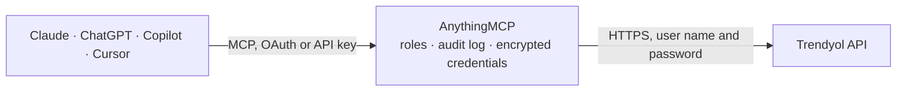

<!-- Generated by scripts/export-github-catalog.mjs in the anythingmcp-website repository. Do not edit by hand. -->

# Trendyol MCP connector

Run a Trendyol seller account from an AI agent: products (Product v2 listing, creation, content, archive), stock and prices, buybox, batch results, shipment packages with status, tracking, carrier … The AnythingMCP connector gives Claude, ChatGPT, Microsoft Copilot, Cursor and Gemini 35 MCP tools for Trendyol: 21 read and 14 can change data.

**Category:** [E-commerce](../e-commerce.md) · **Tools:** 35 · **Setup guide:** [anythingmcp.com](https://anythingmcp.com/guides/trendyol-to-mcp) · [Deutsch](https://anythingmcp.com/de/guides/trendyol-to-mcp) · [Italiano](https://anythingmcp.com/it/guides/trendyol-to-mcp) · [Español](https://anythingmcp.com/es/guides/trendyol-to-mcp) · [日本語](https://anythingmcp.com/ja/guides/trendyol-to-mcp) · [Русский](https://anythingmcp.com/ru/guides/trendyol-to-mcp) · [中文](https://anythingmcp.com/zh/guides/trendyol-to-mcp)

## Start without code

No installation and no terminal: AnythingMCP Cloud runs the Trendyol connector for you, operated by helpcode.ai in Frankfurt, Germany.

1. **Click the button above** and create an account or sign in. The Trendyol connector opens, ready to install.
2. **Paste the API key or token from your Trendyol account.** Every click is in the [step-by-step guide](https://anythingmcp.com/guides/trendyol-to-mcp).
3. **Click Install.** AnythingMCP shows the address of your MCP server.
4. **Add that address to your assistant:** [Claude](https://anythingmcp.com/guides/connect-trendyol-to-claude) · [ChatGPT](https://anythingmcp.com/guides/connect-trendyol-to-chatgpt) · [Microsoft Copilot](https://anythingmcp.com/guides/connect-trendyol-to-copilot) · [Cursor](https://anythingmcp.com/guides/connect-trendyol-to-cursor) · [Gemini CLI](https://anythingmcp.com/guides/connect-trendyol-to-gemini) · [Meta Muse](https://anythingmcp.com/guides/connect-trendyol-to-muse).
5. **Ask your first question**, for example: *I need the shipment package details for order TY2026-0453 (customer asked about delivery).*

Prefer help with the setup? [Talk to us](https://anythingmcp.com/contact).

## How it works

- **The AI client** speaks MCP (Streamable HTTP) to AnythingMCP and only sees tool names, descriptions and results. It never gets the Trendyol credentials.
- **AnythingMCP** checks the client's role, builds the call from the tool definition, adds the credentials (user name and password), calls Trendyol, logs the call and returns the result.
- **Trendyol** sees an ordinary API client with the rights of the account the credentials belong to.

## Tools

| Tool | What it does | Access |
|---|---|---|
| [`trendyol_list_products`](#trendyol_list_products) | List the seller's approved products (Product v2 filter): one entry per content (productMainId, title, brand, category, images, attributes) with its variants… | read |
| [`trendyol_list_unapproved_products`](#trendyol_list_unapproved_products) | List products that are not approved yet: pending approval or rejected, with the reject reasons, price, stock and attributes. | read |
| [`trendyol_list_stock_and_prices`](#trendyol_list_stock_and_prices) | List only stock and prices of approved products (list price, sale price, quantity, last stock change per variant). | read |
| [`trendyol_get_product`](#trendyol_get_product) | Read the basic state of one product by barcode: approved or not (and when), archived, listing id and content id. | read |
| [`trendyol_get_buybox`](#trendyol_get_buybox) | Check the buybox for up to 10 barcodes: your position in the buybox, the buybox price and whether other sellers offer the same product. | read |
| [`trendyol_get_batch_request`](#trendyol_get_batch_request) | Read the result of an asynchronous product, price, stock, archive or delete request by its batchRequestId: overall status (IN_PROGRESS, COMPLETED) and, per… | read |
| [`trendyol_create_products`](#trendyol_create_products) | Create products (Product v2, up to 1,000 per call). | write |
| [`trendyol_update_price_and_inventory`](#trendyol_update_price_and_inventory) | Update the stock and prices of approved products (up to 1,000 barcodes per call, at most 20,000 units per product). | write |
| [`trendyol_update_product_content`](#trendyol_update_product_content) | Update the content of approved products (title, description, images, attributes) by contentId, up to 1,000 per call. | write |
| [`trendyol_update_unapproved_products`](#trendyol_update_unapproved_products) | Correct products that are still waiting for approval or were rejected (title, description, brand, category, images, attributes, stock code, VAT, addresses)… | write |
| [`trendyol_archive_products`](#trendyol_archive_products) | Archive products (take them off sale) or bring them back from the archive, by barcode, up to 1,000 per call. | write |
| [`trendyol_delete_products`](#trendyol_delete_products) | Delete products from Trendyol by barcode. | write |
| [`trendyol_list_orders`](#trendyol_list_orders) | List shipment packages (orders) with their lines, customer, addresses, amounts, status, cargo provider and tracking. | read |
| [`trendyol_update_package_status`](#trendyol_update_package_status) | Move a shipment package to Picking (you started preparing it) or Invoiced (with the invoice number). | write |
| [`trendyol_update_tracking_number`](#trendyol_update_tracking_number) | Send the carrier's tracking number of a package shipped with your own carrier, mainly on the international storefronts (Europe, Gulf), where… | write |
| [`trendyol_change_cargo_provider`](#trendyol_change_cargo_provider) | Change the cargo company of a shipment package. | write |
| [`trendyol_send_invoice_link`](#trendyol_send_invoice_link) | Send the link of the e-invoice (e-Fatura or e-Arşiv) of a shipment package; Trendyol forwards it to the customer. | write |
| [`trendyol_report_unsupplied`](#trendyol_report_unsupplied) | Report that lines of a package cannot be supplied, which cancels them for the customer. | write |
| [`trendyol_list_claims`](#trendyol_list_claims) | List returns (claims) with the order, customer, cargo tracking and each returned item with the customer reason and status. | read |
| [`trendyol_get_claim_item_audit`](#trendyol_get_claim_item_audit) | Read the status history of one returned item: each status change, when and by whom. | read |
| [`trendyol_list_claim_issue_reasons`](#trendyol_list_claim_issue_reasons) | List the reasons a seller can give when rejecting a returned item, with their ids for trendyol_reject_claim_items. | read |
| [`trendyol_approve_claim_items`](#trendyol_approve_claim_items) | Approve returned items that arrived at your warehouse; the customer is refunded. | write |
| [`trendyol_reject_claim_items`](#trendyol_reject_claim_items) | Open a rejection request for returned items (for example a wrong or damaged item came back), with a reason from trendyol_list_claim_issue_reasons and a… | write |
| [`trendyol_list_questions`](#trendyol_list_questions) | List customer questions about your products: text, product, status (WAITING_FOR_ANSWER to answer), date and the answer if any. | read |
| [`trendyol_get_question`](#trendyol_get_question) | Read one customer question with the product, the answer and, if it was rejected or reported, the reason. | read |
| [`trendyol_answer_question`](#trendyol_answer_question) | Answer a customer question (10 to 2,000 characters). | write |
| [`trendyol_list_categories`](#trendyol_list_categories) | Find categories for product creation. | read |
| [`trendyol_get_category_attributes`](#trendyol_get_category_attributes) | List the attributes of a leaf category: id, name, whether it is required, a variant attribute, allows several values or a free value. | read |
| [`trendyol_list_attribute_values`](#trendyol_list_attribute_values) | List the allowed values of one category attribute (attributeValueId and name), for attributeValueIds in trendyol_create_products. | read |
| [`trendyol_search_brands`](#trendyol_search_brands) | Find brands by name to get the brandId for trendyol_create_products. | read |
| [`trendyol_list_brands`](#trendyol_list_brands) | List all brands page by page (id and name). | read |
| [`trendyol_list_cargo_providers`](#trendyol_list_cargo_providers) | List the cargo companies available on the storefront (code and name). | read |
| [`trendyol_list_addresses`](#trendyol_list_addresses) | List the seller's shipment, invoice and return addresses with their ids (shipmentAddressId and returningAddressId for products) and the defaults. | read |
| [`trendyol_list_settlements`](#trendyol_list_settlements) | List settlement lines: sales, returns, discounts, coupons, commissions and their payout, with amounts, commission rate, seller revenue, order number and… | read |
| [`trendyol_list_other_financials`](#trendyol_list_other_financials) | List other financial records: payment orders (payouts), wire transfers, incoming transfers, deduction and return invoices, commission agreement invoices,… | read |

## Tool reference

Every parameter as the AI client sees it in `tools/list`. Source: [`packages/backend/src/adapters/intl/trendyol.json`](../../../packages/backend/src/adapters/intl/trendyol.json).

### `trendyol_list_products`

List the seller's approved products (Product v2 filter): one entry per content (productMainId, title, brand, category, images, attributes) with its variants (barcode, stock code, price, stock, on-sale state). Filter by barcode, stock code, productMainId, brand or status. Pages with page and size; page x size may not exceed 10,000, beyond that pass nextPageToken.

**Access:** read · **Call:** `GET /product/sellers/{{TRENDYOL_SELLER_ID}}/products/approved`

| Parameter | Type | Required | Description |
|---|---|---|---|
| `barcode` | string | no | One barcode. |
| `stockCode` | string | no | Your stock code. |
| `productMainId` | string | no | Main product code shared by the variants. |
| `brandIds` | string | no | Comma-separated brand ids. |
| `status` | `onSale` \| `archived` \| `locked` \| `blacklisted` | no | Product state. |
| `startDate` | integer | no | Start of the date filter, epoch milliseconds, e.g. 1759276800000 for 2025-10-01 00:00 UTC. |
| `endDate` | integer | no | End of the date filter, epoch milliseconds. |
| `dateQueryType` | `VARIANT_CREATED_DATE` \| `VARIANT_MODIFIED_DATE` \| `CONTENT_MODIFIED_DATE` | no | Which date startDate and endDate filter on. |
| `page` | integer | no | Page number, starting at 0. |
| `size` | integer | no | Contents per page, at most 100. |
| `nextPageToken` | string | no | nextPageToken from the previous answer, only needed beyond 10,000 contents. |

### `trendyol_list_unapproved_products`

List products that are not approved yet: pending approval or rejected, with the reject reasons, price, stock and attributes. Use it after trendyol_create_products to see why a product was refused.

**Access:** read · **Call:** `GET /product/sellers/{{TRENDYOL_SELLER_ID}}/products/unapproved`

| Parameter | Type | Required | Description |
|---|---|---|---|
| `barcode` | string | no | One barcode. |
| `stockCode` | string | no | Your stock code. |
| `productMainId` | string | no | Main product code. |
| `status` | `pendingApproval` \| `rejected` | no | Approval state. |
| `startDate` | integer | no | Start of the date filter, epoch milliseconds, e.g. 1759276800000 for 2025-10-01 00:00 UTC. |
| `endDate` | integer | no | End of the date filter, epoch milliseconds. |
| `dateQueryType` | `CREATED_DATE` \| `LAST_MODIFIED_DATE` | no | Which date the filter uses. |
| `page` | integer | no | Page number, starting at 0. |
| `size` | integer | no | Products per page, at most 1000. |
| `nextPageToken` | string | no | nextPageToken from the previous answer, only needed beyond 10,000 products. |

### `trendyol_list_stock_and_prices`

List only stock and prices of approved products (list price, sale price, quantity, last stock change per variant). Lighter than trendyol_list_products for stock and price checks. Up to 50 barcodes at once.

**Access:** read · **Call:** `GET /product/sellers/{{TRENDYOL_SELLER_ID}}/products/approved/inventory-and-price`

| Parameter | Type | Required | Description |
|---|---|---|---|
| `barcode` | string | no | One barcode. |
| `barcodes` | string | no | Comma-separated barcodes, up to 50. |
| `contentId` | integer | no | One content id. |
| `stockCode` | string | no | Your stock code. |
| `productMainId` | string | no | Main product code. |
| `status` | `onSale` \| `notOnSale` \| `archived` \| `locked` \| `blacklisted` | no | Product state. |
| `orderByDirection` | `asc` \| `desc` | no | Sort by creation date: asc oldest first, desc newest first. |
| `page` | integer | no | Page number, starting at 0. |
| `size` | integer | no | Contents per page, at most 100. |
| `nextPageToken` | string | no | nextPageToken from the previous answer, only needed beyond 10,000 contents. |

### `trendyol_get_product`

Read the basic state of one product by barcode: approved or not (and when), archived, listing id and content id.

**Access:** read · **Call:** `GET /product/sellers/{{TRENDYOL_SELLER_ID}}/product/{barcode}`

| Parameter | Type | Required | Description |
|---|---|---|---|
| `barcode` | string | yes | Product barcode. |

### `trendyol_get_buybox`

Check the buybox for up to 10 barcodes: your position in the buybox, the buybox price and whether other sellers offer the same product. Read-only although it is a POST.

**Access:** read · **Call:** `POST /product/sellers/{{TRENDYOL_SELLER_ID}}/products/buybox-information`

| Parameter | Type | Required | Description |
|---|---|---|---|
| `barcodes` | string[] | yes | Barcodes, at most 10. |

### `trendyol_get_batch_request`

Read the result of an asynchronous product, price, stock, archive or delete request by its batchRequestId: overall status (IN_PROGRESS, COMPLETED) and, per item, SUCCESS or FAILED with the failure reasons. Results are kept for 4 hours.

**Access:** read · **Call:** `GET /product/sellers/{{TRENDYOL_SELLER_ID}}/products/batch-requests/{batchRequestId}`

| Parameter | Type | Required | Description |
|---|---|---|---|
| `batchRequestId` | string | yes | The batchRequestId returned by the write. |

### `trendyol_create_products`

Create products (Product v2, up to 1,000 per call). Each item needs barcode, title, productMainId, brandId, categoryId (a leaf category), quantity, stockCode, dimensionalWeight, description, listPrice, salePrice (not above listPrice), vatRate, images (up to 8 {url}) and the category attributes. Processed asynchronously: check the returned batchRequestId with trendyol_get_batch_request. Products go to Trendyol for approval: describe them and get a yes from the user first.

**Access:** write · **Call:** `POST /product/sellers/{{TRENDYOL_SELLER_ID}}/v2/products`

| Parameter | Type | Required | Description |
|---|---|---|---|
| `items` | object[] | yes | Products to create. Attributes are [{"attributeId": 338, "attributeValueIds": [6980]}] or [{"attributeId": 47, "attributeValue": "free text"}] for attributes that allow custom values. Optional: shipmentAddressId and returningAddressId from trendyol_list_addresses, deliveryOption, lotNumber. |

### `trendyol_update_price_and_inventory`

Update the stock and prices of approved products (up to 1,000 barcodes per call, at most 20,000 units per product). Send only the fields to change per barcode. The same request may not be repeated within 15 minutes. Processed asynchronously: check the returned batchRequestId with trendyol_get_batch_request. Changes what shoppers see at once: list each barcode with the old and new value and get a yes from the user first.

**Access:** write · **Call:** `POST /inventory/sellers/{{TRENDYOL_SELLER_ID}}/products/price-and-inventory`

| Parameter | Type | Required | Description |
|---|---|---|---|
| `items` | object[] | yes | One entry per barcode: {"barcode": "...", "quantity": 10, "salePrice": 199.9, "listPrice": 249.9}. salePrice may not exceed listPrice. |

### `trendyol_update_product_content`

Update the content of approved products (title, description, images, attributes) by contentId, up to 1,000 per call. Fields left out stay as they are, except attributes: when you change one, send all of them. Asynchronous: check the batchRequestId with trendyol_get_batch_request. Changes the live product page: show the change and get a yes from the user first.

**Access:** write · **Call:** `POST /product/sellers/{{TRENDYOL_SELLER_ID}}/products/content-bulk-update`

| Parameter | Type | Required | Description |
|---|---|---|---|
| `items` | object[] | yes | One entry per content: {"contentId": 123, "title": "...", "description": "...", "images": [{"url": "https://..."}], "attributes": [...]}. |

### `trendyol_update_unapproved_products`

Correct products that are still waiting for approval or were rejected (title, description, brand, category, images, attributes, stock code, VAT, addresses) by barcode, up to 1,000 per call. Asynchronous: check the batchRequestId with trendyol_get_batch_request. Show the change and get a yes from the user first.

**Access:** write · **Call:** `POST /product/sellers/{{TRENDYOL_SELLER_ID}}/products/unapproved-bulk-update`

| Parameter | Type | Required | Description |
|---|---|---|---|
| `items` | object[] | yes | One entry per barcode with the fields to change, e.g. {"barcode": "...", "title": "...", "attributes": [...]}. |

### `trendyol_archive_products`

Archive products (take them off sale) or bring them back from the archive, by barcode, up to 1,000 per call. Asynchronous: check the batchRequestId with trendyol_get_batch_request. Name the products and get a yes from the user first.

**Access:** write · **Call:** `PUT /product/sellers/{{TRENDYOL_SELLER_ID}}/products/archive-state`

| Parameter | Type | Required | Description |
|---|---|---|---|
| `items` | object[] | yes | [{"barcode": "...", "archived": true}] to archive, archived false to restore. |

### `trendyol_delete_products`

Delete products from Trendyol by barcode. Only products waiting for approval, and approved products archived for more than a day, can be deleted. Cannot be undone. Installed switched off; name every barcode and get a yes from the user first.

**Access:** write · **Call:** `DELETE /product/sellers/{{TRENDYOL_SELLER_ID}}/products`

| Parameter | Type | Required | Description |
|---|---|---|---|
| `items` | object[] | yes | [{"barcode": "..."}]. |

### `trendyol_list_orders`

List shipment packages (orders) with their lines, customer, addresses, amounts, status, cargo provider and tracking. Filter by status (Created = to process), order number, package ids or a date window of at most 2 weeks within the last month (without dates: the last week). Pages with page and size; only the first 10,000 packages of a filter can be reached, so narrow the window for more.

**Access:** read · **Call:** `GET /order/sellers/{{TRENDYOL_SELLER_ID}}/v2/orders`

| Parameter | Type | Required | Description |
|---|---|---|---|
| `status` | `Awaiting` \| `Created` \| `Picking` \| `Invoiced` \| `Shipped` \| `Cancelled` \| `Delivered` \| `UnDelivered` \| `Returned` \| `AtCollectionPoint` \| `UnPacked` \| `UnSupplied` \| `Verified` | no | Package status. |
| `startDate` | integer | no | Packages from this time, epoch milliseconds, e.g. 1759276800000 for 2025-10-01 00:00 UTC. |
| `endDate` | integer | no | Packages up to this time, epoch milliseconds. At most 2 weeks after startDate. |
| `orderNumber` | string | no | One order number. |
| `shipmentPackageIds` | string | no | Comma-separated package ids, up to 50. |
| `orderByField` | `PackageLastModifiedDate` \| `CreatedDate` | no | Sort field. |
| `orderByDirection` | `ASC` \| `DESC` | no | Sort direction. |
| `page` | integer | no | Page number, starting at 0. |
| `size` | integer | no | Packages per page, at most 200. |

### `trendyol_update_package_status`

Move a shipment package to Picking (you started preparing it) or Invoiced (with the invoice number). Picking must come first. List every line with its quantity. The customer sees the new state: name the package, status and lines and get a yes from the user first.

**Access:** write · **Call:** `PUT /order/sellers/{{TRENDYOL_SELLER_ID}}/shipment-packages/{packageId}`

| Parameter | Type | Required | Description |
|---|---|---|---|
| `packageId` | integer | yes | Shipment package id (id in trendyol_list_orders). |
| `status` | `Picking` \| `Invoiced` | yes | New status. |
| `lines` | object[] | yes | The package lines: [{"lineId": 123, "quantity": 1}]. |
| `invoiceNumber` | string | no | Invoice number, only with status Invoiced. |

### `trendyol_update_tracking_number`

Send the carrier's tracking number of a package shipped with your own carrier, mainly on the international storefronts (Europe, Gulf), where TRENDYOL_STOREFRONT_CODE is required. The package must be in Picking first; the number can be changed in Picking, Invoiced and Shipped. Shown to the customer: name the package and tracking data and get a yes from the user first.

**Access:** write · **Call:** `PUT /order/sellers/{{TRENDYOL_SELLER_ID}}/shipment-packages/{packageId}/tracking-details`

| Parameter | Type | Required | Description |
|---|---|---|---|
| `packageId` | integer | yes | Shipment package id. |
| `cargoSenderNumber` | string | yes | The carrier's tracking number. |
| `providerCode` | string | yes | Carrier code, e.g. DHLMP (see trendyol_list_cargo_providers). |
| `returnTrackingNumber` | string | no | Optional return tracking number. |

### `trendyol_change_cargo_provider`

Change the cargo company of a shipment package. Name the package and the new carrier and get a yes from the user first.

**Access:** write · **Call:** `PUT /order/sellers/{{TRENDYOL_SELLER_ID}}/shipment-packages/{packageId}/cargo-providers`

| Parameter | Type | Required | Description |
|---|---|---|---|
| `packageId` | integer | yes | Shipment package id. |
| `cargoProvider` | `YKMP` \| `ARASMP` \| `SURATMP` \| `HOROZMP` \| `DHLECOMMP` \| `PTTMP` \| `CEVAMP` \| `TEXMP` \| `KOLAYGELSINMP` \| `CEVATEDARIK` | yes | New carrier code. |

### `trendyol_send_invoice_link`

Send the link of the e-invoice (e-Fatura or e-Arşiv) of a shipment package; Trendyol forwards it to the customer. The link must stay reachable for 10 years. Only one invoice per package. Name the package and the link and get a yes from the user first.

**Access:** write · **Call:** `POST /sellers/{{TRENDYOL_SELLER_ID}}/seller-invoice-links`

| Parameter | Type | Required | Description |
|---|---|---|---|
| `shipmentPackageId` | integer | yes | Shipment package id. |
| `invoiceLink` | string | yes | Public URL of the invoice PDF. |
| `invoiceNumber` | string | no | 16-character invoice number (3 letters or digits, the year, 9 digits), required for micro-export packages. |
| `invoiceDateTime` | integer | no | Invoice date, epoch seconds or milliseconds, required for micro-export packages. |

### `trendyol_report_unsupplied`

Report that lines of a package cannot be supplied, which cancels them for the customer. Cannot be undone. Installed switched off; name the package, lines, quantities and reason and get a yes from the user first.

**Access:** write · **Call:** `PUT /order/sellers/{{TRENDYOL_SELLER_ID}}/shipment-packages/{packageId}/items/unsupplied`

| Parameter | Type | Required | Description |
|---|---|---|---|
| `packageId` | integer | yes | Shipment package id. |
| `lines` | object[] | yes | Lines to cancel: [{"lineId": 123, "quantity": 1}]. |
| `reasonId` | integer | yes | Cancellation reason id: 500, 501, 502, 504, 505 or 506 (see the Trendyol documentation for their meaning). |

### `trendyol_list_claims`

List returns (claims) with the order, customer, cargo tracking and each returned item with the customer reason and status. Filter by item status, order number or date. Pages with page and size.

**Access:** read · **Call:** `GET /order/sellers/{{TRENDYOL_SELLER_ID}}/claims`

| Parameter | Type | Required | Description |
|---|---|---|---|
| `claimItemStatus` | `Created` \| `WaitingInAction` \| `WaitingFraudCheck` \| `Accepted` \| `Unresolved` \| `Rejected` \| `Cancelled` \| `InAnalysis` | no | Status of the returned items. |
| `orderNumber` | string | no | One order number. |
| `claimIds` | string | no | Comma-separated claim ids. |
| `startDate` | integer | no | From this time, epoch milliseconds, e.g. 1759276800000 for 2025-10-01 00:00 UTC. |
| `endDate` | integer | no | Up to this time, epoch milliseconds. |
| `page` | integer | no | Page number, starting at 0. |
| `size` | integer | no | Claims per page, at most 200. |

### `trendyol_get_claim_item_audit`

Read the status history of one returned item: each status change, when and by whom.

**Access:** read · **Call:** `GET /order/sellers/{{TRENDYOL_SELLER_ID}}/claims/items/{claimItemId}/audit`

| Parameter | Type | Required | Description |
|---|---|---|---|
| `claimItemId` | string | yes | Claim item id (items[].claimItems[].id in trendyol_list_claims). |

### `trendyol_list_claim_issue_reasons`

List the reasons a seller can give when rejecting a returned item, with their ids for trendyol_reject_claim_items.

**Access:** read · **Call:** `GET /order/claim-issue-reasons`

No parameters.

### `trendyol_approve_claim_items`

Approve returned items that arrived at your warehouse; the customer is refunded. Name the claim and items and get a yes from the user first.

**Access:** write · **Call:** `PUT /order/sellers/{{TRENDYOL_SELLER_ID}}/claims/{claimId}/items/approve`

| Parameter | Type | Required | Description |
|---|---|---|---|
| `claimId` | string | yes | Claim id. |
| `claimLineItemIdList` | string[] | yes | Claim item ids to approve. |

### `trendyol_reject_claim_items`

Open a rejection request for returned items (for example a wrong or damaged item came back), with a reason from trendyol_list_claim_issue_reasons and a description. Trendyol reviews it. Installed switched off; name the claim, items and reason and get a yes from the user first.

**Access:** write · **Call:** `POST /order/sellers/{{TRENDYOL_SELLER_ID}}/claims/{claimId}/issue`

| Parameter | Type | Required | Description |
|---|---|---|---|
| `claimId` | string | yes | Claim id. |
| `claimIssueReasonId` | integer | yes | Reason id from trendyol_list_claim_issue_reasons. |
| `claimItemIdList` | string | yes | Comma-separated claim item ids. |
| `description` | string | yes | Explanation, up to 500 characters. |
| `file_url` | string | no | Optional public URL of a photo or PDF as evidence. |

### `trendyol_list_questions`

List customer questions about your products: text, product, status (WAITING_FOR_ANSWER to answer), date and the answer if any. Pages with page and size.

**Access:** read · **Call:** `GET /qna/sellers/{{TRENDYOL_SELLER_ID}}/questions/filter`

| Parameter | Type | Required | Description |
|---|---|---|---|
| `status` | `WAITING_FOR_ANSWER` \| `ANSWERED` \| `REJECTED` \| `REPORTED` | no | Question status. |
| `barcode` | string | no | Only questions about this barcode. |
| `startDate` | integer | no | From this time, epoch milliseconds, e.g. 1759276800000 for 2025-10-01 00:00 UTC. |
| `endDate` | integer | no | Up to this time, epoch milliseconds. |
| `orderByField` | `CreatedDate` \| `LastModifiedDate` | no | Sort field (default CreatedDate). |
| `orderByDirection` | `ASC` \| `DESC` | no | Sort direction (default DESC). |
| `page` | integer | no | Page number, starting at 0. |
| `size` | integer | no | Questions per page, at most 200. |

### `trendyol_get_question`

Read one customer question with the product, the answer and, if it was rejected or reported, the reason.

**Access:** read · **Call:** `GET /qna/sellers/{{TRENDYOL_SELLER_ID}}/questions/{id}`

| Parameter | Type | Required | Description |
|---|---|---|---|
| `id` | integer | yes | Question id. |

### `trendyol_answer_question`

Answer a customer question (10 to 2,000 characters). Trendyol reviews the answer and then publishes it on the product page. Show the user the answer and get a yes from the user first.

**Access:** write · **Call:** `POST /qna/sellers/{{TRENDYOL_SELLER_ID}}/questions/{id}/answers`

| Parameter | Type | Required | Description |
|---|---|---|---|
| `id` | integer | yes | Question id. |
| `text` | string | yes | The answer, 10 to 2,000 characters. |

### `trendyol_list_categories`

Find categories for product creation. Always pass name: the full tree is several hundred kilobytes. Returns the matching categories with their parents and subcategories; products need a leaf category id (no subCategories).

**Access:** read · **Call:** `GET /product/product-categories`

| Parameter | Type | Required | Description |
|---|---|---|---|
| `name` | string | no | Part of the category name, e.g. Ayakkabı or Shoes (the language follows the storefront). |
| `language` | string | no | Answer language on international storefronts: tr, en, ro, ar or el. The TR storefront always answers in Turkish. |

### `trendyol_get_category_attributes`

List the attributes of a leaf category: id, name, whether it is required, a variant attribute, allows several values or a free value. Use it to build the attributes of trendyol_create_products.

**Access:** read · **Call:** `GET /product/categories/{categoryId}/attributes`

| Parameter | Type | Required | Description |
|---|---|---|---|
| `categoryId` | integer | yes | Leaf category id. |
| `required` | boolean | no | true: only required attributes; false: only optional ones; leave out for all. |
| `language` | string | no | Answer language on international storefronts: tr, en, ro, ar or el. |

### `trendyol_list_attribute_values`

List the allowed values of one category attribute (attributeValueId and name), for attributeValueIds in trendyol_create_products.

**Access:** read · **Call:** `GET /product/categories/{categoryId}/attributes/{attributeId}/values`

| Parameter | Type | Required | Description |
|---|---|---|---|
| `categoryId` | integer | yes | Leaf category id. |
| `attributeId` | integer | yes | Attribute id. |
| `page` | integer | no | Page number, starting at 0. |
| `size` | integer | no | Values per page, at most 1000. |
| `language` | string | no | Answer language on international storefronts: tr, en, ro, ar or el. |

### `trendyol_search_brands`

Find brands by name to get the brandId for trendyol_create_products. The search is case-sensitive.

**Access:** read · **Call:** `GET /product/brands/by-name`

| Parameter | Type | Required | Description |
|---|---|---|---|
| `name` | string | yes | Brand name, case-sensitive. |

### `trendyol_list_brands`

List all brands page by page (id and name). Prefer trendyol_search_brands to find one brand.

**Access:** read · **Call:** `GET /product/brands`

| Parameter | Type | Required | Description |
|---|---|---|---|
| `page` | integer | no | Page number, starting at 0. |
| `size` | integer | no | Brands per page. |

### `trendyol_list_cargo_providers`

List the cargo companies available on the storefront (code and name).

**Access:** read · **Call:** `GET /product/lookup/cargo-providers`

No parameters.

### `trendyol_list_addresses`

List the seller's shipment, invoice and return addresses with their ids (shipmentAddressId and returningAddressId for products) and the defaults.

**Access:** read · **Call:** `GET /sellers/{{TRENDYOL_SELLER_ID}}/addresses`

No parameters.

### `trendyol_list_settlements`

List settlement lines: sales, returns, discounts, coupons, commissions and their payout, with amounts, commission rate, seller revenue, order number and payment date. Give a transaction type and a window of at most 15 days, or a paymentDate or paymentOrderId. Pages of 500 or 1000.

**Access:** read · **Call:** `GET /finance/che/sellers/{{TRENDYOL_SELLER_ID}}/settlements`

| Parameter | Type | Required | Description |
|---|---|---|---|
| `transactionType` | `Sale` \| `Return` \| `Discount` \| `DiscountCancel` \| `Coupon` \| `CouponCancel` \| `ProvisionPositive` \| `ProvisionNegative` \| `ManualRefund` \| `ManualRefundCancel` \| `TyDiscount` \| `TyDiscountCancel` \| `TyCoupon` \| `TyCouponCancel` \| `SellerRevenuePositive` \| `SellerRevenueNegative` \| `CommissionPositive` \| `CommissionNegative` \| `SellerRevenuePositiveCancel` \| `SellerRevenueNegativeCancel` \| `CommissionPositiveCancel` \| `CommissionNegativeCancel` \| `DeliveryFee` \| `DeliveryFeeCancel` \| `PayByLink` | no | Transaction type. |
| `transactionTypes` | string | no | Several types, comma-separated; wins over transactionType. |
| `startDate` | integer | no | Start of the window, epoch milliseconds, e.g. 1759276800000 for 2025-10-01 00:00 UTC. |
| `endDate` | integer | no | End of the window, epoch milliseconds, at most 15 days after startDate. |
| `paymentDate` | string | no | Instead of the window: lines due for payment from this date, yyyy-MM-dd (Istanbul time). |
| `paymentOrderId` | integer | no | Instead of the window: lines of this payment order. |
| `page` | integer | no | Page number, starting at 0. |
| `size` | `500` \| `1000` | no | Lines per page: 500 or 1000. |

### `trendyol_list_other_financials`

List other financial records: payment orders (payouts), wire transfers, incoming transfers, deduction and return invoices, commission agreement invoices, cash advances and stoppages. Give a transaction type and a window of at most 15 days, or a paymentDate or paymentOrderId.

**Access:** read · **Call:** `GET /finance/che/sellers/{{TRENDYOL_SELLER_ID}}/otherfinancials`

| Parameter | Type | Required | Description |
|---|---|---|---|
| `transactionType` | `Stoppage` \| `CashAdvance` \| `WireTransfer` \| `IncomingTransfer` \| `ReturnInvoice` \| `CommissionAgreementInvoice` \| `PaymentOrder` \| `DeductionInvoices` \| `FinancialItem` | no | Record type. |
| `transactionTypes` | string | no | Several types, comma-separated; wins over transactionType. |
| `startDate` | integer | no | Start of the window, epoch milliseconds, e.g. 1759276800000 for 2025-10-01 00:00 UTC. |
| `endDate` | integer | no | End of the window, epoch milliseconds, at most 15 days after startDate. |
| `paymentDate` | string | no | Instead of the window: records due for payment from this date, yyyy-MM-dd. |
| `paymentOrderId` | integer | no | Instead of the window: records of this payment order. |
| `page` | integer | no | Page number, starting at 0. |
| `size` | `500` \| `1000` | no | Records per page: 500 or 1000. |

## Run it yourself

AnythingMCP is open source (AGPL-3.0). [Run it with Docker](../../../README.md#run-it-yourself), open **Connectors → Store**, pick **Trendyol** and enter `TRENDYOL_API_HOST`, `TRENDYOL_SELLER_ID`, `TRENDYOL_API_KEY`, `TRENDYOL_API_SECRET`, then add your MCP server URL to the AI client.

[← E-commerce connectors](../e-commerce.md) · [All categories](../README.md)
