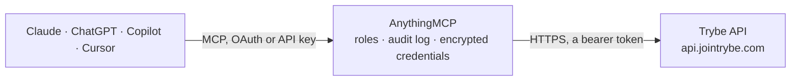

<!-- Generated by scripts/export-github-catalog.mjs in the anythingmcp-website repository. Do not edit by hand. -->

# Trybe MCP connector

Trybe performance-based UGC platform for brands: the creator roster and sample obligations, creator performance (earnings, GMV, ad spend, purchases and ROAS across Meta, TikTok and AppLovin) and the … The AnythingMCP connector gives Claude, ChatGPT, Microsoft Copilot, Cursor and Gemini 8 MCP tools for Trybe: 5 read and 3 can change data.

**Category:** [Marketing Automation](../marketing-automation.md) · **Tools:** 8 · **Setup guide:** [anythingmcp.com](https://anythingmcp.com/guides/trybe-to-mcp) · [Deutsch](https://anythingmcp.com/de/guides/trybe-to-mcp) · [Italiano](https://anythingmcp.com/it/guides/trybe-to-mcp) · [Español](https://anythingmcp.com/es/guides/trybe-to-mcp) · [日本語](https://anythingmcp.com/ja/guides/trybe-to-mcp) · [Русский](https://anythingmcp.com/ru/guides/trybe-to-mcp) · [中文](https://anythingmcp.com/zh/guides/trybe-to-mcp)

## Start without code

No installation and no terminal: AnythingMCP Cloud runs the Trybe connector for you, operated by helpcode.ai in Frankfurt, Germany.

1. **Click the button above** and create an account or sign in. The Trybe connector opens, ready to install.
2. **Paste the API key or token from your Trybe account.** Every click is in the [step-by-step guide](https://anythingmcp.com/guides/trybe-to-mcp).
3. **Click Install.** AnythingMCP shows the address of your MCP server.
4. **Add that address to your assistant:** [Claude](https://anythingmcp.com/guides/connect-trybe-to-claude) · [ChatGPT](https://anythingmcp.com/guides/connect-trybe-to-chatgpt) · [Microsoft Copilot](https://anythingmcp.com/guides/connect-trybe-to-copilot) · [Cursor](https://anythingmcp.com/guides/connect-trybe-to-cursor) · [Gemini CLI](https://anythingmcp.com/guides/connect-trybe-to-gemini) · [Meta Muse](https://anythingmcp.com/guides/connect-trybe-to-muse).
5. **Ask your first question**, for example: *I need the overdue sample obligation and creator id for Maya Lopez at our Trybe brand.*

Prefer help with the setup? [Talk to us](https://anythingmcp.com/contact).

## How it works

- **The AI client** speaks MCP (Streamable HTTP) to AnythingMCP and only sees tool names, descriptions and results. It never gets the Trybe credentials.
- **AnythingMCP** checks the client's role, builds the call from the tool definition, adds the credentials (a bearer token), calls Trybe, logs the call and returns the result.
- **Trybe** sees an ordinary API client with the rights of the account the credentials belong to.

## Tools

| Tool | What it does | Access |
|---|---|---|
| [`trybe_list_creators`](#trybe_list_creators) | List the active creators of your brand, newest first: id, name, avatar, join date and their sample status at your brand (samples requested, approved,… | read |
| [`trybe_get_creator`](#trybe_get_creator) | Get one creator of your brand by Trybe id: name, avatar, join date, sample status, and the programs they are enrolled in with each program's commission… | read |
| [`trybe_get_creator_performance`](#trybe_get_creator_performance) | Creator performance for a date range: per creator their programs, last activity and metrics (earnings, Trybe conversions and GMV, new and active… | read |
| [`trybe_list_submissions`](#trybe_list_submissions) | List the content (video or image) creators submitted to your brand: status (pending, approved, rejected, revision_requested), creator, program, products,… | read |
| [`trybe_get_submission`](#trybe_get_submission) | Get one submission by id with its status, creator, program, products, transcript, angles, review comment, ad usage, the trybe_id that ads must carry, and a… | read |
| [`trybe_approve_submission`](#trybe_approve_submission) | Approve a submission. | write |
| [`trybe_reject_submission`](#trybe_reject_submission) | Reject a submission. | write |
| [`trybe_request_submission_revision`](#trybe_request_submission_revision) | Send a submission back to the creator with a revision request; the comment tells them what to change. | write |

## Tool reference

Every parameter as the AI client sees it in `tools/list`. Source: [`packages/backend/src/adapters/intl/trybe.json`](../../../packages/backend/src/adapters/intl/trybe.json).

### `trybe_list_creators`

List the active creators of your brand, newest first: id, name, avatar, join date and their sample status at your brand (samples requested, approved, fulfilled, overdue, the sample to act on and the Sample Score). Filter by sample_obligation to find who owes a video. Paginated with cursors.

**Access:** read · **Call:** `GET /v1/creators`

| Parameter | Type | Required | Description |
|---|---|---|---|
| `limit` | integer | no | Rows per page, default 20, at most 100. |
| `after` | string | no | Cursor from next_cursor of the previous page: returns the rows after it. Do not combine with before. |
| `before` | string | no | Cursor from previous_cursor: returns the rows before it. Do not combine with after. |
| `sample_obligation` | `not_yet_due` \| `submitted_awaiting_review` \| `needs_resubmit` \| `overdue` \| `fulfilled` \| `none` | no | Keep only creators with a sample in this state: overdue (owes a video past the due date), needs_resubmit, not_yet_due, submitted_awaiting_review, fulfilled, or none (no sample ever approved). |

### `trybe_get_creator`

Get one creator of your brand by Trybe id: name, avatar, join date, sample status, and the programs they are enrolled in with each program's commission rules (e.g. 10% of GMV plus a flat amount per order).

**Access:** read · **Call:** `GET /v1/creators/{creator_id}`

| Parameter | Type | Required | Description |
|---|---|---|---|
| `creator_id` | string | yes | Trybe creator id as the API returns it, `creator_` plus a UUID, e.g. creator_8f3e21a0-7c6d-4b1e-9a3f-1b2c3d4e5f60. Take it from trybe_list_creators. |

### `trybe_get_creator_performance`

Creator performance for a date range: per creator their programs, last activity and metrics (earnings, Trybe conversions and GMV, new and active submissions, ads running their content, ad spend, purchases, purchase value and ROAS). Money is in USD cents. Without dates it covers the last 30 complete UTC days. Sort by a metric to rank the whole roster (window then capped at 90 days).

**Access:** read · **Call:** `GET /v1/creator-performance`

| Parameter | Type | Required | Description |
|---|---|---|---|
| `start_date` | string | no | First day, inclusive, YYYY-MM-DD in UTC. Default 30 complete days ago. |
| `end_date` | string | no | Last day, inclusive, YYYY-MM-DD in UTC. Default yesterday; future dates are rejected. |
| `creator_id` | string | no | Only this creator (`creator_` plus a UUID from trybe_list_creators). |
| `sort_by` | `joined_at` \| `earnings` \| `trybe_gmv` \| `trybe_conversions` \| `new_submissions` \| `active_submissions` \| `ads` \| `spend` \| `purchase_value` \| `purchases` | no | Row order. joined_at (default) pages newest first; any metric ranks the whole roster highest first. |
| `program_id` | string | no | Only creators enrolled in this program (`creator_program_` plus a UUID). |
| `managed_by` | `brand` \| `partner` | no | partner = creators a partner agency manages; brand = creators the brand manages directly. Omit for both. |
| `active_only` | boolean | no | true drops creators with every metric zero in the window (window then capped at 90 days). |
| `platforms` | string | no | Ad platforms whose ad data to include, comma-separated from meta, tiktok, applovin (e.g. meta,tiktok). Default: every platform. |
| `limit` | integer | no | Rows per page, default 20, at most 100. |
| `after` | string | no | Cursor from next_cursor of the previous page: returns the rows after it. Do not combine with before. |
| `before` | string | no | Cursor from previous_cursor: returns the rows before it. Do not combine with after. |

### `trybe_list_submissions`

List the content (video or image) creators submitted to your brand: status (pending, approved, rejected, revision_requested), creator, program, products, angles, transcript, all-time ad usage, thumbnail and a download link that expires after about 20 minutes. Filter by status, creator, program, product, angle, transcript language or words the video says or shows.

**Access:** read · **Call:** `GET /v1/submissions`

| Parameter | Type | Required | Description |
|---|---|---|---|
| `status` | `pending` \| `approved` \| `rejected` \| `revision_requested` | no | Review status to keep. |
| `creator_id` | string | no | Only this creator (`creator_` plus a UUID). |
| `group_id` | string | no | Only the variants of this submission group (`subgroup_` plus a UUID). |
| `angle` | string | no | Only submissions tagged with this angle name, case-insensitive (e.g. Unboxing & First Impressions). |
| `program_id` | string | no | Program id `creator_program_` plus a UUID, as shown in programs[].id. |
| `product_id` | string | no | Only submissions tagged with this product (`product_` plus a UUID, from products[].id). |
| `transcript_language` | string | no | ISO 639-1 language of the transcript, e.g. en or es. |
| `query` | string | no | One phrase of 2 to 100 characters matched against the transcript, on-screen text and the creator's note. |
| `platforms` | string | no | Ad platforms whose ad data to include, comma-separated from meta, tiktok, applovin (e.g. meta,tiktok). Default: every platform. |
| `limit` | integer | no | Rows per page, default 20, at most 100. |
| `after` | string | no | Cursor from next_cursor of the previous page: returns the rows after it. Do not combine with before. |
| `before` | string | no | Cursor from previous_cursor: returns the rows before it. Do not combine with after. |

### `trybe_get_submission`

Get one submission by id with its status, creator, program, products, transcript, angles, review comment, ad usage, the trybe_id that ads must carry, and a fresh download link (expires after about 20 minutes, fetch again rather than storing it).

**Access:** read · **Call:** `GET /v1/submissions/{submission_id}`

| Parameter | Type | Required | Description |
|---|---|---|---|
| `submission_id` | string | yes | Submission id as the API returns it, `submission_` plus a UUID. Take it from trybe_list_submissions. |
| `platforms` | string | no | Ad platforms whose ad data to include, comma-separated from meta, tiktok, applovin (e.g. meta,tiktok). Default: every platform. |

### `trybe_approve_submission`

Approve a submission. The creator is notified and an approved submission can count toward their earnings and sample obligation. Installed switched off; confirm with the user first.

**Access:** write · **Call:** `POST /v1/submissions/{submission_id}/approve`

| Parameter | Type | Required | Description |
|---|---|---|---|
| `submission_id` | string | yes | Submission id as the API returns it, `submission_` plus a UUID. Take it from trybe_list_submissions. |
| `comment` | string | no | Optional note to the creator, shown with the review. |

### `trybe_reject_submission`

Reject a submission. The creator is notified and the sample may turn into needs_resubmit. Installed switched off; confirm with the user first.

**Access:** write · **Call:** `POST /v1/submissions/{submission_id}/reject`

| Parameter | Type | Required | Description |
|---|---|---|---|
| `submission_id` | string | yes | Submission id as the API returns it, `submission_` plus a UUID. Take it from trybe_list_submissions. |
| `comment` | string | no | Optional note to the creator, shown with the review. |

### `trybe_request_submission_revision`

Send a submission back to the creator with a revision request; the comment tells them what to change. Installed switched off; confirm with the user first.

**Access:** write · **Call:** `POST /v1/submissions/{submission_id}/request-revision`

| Parameter | Type | Required | Description |
|---|---|---|---|
| `submission_id` | string | yes | Submission id as the API returns it, `submission_` plus a UUID. Take it from trybe_list_submissions. |
| `comment` | string | yes | Message to the creator explaining what to change. Required. |

## Run it yourself

AnythingMCP is open source (AGPL-3.0). [Run it with Docker](../../../README.md#run-it-yourself), open **Connectors → Store**, pick **Trybe** and enter `TRYBE_API_KEY`, then add your MCP server URL to the AI client.

[← Marketing Automation connectors](../marketing-automation.md) · [All categories](../README.md)
