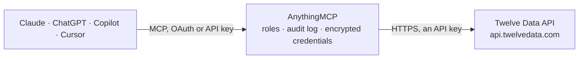

<!-- Generated by scripts/export-github-catalog.mjs in the anythingmcp-website repository. Do not edit by hand. -->

# Twelve Data MCP connector

Market data for AI agents from Twelve Data: real-time quotes and prices, historical time series, exchange rates and currency conversion, symbol search, stock, forex and crypto lists, exchanges and … The AnythingMCP connector gives Claude, ChatGPT, Microsoft Copilot, Cursor and Gemini 19 MCP tools for Twelve Data, all read-only.

**Category:** [Finance](../finance.md) · **Tools:** 19 · **Setup guide:** [anythingmcp.com](https://anythingmcp.com/guides/twelve-data-to-mcp) · [Deutsch](https://anythingmcp.com/de/guides/twelve-data-to-mcp) · [Italiano](https://anythingmcp.com/it/guides/twelve-data-to-mcp) · [Español](https://anythingmcp.com/es/guides/twelve-data-to-mcp) · [日本語](https://anythingmcp.com/ja/guides/twelve-data-to-mcp) · [Русский](https://anythingmcp.com/ru/guides/twelve-data-to-mcp) · [中文](https://anythingmcp.com/zh/guides/twelve-data-to-mcp)

## Start without code

No installation and no terminal: AnythingMCP Cloud runs the Twelve Data connector for you, operated by helpcode.ai in Frankfurt, Germany.

1. **Click the button above** and create an account or sign in. The Twelve Data connector opens, ready to install.
2. **Paste the API key or token from your Twelve Data account.** Every click is in the [step-by-step guide](https://anythingmcp.com/guides/twelve-data-to-mcp).
3. **Click Install.** AnythingMCP shows the address of your MCP server.
4. **Add that address to your assistant:** [Claude](https://anythingmcp.com/guides/connect-twelve-data-to-claude) · [ChatGPT](https://anythingmcp.com/guides/connect-twelve-data-to-chatgpt) · [Microsoft Copilot](https://anythingmcp.com/guides/connect-twelve-data-to-copilot) · [Cursor](https://anythingmcp.com/guides/connect-twelve-data-to-cursor) · [Gemini CLI](https://anythingmcp.com/guides/connect-twelve-data-to-gemini) · [Meta Muse](https://anythingmcp.com/guides/connect-twelve-data-to-muse).
5. **Ask your first question**, for example: *What's the current EUR/USD rate and converted amount to USD for a 12,500 EUR supplier invoice right now?*

Prefer help with the setup? [Talk to us](https://anythingmcp.com/contact).

## How it works

- **The AI client** speaks MCP (Streamable HTTP) to AnythingMCP and only sees tool names, descriptions and results. It never gets the Twelve Data credentials.
- **AnythingMCP** checks the client's role, builds the call from the tool definition, adds the credentials (an API key), calls Twelve Data, logs the call and returns the result.
- **Twelve Data** sees an ordinary API client with the rights of the account the credentials belong to.

## Tools

| Tool | What it does | Access |
|---|---|---|
| [`twelve_data_get_api_usage`](#twelve_data_get_api_usage) | Show the requests made in the last minute and today, the plan's per-minute and daily limits, and the plan category. | read |
| [`twelve_data_get_quote`](#twelve_data_get_quote) | Real-time quote for one instrument: name, exchange, currency, open, high, low, close, volume, previous close, change and percent change, 52-week range, and… | read |
| [`twelve_data_get_price`](#twelve_data_get_price) | Latest traded price of one instrument as a single number. | read |
| [`twelve_data_get_time_series`](#twelve_data_get_time_series) | Historical OHLCV bars for one instrument at an interval (1min to 1month): meta (symbol, currency, exchange, timezone) and values with datetime, open, high,… | read |
| [`twelve_data_get_eod`](#twelve_data_get_eod) | Closing price of the last trading day (or of a given date) for one instrument, with exchange, currency and datetime. | read |
| [`twelve_data_get_exchange_rate`](#twelve_data_get_exchange_rate) | Real-time exchange rate of a forex or crypto pair, for example EUR/USD or BTC/ETH, with its timestamp. | read |
| [`twelve_data_convert_currency`](#twelve_data_convert_currency) | Convert an amount from the base to the quote currency of a forex or crypto pair at the real-time (or a historical) rate. | read |
| [`twelve_data_search_symbols`](#twelve_data_search_symbols) | Find instruments by ticker or name, ordered by relevance: symbol, instrument name, exchange, MIC, currency, country and type. | read |
| [`twelve_data_list_stocks`](#twelve_data_list_stocks) | List stock symbols covered by Twelve Data, updated daily: symbol, name, currency, exchange, MIC, country, type. | read |
| [`twelve_data_list_forex_pairs`](#twelve_data_list_forex_pairs) | List the forex pairs available, updated daily: symbol (for example EUR/USD), currency group, base and quote currency. | read |
| [`twelve_data_list_cryptocurrencies`](#twelve_data_list_cryptocurrencies) | List the cryptocurrency pairs available, updated daily: symbol (for example BTC/USD), the exchanges that quote it, base and quote currency. | read |
| [`twelve_data_list_exchanges`](#twelve_data_list_exchanges) | List equity exchanges: name, MIC code, country, timezone and access plan. | read |
| [`twelve_data_get_earliest_timestamp`](#twelve_data_get_earliest_timestamp) | Return the earliest date and time for which data exists for an instrument at an interval. | read |
| [`twelve_data_get_market_state`](#twelve_data_get_market_state) | Show whether stock exchanges are open now, with time to open, time to close and time since open. | read |
| [`twelve_data_get_rsi`](#twelve_data_get_rsi) | Relative Strength Index (0 to 100) series for an instrument; above 70 is commonly read as overbought, below 30 as oversold. | read |
| [`twelve_data_get_macd`](#twelve_data_get_macd) | Moving Average Convergence Divergence series for an instrument: macd line, signal line and histogram per datetime, to spot trend changes. | read |
| [`twelve_data_get_sma`](#twelve_data_get_sma) | Simple Moving Average series for an instrument over time_period bars, for trend direction and support levels. | read |
| [`twelve_data_get_ema`](#twelve_data_get_ema) | Exponential Moving Average series for an instrument over time_period bars; reacts faster to recent prices than the SMA. | read |
| [`twelve_data_get_bbands`](#twelve_data_get_bbands) | Bollinger Bands series for an instrument: upper band, middle band (moving average) and lower band per datetime, to judge volatility. | read |

## Tool reference

Every parameter as the AI client sees it in `tools/list`. Source: [`packages/backend/src/adapters/intl/twelve-data.json`](../../../packages/backend/src/adapters/intl/twelve-data.json).

### `twelve_data_get_api_usage`

Show the requests made in the last minute and today, the plan's per-minute and daily limits, and the plan category. Costs 1 credit; use it to check the key and the capacity left.

**Access:** read · **Call:** `GET /api_usage`

No parameters.

### `twelve_data_get_quote`

Real-time quote for one instrument: name, exchange, currency, open, high, low, close, volume, previous close, change and percent change, 52-week range, and whether the market is open. 1 credit per symbol.

**Access:** read · **Call:** `GET /quote`

| Parameter | Type | Required | Description |
|---|---|---|---|
| `symbol` | string | yes | Ticker, for example AAPL, EUR/USD or BTC/USD. Use twelve_data_search_symbols when unsure. Indices such as NDX need a paid plan and CFD names such as NAS100 or US100 do not exist here; on the Basic plan use an ETF such as QQQ. |
| `exchange` | string | no | Optional exchange name or MIC to pick the listing, for example NASDAQ or XETR. |
| `interval` | `1min` \| `5min` \| `15min` \| `30min` \| `45min` \| `1h` \| `2h` \| `4h` \| `8h` \| `1day` \| `1week` \| `1month` | no | Interval the quote is built on, default 1day. |
| `eod` | boolean | no | true returns the data of the last closed day instead of live values. |
| `dp` | integer | no | Decimal places in the values, 0 to 11. |
| `timezone` | string | no | Timezone of the returned datetimes: Exchange (default, local exchange time), UTC, or an IANA name such as Europe/Berlin. |

### `twelve_data_get_price`

Latest traded price of one instrument as a single number. The cheapest way to read a price (1 credit per symbol); use twelve_data_get_quote for change and volume.

**Access:** read · **Call:** `GET /price`

| Parameter | Type | Required | Description |
|---|---|---|---|
| `symbol` | string | yes | Ticker, for example AAPL, EUR/USD or BTC/USD. Use twelve_data_search_symbols when unsure. Indices such as NDX need a paid plan and CFD names such as NAS100 or US100 do not exist here; on the Basic plan use an ETF such as QQQ. |
| `exchange` | string | no | Optional exchange name or MIC to pick the listing, for example NASDAQ or XETR. |
| `dp` | integer | no | Decimal places in the values, 0 to 11. |

### `twelve_data_get_time_series`

Historical OHLCV bars for one instrument at an interval (1min to 1month): meta (symbol, currency, exchange, timezone) and values with datetime, open, high, low, close, volume. Newest first by default. 1 credit per symbol.

**Access:** read · **Call:** `GET /time_series`

| Parameter | Type | Required | Description |
|---|---|---|---|
| `symbol` | string | yes | Ticker, for example AAPL, EUR/USD or BTC/USD. Use twelve_data_search_symbols when unsure. Indices such as NDX need a paid plan and CFD names such as NAS100 or US100 do not exist here; on the Basic plan use an ETF such as QQQ. |
| `interval` | `1min` \| `5min` \| `15min` \| `30min` \| `45min` \| `1h` \| `2h` \| `4h` \| `8h` \| `1day` \| `1week` \| `1month` | yes | Interval between two data points, for example 1day or 1h. |
| `outputsize` | integer | no | Number of data points, 1 to 5000. Default 30 here; keep it small to save context. |
| `start_date` | string | no | Optional start, 2006-01-02 or 2006-01-02T15:04:05, in the exchange timezone (UTC for forex and crypto). |
| `end_date` | string | no | Optional end, same format as start_date. |
| `order` | `desc` \| `asc` | no | desc (default) newest first, asc oldest first. |
| `exchange` | string | no | Optional exchange name or MIC to pick the listing, for example NASDAQ or XETR. |
| `adjust` | `all` \| `splits` \| `dividends` \| `none` | no | Price adjustment: splits (default), dividends, all or none. |
| `timezone` | string | no | Timezone of the returned datetimes: Exchange (default, local exchange time), UTC, or an IANA name such as Europe/Berlin. |
| `dp` | integer | no | Decimal places in the values, 0 to 11. |

### `twelve_data_get_eod`

Closing price of the last trading day (or of a given date) for one instrument, with exchange, currency and datetime. 1 credit per symbol.

**Access:** read · **Call:** `GET /eod`

| Parameter | Type | Required | Description |
|---|---|---|---|
| `symbol` | string | yes | Ticker, for example AAPL, EUR/USD or BTC/USD. Use twelve_data_search_symbols when unsure. Indices such as NDX need a paid plan and CFD names such as NAS100 or US100 do not exist here; on the Basic plan use an ETF such as QQQ. |
| `exchange` | string | no | Optional exchange name or MIC to pick the listing, for example NASDAQ or XETR. |
| `date` | string | no | Optional date, 2006-01-02. Default: the latest closed day. |
| `dp` | integer | no | Decimal places in the values, 0 to 11. |

### `twelve_data_get_exchange_rate`

Real-time exchange rate of a forex or crypto pair, for example EUR/USD or BTC/ETH, with its timestamp. Optional date for a historical rate. 1 credit per symbol.

**Access:** read · **Call:** `GET /exchange_rate`

| Parameter | Type | Required | Description |
|---|---|---|---|
| `symbol` | string | yes | Currency pair with a slash, for example EUR/USD or BTC/ETH. |
| `date` | string | no | Optional date or datetime for a historical rate, 2006-01-02 or 2006-01-02T15:04:05. |
| `dp` | integer | no | Decimal places in the values, 0 to 11. |
| `timezone` | string | no | Timezone of the returned datetimes: Exchange (default, local exchange time), UTC, or an IANA name such as Europe/Berlin. |

### `twelve_data_convert_currency`

Convert an amount from the base to the quote currency of a forex or crypto pair at the real-time (or a historical) rate. Returns the rate and the converted amount. 1 credit per symbol.

**Access:** read · **Call:** `GET /currency_conversion`

| Parameter | Type | Required | Description |
|---|---|---|---|
| `symbol` | string | yes | Currency pair with a slash, base/quote, for example USD/JPY. |
| `amount` | number | yes | Amount of the base currency to convert, for example 1250.50. |
| `date` | string | no | Optional date or datetime for a historical rate, 2006-01-02. |
| `dp` | integer | no | Decimal places in the values, 0 to 11. |
| `timezone` | string | no | Timezone of the returned datetimes: Exchange (default, local exchange time), UTC, or an IANA name such as Europe/Berlin. |

### `twelve_data_search_symbols`

Find instruments by ticker or name, ordered by relevance: symbol, instrument name, exchange, MIC, currency, country and type. Use it to resolve a company or asset name into the symbol other tools need.

**Access:** read · **Call:** `GET /symbol_search`

| Parameter | Type | Required | Description |
|---|---|---|---|
| `symbol` | string | yes | Ticker or name to search, for example Tesla, TSLA or Siemens. |
| `outputsize` | integer | no | Number of data points, 1 to 120. Default 10 here; keep it small to save context. |
| `show_plan` | boolean | no | true adds, for every match, the plan it needs (access.plan), so you can pick a symbol the account can read. |

### `twelve_data_list_stocks`

List stock symbols covered by Twelve Data, updated daily: symbol, name, currency, exchange, MIC, country, type. Filter by exchange, country, type or symbol; the full list is very long.

**Access:** read · **Call:** `GET /stocks`

| Parameter | Type | Required | Description |
|---|---|---|---|
| `symbol` | string | no | Optional exact ticker to look up. |
| `exchange` | string | no | Optional exchange name or MIC to pick the listing, for example NASDAQ or XETR. |
| `country` | string | no | Optional country name or ISO code, for example Germany or DE. |
| `type` | string | no | Optional instrument type, for example Common Stock, ETF, REIT or Preferred Stock. |
| `outputsize` | integer | no | Number of data points, 1 to 5000. Default 50 here; keep it small to save context. |
| `page` | integer | no | Page number, from 1. |

### `twelve_data_list_forex_pairs`

List the forex pairs available, updated daily: symbol (for example EUR/USD), currency group, base and quote currency. Filter by base or quote currency.

**Access:** read · **Call:** `GET /forex_pairs`

| Parameter | Type | Required | Description |
|---|---|---|---|
| `symbol` | string | no | Optional pair to look up, for example EUR/USD. |
| `currency_base` | string | no | Optional base currency, for example EUR. |
| `currency_quote` | string | no | Optional quote currency, for example USD. |
| `outputsize` | integer | no | Number of data points, 1 to 5000. Default 50 here; keep it small to save context. |

### `twelve_data_list_cryptocurrencies`

List the cryptocurrency pairs available, updated daily: symbol (for example BTC/USD), the exchanges that quote it, base and quote currency. Filter by symbol, exchange or currencies.

**Access:** read · **Call:** `GET /cryptocurrencies`

| Parameter | Type | Required | Description |
|---|---|---|---|
| `symbol` | string | no | Optional pair to look up, for example ETH/BTC. |
| `exchange` | string | no | Optional crypto exchange, for example Binance. |
| `currency_base` | string | no | Optional base currency, for example BTC. |
| `currency_quote` | string | no | Optional quote currency, for example USD. |
| `outputsize` | integer | no | Number of data points, 1 to 5000. Default 50 here; keep it small to save context. |

### `twelve_data_list_exchanges`

List equity exchanges: name, MIC code, country, timezone and access plan. Filter by name, MIC code or country. Use it to find the exchange or MIC for a listing.

**Access:** read · **Call:** `GET /exchanges`

| Parameter | Type | Required | Description |
|---|---|---|---|
| `name` | string | no | Optional exchange name, for example NASDAQ. |
| `code` | string | no | Optional MIC code, for example XNAS. |
| `country` | string | no | Optional country, for example United States. |

### `twelve_data_get_earliest_timestamp`

Return the earliest date and time for which data exists for an instrument at an interval. Use it before requesting long time series to know where history starts.

**Access:** read · **Call:** `GET /earliest_timestamp`

| Parameter | Type | Required | Description |
|---|---|---|---|
| `symbol` | string | yes | Ticker, for example AAPL, EUR/USD or BTC/USD. Use twelve_data_search_symbols when unsure. Indices such as NDX need a paid plan and CFD names such as NAS100 or US100 do not exist here; on the Basic plan use an ETF such as QQQ. |
| `interval` | `1min` \| `5min` \| `15min` \| `30min` \| `45min` \| `1h` \| `2h` \| `4h` \| `8h` \| `1day` \| `1week` \| `1month` | yes | Interval between two data points, for example 1day or 1h. |
| `exchange` | string | no | Optional exchange name or MIC to pick the listing, for example NASDAQ or XETR. |
| `timezone` | string | no | Timezone of the returned datetimes: Exchange (default, local exchange time), UTC, or an IANA name such as Europe/Berlin. |

### `twelve_data_get_market_state`

Show whether stock exchanges are open now, with time to open, time to close and time since open. Filter by exchange name, MIC code or country; without filters all exchanges are listed.

**Access:** read · **Call:** `GET /market_state`

| Parameter | Type | Required | Description |
|---|---|---|---|
| `exchange` | string | no | Optional exchange name, for example NYSE. |
| `code` | string | no | Optional MIC code, for example XNYS. |
| `country` | string | no | Optional country, for example United States. |

### `twelve_data_get_rsi`

Relative Strength Index (0 to 100) series for an instrument; above 70 is commonly read as overbought, below 30 as oversold. Values newest first. 1 credit per symbol.

**Access:** read · **Call:** `GET /rsi`

| Parameter | Type | Required | Description |
|---|---|---|---|
| `symbol` | string | yes | Ticker, for example AAPL, EUR/USD or BTC/USD. Use twelve_data_search_symbols when unsure. Indices such as NDX need a paid plan and CFD names such as NAS100 or US100 do not exist here; on the Basic plan use an ETF such as QQQ. |
| `interval` | `1min` \| `5min` \| `15min` \| `30min` \| `45min` \| `1h` \| `2h` \| `4h` \| `8h` \| `1day` \| `1week` \| `1month` | yes | Interval between two data points, for example 1day or 1h. |
| `outputsize` | integer | no | Number of data points, 1 to 5000. Default 30 here; keep it small to save context. |
| `exchange` | string | no | Optional exchange name or MIC to pick the listing, for example NASDAQ or XETR. |
| `time_period` | integer | no | Periods to average over, default 14. |
| `series_type` | `close` \| `open` \| `high` \| `low` \| `volume` | no | Price field the indicator is computed on. Default close here (the API's own default is open). |

### `twelve_data_get_macd`

Moving Average Convergence Divergence series for an instrument: macd line, signal line and histogram per datetime, to spot trend changes. 1 credit per symbol.

**Access:** read · **Call:** `GET /macd`

| Parameter | Type | Required | Description |
|---|---|---|---|
| `symbol` | string | yes | Ticker, for example AAPL, EUR/USD or BTC/USD. Use twelve_data_search_symbols when unsure. Indices such as NDX need a paid plan and CFD names such as NAS100 or US100 do not exist here; on the Basic plan use an ETF such as QQQ. |
| `interval` | `1min` \| `5min` \| `15min` \| `30min` \| `45min` \| `1h` \| `2h` \| `4h` \| `8h` \| `1day` \| `1week` \| `1month` | yes | Interval between two data points, for example 1day or 1h. |
| `outputsize` | integer | no | Number of data points, 1 to 5000. Default 30 here; keep it small to save context. |
| `exchange` | string | no | Optional exchange name or MIC to pick the listing, for example NASDAQ or XETR. |
| `fast_period` | integer | no | Fast moving average periods, default 12. |
| `slow_period` | integer | no | Slow moving average periods, default 26. |
| `signal_period` | integer | no | Signal line periods, default 9. |
| `series_type` | `close` \| `open` \| `high` \| `low` \| `volume` | no | Price field the indicator is computed on. Default close here (the API's own default is open). |

### `twelve_data_get_sma`

Simple Moving Average series for an instrument over time_period bars, for trend direction and support levels. 1 credit per symbol.

**Access:** read · **Call:** `GET /sma`

| Parameter | Type | Required | Description |
|---|---|---|---|
| `symbol` | string | yes | Ticker, for example AAPL, EUR/USD or BTC/USD. Use twelve_data_search_symbols when unsure. Indices such as NDX need a paid plan and CFD names such as NAS100 or US100 do not exist here; on the Basic plan use an ETF such as QQQ. |
| `interval` | `1min` \| `5min` \| `15min` \| `30min` \| `45min` \| `1h` \| `2h` \| `4h` \| `8h` \| `1day` \| `1week` \| `1month` | yes | Interval between two data points, for example 1day or 1h. |
| `outputsize` | integer | no | Number of data points, 1 to 5000. Default 30 here; keep it small to save context. |
| `exchange` | string | no | Optional exchange name or MIC to pick the listing, for example NASDAQ or XETR. |
| `time_period` | integer | no | Periods to average over, for example 50 or 200. Default 9. |
| `series_type` | `close` \| `open` \| `high` \| `low` \| `volume` | no | Price field the indicator is computed on. Default close here (the API's own default is open). |

### `twelve_data_get_ema`

Exponential Moving Average series for an instrument over time_period bars; reacts faster to recent prices than the SMA. 1 credit per symbol.

**Access:** read · **Call:** `GET /ema`

| Parameter | Type | Required | Description |
|---|---|---|---|
| `symbol` | string | yes | Ticker, for example AAPL, EUR/USD or BTC/USD. Use twelve_data_search_symbols when unsure. Indices such as NDX need a paid plan and CFD names such as NAS100 or US100 do not exist here; on the Basic plan use an ETF such as QQQ. |
| `interval` | `1min` \| `5min` \| `15min` \| `30min` \| `45min` \| `1h` \| `2h` \| `4h` \| `8h` \| `1day` \| `1week` \| `1month` | yes | Interval between two data points, for example 1day or 1h. |
| `outputsize` | integer | no | Number of data points, 1 to 5000. Default 30 here; keep it small to save context. |
| `exchange` | string | no | Optional exchange name or MIC to pick the listing, for example NASDAQ or XETR. |
| `time_period` | integer | no | Periods to average over, for example 20. Default 9. |
| `series_type` | `close` \| `open` \| `high` \| `low` \| `volume` | no | Price field the indicator is computed on. Default close here (the API's own default is open). |

### `twelve_data_get_bbands`

Bollinger Bands series for an instrument: upper band, middle band (moving average) and lower band per datetime, to judge volatility. 1 credit per symbol.

**Access:** read · **Call:** `GET /bbands`

| Parameter | Type | Required | Description |
|---|---|---|---|
| `symbol` | string | yes | Ticker, for example AAPL, EUR/USD or BTC/USD. Use twelve_data_search_symbols when unsure. Indices such as NDX need a paid plan and CFD names such as NAS100 or US100 do not exist here; on the Basic plan use an ETF such as QQQ. |
| `interval` | `1min` \| `5min` \| `15min` \| `30min` \| `45min` \| `1h` \| `2h` \| `4h` \| `8h` \| `1day` \| `1week` \| `1month` | yes | Interval between two data points, for example 1day or 1h. |
| `outputsize` | integer | no | Number of data points, 1 to 5000. Default 30 here; keep it small to save context. |
| `exchange` | string | no | Optional exchange name or MIC to pick the listing, for example NASDAQ or XETR. |
| `time_period` | integer | no | Periods of the middle band, default 20. |
| `sd` | number | no | Standard deviations for the bands, default 2. |
| `ma_type` | `SMA` \| `EMA` \| `WMA` \| `DEMA` \| `TEMA` \| `TRIMA` \| `KAMA` \| `MAMA` \| `T3MA` | no | Moving average type of the middle band, default SMA. |
| `series_type` | `close` \| `open` \| `high` \| `low` \| `volume` | no | Price field the indicator is computed on. Default close here (the API's own default is open). |

## Run it yourself

AnythingMCP is open source (AGPL-3.0). [Run it with Docker](../../../README.md#run-it-yourself), open **Connectors → Store**, pick **Twelve Data** and enter `TWELVE_DATA_API_KEY`, then add your MCP server URL to the AI client.

[← Finance connectors](../finance.md) · [All categories](../README.md)
