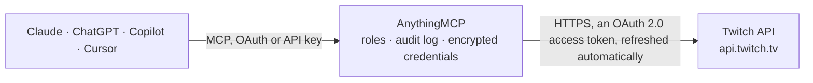

<!-- Generated by scripts/export-github-catalog.mjs in the anythingmcp-website repository. Do not edit by hand. -->

# Twitch MCP connector

Let your AI work with Twitch: look up channels, live streams, videos, clips, categories and stream schedules, search channels, see follower counts and chat settings, and create clips or change your … The AnythingMCP connector gives Claude, ChatGPT, Microsoft Copilot, Cursor and Gemini 15 MCP tools for Twitch: 12 read and 3 can change data.

**Category:** [Social Media](../social.md) · **Tools:** 15 · **Setup guide:** [anythingmcp.com](https://anythingmcp.com/guides/twitch-to-mcp) · [Deutsch](https://anythingmcp.com/de/guides/twitch-to-mcp) · [Italiano](https://anythingmcp.com/it/guides/twitch-to-mcp) · [Español](https://anythingmcp.com/es/guides/twitch-to-mcp) · [日本語](https://anythingmcp.com/ja/guides/twitch-to-mcp) · [Русский](https://anythingmcp.com/ru/guides/twitch-to-mcp) · [中文](https://anythingmcp.com/zh/guides/twitch-to-mcp)

## Start without code

No installation and no terminal: AnythingMCP Cloud runs the Twitch connector for you, operated by helpcode.ai in Frankfurt, Germany.

1. **Click the button above** and create an account or sign in. The Twitch connector opens, ready to install.
2. **Sign in with your Twitch account** when AnythingMCP asks. The first time, an admin creates a small app in the Twitch developer console. Every click is in the [step-by-step guide](https://anythingmcp.com/guides/twitch-to-mcp).
3. **Click Install.** AnythingMCP shows the address of your MCP server.
4. **Add that address to your assistant:** [Claude](https://anythingmcp.com/guides/connect-twitch-to-claude) · [ChatGPT](https://anythingmcp.com/guides/connect-twitch-to-chatgpt) · [Microsoft Copilot](https://anythingmcp.com/guides/connect-twitch-to-copilot) · [Cursor](https://anythingmcp.com/guides/connect-twitch-to-cursor) · [Gemini CLI](https://anythingmcp.com/guides/connect-twitch-to-gemini) · [Meta Muse](https://anythingmcp.com/guides/connect-twitch-to-muse).
5. **Ask your first question**, for example: *Find follower count for streamer 'pixelforge' and tell me if they're live right now*

Prefer help with the setup? [Talk to us](https://anythingmcp.com/contact).

## How it works

- **The AI client** speaks MCP (Streamable HTTP) to AnythingMCP and only sees tool names, descriptions and results. It never gets the Twitch credentials.
- **AnythingMCP** checks the client's role, builds the call from the tool definition, adds the credentials (an OAuth 2.0 access token, refreshed automatically), calls Twitch, logs the call and returns the result.
- **Twitch** sees an ordinary API client with the rights of the account the credentials belong to.

## Tools

| Tool | What it does | Access |
|---|---|---|
| [`twitch_get_users`](#twitch_get_users) | Look up Twitch users by id or login name: id, login, display name, broadcaster type (partner, affiliate or empty), description, profile image and creation date. | read |
| [`twitch_get_channel_info`](#twitch_get_channel_info) | Read channel information for one or more broadcasters: login, display name, language, current or last category (game), stream title, tags, content… | read |
| [`twitch_get_streams`](#twitch_get_streams) | List live streams, most viewers first: stream id, broadcaster, category, title, tags, viewer count, start time and language. | read |
| [`twitch_get_videos`](#twitch_get_videos) | List published videos (past broadcasts, highlights, uploads): id, title, description, creation and publish time, URL, view count, type, duration and language. | read |
| [`twitch_get_clips`](#twitch_get_clips) | List clips captured from streams, most viewed first: id, URL, broadcaster, creator, source video and offset, category, title, view count, creation time,… | read |
| [`twitch_get_games`](#twitch_get_games) | Look up categories (games) by id, exact name or IGDB id: id, name, IGDB id and box art URL. | read |
| [`twitch_get_top_games`](#twitch_get_top_games) | List the categories (games) with the most viewers right now: id, name, IGDB id and box art URL, most watched first. | read |
| [`twitch_search_channels`](#twitch_search_channels) | Search channels that streamed in the last 6 months by the start of their login name (or, with live_only, by name and category): id (the broadcaster id),… | read |
| [`twitch_search_categories`](#twitch_search_categories) | Search categories (games) whose name contains all words of the query: id, name and box art URL. | read |
| [`twitch_get_channel_followers`](#twitch_get_channel_followers) | Read how many users follow a channel (total) for any broadcaster. | read |
| [`twitch_get_schedule`](#twitch_get_schedule) | Read a broadcaster's stream schedule from now on (or from start_time): each segment's id, start and end time, title, category, whether it recurs weekly and… | read |
| [`twitch_get_chat_settings`](#twitch_get_chat_settings) | Read a channel's chat settings: emote-only, follower-only (and how long one must follow), slow mode wait time, subscriber-only and unique-chat mode. | read |
| [`twitch_create_clip`](#twitch_create_clip) | Create a clip from a channel that is live right now: Twitch captures up to the last 90 seconds and publishes a part of it (default 30 seconds). | write |
| [`twitch_update_channel`](#twitch_update_channel) | Change the signed-in broadcaster's channel: stream title, category (game_id), language, tags or the branded-content flag. | write |
| [`twitch_send_chat_announcement`](#twitch_send_chat_announcement) | Send a highlighted announcement to a channel's chat as the broadcaster or a moderator (up to 500 characters). | write |

## Tool reference

Every parameter as the AI client sees it in `tools/list`. Source: [`packages/backend/src/adapters/intl/twitch.json`](../../../packages/backend/src/adapters/intl/twitch.json).

### `twitch_get_users`

Look up Twitch users by id or login name: id, login, display name, broadcaster type (partner, affiliate or empty), description, profile image and creation date. Without ids or logins it returns the signed-in user, which is how to find your own user id (the broadcaster_id other tools ask for).

**Access:** read · **Call:** `GET /users`

| Parameter | Type | Required | Description |
|---|---|---|---|
| `id` | string[] | no | User ids to look up. At most 100; sent as repeated parameters. |
| `login` | string[] | no | Login names to look up, e.g. ["twitchdev"]. At most 100; sent as repeated parameters. |

### `twitch_get_channel_info`

Read channel information for one or more broadcasters: login, display name, language, current or last category (game), stream title, tags, content classification labels and branded-content flag.

**Access:** read · **Call:** `GET /channels`

| Parameter | Type | Required | Description |
|---|---|---|---|
| `broadcaster_id` | string[] | yes | Broadcaster user ids (from twitch_get_users or twitch_search_channels). At most 100; sent as repeated parameters. |

### `twitch_get_streams`

List live streams, most viewers first: stream id, broadcaster, category, title, tags, viewer count, start time and language. Filter by user ids, logins, game ids or language; without filters it lists the top live streams on Twitch. A broadcaster who is offline is simply missing from the list.

**Access:** read · **Call:** `GET /streams`

| Parameter | Type | Required | Description |
|---|---|---|---|
| `user_id` | string[] | no | Only these broadcaster ids. At most 100; sent as repeated parameters. |
| `user_login` | string[] | no | Only these broadcaster logins. At most 100; sent as repeated parameters. |
| `game_id` | string[] | no | Only streams in these categories (game ids from twitch_search_categories). At most 100; sent as repeated parameters. |
| `language` | string[] | no | Only these languages, ISO 639-1 codes such as de or en. At most 100; sent as repeated parameters. |
| `type` | `all` \| `live` | no | all (default) or live. |
| `first` | integer | no | Items per page, 1 to 100 (default 20). |
| `after` | string | no | Cursor from pagination.cursor of the previous page, to get the next page. |
| `before` | string | no | Cursor from pagination.cursor, to get the previous page. |

### `twitch_get_videos`

List published videos (past broadcasts, highlights, uploads): id, title, description, creation and publish time, URL, view count, type, duration and language. Give exactly one of id, user_id or game_id; period, sort and type only apply with user_id or game_id, language only with game_id.

**Access:** read · **Call:** `GET /videos`

| Parameter | Type | Required | Description |
|---|---|---|---|
| `id` | string[] | no | Video ids. At most 100; sent as repeated parameters. |
| `user_id` | string | no | Broadcaster id whose videos to list. |
| `game_id` | string | no | Category (game) id; returns at most 500 videos. |
| `language` | string | no | ISO 639-1 language filter, only with game_id. |
| `period` | `all` \| `day` \| `week` \| `month` | no | all (default), day, week or month. |
| `sort` | `time` \| `trending` \| `views` | no | time (default, newest first), trending or views. |
| `type` | `all` \| `archive` \| `highlight` \| `upload` | no | all (default), archive (past broadcasts), highlight or upload. |
| `first` | integer | no | Items per page, 1 to 100 (default 20). |
| `after` | string | no | Cursor for the next page (user_id only). |
| `before` | string | no | Cursor for the previous page (user_id only). |

### `twitch_get_clips`

List clips captured from streams, most viewed first: id, URL, broadcaster, creator, source video and offset, category, title, view count, creation time, duration and featured flag. Give exactly one of broadcaster_id, game_id or id. Without a date range Twitch looks at all time; ended_at defaults to started_at plus one week.

**Access:** read · **Call:** `GET /clips`

| Parameter | Type | Required | Description |
|---|---|---|---|
| `broadcaster_id` | string | no | Broadcaster id whose clips to list. |
| `game_id` | string | no | Category (game) id whose clips to list. |
| `id` | string[] | no | Clip ids. At most 100; sent as repeated parameters. |
| `started_at` | string | no | Start of the creation window, RFC 3339, e.g. 2026-10-01T00:00:00Z. |
| `ended_at` | string | no | End of the window, RFC 3339. |
| `is_featured` | boolean | no | true only featured clips, false only non-featured; leave empty for all. |
| `first` | integer | no | Items per page, 1 to 100 (default 20). |
| `after` | string | no | Cursor from pagination.cursor of the previous page, to get the next page. |
| `before` | string | no | Cursor from pagination.cursor, to get the previous page. |

### `twitch_get_games`

Look up categories (games) by id, exact name or IGDB id: id, name, IGDB id and box art URL. For a partial name use twitch_search_categories.

**Access:** read · **Call:** `GET /games`

| Parameter | Type | Required | Description |
|---|---|---|---|
| `id` | string[] | no | Category ids. At most 100; sent as repeated parameters. |
| `name` | string[] | no | Exact category names, e.g. ["Just Chatting"]. At most 100; sent as repeated parameters. |
| `igdb_id` | string[] | no | IGDB game ids. At most 100; sent as repeated parameters. |

### `twitch_get_top_games`

List the categories (games) with the most viewers right now: id, name, IGDB id and box art URL, most watched first.

**Access:** read · **Call:** `GET /games/top`

| Parameter | Type | Required | Description |
|---|---|---|---|
| `first` | integer | no | Items per page, 1 to 100 (default 20). |
| `after` | string | no | Cursor from pagination.cursor of the previous page, to get the next page. |
| `before` | string | no | Cursor from pagination.cursor, to get the previous page. |

### `twitch_search_channels`

Search channels that streamed in the last 6 months by the start of their login name (or, with live_only, by name and category): id (the broadcaster id), login, display name, language, category, live flag, title, tags and start time.

**Access:** read · **Call:** `GET /search/channels`

| Parameter | Type | Required | Description |
|---|---|---|---|
| `query` | string | yes | Search text, e.g. a channel name. |
| `live_only` | boolean | no | true to return only channels that are live now (default false). |
| `first` | integer | no | Items per page, 1 to 100 (default 20). |
| `after` | string | no | Cursor from pagination.cursor of the previous page, to get the next page. |

### `twitch_search_categories`

Search categories (games) whose name contains all words of the query: id, name and box art URL.

**Access:** read · **Call:** `GET /search/categories`

| Parameter | Type | Required | Description |
|---|---|---|---|
| `query` | string | yes | Search text, e.g. "just chat". |
| `first` | integer | no | Items per page, 1 to 100 (default 20). |
| `after` | string | no | Cursor from pagination.cursor of the previous page, to get the next page. |

### `twitch_get_channel_followers`

Read how many users follow a channel (total) for any broadcaster. For your own channel, or one you moderate, it also lists the followers (user id, login, name, followed_at), newest first; user_id checks whether one user follows.

**Access:** read · **Call:** `GET /channels/followers`

| Parameter | Type | Required | Description |
|---|---|---|---|
| `broadcaster_id` | string | yes | Broadcaster id of the channel. |
| `user_id` | string | no | Optional: check whether this user follows (own or moderated channel only). |
| `first` | integer | no | Items per page, 1 to 100 (default 20). |
| `after` | string | no | Cursor from pagination.cursor of the previous page, to get the next page. |

### `twitch_get_schedule`

Read a broadcaster's stream schedule from now on (or from start_time): each segment's id, start and end time, title, category, whether it recurs weekly and whether it is cancelled, plus any vacation. Twitch answers 404 when the broadcaster has no schedule.

**Access:** read · **Call:** `GET /schedule`

| Parameter | Type | Required | Description |
|---|---|---|---|
| `broadcaster_id` | string | yes | Broadcaster id. |
| `id` | string[] | no | Only these segment ids. At most 100; sent as repeated parameters. |
| `start_time` | string | no | Start of the period, RFC 3339 in UTC, e.g. 2026-10-20T00:00:00Z. |
| `first` | integer | no | Segments per page, 1 to 25 (default 20). |
| `after` | string | no | Cursor from pagination.cursor of the previous page, to get the next page. |

### `twitch_get_chat_settings`

Read a channel's chat settings: emote-only, follower-only (and how long one must follow), slow mode wait time, subscriber-only and unique-chat mode.

**Access:** read · **Call:** `GET /chat/settings`

| Parameter | Type | Required | Description |
|---|---|---|---|
| `broadcaster_id` | string | yes | Broadcaster id of the channel. |

### `twitch_create_clip`

Create a clip from a channel that is live right now: Twitch captures up to the last 90 seconds and publishes a part of it (default 30 seconds). Returns the clip id and an edit_url (valid 24 hours) to trim and title it. Before calling, show the user exactly what will happen and wait for their yes. Creation is asynchronous: check with twitch_get_clips after a few seconds; Twitch answers 404 when the channel is offline.

**Access:** write · **Call:** `POST /clips`

| Parameter | Type | Required | Description |
|---|---|---|---|
| `broadcaster_id` | string | yes | Broadcaster id of the live channel. |
| `title` | string | no | Optional clip title. |
| `duration` | number | no | Clip length in seconds, 5 to 60 (default 30). |

### `twitch_update_channel`

Change the signed-in broadcaster's channel: stream title, category (game_id), language, tags or the branded-content flag. Only your own channel can be changed. Before calling, show the user exactly what will happen and wait for their yes. Viewers see the change at once. Returns nothing on success.

**Access:** write · **Call:** `PATCH /channels`

| Parameter | Type | Required | Description |
|---|---|---|---|
| `broadcaster_id` | string | yes | Your own broadcaster id (twitch_get_users without arguments). |
| `title` | string | no | New stream title, up to 140 characters; cannot be empty. |
| `game_id` | string | no | Category id from twitch_search_categories; "0" removes the category. |
| `broadcaster_language` | string | no | ISO 639-1 language code, e.g. de, or other. |
| `tags` | string[] | no | Up to 10 tags, each up to 25 characters without spaces or special characters. An empty list removes all tags. |
| `is_branded_content` | boolean | no | true when the stream contains branded content. |

### `twitch_send_chat_announcement`

Send a highlighted announcement to a channel's chat as the broadcaster or a moderator (up to 500 characters). Everyone in chat sees it at once. Before calling, show the user exactly what will happen and wait for their yes. Installed switched off; needs the extra scope moderator:manage:announcements.

**Access:** write · **Call:** `POST /chat/announcements`

| Parameter | Type | Required | Description |
|---|---|---|---|
| `broadcaster_id` | string | yes | Broadcaster id of the channel. |
| `moderator_id` | string | yes | Your own user id (the broadcaster's id when you are the broadcaster). |
| `message` | string | yes | Announcement text, up to 500 characters. |
| `color` | `primary` \| `blue` \| `green` \| `orange` \| `purple` | no | primary (default, the channel's accent color), blue, green, orange or purple. |

## Run it yourself

AnythingMCP is open source (AGPL-3.0). [Run it with Docker](../../../README.md#run-it-yourself), open **Connectors → Store**, pick **Twitch** and enter `TWITCH_CLIENT_ID`, `TWITCH_CLIENT_SECRET`, then add your MCP server URL to the AI client.

[← Social Media connectors](../social.md) · [All categories](../README.md)
