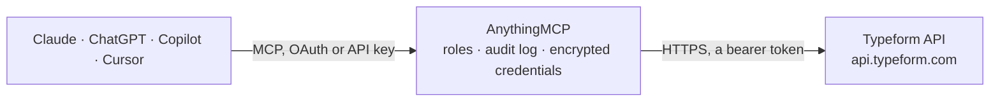

<!-- Generated by scripts/export-github-catalog.mjs in the anythingmcp-website repository. Do not edit by hand. -->

# Typeform MCP connector

Read Typeform responses, list forms, fetch form definitions and manage workspaces from any AI agent. 10 tools, Personal Token Bearer auth. The AnythingMCP connector gives Claude, ChatGPT, Microsoft Copilot, Cursor and Gemini 10 MCP tools for Typeform: 9 read and 1 can change data.

**Category:** [Forms & Surveys](../forms.md) · **Tools:** 10 · **Setup guide:** [anythingmcp.com](https://anythingmcp.com/guides/typeform-to-mcp) · [Deutsch](https://anythingmcp.com/de/guides/typeform-to-mcp) · [Italiano](https://anythingmcp.com/it/guides/typeform-to-mcp) · [Español](https://anythingmcp.com/es/guides/typeform-to-mcp) · [日本語](https://anythingmcp.com/ja/guides/typeform-to-mcp) · [Русский](https://anythingmcp.com/ru/guides/typeform-to-mcp) · [中文](https://anythingmcp.com/zh/guides/typeform-to-mcp)

## Start without code

No installation and no terminal: AnythingMCP Cloud runs the Typeform connector for you, operated by helpcode.ai in Frankfurt, Germany.

1. **Click the button above** and create an account or sign in. The Typeform connector opens, ready to install.
2. **Paste the API key or token from your Typeform account.** Every click is in the [step-by-step guide](https://anythingmcp.com/guides/typeform-to-mcp).
3. **Click Install.** AnythingMCP shows the address of your MCP server.
4. **Add that address to your assistant:** [Claude](https://anythingmcp.com/guides/connect-typeform-to-claude) · [ChatGPT](https://anythingmcp.com/guides/connect-typeform-to-chatgpt) · [Microsoft Copilot](https://anythingmcp.com/guides/connect-typeform-to-copilot) · [Cursor](https://anythingmcp.com/guides/connect-typeform-to-cursor) · [Gemini CLI](https://anythingmcp.com/guides/connect-typeform-to-gemini) · [Meta Muse](https://anythingmcp.com/guides/connect-typeform-to-muse).
5. **Ask your first question**, for example: *Do we have a response from Marin Logistics BV on form Wf2hrM submitted 2026-09-14?*

Prefer help with the setup? [Talk to us](https://anythingmcp.com/contact).

## How it works

- **The AI client** speaks MCP (Streamable HTTP) to AnythingMCP and only sees tool names, descriptions and results. It never gets the Typeform credentials.
- **AnythingMCP** checks the client's role, builds the call from the tool definition, adds the credentials (a bearer token), calls Typeform, logs the call and returns the result.
- **Typeform** sees an ordinary API client with the rights of the account the credentials belong to.

## Tools

| Tool | What it does | Access |
|---|---|---|
| [`typeform_get_current_user`](#typeform_get_current_user) | Return the user the personal token belongs to: email, alias, language. | read |
| [`typeform_list_forms`](#typeform_list_forms) | List forms (paginated). | read |
| [`typeform_get_form`](#typeform_get_form) | Fetch a form's full definition: title, fields[] (each with id, title, type, properties, ref, validations), thankyou_screens, welcome_screens, logic, settings. | read |
| [`typeform_list_responses`](#typeform_list_responses) | List responses (submissions) for a form, paginated. | read |
| [`typeform_delete_responses`](#typeform_delete_responses) | Delete responses by their IDs (max 1000 per call). | write |
| [`typeform_list_workspaces`](#typeform_list_workspaces) | List workspaces (folders for organizing forms). | read |
| [`typeform_get_workspace`](#typeform_get_workspace) | Fetch one workspace's full details including members[] and forms[] (URI list). | read |
| [`typeform_list_form_messages`](#typeform_list_form_messages) | Get the localized messages (button text, validation errors, etc.) configured on a form. | read |
| [`typeform_get_form_insights`](#typeform_get_form_insights) | Fetch aggregate insights (visits, submissions, completion_rate, average_time_to_complete, etc.) for a form. | read |
| [`typeform_list_themes`](#typeform_list_themes) | List visual themes (color/font/background combos) available on the account. | read |

## Tool reference

Every parameter as the AI client sees it in `tools/list`. Source: [`packages/backend/src/adapters/intl/typeform.json`](../../../packages/backend/src/adapters/intl/typeform.json).

### `typeform_get_current_user`

Return the user the personal token belongs to: email, alias, language. Health check + whoami.

**Access:** read · **Call:** `GET /me`

No parameters.

### `typeform_list_forms`

List forms (paginated). Returns each form's id, title, type, settings.is_public, _links.display URL, last_updated_at, workspace_id.

**Access:** read · **Call:** `GET /forms`

| Parameter | Type | Required | Description |
|---|---|---|---|
| `page` | integer | no | Page number (1-based, default 1). |
| `page_size` | integer | no | Forms per page (default 10, max 200). |
| `search` | string | no | Substring filter on form titles. |
| `workspace_id` | string | no | Only forms in this workspace. |

### `typeform_get_form`

Fetch a form's full definition: title, fields[] (each with id, title, type, properties, ref, validations), thankyou_screens, welcome_screens, logic, settings. Required to map answer field IDs to human-readable titles.

**Access:** read · **Call:** `GET /forms/{formId}`

| Parameter | Type | Required | Description |
|---|---|---|---|
| `formId` | string | yes | 8-char form ID. |

### `typeform_list_responses`

List responses (submissions) for a form, paginated. Each response: response_id, landed_at, submitted_at, hidden{utm_*}, answers[{field:{id,type,ref}, type, ...typed value...}], metadata{platform,browser,network_id}, calculated{score?}.

**Access:** read · **Call:** `GET /forms/{formId}/responses`

| Parameter | Type | Required | Description |
|---|---|---|---|
| `formId` | string | yes | Form ID. |
| `page_size` | integer | no | Responses per page (default 25, max 1000). |
| `since` | string | no | ISO 8601 — only responses with submitted_at >= this. Best for incremental sync. |
| `until` | string | no | ISO 8601 — submitted_at < this. |
| `after` | string | no | Token cursor — return responses after this token (from prior page). |
| `before` | string | no | Token cursor — return responses before this token. |
| `included_response_ids` | string | no | Comma-separated response_id list to bypass pagination and fetch specific ones. |
| `completed` | boolean | no | true=only completed, false=only partial, omit=all. |
| `sort` | string | no | Sort by submitted_at: 'submitted_at,asc' (oldest first) or 'submitted_at,desc' (default). |
| `query` | string | no | Full-text search across answers. |
| `fields` | string | no | Comma-separated field IDs to return only answers for these (reduces response size). |

### `typeform_delete_responses`

Delete responses by their IDs (max 1000 per call). Irreversible. Use for GDPR right-to-be-forgotten requests; for normal cleanup prefer keeping data.

**Access:** write · **Call:** `DELETE /forms/{formId}/responses`

| Parameter | Type | Required | Description |
|---|---|---|---|
| `formId` | string | yes | Form ID. |
| `included_response_ids` | string | yes | Comma-separated response IDs to delete. |

### `typeform_list_workspaces`

List workspaces (folders for organizing forms). Each workspace has id, name, default flag, members count, forms count, _links.self URL.

**Access:** read · **Call:** `GET /workspaces`

| Parameter | Type | Required | Description |
|---|---|---|---|
| `page` | integer | no | Page number. |
| `page_size` | integer | no | Per page (default 10). |

### `typeform_get_workspace`

Fetch one workspace's full details including members[] and forms[] (URI list).

**Access:** read · **Call:** `GET /workspaces/{workspaceId}`

| Parameter | Type | Required | Description |
|---|---|---|---|
| `workspaceId` | string | yes | Workspace ID. |

### `typeform_list_form_messages`

Get the localized messages (button text, validation errors, etc.) configured on a form. Useful when building a custom embed.

**Access:** read · **Call:** `GET /forms/{formId}/messages`

| Parameter | Type | Required | Description |
|---|---|---|---|
| `formId` | string | yes | Form ID. |

### `typeform_get_form_insights`

Fetch aggregate insights (visits, submissions, completion_rate, average_time_to_complete, etc.) for a form. Returns one summary block.

**Access:** read · **Call:** `GET /insights/{formId}/summary`

| Parameter | Type | Required | Description |
|---|---|---|---|
| `formId` | string | yes | Form ID. |

### `typeform_list_themes`

List visual themes (color/font/background combos) available on the account. Use to apply a theme when programmatically creating forms.

**Access:** read · **Call:** `GET /themes`

| Parameter | Type | Required | Description |
|---|---|---|---|
| `page` | integer | no | Page number. |
| `page_size` | integer | no | Per page. |

## Run it yourself

AnythingMCP is open source (AGPL-3.0). [Run it with Docker](../../../README.md#run-it-yourself), open **Connectors → Store**, pick **Typeform** and enter `TYPEFORM_PERSONAL_TOKEN`, then add your MCP server URL to the AI client.

[← Forms & Surveys connectors](../forms.md) · [All categories](../README.md)
