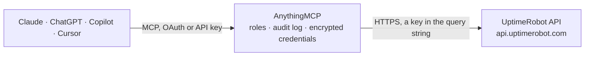

<!-- Generated by scripts/export-github-catalog.mjs in the anythingmcp-website repository. Do not edit by hand. -->

# UptimeRobot MCP connector

Manage UptimeRobot (uptime monitoring) monitors, alert contacts, maintenance windows, public status pages from any AI agent. 8 tools, API-key auth. The AnythingMCP connector gives Claude, ChatGPT, Microsoft Copilot, Cursor and Gemini 8 MCP tools for UptimeRobot: 5 read and 3 can change data.

**Category:** [Monitoring](../monitoring.md) · **Tools:** 8 · **Setup guide:** [anythingmcp.com](https://anythingmcp.com/guides/uptime-robot-to-mcp) · [Deutsch](https://anythingmcp.com/de/guides/uptime-robot-to-mcp) · [Italiano](https://anythingmcp.com/it/guides/uptime-robot-to-mcp) · [Español](https://anythingmcp.com/es/guides/uptime-robot-to-mcp) · [日本語](https://anythingmcp.com/ja/guides/uptime-robot-to-mcp) · [Русский](https://anythingmcp.com/ru/guides/uptime-robot-to-mcp) · [中文](https://anythingmcp.com/zh/guides/uptime-robot-to-mcp)

## Start without code

No installation and no terminal: AnythingMCP Cloud runs the UptimeRobot connector for you, operated by helpcode.ai in Frankfurt, Germany.

1. **Click the button above** and create an account or sign in. The UptimeRobot connector opens, ready to install.
2. **Paste the API key or token from your UptimeRobot account.** Every click is in the [step-by-step guide](https://anythingmcp.com/guides/uptime-robot-to-mcp).
3. **Click Install.** AnythingMCP shows the address of your MCP server.
4. **Add that address to your assistant:** [Claude](https://anythingmcp.com/guides/connect-uptime-robot-to-claude) · [ChatGPT](https://anythingmcp.com/guides/connect-uptime-robot-to-chatgpt) · [Microsoft Copilot](https://anythingmcp.com/guides/connect-uptime-robot-to-copilot) · [Cursor](https://anythingmcp.com/guides/connect-uptime-robot-to-cursor) · [Gemini CLI](https://anythingmcp.com/guides/connect-uptime-robot-to-gemini) · [Meta Muse](https://anythingmcp.com/guides/connect-uptime-robot-to-muse).
5. **Ask your first question**, for example: *Find the monitor record for 'PayRight Portal' (customer-facing portal) and give its id, URL and current status.*

Prefer help with the setup? [Talk to us](https://anythingmcp.com/contact).

## How it works

- **The AI client** speaks MCP (Streamable HTTP) to AnythingMCP and only sees tool names, descriptions and results. It never gets the UptimeRobot credentials.
- **AnythingMCP** checks the client's role, builds the call from the tool definition, adds the credentials (a key in the query string), calls UptimeRobot, logs the call and returns the result.
- **UptimeRobot** sees an ordinary API client with the rights of the account the credentials belong to.

## Tools

| Tool | What it does | Access |
|---|---|---|
| [`uptimerobot_get_account_details`](#uptimerobot_get_account_details) | Returns account info: email, monitor_limit, monitor_interval, up_monitors, down_monitors, paused_monitors. | read |
| [`uptimerobot_get_monitors`](#uptimerobot_get_monitors) | List monitors. | read |
| [`uptimerobot_new_monitor`](#uptimerobot_new_monitor) | Create a new monitor. | write |
| [`uptimerobot_edit_monitor`](#uptimerobot_edit_monitor) | Edit an existing monitor. | write |
| [`uptimerobot_delete_monitor`](#uptimerobot_delete_monitor) | Permanently delete a monitor. | write |
| [`uptimerobot_get_alert_contacts`](#uptimerobot_get_alert_contacts) | List configured alert contacts (email, webhook, Slack, Telegram, SMS). | read |
| [`uptimerobot_get_mwindows`](#uptimerobot_get_mwindows) | List maintenance windows. | read |
| [`uptimerobot_get_psps`](#uptimerobot_get_psps) | List public status pages (PSPs) configured for this account. | read |

## Tool reference

Every parameter as the AI client sees it in `tools/list`. Source: [`packages/backend/src/adapters/intl/uptime-robot.json`](../../../packages/backend/src/adapters/intl/uptime-robot.json).

### `uptimerobot_get_account_details`

Returns account info: email, monitor_limit, monitor_interval, up_monitors, down_monitors, paused_monitors.

**Access:** read · **Call:** `POST /getAccountDetails`

No parameters.

### `uptimerobot_get_monitors`

List monitors. Optional filters by id, status, search string. Use `logs=1` to include up/down event history; `response_times=1` for response-time series; both add latency.

**Access:** read · **Call:** `POST /getMonitors`

| Parameter | Type | Required | Description |
|---|---|---|---|
| `monitors` | string | no | Comma-separated monitor IDs to fetch (default: all). |
| `types` | string | no | Comma-separated type codes (1-5). |
| `statuses` | string | no | Comma-separated status codes (0,1,2,8,9). |
| `search` | string | no | Substring filter against friendly_name or url. |
| `logs` | integer | no | 1 to include event log; 0 to skip. |
| `response_times` | integer | no | 1 to include response time series. |
| `offset` | integer | no | Pagination offset (0-based). |
| `limit` | integer | no | Page size (max 50). |

### `uptimerobot_new_monitor`

Create a new monitor. `type` is required (1=HTTP, 2=Keyword, 3=Ping, 4=Port, 5=Heartbeat). For type=2 you must also supply `keyword_type` (1=exists, 2=not exists) + `keyword_value`.

**Access:** write · **Call:** `POST /newMonitor`

| Parameter | Type | Required | Description |
|---|---|---|---|
| `friendly_name` | string | yes | Display name. |
| `url` | string | yes | URL or IP to monitor. |
| `type` | integer | yes | 1=HTTP, 2=Keyword, 3=Ping, 4=Port, 5=Heartbeat. |
| `interval` | integer | no | Check interval in seconds (60-86400). Free plan minimum 300. |
| `timeout` | integer | no | Timeout in seconds. |
| `port` | integer | no | Port number (required if type=4). |
| `keyword_type` | integer | no | 1=exists, 2=not exists (required if type=2). |
| `keyword_value` | string | no | Keyword to look for (required if type=2). |
| `alert_contacts` | string | no | Format: '<contactId>_<threshold>_<recurrence>-<contactId2>_..'. |

### `uptimerobot_edit_monitor`

Edit an existing monitor. Pass `id` + any field you want to update.

**Access:** write · **Call:** `POST /editMonitor`

| Parameter | Type | Required | Description |
|---|---|---|---|
| `id` | integer | yes | Monitor ID. |
| `friendly_name` | string | no | New display name. |
| `url` | string | no | New URL. |
| `interval` | integer | no | New check interval. |
| `status` | integer | no | 0 to pause, 1 to resume. |

### `uptimerobot_delete_monitor`

Permanently delete a monitor. Irreversible.

**Access:** write · **Call:** `POST /deleteMonitor`

| Parameter | Type | Required | Description |
|---|---|---|---|
| `id` | integer | yes | Monitor ID. |

### `uptimerobot_get_alert_contacts`

List configured alert contacts (email, webhook, Slack, Telegram, SMS).

**Access:** read · **Call:** `POST /getAlertContacts`

| Parameter | Type | Required | Description |
|---|---|---|---|
| `alert_contacts` | string | no | Comma-separated IDs (default: all). |
| `offset` | integer | no | Pagination offset. |
| `limit` | integer | no | Page size. |

### `uptimerobot_get_mwindows`

List maintenance windows.

**Access:** read · **Call:** `POST /getMWindows`

| Parameter | Type | Required | Description |
|---|---|---|---|
| `mwindows` | string | no | Comma-separated maintenance window IDs (default: all). |

### `uptimerobot_get_psps`

List public status pages (PSPs) configured for this account.

**Access:** read · **Call:** `POST /getPSPs`

| Parameter | Type | Required | Description |
|---|---|---|---|
| `psps` | string | no | Comma-separated PSP IDs (default: all). |

## Run it yourself

AnythingMCP is open source (AGPL-3.0). [Run it with Docker](../../../README.md#run-it-yourself), open **Connectors → Store**, pick **UptimeRobot** and enter `UPTIMEROBOT_API_KEY`, then add your MCP server URL to the AI client.

[← Monitoring connectors](../monitoring.md) · [All categories](../README.md)
