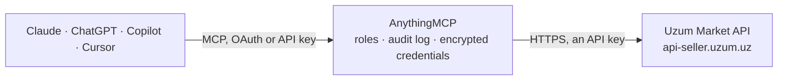

<!-- Generated by scripts/export-github-catalog.mjs in the anythingmcp-website repository. Do not edit by hand. -->

# Uzum Market MCP connector

Manage an Uzum Market (Uzbekistan) seller account from an AI agent: shops, products and SKUs, FBS and DBS orders, stock, prices, sales and seller expenses, supply and return invoices. 16 tools on the … The AnythingMCP connector gives Claude, ChatGPT, Microsoft Copilot, Cursor and Gemini 16 MCP tools for Uzum Market: 12 read and 4 can change data.

**Category:** [E-commerce](../e-commerce.md) · **Tools:** 16 · **Setup guide:** [anythingmcp.com](https://anythingmcp.com/guides/uzum-market-to-mcp) · [Deutsch](https://anythingmcp.com/de/guides/uzum-market-to-mcp) · [Italiano](https://anythingmcp.com/it/guides/uzum-market-to-mcp) · [Español](https://anythingmcp.com/es/guides/uzum-market-to-mcp) · [日本語](https://anythingmcp.com/ja/guides/uzum-market-to-mcp) · [Русский](https://anythingmcp.com/ru/guides/uzum-market-to-mcp) · [中文](https://anythingmcp.com/zh/guides/uzum-market-to-mcp)

## Start without code

No installation and no terminal: AnythingMCP Cloud runs the Uzum Market connector for you, operated by helpcode.ai in Frankfurt, Germany.

1. **Click the button above** and create an account or sign in. The Uzum Market connector opens, ready to install.
2. **Paste the API key or token from your Uzum Market account.** Every click is in the [step-by-step guide](https://anythingmcp.com/guides/uzum-market-to-mcp).
3. **Click Install.** AnythingMCP shows the address of your MCP server.
4. **Add that address to your assistant:** [Claude](https://anythingmcp.com/guides/connect-uzum-market-to-claude) · [ChatGPT](https://anythingmcp.com/guides/connect-uzum-market-to-chatgpt) · [Microsoft Copilot](https://anythingmcp.com/guides/connect-uzum-market-to-copilot) · [Cursor](https://anythingmcp.com/guides/connect-uzum-market-to-cursor) · [Gemini CLI](https://anythingmcp.com/guides/connect-uzum-market-to-gemini) · [Meta Muse](https://anythingmcp.com/guides/connect-uzum-market-to-muse).
5. **Ask your first question**, for example: *Show me order 2026-ORD-00421 details — buyer info and acceptUntil for that order*

Prefer help with the setup? [Talk to us](https://anythingmcp.com/contact).

## How it works

- **The AI client** speaks MCP (Streamable HTTP) to AnythingMCP and only sees tool names, descriptions and results. It never gets the Uzum Market credentials.
- **AnythingMCP** checks the client's role, builds the call from the tool definition, adds the credentials (an API key), calls Uzum Market, logs the call and returns the result.
- **Uzum Market** sees an ordinary API client with the rights of the account the credentials belong to.

## Tools

| Tool | What it does | Access |
|---|---|---|
| [`uzum_market_list_shops`](#uzum_market_list_shops) | List the seller's own shops (id and name). | read |
| [`uzum_market_list_products`](#uzum_market_list_products) | List the products of one shop with their SKUs: product id, category, status, moderation, commission, and per SKU the skuId, barcode, price and stock… | read |
| [`uzum_market_list_orders`](#uzum_market_list_orders) | List FBS and DBS orders of one or more shops in one status (default CREATED, the new orders to confirm): id, status, dates, acceptUntil and deliverUntil… | read |
| [`uzum_market_count_orders`](#uzum_market_count_orders) | Count FBS orders by status (default CREATED), shop and date range. | read |
| [`uzum_market_get_order`](#uzum_market_get_order) | Get one FBS or DBS order by id: status and all status dates, deadlines, price, items, invoice number, time slot, drop-off point and, for DBS, delivery info. | read |
| [`uzum_market_confirm_order`](#uzum_market_confirm_order) | Confirm a new (CREATED) FBS or DBS order so it moves to packing. | write |
| [`uzum_market_cancel_order`](#uzum_market_cancel_order) | Cancel an FBS or DBS order with a reason (for example OUT_OF_STOCK). | write |
| [`uzum_market_list_cancel_reasons`](#uzum_market_list_cancel_reasons) | List the reason codes Uzum accepts when an order is cancelled or returned (OUT_OF_STOCK, OUT_OF_TIME, OTHER, ...). | read |
| [`uzum_market_list_stocks`](#uzum_market_list_stocks) | List FBS and DBS stock per SKU across the seller's shops: skuId, titles, barcode, amount, and whether FBS or DBS is allowed and linked. | read |
| [`uzum_market_update_stocks`](#uzum_market_update_stocks) | Set the FBS and DBS stock of one or more SKUs. | write |
| [`uzum_market_update_prices`](#uzum_market_update_prices) | Change the full price and sale price of the SKUs of one product in a shop. | write |
| [`uzum_market_list_sales`](#uzum_market_list_sales) | List sold order items of one or more shops from the finance section: order and item, price, quantity, commission, seller profit, status (TO_WITHDRAW,… | read |
| [`uzum_market_list_expenses`](#uzum_market_list_expenses) | List the seller's expenses charged by Uzum (logistics, storage, services and other payments): name, source, shop, amount, price, status and dates, as… | read |
| [`uzum_market_list_supply_invoices`](#uzum_market_list_supply_invoices) | List FBO supply invoices (deliveries of goods to Uzum warehouses) of one shop: invoice number, status, dates, quantities sent and accepted, and price. | read |
| [`uzum_market_list_fbs_invoices`](#uzum_market_list_fbs_invoices) | List FBS invoices (hand-over documents that group FBS orders for a drop-off point) by status: number, status, order counts, prices, drop-off point and time… | read |
| [`uzum_market_list_returns`](#uzum_market_list_returns) | List the seller's return invoices (goods coming back from Uzum warehouses: defects, returns, FBS): id, type, status, dates and returned SKUs with amounts. | read |

## Tool reference

Every parameter as the AI client sees it in `tools/list`. Source: [`packages/backend/src/adapters/intl/uzum-market.json`](../../../packages/backend/src/adapters/intl/uzum-market.json).

### `uzum_market_list_shops`

List the seller's own shops (id and name). Call this first: the shop id is needed by the product, order, price, sales and invoice tools. A shop listed here can still answer 500 on every other tool when the token has no rights on it; then query the shops one at a time.

**Access:** read · **Call:** `GET /v1/shops`

No parameters.

### `uzum_market_list_products`

List the products of one shop with their SKUs: product id, category, status, moderation, commission, and per SKU the skuId, barcode, price and stock quantities (active, FBS, sold, returned). Paginated by page and size.

**Access:** read · **Call:** `GET /v1/product/shop/{shop_id}`

| Parameter | Type | Required | Description |
|---|---|---|---|
| `shop_id` | integer | yes | Shop id from uzum_market_list_shops. |
| `size` | integer | yes | Products per page, for example 20. |
| `page` | integer | yes | Page number, starting at 0. |
| `search_query` | string | no | Search text matched against product title and description. |
| `filter` | `ALL` \| `ACTIVE` \| `INACTIVE` \| `WARNING` \| `WITH_SKU` \| `ARCHIVE` \| `DEFECTED` \| `WITHOUT_REQUIRED_FILTERS` | no | Product filter. Default ALL. |
| `sort_by` | `DEFAULT` \| `ORDERS` \| `PRICE` \| `ID` \| `ROI` \| `CONVERSION` \| `LEFTOVERS` \| `CREATED_AND_TITLE` | no | Sort criterion. Default DEFAULT. |
| `order` | `ASC` \| `DESC` | no | Sort direction. Default ASC. |
| `product_rank` | `A` \| `B` \| `C` \| `N` \| `D` | no | Optional ABC rank of products to show. |

### `uzum_market_list_orders`

List FBS and DBS orders of one or more shops in one status (default CREATED, the new orders to confirm): id, status, dates, acceptUntil and deliverUntil deadlines, price, items, drop-off point and delivery info. Up to 50 per page.

**Access:** read · **Call:** `GET /v2/fbs/orders`

| Parameter | Type | Required | Description |
|---|---|---|---|
| `shop_ids` | integer[] | yes | Shop ids from uzum_market_list_shops, for example [12345]. |
| `status` | `CREATED` \| `PACKING` \| `PENDING_DELIVERY` \| `DELIVERING` \| `DELIVERED` \| `ACCEPTED_AT_DP` \| `DELIVERED_TO_CUSTOMER_DELIVERY_POINT` \| `COMPLETED` \| `CANCELED` \| `PENDING_CANCELLATION` \| `RETURNED` | no | Order status to list. Default CREATED. |
| `scheme` | `FBS` \| `DBS` | no | Fulfilment scheme. Omit for both FBS and DBS. |
| `date_from` | integer | no | Only orders from this moment, Unix time in milliseconds. |
| `date_to` | integer | no | Only orders up to this moment, Unix time in milliseconds. |
| `page` | integer | no | Page number, starting at 0. |
| `size` | integer | no | Orders per page, at most 50. Default 20. |

### `uzum_market_count_orders`

Count FBS orders by status (default CREATED), shop and date range. A cheap way to see how many new orders wait for confirmation before listing them.

**Access:** read · **Call:** `GET /v2/fbs/orders/count`

| Parameter | Type | Required | Description |
|---|---|---|---|
| `shop_ids` | integer[] | no | Optional shop ids from uzum_market_list_shops. Omit for all shops. |
| `status` | `CREATED` \| `PACKING` \| `PENDING_DELIVERY` \| `DELIVERING` \| `DELIVERED` \| `ACCEPTED_AT_DP` \| `DELIVERED_TO_CUSTOMER_DELIVERY_POINT` \| `COMPLETED` \| `CANCELED` \| `PENDING_CANCELLATION` \| `RETURNED` | no | Order status to count. Default CREATED. |
| `date_from` | integer | no | Only orders from this moment, Unix time in milliseconds. |
| `date_to` | integer | no | Only orders up to this moment, Unix time in milliseconds. |

### `uzum_market_get_order`

Get one FBS or DBS order by id: status and all status dates, deadlines, price, items, invoice number, time slot, drop-off point and, for DBS, delivery info.

**Access:** read · **Call:** `GET /v1/fbs/order/{order_id}`

| Parameter | Type | Required | Description |
|---|---|---|---|
| `order_id` | integer | yes | Order id from uzum_market_list_orders. |

### `uzum_market_confirm_order`

Confirm a new (CREATED) FBS or DBS order so it moves to packing. Must happen before the order's acceptUntil time. Returns the updated order.

**Access:** write · **Call:** `POST /v1/fbs/order/{order_id}/confirm`

| Parameter | Type | Required | Description |
|---|---|---|---|
| `order_id` | integer | yes | Id of the order to confirm, from uzum_market_list_orders. |

### `uzum_market_cancel_order`

Cancel an FBS or DBS order with a reason (for example OUT_OF_STOCK). Cannot be undone, and cancellations affect the seller's rating.

**Access:** write · **Call:** `POST /v1/fbs/order/{order_id}/cancel`

| Parameter | Type | Required | Description |
|---|---|---|---|
| `order_id` | integer | yes | Id of the order to cancel. |
| `reason` | `OUT_OF_STOCK` \| `OUT_OF_PACKAGE` \| `OUT_OF_TIME` \| `OTHER` \| `ACCEPTANCE_TIME_EXPIRED` \| `DELIVERY_TIME_EXPIRED` \| `RETURNED_BY_CUSTOMER` \| `CANCELED_BY_CUSTOMER` \| `MARKET_REASON` | yes | Cancellation reason. See uzum_market_list_cancel_reasons. |
| `comment` | string | no | Optional free-text comment. |

### `uzum_market_list_cancel_reasons`

List the reason codes Uzum accepts when an order is cancelled or returned (OUT_OF_STOCK, OUT_OF_TIME, OTHER, ...). Reference data for uzum_market_cancel_order.

**Access:** read · **Call:** `GET /v1/fbs/order/return-reasons`

No parameters.

### `uzum_market_list_stocks`

List FBS and DBS stock per SKU across the seller's shops: skuId, titles, barcode, amount, and whether FBS or DBS is allowed and linked. Page mode (newest skuId first) or cursor mode with sku_id_from (ascending, recommended for a full read).

**Access:** read · **Call:** `GET /v3/fbs/sku/stocks`

| Parameter | Type | Required | Description |
|---|---|---|---|
| `page` | integer | no | Page number starting at 0. Do not combine with sku_id_from. |
| `size` | integer | no | SKUs per page, 1 to 100. Default 50. |
| `sku_id_from` | integer | no | Cursor: return SKUs with skuId greater than this, ascending. 0 for the first page, then the skuId of the last item. Do not combine with page. |

### `uzum_market_update_stocks`

Set the FBS and DBS stock of one or more SKUs. Each entry overwrites the amount of the SKU identified by its Uzum barcode. Changes what buyers can order; read back with uzum_market_list_stocks.

**Access:** write · **Call:** `POST /v2/fbs/sku/stocks`

| Parameter | Type | Required | Description |
|---|---|---|---|
| `items` | object[] | yes | SKU stock entries, for example [{"barcode": "2000000123456", "amount": 10}]. barcode and amount are required; skuId may be added. |

### `uzum_market_update_prices`

Change the full price and sale price of the SKUs of one product in a shop. Prices are in Uzbek som. Changes live prices; check them afterwards with uzum_market_list_products.

**Access:** write · **Call:** `POST /v1/product/{shop_id}/sendPriceData`

| Parameter | Type | Required | Description |
|---|---|---|---|
| `shop_id` | integer | yes | Shop id from uzum_market_list_shops. |
| `product_id` | integer | yes | Product id from uzum_market_list_products. |
| `skus` | object[] | yes | SKUs of that product with their new prices, for example [{"skuId": 111, "fullPrice": 150000, "sellPrice": 120000}]. |

### `uzum_market_list_sales`

List sold order items of one or more shops from the finance section: order and item, price, quantity, commission, seller profit, status (TO_WITHDRAW, PROCESSING, CANCELED, PARTIALLY_CANCELLED) and dates. Use for revenue and payout questions.

**Access:** read · **Call:** `GET /v1/finance/orders`

| Parameter | Type | Required | Description |
|---|---|---|---|
| `shop_ids` | integer[] | yes | Shop ids from uzum_market_list_shops. |
| `date_from` | integer | no | From this moment, Unix time in milliseconds. |
| `date_to` | integer | no | Up to this moment, Unix time in milliseconds. |
| `statuses` | `TO_WITHDRAW` \| `PROCESSING` \| `CANCELED` \| `PARTIALLY_CANCELLED`[] | no | Optional status filter. |
| `group` | boolean | no | true groups items by product; false (default) returns one row per order item. |
| `page` | integer | no | Page number, starting at 0. |
| `size` | integer | no | Rows per page. Default 20. |

### `uzum_market_list_expenses`

List the seller's expenses charged by Uzum (logistics, storage, services and other payments): name, source, shop, amount, price, status and dates, as OUTCOME or INCOME. Filter by shop, period and source.

**Access:** read · **Call:** `GET /v1/finance/expenses`

| Parameter | Type | Required | Description |
|---|---|---|---|
| `shop_ids` | integer[] | no | Optional shop ids from uzum_market_list_shops. |
| `date_from` | integer | no | From this moment, Unix time in milliseconds. |
| `date_to` | integer | no | Up to this moment, Unix time in milliseconds. |
| `sources` | string[] | no | Optional expense sources to filter by, as returned in the source field. |
| `page` | integer | no | Page number, starting at 0. |
| `size` | integer | no | Rows per page. Default 20. |

### `uzum_market_list_supply_invoices`

List FBO supply invoices (deliveries of goods to Uzum warehouses) of one shop: invoice number, status, dates, quantities sent and accepted, and price.

**Access:** read · **Call:** `GET /v1/shop/{shop_id}/invoice`

| Parameter | Type | Required | Description |
|---|---|---|---|
| `shop_id` | integer | yes | Shop id from uzum_market_list_shops. |
| `page` | integer | no | Page number, starting at 0. |
| `size` | integer | no | Invoices per page, for example 20. |

### `uzum_market_list_fbs_invoices`

List FBS invoices (hand-over documents that group FBS orders for a drop-off point) by status: number, status, order counts, prices, drop-off point and time slot. Up to 20 per page.

**Access:** read · **Call:** `GET /v1/fbs/invoice`

| Parameter | Type | Required | Description |
|---|---|---|---|
| `statuses` | `CREATED` \| `ACCEPTANCE_IN_PROGRESS` \| `CANCELLED` \| `ACCEPTED`[] | yes | Invoice statuses to list, for example ["CREATED"]. |
| `page` | integer | no | Page number, starting at 0. |
| `size` | integer | no | Invoices per page, at most 20. |
| `language` | `ru` \| `uz` | no | Language of status texts: uz (default) or ru. |

### `uzum_market_list_returns`

List the seller's return invoices (goods coming back from Uzum warehouses: defects, returns, FBS): id, type, status, dates and returned SKUs with amounts. One return via return_id.

**Access:** read · **Call:** `GET /v1/return`

| Parameter | Type | Required | Description |
|---|---|---|---|
| `return_id` | integer | no | Optional return id; omit to list all returns. |
| `page` | integer | no | Page number, starting at 0. |
| `size` | integer | no | Returns per page, at most 50. |

## Run it yourself

AnythingMCP is open source (AGPL-3.0). [Run it with Docker](../../../README.md#run-it-yourself), open **Connectors → Store**, pick **Uzum Market** and enter `UZUM_API_TOKEN`, then add your MCP server URL to the AI client.

[← E-commerce connectors](../e-commerce.md) · [All categories](../README.md)
