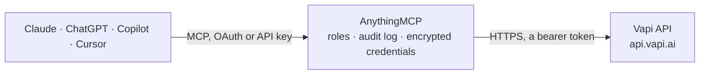

<!-- Generated by scripts/export-github-catalog.mjs in the anythingmcp-website repository. Do not edit by hand. -->

# Vapi MCP connector

Let your AI work with Vapi voice agents: read and change assistants and squads, review calls with transcripts, recordings, analysis and costs, start outbound phone calls, route phone numbers, test … The AnythingMCP connector gives Claude, ChatGPT, Microsoft Copilot, Cursor and Gemini 26 MCP tools for Vapi: 20 read and 6 can change data.

**Category:** [Messaging](../messaging.md) · **Tools:** 26 · **Setup guide:** [anythingmcp.com](https://anythingmcp.com/guides/vapi-to-mcp) · [Deutsch](https://anythingmcp.com/de/guides/vapi-to-mcp) · [Italiano](https://anythingmcp.com/it/guides/vapi-to-mcp) · [Español](https://anythingmcp.com/es/guides/vapi-to-mcp) · [日本語](https://anythingmcp.com/ja/guides/vapi-to-mcp) · [Русский](https://anythingmcp.com/ru/guides/vapi-to-mcp) · [中文](https://anythingmcp.com/zh/guides/vapi-to-mcp)

## Start without code

No installation and no terminal: AnythingMCP Cloud runs the Vapi connector for you, operated by helpcode.ai in Frankfurt, Germany.

1. **Click the button above** and create an account or sign in. The Vapi connector opens, ready to install.
2. **Paste the API key or token from your Vapi account.** Every click is in the [step-by-step guide](https://anythingmcp.com/guides/vapi-to-mcp).
3. **Click Install.** AnythingMCP shows the address of your MCP server.
4. **Add that address to your assistant:** [Claude](https://anythingmcp.com/guides/connect-vapi-to-claude) · [ChatGPT](https://anythingmcp.com/guides/connect-vapi-to-chatgpt) · [Microsoft Copilot](https://anythingmcp.com/guides/connect-vapi-to-copilot) · [Cursor](https://anythingmcp.com/guides/connect-vapi-to-cursor) · [Gemini CLI](https://anythingmcp.com/guides/connect-vapi-to-gemini) · [Meta Muse](https://anythingmcp.com/guides/connect-vapi-to-muse).
5. **Ask your first question**, for example: *Find the most recent call to +491521234567 handled by assistant SolarSupport that ended as voicemail in October 2026*

Prefer help with the setup? [Talk to us](https://anythingmcp.com/contact).

## How it works

- **The AI client** speaks MCP (Streamable HTTP) to AnythingMCP and only sees tool names, descriptions and results. It never gets the Vapi credentials.
- **AnythingMCP** checks the client's role, builds the call from the tool definition, adds the credentials (a bearer token), calls Vapi, logs the call and returns the result.
- **Vapi** sees an ordinary API client with the rights of the account the credentials belong to.

## Tools

| Tool | What it does | Access |
|---|---|---|
| [`vapi_list_assistants`](#vapi_list_assistants) | List the voice assistants of the Vapi organization, newest first: id, name, firstMessage, model provider and model, voice, transcriber, createdAt. | read |
| [`vapi_get_assistant`](#vapi_get_assistant) | Full configuration of one assistant: model with the system prompt (model.messages) and tool ids, voice, transcriber, first message, voicemail and end-call… | read |
| [`vapi_create_assistant`](#vapi_create_assistant) | Create a voice assistant. | write |
| [`vapi_update_assistant`](#vapi_update_assistant) | Change an assistant. | write |
| [`vapi_list_squads`](#vapi_list_squads) | List squads (groups of assistants that hand calls over to each other), newest first: id, name, members with their assistantId and transfer destinations. | read |
| [`vapi_get_squad`](#vapi_get_squad) | One squad with its members, their assistant ids or inline assistants, and member overrides. | read |
| [`vapi_list_calls`](#vapi_list_calls) | List calls, newest first: id, type (inboundPhoneCall, outboundPhoneCall, webCall), status, endedReason, assistantId, squadId, phoneNumberId, customer… | read |
| [`vapi_get_call`](#vapi_get_call) | One call in full: status, endedReason, customer, timings, cost and costBreakdown (USD), analysis (summary, structuredData, successEvaluation), and artifact… | read |
| [`vapi_get_call_logs`](#vapi_get_call_logs) | Download the debug log file of one ended call (all logging output of the pipeline: transcriber, model, voice, tool calls, errors). | read |
| [`vapi_create_call`](#vapi_create_call) | Start a real outbound phone call: Vapi dials customer_number from one of your Vapi phone numbers and the assistant (or squad) talks to the person. | write |
| [`vapi_list_phone_numbers`](#vapi_list_phone_numbers) | List the organization's phone numbers (Vapi numbers and imported Twilio, Vonage, Telnyx or SIP numbers): id, number, name, provider, status, the… | read |
| [`vapi_get_phone_number`](#vapi_get_phone_number) | One phone number with its provider, status, inbound assistant, squad or workflow, fallback destination and server settings. | read |
| [`vapi_update_phone_number`](#vapi_update_phone_number) | Change who answers a phone number or its name: set assistant_id or squad_id for inbound calls, a fallback_destination, or the server URL. | write |
| [`vapi_list_tools`](#vapi_list_tools) | List the tools assistants can call during a call (function, apiRequest, transferCall, endCall, dtmf, query, mcp, integrations): id, type, function name and… | read |
| [`vapi_get_tool`](#vapi_get_tool) | One tool with its full definition: function parameters, server, messages spoken while it runs, transfer destinations. | read |
| [`vapi_list_files`](#vapi_list_files) | List uploaded files (knowledge for assistants): id, name, originalName, bytes, mimetype, status (processing, done, failed), purpose, url. | read |
| [`vapi_get_file`](#vapi_get_file) | One uploaded file with its status, size, url and parsedTextUrl (the extracted text). | read |
| [`vapi_upload_file`](#vapi_upload_file) | Upload a document (PDF, DOCX, TXT, CSV, MD, ...) to Vapi from a public URL, for use as assistant knowledge. | write |
| [`vapi_list_knowledge_bases`](#vapi_list_knowledge_bases) | List knowledge bases (version 2): id, name, description, createdAt. | read |
| [`vapi_get_knowledge_base`](#vapi_get_knowledge_base) | One knowledge base (version 2) with its name, description and settings. | read |
| [`vapi_list_chats`](#vapi_list_chats) | List text chats with assistants, newest first: id, assistantId, squadId, sessionId, input, output messages, cost (USD). | read |
| [`vapi_get_chat`](#vapi_get_chat) | One text chat with its input, context messages, output and cost. | read |
| [`vapi_create_chat`](#vapi_create_chat) | Send a text message to an assistant and get its answer, without a phone call: useful to test a prompt or tools. | write |
| [`vapi_list_campaigns`](#vapi_list_campaigns) | List outbound call campaigns (batch calling), newest first: id, name, status (scheduled, in-progress, ended, cancelled), assistantId or squadId,… | read |
| [`vapi_get_campaign`](#vapi_get_campaign) | One campaign with its customers, the calls it placed (calls map by call id) and the counters of scheduled, queued, in-progress and ended calls. | read |
| [`vapi_query_analytics`](#vapi_query_analytics) | Aggregate call metrics: count, sum, avg, min or max of call columns (duration, cost, and others) over a time range, optionally per day or week and grouped… | read |

## Tool reference

Every parameter as the AI client sees it in `tools/list`. Source: [`packages/backend/src/adapters/intl/vapi.json`](../../../packages/backend/src/adapters/intl/vapi.json).

### `vapi_list_assistants`

List the voice assistants of the Vapi organization, newest first: id, name, firstMessage, model provider and model, voice, transcriber, createdAt. Prompts, tools and plans are left out here; vapi_get_assistant returns the full configuration.

**Access:** read · **Call:** `GET /assistant`

| Parameter | Type | Required | Description |
|---|---|---|---|
| `limit` | integer | no | Maximum number of items to return (default 25, at most 1000), newest first. |
| `created_at_gt` | string | no | Only items created after this ISO 8601 time, e.g. 2026-10-01T00:00:00Z. |
| `created_at_lt` | string | no | Only items created before this ISO 8601 time. For the next page pass the createdAt of the last item you got. |
| `updated_at_gt` | string | no | Only items updated after this ISO 8601 time. |
| `updated_at_lt` | string | no | Only items updated before this ISO 8601 time. |

### `vapi_get_assistant`

Full configuration of one assistant: model with the system prompt (model.messages) and tool ids, voice, transcriber, first message, voicemail and end-call settings, analysis and artifact plans, server URL.

**Access:** read · **Call:** `GET /assistant/{assistant_id}`

| Parameter | Type | Required | Description |
|---|---|---|---|
| `assistant_id` | string | yes | The assistant id (a UUID). |

### `vapi_create_assistant`

Create a voice assistant. Usually give name, first_message, model (with the system prompt in model.messages), voice and transcriber; Vapi fills defaults for the rest. Returns the assistant with its id. Ask the user to confirm the configuration first.

**Access:** write · **Call:** `POST /assistant`

| Parameter | Type | Required | Description |
|---|---|---|---|
| `name` | string | no | Name of the assistant (needed to transfer between assistants in a squad). |
| `first_message` | string | no | What the assistant says first, e.g. "Hi, this is Ava from Acme. How can I help?". |
| `first_message_mode` | `assistant-speaks-first` \| `assistant-speaks-first-with-model-generated-message` \| `assistant-waits-for-user` | no | Who speaks first. |
| `model` | object | no | The LLM, e.g. {"provider": "openai", "model": "gpt-4o", "messages": [{"role": "system", "content": "You are ..."}], "toolIds": ["..."]}. The system prompt lives in model.messages. On update the whole model object is replaced, so send it complete (read it first with vapi_get_assistant). |
| `voice` | object | no | The voice, e.g. {"provider": "vapi", "voiceId": "Elliot"} or {"provider": "11labs", "voiceId": "..."}. |
| `transcriber` | object | no | Speech to text, e.g. {"provider": "deepgram", "model": "nova-3", "language": "en"}. |
| `voicemail_message` | string | no | What the assistant says when the call reaches voicemail. |
| `end_call_message` | string | no | What the assistant says before it hangs up. |
| `end_call_phrases` | string[] | no | Phrases that end the call when the assistant says them. |
| `max_duration_seconds` | integer | no | Maximum call length in seconds (Vapi default 600). |
| `analysis_plan` | object | no | Post-call analysis, stored in call.analysis: e.g. {"summaryPlan": {...}, "successEvaluationPlan": {...}}. |
| `server` | object | no | Where Vapi sends webhooks and tool calls: {"url": "https://...", "timeoutSeconds": 20}. |
| `metadata` | object | no | Your own key/value data stored on the assistant. |

### `vapi_update_assistant`

Change an assistant. Only the fields you send change, but an object field (model, voice, transcriber, analysis_plan, server) is replaced as a whole, so read the assistant first and send the complete object. Takes effect on the next call, including live inbound numbers; confirm with the user first.

**Access:** write · **Call:** `PATCH /assistant/{assistant_id}`

| Parameter | Type | Required | Description |
|---|---|---|---|
| `assistant_id` | string | yes | The assistant id (a UUID). |
| `name` | string | no | Name of the assistant (needed to transfer between assistants in a squad). |
| `first_message` | string | no | What the assistant says first, e.g. "Hi, this is Ava from Acme. How can I help?". |
| `first_message_mode` | `assistant-speaks-first` \| `assistant-speaks-first-with-model-generated-message` \| `assistant-waits-for-user` | no | Who speaks first. |
| `model` | object | no | The LLM, e.g. {"provider": "openai", "model": "gpt-4o", "messages": [{"role": "system", "content": "You are ..."}], "toolIds": ["..."]}. The system prompt lives in model.messages. On update the whole model object is replaced, so send it complete (read it first with vapi_get_assistant). |
| `voice` | object | no | The voice, e.g. {"provider": "vapi", "voiceId": "Elliot"} or {"provider": "11labs", "voiceId": "..."}. |
| `transcriber` | object | no | Speech to text, e.g. {"provider": "deepgram", "model": "nova-3", "language": "en"}. |
| `voicemail_message` | string | no | What the assistant says when the call reaches voicemail. |
| `end_call_message` | string | no | What the assistant says before it hangs up. |
| `end_call_phrases` | string[] | no | Phrases that end the call when the assistant says them. |
| `max_duration_seconds` | integer | no | Maximum call length in seconds (Vapi default 600). |
| `analysis_plan` | object | no | Post-call analysis, stored in call.analysis: e.g. {"summaryPlan": {...}, "successEvaluationPlan": {...}}. |
| `server` | object | no | Where Vapi sends webhooks and tool calls: {"url": "https://...", "timeoutSeconds": 20}. |
| `metadata` | object | no | Your own key/value data stored on the assistant. |

### `vapi_list_squads`

List squads (groups of assistants that hand calls over to each other), newest first: id, name, members with their assistantId and transfer destinations.

**Access:** read · **Call:** `GET /squad`

| Parameter | Type | Required | Description |
|---|---|---|---|
| `limit` | integer | no | Maximum number of items to return (Vapi default 100, newest first). |
| `created_at_gt` | string | no | Only items created after this ISO 8601 time, e.g. 2026-10-01T00:00:00Z. |
| `created_at_lt` | string | no | Only items created before this ISO 8601 time. For the next page pass the createdAt of the last item you got. |
| `updated_at_gt` | string | no | Only items updated after this ISO 8601 time. |
| `updated_at_lt` | string | no | Only items updated before this ISO 8601 time. |

### `vapi_get_squad`

One squad with its members, their assistant ids or inline assistants, and member overrides.

**Access:** read · **Call:** `GET /squad/{squad_id}`

| Parameter | Type | Required | Description |
|---|---|---|---|
| `squad_id` | string | yes | The squad id (a UUID). |

### `vapi_list_calls`

List calls, newest first: id, type (inboundPhoneCall, outboundPhoneCall, webCall), status, endedReason, assistantId, squadId, phoneNumberId, customer number, startedAt, endedAt, cost (USD), campaignId and the analysis summary. Transcripts and messages are left out; use vapi_get_call for one call.

**Access:** read · **Call:** `GET /call`

| Parameter | Type | Required | Description |
|---|---|---|---|
| `assistant_id` | string | no | Only calls of this assistant. |
| `phone_number_id` | string | no | Only calls on this Vapi phone number id. |
| `call_id` | string | no | Only the call with this id. |
| `limit` | integer | no | Maximum number of items to return (default 25, at most 1000), newest first. |
| `created_at_gt` | string | no | Only items created after this ISO 8601 time, e.g. 2026-10-01T00:00:00Z. |
| `created_at_lt` | string | no | Only items created before this ISO 8601 time. For the next page pass the createdAt of the last item you got. |
| `updated_at_gt` | string | no | Only items updated after this ISO 8601 time. |
| `updated_at_lt` | string | no | Only items updated before this ISO 8601 time. |

### `vapi_get_call`

One call in full: status, endedReason, customer, timings, cost and costBreakdown (USD), analysis (summary, structuredData, successEvaluation), and artifact with the transcript, the per-message log (artifact.messages, including tool calls) and recording URLs (artifact.recordingUrl, stereoRecordingUrl). Also the monitor URLs of a live call.

**Access:** read · **Call:** `GET /call/{call_id}`

| Parameter | Type | Required | Description |
|---|---|---|---|
| `call_id` | string | yes | The call id (a UUID). |

### `vapi_get_call_logs`

Download the debug log file of one ended call (all logging output of the pipeline: transcriber, model, voice, tool calls, errors). Use it when vapi_get_call does not explain why a call failed. Can be large.

**Access:** read · **Call:** `GET /call/{call_id}/call-logs`

| Parameter | Type | Required | Description |
|---|---|---|---|
| `call_id` | string | yes | The call id (a UUID). |

### `vapi_create_call`

Start a real outbound phone call: Vapi dials customer_number from one of your Vapi phone numbers and the assistant (or squad) talks to the person. This reaches a real person and costs money (Vapi bills per minute for the platform, model, voice and transcriber, plus telephony), so show the user who is called, from which number, by which assistant and with which variables, and call only after the user confirms. With schedule_plan the call is placed later. Returns the call with id and status (queued, then ringing, in-progress, ended); follow it with vapi_get_call.

**Access:** write · **Call:** `POST /call`

| Parameter | Type | Required | Description |
|---|---|---|---|
| `phone_number_id` | string | yes | Your Vapi phone number to call from (id from vapi_list_phone_numbers). |
| `customer_number` | string | yes | The number to call in E.164 format, e.g. +14155550123. |
| `customer_name` | string | no | Name of the person called, for your own reference (also usable in prompts). |
| `customer_extension` | string | no | Extension to dial after the call is answered. |
| `assistant_id` | string | no | The assistant that handles the call (from vapi_list_assistants). Give this or squad_id. |
| `squad_id` | string | no | The squad that handles the call instead of a single assistant. |
| `assistant_overrides` | object | no | Per-call overrides of the assistant, most often template variables: {"variableValues": {"name": "Joe", "appointment": "Tuesday 3 pm"}}; can also override firstMessage, voice or model. |
| `schedule_plan` | object | no | Place the call later: {"earliestAt": "2026-11-02T15:00:00Z", "latestAt": "2026-11-02T17:00:00Z"} (ISO 8601). |
| `name` | string | no | Name of the call, for your own reference. |

### `vapi_list_phone_numbers`

List the organization's phone numbers (Vapi numbers and imported Twilio, Vonage, Telnyx or SIP numbers): id, number, name, provider, status, the assistantId, squadId or workflowId that answers inbound calls, and the server URL. Paged: results plus metadata (currentPage, totalPages, hasNextPage).

**Access:** read · **Call:** `GET /v2/phone-number`

| Parameter | Type | Required | Description |
|---|---|---|---|
| `search` | string | no | Search by name, number or SIP URI (partial, case-insensitive). |
| `page` | integer | no | Page number, from 1. |
| `limit` | integer | no | Maximum number of items to return (Vapi default 100, newest first). |
| `created_at_gt` | string | no | Only items created after this ISO 8601 time, e.g. 2026-10-01T00:00:00Z. |
| `created_at_lt` | string | no | Only items created before this ISO 8601 time. For the next page pass the createdAt of the last item you got. |
| `updated_at_gt` | string | no | Only items updated after this ISO 8601 time. |
| `updated_at_lt` | string | no | Only items updated before this ISO 8601 time. |

### `vapi_get_phone_number`

One phone number with its provider, status, inbound assistant, squad or workflow, fallback destination and server settings.

**Access:** read · **Call:** `GET /phone-number/{phone_number_id}`

| Parameter | Type | Required | Description |
|---|---|---|---|
| `phone_number_id` | string | yes | The phone number id (a UUID). |

### `vapi_update_phone_number`

Change who answers a phone number or its name: set assistant_id or squad_id for inbound calls, a fallback_destination, or the server URL. Live inbound calls follow the change immediately, so confirm with the user first.

**Access:** write · **Call:** `PATCH /phone-number/{phone_number_id}`

| Parameter | Type | Required | Description |
|---|---|---|---|
| `phone_number_id` | string | yes | The phone number id (a UUID). |
| `name` | string | no | New name of the number, for your own reference. |
| `assistant_id` | string | no | Assistant that answers inbound calls. |
| `squad_id` | string | no | Squad that answers inbound calls (instead of an assistant). |
| `fallback_destination` | object | no | Where inbound calls go when no assistant answers: {"type": "number", "number": "+14155550123"}. |
| `server` | object | no | Server URL for inbound call webhooks on this number: {"url": "https://..."}. |

### `vapi_list_tools`

List the tools assistants can call during a call (function, apiRequest, transferCall, endCall, dtmf, query, mcp, integrations): id, type, function name and description, server URL, destinations.

**Access:** read · **Call:** `GET /tool`

| Parameter | Type | Required | Description |
|---|---|---|---|
| `limit` | integer | no | Maximum number of items to return (Vapi default 100, newest first). |
| `created_at_gt` | string | no | Only items created after this ISO 8601 time, e.g. 2026-10-01T00:00:00Z. |
| `created_at_lt` | string | no | Only items created before this ISO 8601 time. For the next page pass the createdAt of the last item you got. |
| `updated_at_gt` | string | no | Only items updated after this ISO 8601 time. |
| `updated_at_lt` | string | no | Only items updated before this ISO 8601 time. |

### `vapi_get_tool`

One tool with its full definition: function parameters, server, messages spoken while it runs, transfer destinations.

**Access:** read · **Call:** `GET /tool/{tool_id}`

| Parameter | Type | Required | Description |
|---|---|---|---|
| `tool_id` | string | yes | The tool id (a UUID). |

### `vapi_list_files`

List uploaded files (knowledge for assistants): id, name, originalName, bytes, mimetype, status (processing, done, failed), purpose, url.

**Access:** read · **Call:** `GET /file`

| Parameter | Type | Required | Description |
|---|---|---|---|
| `purpose` | `assistant` \| `knowledge-base-v2` \| `composer-attachment` | no | Only files of this purpose. |

### `vapi_get_file`

One uploaded file with its status, size, url and parsedTextUrl (the extracted text).

**Access:** read · **Call:** `GET /file/{file_id}`

| Parameter | Type | Required | Description |
|---|---|---|---|
| `file_id` | string | yes | The file id (a UUID). |

### `vapi_upload_file`

Upload a document (PDF, DOCX, TXT, CSV, MD, ...) to Vapi from a public URL, for use as assistant knowledge. Vapi fetches nothing itself: AnythingMCP downloads file_url (up to 10 MB) and sends the bytes. Returns the file with id and status processing; check vapi_get_file until status is done.

**Access:** write · **Call:** `POST /file`

| Parameter | Type | Required | Description |
|---|---|---|---|
| `file_url` | string | yes | Public https URL of the document to upload. |
| `purpose` | `assistant` \| `knowledge-base-v2` | no | What the file is for (optional). |

### `vapi_list_knowledge_bases`

List knowledge bases (version 2): id, name, description, createdAt.

**Access:** read · **Call:** `GET /v2/knowledge-base`

| Parameter | Type | Required | Description |
|---|---|---|---|
| `limit` | integer | no | Maximum number of items to return (Vapi default 100, newest first). |

### `vapi_get_knowledge_base`

One knowledge base (version 2) with its name, description and settings.

**Access:** read · **Call:** `GET /v2/knowledge-base/{knowledge_base_id}`

| Parameter | Type | Required | Description |
|---|---|---|---|
| `knowledge_base_id` | string | yes | The knowledge base id (a UUID). |

### `vapi_list_chats`

List text chats with assistants, newest first: id, assistantId, squadId, sessionId, input, output messages, cost (USD). Paged: results plus metadata.

**Access:** read · **Call:** `GET /chat`

| Parameter | Type | Required | Description |
|---|---|---|---|
| `assistant_id` | string | no | Only chats of this assistant. |
| `session_id` | string | no | Only chats of this session. |
| `page` | integer | no | Page number, from 1. |
| `limit` | integer | no | Maximum number of items to return (default 25, at most 1000), newest first. |
| `created_at_gt` | string | no | Only items created after this ISO 8601 time, e.g. 2026-10-01T00:00:00Z. |
| `created_at_lt` | string | no | Only items created before this ISO 8601 time. For the next page pass the createdAt of the last item you got. |
| `updated_at_gt` | string | no | Only items updated after this ISO 8601 time. |
| `updated_at_lt` | string | no | Only items updated before this ISO 8601 time. |

### `vapi_get_chat`

One text chat with its input, context messages, output and cost.

**Access:** read · **Call:** `GET /chat/{chat_id}`

| Parameter | Type | Required | Description |
|---|---|---|---|
| `chat_id` | string | yes | The chat id (a UUID). |

### `vapi_create_chat`

Send a text message to an assistant and get its answer, without a phone call: useful to test a prompt or tools. Model usage is billed. Continue a conversation with previous_chat_id (the id of the last chat) or session_id. Returns the chat with output (the assistant's reply messages) and cost.

**Access:** write · **Call:** `POST /chat`

| Parameter | Type | Required | Description |
|---|---|---|---|
| `input` | string | yes | The user's message to the assistant. |
| `assistant_id` | string | no | The assistant to talk to. Give this or squad_id. |
| `squad_id` | string | no | The squad to talk to instead of an assistant. |
| `previous_chat_id` | string | no | Continue after this chat (its messages become context). Do not combine with session_id. |
| `session_id` | string | no | Continue inside this session. |
| `assistant_overrides` | object | no | Template variables and overrides: {"variableValues": {"name": "Joe"}}. |
| `name` | string | no | Name of the chat, for your own reference. |

### `vapi_list_campaigns`

List outbound call campaigns (batch calling), newest first: id, name, status (scheduled, in-progress, ended, cancelled), assistantId or squadId, phoneNumberId, schedulePlan and call counters. Paged: results plus metadata.

**Access:** read · **Call:** `GET /campaign`

| Parameter | Type | Required | Description |
|---|---|---|---|
| `status` | `scheduled` \| `in-progress` \| `ended` \| `cancelled` \| `archived` | no | Only campaigns in this status. |
| `page` | integer | no | Page number, from 1. |
| `limit` | integer | no | Maximum number of items to return (Vapi default 100, newest first). |
| `created_at_gt` | string | no | Only items created after this ISO 8601 time, e.g. 2026-10-01T00:00:00Z. |
| `created_at_lt` | string | no | Only items created before this ISO 8601 time. For the next page pass the createdAt of the last item you got. |
| `updated_at_gt` | string | no | Only items updated after this ISO 8601 time. |
| `updated_at_lt` | string | no | Only items updated before this ISO 8601 time. |

### `vapi_get_campaign`

One campaign with its customers, the calls it placed (calls map by call id) and the counters of scheduled, queued, in-progress and ended calls.

**Access:** read · **Call:** `GET /campaign/{campaign_id}`

| Parameter | Type | Required | Description |
|---|---|---|---|
| `campaign_id` | string | yes | The campaign id (a UUID). |

### `vapi_query_analytics`

Aggregate call metrics: count, sum, avg, min or max of call columns (duration, cost, and others) over a time range, optionally per day or week and grouped by assistantId, endedReason, type, status or analysis.successEvaluation. Read-only, though sent as POST. Example queries: [{"table": "call", "name": "daily", "operations": [{"operation": "count", "column": "id"}, {"operation": "sum", "column": "cost"}, {"operation": "avg", "column": "duration"}], "groupBy": ["assistantId"], "timeRange": {"start": "2026-10-01T00:00:00Z", "end": "2026-10-31T00:00:00Z", "step": "day", "timezone": "Europe/Berlin"}}]. Without timeRange the last 7 days are used.

**Access:** read · **Call:** `POST /analytics`

| Parameter | Type | Required | Description |
|---|---|---|---|
| `queries` | object[] | yes | One or more queries: table (call or subscription), name (your label, echoed in the answer), operations [{operation, column, alias?}], optional groupBy, groupByVariableValue and timeRange {start, end, step, timezone}. |

## Run it yourself

AnythingMCP is open source (AGPL-3.0). [Run it with Docker](../../../README.md#run-it-yourself), open **Connectors → Store**, pick **Vapi** and enter `VAPI_API_KEY`, then add your MCP server URL to the AI client.

[← Messaging connectors](../messaging.md) · [All categories](../README.md)
