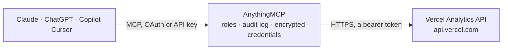

<!-- Generated by scripts/export-github-catalog.mjs in the anythingmcp-website repository. Do not edit by hand. -->

# Vercel Analytics MCP connector

Read Vercel Analytics / Speed Insights / Audience data via the Vercel API. 4 tools, Bearer auth. The AnythingMCP connector gives Claude, ChatGPT, Microsoft Copilot, Cursor and Gemini 4 MCP tools for Vercel Analytics, all read-only.

**Category:** [Analytics](../analytics.md) · **Tools:** 4 · **Setup guide:** [anythingmcp.com](https://anythingmcp.com/guides/vercel-analytics-to-mcp) · [Deutsch](https://anythingmcp.com/de/guides/vercel-analytics-to-mcp) · [Italiano](https://anythingmcp.com/it/guides/vercel-analytics-to-mcp) · [Español](https://anythingmcp.com/es/guides/vercel-analytics-to-mcp) · [日本語](https://anythingmcp.com/ja/guides/vercel-analytics-to-mcp) · [Русский](https://anythingmcp.com/ru/guides/vercel-analytics-to-mcp) · [中文](https://anythingmcp.com/zh/guides/vercel-analytics-to-mcp)

## Start without code

No installation and no terminal: AnythingMCP Cloud runs the Vercel Analytics connector for you, operated by helpcode.ai in Frankfurt, Germany.

1. **Click the button above** and create an account or sign in. The Vercel Analytics connector opens, ready to install.
2. **Paste the API key or token from your Vercel Analytics account.** Every click is in the [step-by-step guide](https://anythingmcp.com/guides/vercel-analytics-to-mcp).
3. **Click Install.** AnythingMCP shows the address of your MCP server.
4. **Add that address to your assistant:** [Claude](https://anythingmcp.com/guides/connect-vercel-analytics-to-claude) · [ChatGPT](https://anythingmcp.com/guides/connect-vercel-analytics-to-chatgpt) · [Microsoft Copilot](https://anythingmcp.com/guides/connect-vercel-analytics-to-copilot) · [Cursor](https://anythingmcp.com/guides/connect-vercel-analytics-to-cursor) · [Gemini CLI](https://anythingmcp.com/guides/connect-vercel-analytics-to-gemini) · [Meta Muse](https://anythingmcp.com/guides/connect-vercel-analytics-to-muse).
5. **Ask your first question**, for example: *Show the most recent deployment for project 'greenwood-shop' in team 'MapleTree GmbH'.*

Prefer help with the setup? [Talk to us](https://anythingmcp.com/contact).

## How it works

- **The AI client** speaks MCP (Streamable HTTP) to AnythingMCP and only sees tool names, descriptions and results. It never gets the Vercel Analytics credentials.
- **AnythingMCP** checks the client's role, builds the call from the tool definition, adds the credentials (a bearer token), calls Vercel Analytics, logs the call and returns the result.
- **Vercel Analytics** sees an ordinary API client with the rights of the account the credentials belong to.

## Tools

| Tool | What it does | Access |
|---|---|---|
| [`vercel_analytics_get_user`](#vercel_analytics_get_user) | Return the user the token belongs to. | read |
| [`vercel_analytics_list_projects`](#vercel_analytics_list_projects) | List projects in the team / account. | read |
| [`vercel_analytics_get_deployments`](#vercel_analytics_get_deployments) | List deployments for a project. | read |
| [`vercel_analytics_get_speed_insights`](#vercel_analytics_get_speed_insights) | Get Speed Insights (Core Web Vitals) data for a project — requires Vercel Speed Insights enabled on the project + Pro plan. | read |

## Tool reference

Every parameter as the AI client sees it in `tools/list`. Source: [`packages/backend/src/adapters/intl/vercel-analytics.json`](../../../packages/backend/src/adapters/intl/vercel-analytics.json).

### `vercel_analytics_get_user`

Return the user the token belongs to.

**Access:** read · **Call:** `GET /v2/user`

No parameters.

### `vercel_analytics_list_projects`

List projects in the team / account.

**Access:** read · **Call:** `GET /v9/projects`

| Parameter | Type | Required | Description |
|---|---|---|---|
| `teamId` | string | no | Team ID (omit for personal account). |
| `limit` | integer | no | Per page (max 100). |
| `from` | integer | no | Unix ms — projects created after. |
| `search` | string | no | Substring filter on project name. |

### `vercel_analytics_get_deployments`

List deployments for a project. Returns each deployment's url, state, source, created.

**Access:** read · **Call:** `GET /v6/deployments`

| Parameter | Type | Required | Description |
|---|---|---|---|
| `projectId` | string | no | Project ID or name. |
| `teamId` | string | no | Team ID if team-scoped. |
| `limit` | integer | no | Per page (default 20, max 100). |
| `state` | string | no | BUILDING, ERROR, INITIALIZING, QUEUED, READY, CANCELED. |
| `until` | integer | no | Unix ms — deployments before. |
| `since` | integer | no | Unix ms — deployments after. |

### `vercel_analytics_get_speed_insights`

Get Speed Insights (Core Web Vitals) data for a project — requires Vercel Speed Insights enabled on the project + Pro plan.

**Access:** read · **Call:** `GET /web-analytics/v1/projects/{projectId}/speed-insights`

| Parameter | Type | Required | Description |
|---|---|---|---|
| `projectId` | string | yes | Project ID. |
| `teamId` | string | no | Team ID. |
| `from` | integer | no | Unix ms range start. |
| `to` | integer | no | Unix ms range end. |
| `interval` | string | no | 1h, 1d, 7d, 30d. |

## Run it yourself

AnythingMCP is open source (AGPL-3.0). [Run it with Docker](../../../README.md#run-it-yourself), open **Connectors → Store**, pick **Vercel Analytics** and enter `VERCEL_ACCESS_TOKEN`, then add your MCP server URL to the AI client.

[← Analytics connectors](../analytics.md) · [All categories](../README.md)
