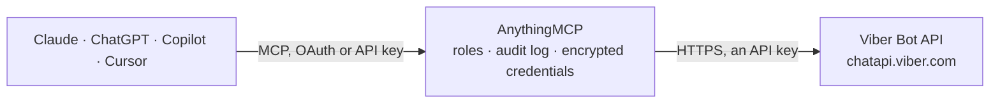

<!-- Generated by scripts/export-github-catalog.mjs in the anythingmcp-website repository. Do not edit by hand. -->

# Viber Bot MCP connector

Send Viber messages from a Viber bot through the Viber REST Bot API: text with keyboards, pictures, videos, files, links, contacts, locations, stickers and rich media carousels, broadcasts to up to … The AnythingMCP connector gives Claude, ChatGPT, Microsoft Copilot, Cursor and Gemini 15 MCP tools for Viber Bot: 3 read and 12 can change data.

[](https://cloud.anythingmcp.com/login?mode=register&redirect=%2Fconnectors%2Fstore%3Finstall%3Dviber&utm_source=github&utm_medium=catalog&utm_campaign=viber)

**Category:** [Messaging](../messaging.md) · **Tools:** 15 · **Setup guide:** [anythingmcp.com](https://anythingmcp.com/guides/viber-to-mcp) · [Deutsch](https://anythingmcp.com/de/guides/viber-to-mcp) · [Italiano](https://anythingmcp.com/it/guides/viber-to-mcp) · [Español](https://anythingmcp.com/es/guides/viber-to-mcp) · [日本語](https://anythingmcp.com/ja/guides/viber-to-mcp) · [Русский](https://anythingmcp.com/ru/guides/viber-to-mcp) · [中文](https://anythingmcp.com/zh/guides/viber-to-mcp)

## Start without code

No installation and no terminal: AnythingMCP Cloud runs the Viber Bot connector for you, operated by helpcode.ai in Frankfurt, Germany.

1. **Click the button above** and create an account or sign in. The Viber Bot connector opens, ready to install.
2. **Paste the API key or token from your Viber Bot account.** Every click is in the [step-by-step guide](https://anythingmcp.com/guides/viber-to-mcp).
3. **Click Install.** AnythingMCP shows the address of your MCP server.
4. **Add that address to your assistant:** [Claude](https://anythingmcp.com/guides/connect-viber-to-claude) · [ChatGPT](https://anythingmcp.com/guides/connect-viber-to-chatgpt) · [Microsoft Copilot](https://anythingmcp.com/guides/connect-viber-to-copilot) · [Cursor](https://anythingmcp.com/guides/connect-viber-to-cursor) · [Gemini CLI](https://anythingmcp.com/guides/connect-viber-to-gemini) · [Meta Muse](https://anythingmcp.com/guides/connect-viber-to-muse).
5. **Ask your first question**, for example: *Get Viber subscriber details for user id u7a8f9c3b2, I need country and device now*

Prefer help with the setup? [Talk to us](https://anythingmcp.com/contact).

## How it works



- **The AI client** speaks MCP (Streamable HTTP) to AnythingMCP and only sees tool names, descriptions and results. It never gets the Viber Bot credentials.
- **AnythingMCP** checks the client's role, builds the call from the tool definition, adds the credentials (an API key), calls Viber Bot, logs the call and returns the result.
- **Viber Bot** sees an ordinary API client with the rights of the account the credentials belong to.

## Tools

| Tool | What it does | Access |
|---|---|---|
| [`viber_get_account_info`](#viber_get_account_info) | Details of the bot account: id, name, uri, icon, category, country, the webhook URL and its event_types, and subscribers_count. | read |
| [`viber_get_user_details`](#viber_get_user_details) | Details of one subscribed user: name, avatar, country, language, primary device OS, device type, Viber and API version. | read |
| [`viber_get_online`](#viber_get_online) | Online status of up to 100 subscribed users. | read |
| [`viber_send_text`](#viber_send_text) | Send a text message (up to 7,000 characters) to one subscribed user, optionally with a keyboard of reply buttons. | write |
| [`viber_send_picture`](#viber_send_picture) | Send a picture (JPEG, PNG or static GIF from a URL) with a caption to one subscribed user. | write |
| [`viber_send_video`](#viber_send_video) | Send an MP4 video (H.264, up to 26 MB and 180 seconds) from a URL to one subscribed user. | write |
| [`viber_send_file`](#viber_send_file) | Send a file (up to 50 MB, from a URL) to one subscribed user, e.g. a PDF invoice. | write |
| [`viber_send_url`](#viber_send_url) | Send a link (up to 2,000 characters) to one subscribed user; Viber shows a preview. | write |
| [`viber_send_contact`](#viber_send_contact) | Send a contact card (name and phone number) to one subscribed user. | write |
| [`viber_send_location`](#viber_send_location) | Send a location pin (latitude and longitude) to one subscribed user. | write |
| [`viber_send_sticker`](#viber_send_sticker) | Send a Viber sticker by its numeric sticker id to one subscribed user. | write |
| [`viber_send_rich_media`](#viber_send_rich_media) | Send a rich media message (a carousel of cards with images, text and buttons) to one subscribed user. | write |
| [`viber_broadcast_message`](#viber_broadcast_message) | Send the same message to up to 300 subscribed users in one call. | write |
| [`viber_set_webhook`](#viber_set_webhook) | Set the bot's webhook, the HTTPS endpoint where Viber delivers incoming messages and events. | write |
| [`viber_remove_webhook`](#viber_remove_webhook) | Remove the bot's webhook. | write |

## Tool reference

Every parameter as the AI client sees it in `tools/list`. Source: [`packages/backend/src/adapters/intl/viber.json`](../../../packages/backend/src/adapters/intl/viber.json).

### `viber_get_account_info`

Details of the bot account: id, name, uri, icon, category, country, the webhook URL and its event_types, and subscribers_count.

**Access:** read · **Call:** `POST /get_account_info`

No parameters.

### `viber_get_user_details`

Details of one subscribed user: name, avatar, country, language, primary device OS, device type, Viber and API version. Viber allows this at most twice per user in 12 hours.

**Access:** read · **Call:** `POST /get_user_details`

| Parameter | Type | Required | Description |
|---|---|---|---|
| `id` | string | yes | The user's Viber id, e.g. 01234567890A= (from an incoming message's sender.id). |

### `viber_get_online`

Online status of up to 100 subscribed users. online_status: 0 online, 1 offline (with last_online in Unix ms), 2 hidden by the user, 3 try later, 4 not a Viber user or not subscribed.

**Access:** read · **Call:** `POST /get_online`

| Parameter | Type | Required | Description |
|---|---|---|---|
| `ids` | string[] | yes | Viber user ids. |

### `viber_send_text`

Send a text message (up to 7,000 characters) to one subscribed user, optionally with a keyboard of reply buttons. Returns message_token.

**Access:** write · **Call:** `POST /send_message`

| Parameter | Type | Required | Description |
|---|---|---|---|
| `receiver` | string | yes | The subscribed user's Viber id. |
| `text` | string | yes | Message text, up to 7,000 characters. Supports *bold*, _italic_, ~strike~ and ```monospace```. |
| `sender_name` | string | yes | Name shown as the sender, at most 28 characters (usually the bot's name). |
| `sender_avatar` | string | no | URL of the sender's avatar image, at most 100 KB. |
| `keyboard` | object | no | Optional reply keyboard: {"Type": "keyboard", "Buttons": [{"ActionType": "reply", "ActionBody": "yes", "Text": "Yes"}]}. |
| `tracking_data` | string | no | Optional text up to 4,096 characters that comes back to the webhook with the user's reply. |
| `min_api_version` | integer | no | Lowest Viber client API version that may receive the message (default 1; keyboards with newer features need a higher value). |

### `viber_send_picture`

Send a picture (JPEG, PNG or static GIF from a URL) with a caption to one subscribed user. The URL must end in .jpg, .jpeg, .png or .gif.

**Access:** write · **Call:** `POST /send_message`

| Parameter | Type | Required | Description |
|---|---|---|---|
| `receiver` | string | yes | The subscribed user's Viber id. |
| `media` | string | yes | Public URL of the image, ending in .jpg, .jpeg, .png or .gif; at most 1 MB for iOS users (3 MB on Android). |
| `text` | string | yes | Caption, up to 768 characters. |
| `thumbnail` | string | no | Optional URL of a small preview image (about 400x400, at most 100 KB). |
| `sender_name` | string | yes | Name shown as the sender, at most 28 characters. |
| `sender_avatar` | string | no | URL of the sender's avatar image, at most 100 KB. |
| `keyboard` | object | no | Optional reply keyboard, see viber_send_text. |
| `tracking_data` | string | no | Optional text that comes back to the webhook with the user's reply. |
| `min_api_version` | integer | no | Lowest Viber client API version that may receive the message (default 1). |

### `viber_send_video`

Send an MP4 video (H.264, up to 26 MB and 180 seconds) from a URL to one subscribed user.

**Access:** write · **Call:** `POST /send_message`

| Parameter | Type | Required | Description |
|---|---|---|---|
| `receiver` | string | yes | The subscribed user's Viber id. |
| `media` | string | yes | Public URL of the video, ending in .mp4. |
| `size` | integer | yes | Size of the video in bytes. |
| `duration` | integer | no | Duration in seconds, at most 180. |
| `thumbnail` | string | no | Optional URL of a JPEG preview image, at most 100 KB. |
| `sender_name` | string | yes | Name shown as the sender, at most 28 characters. |
| `sender_avatar` | string | no | URL of the sender's avatar image, at most 100 KB. |
| `keyboard` | object | no | Optional reply keyboard, see viber_send_text. |
| `tracking_data` | string | no | Optional text that comes back to the webhook with the user's reply. |
| `min_api_version` | integer | no | Lowest Viber client API version that may receive the message (default 1). |

### `viber_send_file`

Send a file (up to 50 MB, from a URL) to one subscribed user, e.g. a PDF invoice. Executables and scripts are refused by Viber.

**Access:** write · **Call:** `POST /send_message`

| Parameter | Type | Required | Description |
|---|---|---|---|
| `receiver` | string | yes | The subscribed user's Viber id. |
| `media` | string | yes | Public URL of the file, including the file extension. |
| `size` | integer | yes | Size of the file in bytes. |
| `file_name` | string | yes | File name shown to the user, with extension, at most 256 characters, e.g. invoice-1042.pdf. |
| `sender_name` | string | yes | Name shown as the sender, at most 28 characters. |
| `sender_avatar` | string | no | URL of the sender's avatar image, at most 100 KB. |
| `keyboard` | object | no | Optional reply keyboard, see viber_send_text. |
| `tracking_data` | string | no | Optional text that comes back to the webhook with the user's reply. |
| `min_api_version` | integer | no | Lowest Viber client API version that may receive the message (default 1). |

### `viber_send_url`

Send a link (up to 2,000 characters) to one subscribed user; Viber shows a preview. Also the way to send an animated GIF.

**Access:** write · **Call:** `POST /send_message`

| Parameter | Type | Required | Description |
|---|---|---|---|
| `receiver` | string | yes | The subscribed user's Viber id. |
| `media` | string | yes | The URL to send. |
| `sender_name` | string | yes | Name shown as the sender, at most 28 characters. |
| `sender_avatar` | string | no | URL of the sender's avatar image, at most 100 KB. |
| `keyboard` | object | no | Optional reply keyboard, see viber_send_text. |
| `tracking_data` | string | no | Optional text that comes back to the webhook with the user's reply. |
| `min_api_version` | integer | no | Lowest Viber client API version that may receive the message (default 1). |

### `viber_send_contact`

Send a contact card (name and phone number) to one subscribed user.

**Access:** write · **Call:** `POST /send_message`

| Parameter | Type | Required | Description |
|---|---|---|---|
| `receiver` | string | yes | The subscribed user's Viber id. |
| `contact_name` | string | yes | Name of the contact, at most 28 characters. |
| `contact_phone_number` | string | yes | Phone number of the contact, at most 18 characters, e.g. +497611234567. |
| `sender_name` | string | yes | Name shown as the sender, at most 28 characters. |
| `sender_avatar` | string | no | URL of the sender's avatar image, at most 100 KB. |
| `keyboard` | object | no | Optional reply keyboard, see viber_send_text. |
| `tracking_data` | string | no | Optional text that comes back to the webhook with the user's reply. |
| `min_api_version` | integer | no | Lowest Viber client API version that may receive the message (default 1). |

### `viber_send_location`

Send a location pin (latitude and longitude) to one subscribed user.

**Access:** write · **Call:** `POST /send_message`

| Parameter | Type | Required | Description |
|---|---|---|---|
| `receiver` | string | yes | The subscribed user's Viber id. |
| `lat` | number | yes | Latitude in decimal degrees, e.g. 47.9959. |
| `lon` | number | yes | Longitude in decimal degrees, e.g. 7.8522. |
| `sender_name` | string | yes | Name shown as the sender, at most 28 characters. |
| `sender_avatar` | string | no | URL of the sender's avatar image, at most 100 KB. |
| `keyboard` | object | no | Optional reply keyboard, see viber_send_text. |
| `tracking_data` | string | no | Optional text that comes back to the webhook with the user's reply. |
| `min_api_version` | integer | no | Lowest Viber client API version that may receive the message (default 1). |

### `viber_send_sticker`

Send a Viber sticker by its numeric sticker id to one subscribed user.

**Access:** write · **Call:** `POST /send_message`

| Parameter | Type | Required | Description |
|---|---|---|---|
| `receiver` | string | yes | The subscribed user's Viber id. |
| `sticker_id` | integer | yes | Viber sticker id, e.g. 46105 (see the sticker ids page in the Viber developer docs). |
| `sender_name` | string | yes | Name shown as the sender, at most 28 characters. |
| `sender_avatar` | string | no | URL of the sender's avatar image, at most 100 KB. |
| `keyboard` | object | no | Optional reply keyboard, see viber_send_text. |
| `tracking_data` | string | no | Optional text that comes back to the webhook with the user's reply. |
| `min_api_version` | integer | no | Lowest Viber client API version that may receive the message (default 1). |

### `viber_send_rich_media`

Send a rich media message (a carousel of cards with images, text and buttons) to one subscribed user. Needs min_api_version 7 for full support; alt_text is shown on older clients.

**Access:** write · **Call:** `POST /send_message`

| Parameter | Type | Required | Description |
|---|---|---|---|
| `receiver` | string | yes | The subscribed user's Viber id. |
| `rich_media` | object | yes | {"Type": "rich_media", "ButtonsGroupColumns": 6, "ButtonsGroupRows": 7, "BgColor": "#FFFFFF", "Buttons": [{"Columns": 6, "Rows": 3, "ActionType": "open-url", "ActionBody": "https://...", "Image": "https://..."}, {"Columns": 6, "Rows": 2, "Text": "<b>Title</b>", "ActionType": "reply", "ActionBody": "more"}]}. Each card spans ButtonsGroupRows rows. |
| `alt_text` | string | no | Text shown by clients that cannot display rich media. |
| `sender_name` | string | yes | Name shown as the sender, at most 28 characters. |
| `sender_avatar` | string | no | URL of the sender's avatar image, at most 100 KB. |
| `keyboard` | object | no | Optional reply keyboard, see viber_send_text. |
| `tracking_data` | string | no | Optional text that comes back to the webhook with the user's reply. |
| `min_api_version` | integer | no | Lowest Viber client API version that may receive the message; use 7 for rich media. |

### `viber_broadcast_message`

Send the same message to up to 300 subscribed users in one call. Placeholders replace_me_with_user_name and replace_me_with_receiver_id are filled in per receiver. The answer's failed_list names receivers that did not get it.

**Access:** write · **Call:** `POST /broadcast_message`

| Parameter | Type | Required | Description |
|---|---|---|---|
| `broadcast_list` | string[] | yes | Viber ids of the subscribed receivers, at most 300. |
| `type` | `text` \| `picture` \| `video` \| `file` \| `url` \| `contact` \| `location` \| `sticker` \| `rich_media` | yes | Message type; pass the fields that type needs (text; media and text for picture; media and size for video; media, size and file_name for file; media for url; contact; location; sticker_id; rich_media). |
| `text` | string | no | Text for type text (up to 7,000 characters) or the caption for picture. |
| `media` | string | no | URL of the picture, video, file or link. |
| `thumbnail` | string | no | Optional preview image URL for picture or video. |
| `size` | integer | no | Size in bytes for video or file. |
| `file_name` | string | no | File name with extension for type file. |
| `contact` | object | no | For type contact: {"name": "...", "phone_number": "+49..."}. |
| `location` | object | no | For type location: {"lat": 47.9959, "lon": 7.8522}. |
| `sticker_id` | integer | no | Sticker id for type sticker. |
| `rich_media` | object | no | Rich media object for type rich_media, see viber_send_rich_media. |
| `sender_name` | string | yes | Name shown as the sender, at most 28 characters. |
| `sender_avatar` | string | no | URL of the sender's avatar image, at most 100 KB. |
| `keyboard` | object | no | Optional reply keyboard, see viber_send_text. |
| `tracking_data` | string | no | Optional text that comes back to the webhook with each user's reply. |
| `min_api_version` | integer | no | Lowest Viber client API version that may receive the message (default 1; 7 for rich media). |

### `viber_set_webhook`

Set the bot's webhook, the HTTPS endpoint where Viber delivers incoming messages and events. Replaces the current webhook. Viber calls the URL once to check it answers HTTP 200.

**Access:** write · **Call:** `POST /set_webhook`

| Parameter | Type | Required | Description |
|---|---|---|---|
| `url` | string | yes | Public HTTPS URL with a certificate from a trusted CA (no self-signed certificates). |
| `event_types` | `delivered` \| `seen` \| `failed` \| `subscribed` \| `unsubscribed` \| `conversation_started` \| `message`[] | no | Events to receive. Leave out for all events; message, subscribed and unsubscribed always arrive. |
| `send_name` | boolean | no | Whether callbacks include the user's name (default true). |
| `send_photo` | boolean | no | Whether callbacks include the user's photo (default true). |

### `viber_remove_webhook`

Remove the bot's webhook. The bot then receives nothing and users can no longer open a 1-on-1 chat with it until a webhook is set again.

**Access:** write · **Call:** `POST /set_webhook`

No parameters.

## Run it yourself

AnythingMCP is open source (AGPL-3.0). [Run it with Docker](../../../README.md#run-it-yourself), open **Connectors → Store**, pick **Viber Bot** and enter `VIBER_AUTH_TOKEN`, then add your MCP server URL to the AI client.

[← Messaging connectors](../messaging.md) · [All categories](../README.md)
