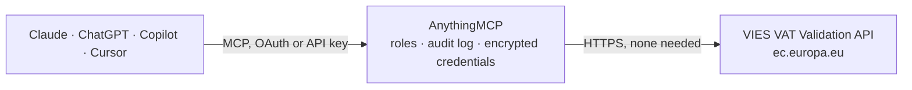

<!-- Generated by scripts/export-github-catalog.mjs in the anythingmcp-website repository. Do not edit by hand. -->

# VIES VAT Validation MCP connector

Validate EU VAT numbers via the European Commission VIES (VAT Information Exchange System) REST API. The AnythingMCP connector gives Claude, ChatGPT, Microsoft Copilot, Cursor and Gemini 1 MCP tool for VIES VAT Validation: 0 read and 1 can change data.

**Category:** [Government](../government.md) · **Tools:** 1 · **Setup guide:** [anythingmcp.com](https://anythingmcp.com/guides/vies-vat-to-mcp) · [Deutsch](https://anythingmcp.com/de/guides/vies-vat-to-mcp) · [Italiano](https://anythingmcp.com/it/guides/vies-vat-to-mcp) · [Español](https://anythingmcp.com/es/guides/vies-vat-to-mcp) · [日本語](https://anythingmcp.com/ja/guides/vies-vat-to-mcp) · [Русский](https://anythingmcp.com/ru/guides/vies-vat-to-mcp) · [中文](https://anythingmcp.com/zh/guides/vies-vat-to-mcp)

## Start without code

No installation and no terminal: AnythingMCP Cloud runs the VIES VAT Validation connector for you, operated by helpcode.ai in Frankfurt, Germany.

1. **Click the button above** and create an account or sign in. The VIES VAT Validation connector opens, ready to install.
2. **Nothing to enter:** this connector needs no credentials. Every click is in the [step-by-step guide](https://anythingmcp.com/guides/vies-vat-to-mcp).
3. **Click Install.** AnythingMCP shows the address of your MCP server.
4. **Add that address to your assistant:** [Claude](https://anythingmcp.com/guides/connect-vies-vat-to-claude) · [ChatGPT](https://anythingmcp.com/guides/connect-vies-vat-to-chatgpt) · [Microsoft Copilot](https://anythingmcp.com/guides/connect-vies-vat-to-copilot) · [Cursor](https://anythingmcp.com/guides/connect-vies-vat-to-cursor) · [Gemini CLI](https://anythingmcp.com/guides/connect-vies-vat-to-gemini) · [Meta Muse](https://anythingmcp.com/guides/connect-vies-vat-to-muse).
5. **Ask your first question**, for example: *Validate the German VAT for Solera Energy GmbH: DE VAT number 811547980*

Prefer help with the setup? [Talk to us](https://anythingmcp.com/contact).

## How it works

- **The AI client** speaks MCP (Streamable HTTP) to AnythingMCP and only sees tool names, descriptions and results. It never gets the VIES VAT Validation credentials.
- **AnythingMCP** checks the client's role, builds the call from the tool definition, adds the credentials (none needed), calls VIES VAT Validation, logs the call and returns the result.
- **VIES VAT Validation** sees an ordinary API client with the rights of the account the credentials belong to.

## Tools

| Tool | What it does | Access |
|---|---|---|
| [`vies_check_vat`](#vies_check_vat) | Check whether an EU VAT number is valid and, when available, return the registered trader name and address. | write |

## Tool reference

Every parameter as the AI client sees it in `tools/list`. Source: [`packages/backend/src/adapters/de/vies-vat.json`](../../../packages/backend/src/adapters/de/vies-vat.json).

### `vies_check_vat`

Check whether an EU VAT number is valid and, when available, return the registered trader name and address.

**Access:** write · **Call:** `POST /check-vat-number`

| Parameter | Type | Required | Description |
|---|---|---|---|
| `countryCode` | string | yes | ISO country code of the member state (e.g. 'DE', 'FR', 'IT'). Use 'EL' for Greece and 'XI' for Northern Ireland. |
| `vatNumber` | string | yes | VAT number without the country prefix (e.g. '123456789' for DE123456789). |

## Run it yourself

AnythingMCP is open source (AGPL-3.0). [Run it with Docker](../../../README.md#run-it-yourself), open **Connectors → Store**, pick **VIES VAT Validation**, then add your MCP server URL to the AI client.

[← Government connectors](../government.md) · [All categories](../README.md)
