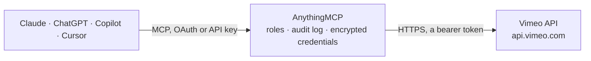

<!-- Generated by scripts/export-github-catalog.mjs in the anythingmcp-website repository. Do not edit by hand. -->

# Vimeo MCP connector

Let your AI work with your Vimeo account: list and search your videos, read details, folders, showcases, comments, captions and transcripts, upload a video from a link and change titles, descriptions … The AnythingMCP connector gives Claude, ChatGPT, Microsoft Copilot, Cursor and Gemini 14 MCP tools for Vimeo: 11 read and 3 can change data.

**Category:** [Publishing](../publishing.md) · **Tools:** 14 · **Setup guide:** [anythingmcp.com](https://anythingmcp.com/guides/vimeo-to-mcp) · [Deutsch](https://anythingmcp.com/de/guides/vimeo-to-mcp) · [Italiano](https://anythingmcp.com/it/guides/vimeo-to-mcp) · [Español](https://anythingmcp.com/es/guides/vimeo-to-mcp) · [日本語](https://anythingmcp.com/ja/guides/vimeo-to-mcp) · [Русский](https://anythingmcp.com/ru/guides/vimeo-to-mcp) · [中文](https://anythingmcp.com/zh/guides/vimeo-to-mcp)

## Start without code

No installation and no terminal: AnythingMCP Cloud runs the Vimeo connector for you, operated by helpcode.ai in Frankfurt, Germany.

1. **Click the button above** and create an account or sign in. The Vimeo connector opens, ready to install.
2. **Paste the API key or token from your Vimeo account.** Every click is in the [step-by-step guide](https://anythingmcp.com/guides/vimeo-to-mcp).
3. **Click Install.** AnythingMCP shows the address of your MCP server.
4. **Add that address to your assistant:** [Claude](https://anythingmcp.com/guides/connect-vimeo-to-claude) · [ChatGPT](https://anythingmcp.com/guides/connect-vimeo-to-chatgpt) · [Microsoft Copilot](https://anythingmcp.com/guides/connect-vimeo-to-copilot) · [Cursor](https://anythingmcp.com/guides/connect-vimeo-to-cursor) · [Gemini CLI](https://anythingmcp.com/guides/connect-vimeo-to-gemini) · [Meta Muse](https://anythingmcp.com/guides/connect-vimeo-to-muse).
5. **Ask your first question**, for example: *What's the status and view count for the onboarding video 'Horizon Solar - Setup Guide' (vimeo.com/48920123)?*

Prefer help with the setup? [Talk to us](https://anythingmcp.com/contact).

## How it works

- **The AI client** speaks MCP (Streamable HTTP) to AnythingMCP and only sees tool names, descriptions and results. It never gets the Vimeo credentials.
- **AnythingMCP** checks the client's role, builds the call from the tool definition, adds the credentials (a bearer token), calls Vimeo, logs the call and returns the result.
- **Vimeo** sees an ordinary API client with the rights of the account the credentials belong to.

## Tools

| Tool | What it does | Access |
|---|---|---|
| [`vimeo_get_me`](#vimeo_get_me) | Read the Vimeo account that owns the access token: uri (with the user id), name, profile link, plan (account), creation date, upload quota and number of videos. | read |
| [`vimeo_list_my_videos`](#vimeo_list_my_videos) | List or search the videos of the account (newest first by default): uri (contains the video id), title, link, duration in seconds, dates, privacy, status… | read |
| [`vimeo_get_video`](#vimeo_get_video) | Read one video: title, description, links (page and player embed), duration, size, language, dates, full privacy settings, status, upload and transcode… | read |
| [`vimeo_list_folders`](#vimeo_list_folders) | List the account's folders (called projects in the API): uri (/users/<user id>/projects/<folder id>), name, dates and how many videos and subfolders each holds. | read |
| [`vimeo_list_folder_items`](#vimeo_list_folder_items) | List everything in one folder, videos and subfolders: type, and for each the uri, name and basic details. | read |
| [`vimeo_list_folder_videos`](#vimeo_list_folder_videos) | List or search the videos in one folder (optionally including its subfolders): uri, title, link, duration, dates, privacy, status and tags. | read |
| [`vimeo_list_showcases`](#vimeo_list_showcases) | List the account's showcases (called albums in the API): uri (/users/<user id>/albums/<showcase id>), name, description, link, privacy, dates and number of… | read |
| [`vimeo_list_showcase_videos`](#vimeo_list_showcase_videos) | List or search the videos in one showcase the account owns: uri, title, link, duration, dates, privacy, status and tags. | read |
| [`vimeo_list_video_comments`](#vimeo_list_video_comments) | List the comments on a video: uri, text, date, author name and how many replies each has. | read |
| [`vimeo_list_text_tracks`](#vimeo_list_text_tracks) | List a video's text tracks (captions and subtitles, including auto-generated ones): id, uri, name, language, type, whether active, and a temporary link to… | read |
| [`vimeo_get_transcript`](#vimeo_get_transcript) | Read the transcript of a video as timed segments, from one of its text tracks (id from vimeo_list_text_tracks). | read |
| [`vimeo_upload_video_from_url`](#vimeo_upload_video_from_url) | Upload a video to the account by letting Vimeo fetch it from a public URL (pull upload): Vimeo downloads the file in the background and transcodes it. | write |
| [`vimeo_update_video`](#vimeo_update_video) | Change a video's title, description, privacy (who can watch, embed, comment, download), password or language. | write |
| [`vimeo_delete_video`](#vimeo_delete_video) | Delete a video permanently. | write |

## Tool reference

Every parameter as the AI client sees it in `tools/list`. Source: [`packages/backend/src/adapters/intl/vimeo.json`](../../../packages/backend/src/adapters/intl/vimeo.json).

### `vimeo_get_me`

Read the Vimeo account that owns the access token: uri (with the user id), name, profile link, plan (account), creation date, upload quota and number of videos. A cheap check that the token works.

**Access:** read · **Call:** `GET /me`

No parameters.

### `vimeo_list_my_videos`

List or search the videos of the account (newest first by default): uri (contains the video id), title, link, duration in seconds, dates, privacy, status (available, transcoding, uploading...), folder and tags. query searches title, description, chapters and tags.

**Access:** read · **Call:** `GET /me/videos`

| Parameter | Type | Required | Description |
|---|---|---|---|
| `query` | string | no | Search text. |
| `sort` | `alphabetical` \| `date` \| `default` \| `duration` \| `last_user_action_event_date` \| `likes` \| `modified_time` \| `plays` | no | alphabetical, date, default, duration, last_user_action_event_date, likes, modified_time or plays. |
| `direction` | `asc` \| `desc` | no | asc or desc. |
| `filter_tag` | string | no | Comma-separated tags; results have at least one of them. |
| `filter` | `app_only` \| `cold_privacy` \| `cold_storage` \| `embeddable` \| `featured` \| `live` \| `no_placeholder` \| `nolive` \| `playable` \| `screen_recorded` | no | Optional filter: embeddable, featured, playable, live, nolive and others. |
| `page` | integer | no | Page number, starting at 1. |
| `per_page` | integer | no | Items per page, 1 to 100 (Vimeo's default 25). |

### `vimeo_get_video`

Read one video: title, description, links (page and player embed), duration, size, language, dates, full privacy settings, status, upload and transcode status, plays, tags, folder, content rating, licence, and how many comments and text tracks it has.

**Access:** read · **Call:** `GET /videos/{video_id}`

| Parameter | Type | Required | Description |
|---|---|---|---|
| `video_id` | string | yes | Numeric Vimeo video id, e.g. 76979871 (the number in vimeo.com/76979871 or in the uri /videos/76979871). |

### `vimeo_list_folders`

List the account's folders (called projects in the API): uri (/users/<user id>/projects/<folder id>), name, dates and how many videos and subfolders each holds.

**Access:** read · **Call:** `GET /me/projects`

| Parameter | Type | Required | Description |
|---|---|---|---|
| `query` | string | no | Search folder names. |
| `sort` | `date` \| `default` \| `modified_time` \| `name` \| `pinned_on` | no | date, default, modified_time, name or pinned_on. |
| `direction` | `asc` \| `desc` | no | asc or desc. |
| `page` | integer | no | Page number, starting at 1. |
| `per_page` | integer | no | Items per page, 1 to 100 (Vimeo's default 25). |

### `vimeo_list_folder_items`

List everything in one folder, videos and subfolders: type, and for each the uri, name and basic details.

**Access:** read · **Call:** `GET /me/projects/{folder_id}/items`

| Parameter | Type | Required | Description |
|---|---|---|---|
| `folder_id` | string | yes | Numeric folder id: the last number of a folder uri such as /users/123/projects/456. |
| `filter` | `file` \| `folder` \| `live_event` \| `video` | no | Only this type: video, folder, file or live_event. |
| `sort` | `alphabetical` \| `date` \| `default` \| `duration` \| `last_user_action_event_date` | no | alphabetical, date, default, duration or last_user_action_event_date. |
| `direction` | `asc` \| `desc` | no | asc or desc. |
| `page` | integer | no | Page number, starting at 1. |
| `per_page` | integer | no | Items per page, 1 to 100 (Vimeo's default 25). |

### `vimeo_list_folder_videos`

List or search the videos in one folder (optionally including its subfolders): uri, title, link, duration, dates, privacy, status and tags.

**Access:** read · **Call:** `GET /me/projects/{folder_id}/videos`

| Parameter | Type | Required | Description |
|---|---|---|---|
| `folder_id` | string | yes | Numeric folder id (last number of the folder uri). |
| `query` | string | no | Search text. |
| `include_subfolders` | boolean | no | true to include videos in subfolders. |
| `sort` | `alphabetical` \| `date` \| `default` \| `duration` \| `last_user_action_event_date` | no | alphabetical, date, default, duration or last_user_action_event_date. |
| `direction` | `asc` \| `desc` | no | asc or desc. |
| `page` | integer | no | Page number, starting at 1. |
| `per_page` | integer | no | Items per page, 1 to 100 (Vimeo's default 25). |

### `vimeo_list_showcases`

List the account's showcases (called albums in the API): uri (/users/<user id>/albums/<showcase id>), name, description, link, privacy, dates and number of videos.

**Access:** read · **Call:** `GET /me/albums`

| Parameter | Type | Required | Description |
|---|---|---|---|
| `query` | string | no | Search showcase names. |
| `sort` | `alphabetical` \| `date` \| `duration` \| `last_modified` \| `videos` | no | alphabetical, date, duration, last_modified or videos. |
| `direction` | `asc` \| `desc` | no | asc or desc. |
| `page` | integer | no | Page number, starting at 1. |
| `per_page` | integer | no | Items per page, 1 to 100 (Vimeo's default 25). |

### `vimeo_list_showcase_videos`

List or search the videos in one showcase the account owns: uri, title, link, duration, dates, privacy, status and tags.

**Access:** read · **Call:** `GET /me/albums/{showcase_id}/videos`

| Parameter | Type | Required | Description |
|---|---|---|---|
| `showcase_id` | string | yes | Numeric showcase id: the last number of a showcase uri such as /users/123/albums/789. |
| `query` | string | no | Search text. |
| `sort` | `alphabetical` \| `comments` \| `date` \| `default` \| `duration` \| `likes` \| `manual` \| `modified_time` \| `plays` | no | alphabetical, comments, date, default, duration, likes, manual, modified_time or plays. |
| `direction` | `asc` \| `desc` | no | asc or desc. |
| `page` | integer | no | Page number, starting at 1. |
| `per_page` | integer | no | Items per page, 1 to 100 (Vimeo's default 25). |

### `vimeo_list_video_comments`

List the comments on a video: uri, text, date, author name and how many replies each has.

**Access:** read · **Call:** `GET /videos/{video_id}/comments`

| Parameter | Type | Required | Description |
|---|---|---|---|
| `video_id` | string | yes | Numeric Vimeo video id, e.g. 76979871 (the number in vimeo.com/76979871 or in the uri /videos/76979871). |
| `direction` | `asc` \| `desc` | no | asc or desc. |
| `page` | integer | no | Page number, starting at 1. |
| `per_page` | integer | no | Items per page, 1 to 100 (Vimeo's default 25). |

### `vimeo_list_text_tracks`

List a video's text tracks (captions and subtitles, including auto-generated ones): id, uri, name, language, type, whether active, and a temporary link to the WebVTT file. The account must own the video. Use the id with vimeo_get_transcript.

**Access:** read · **Call:** `GET /videos/{video_id}/texttracks`

| Parameter | Type | Required | Description |
|---|---|---|---|
| `video_id` | string | yes | Numeric Vimeo video id, e.g. 76979871 (the number in vimeo.com/76979871 or in the uri /videos/76979871). |
| `page` | integer | no | Page number, starting at 1. |
| `per_page` | integer | no | Items per page, 1 to 100 (Vimeo's default 25). |

### `vimeo_get_transcript`

Read the transcript of a video as timed segments, from one of its text tracks (id from vimeo_list_text_tracks). Long videos give long answers; the reply is cut at about 80 KB.

**Access:** read · **Call:** `GET /videos/{video_id}/transcripts/{texttrack_id}`

| Parameter | Type | Required | Description |
|---|---|---|---|
| `video_id` | string | yes | Numeric Vimeo video id, e.g. 76979871 (the number in vimeo.com/76979871 or in the uri /videos/76979871). |
| `texttrack_id` | string | yes | Numeric text track id from vimeo_list_text_tracks. |

### `vimeo_upload_video_from_url`

Upload a video to the account by letting Vimeo fetch it from a public URL (pull upload): Vimeo downloads the file in the background and transcodes it. Before calling, show the user exactly what will change and wait for their yes. The URL must be publicly reachable for at least 24 hours. Returns the new video's uri and link; check progress with vimeo_get_video (upload.status, transcode.status). Counts against the plan's upload quota.

**Access:** write · **Call:** `POST /me/videos`

| Parameter | Type | Required | Description |
|---|---|---|---|
| `video_url` | string | yes | Public URL of the video file, e.g. https://example.com/video.mp4. |
| `name` | string | no | Title of the video. |
| `description` | string | no | Description of the video. |
| `privacy` | object | no | Privacy settings to set, e.g. {"view": "unlisted", "embed": "public"}. view: anybody, nobody (only me), unlisted (anyone with the link), password (also set password), contacts, users, team or disable (hide from vimeo.com, embed only). Some values need a paid plan. |
| `folder_uri` | string | no | Optional folder to put it in, a uri from vimeo_list_folders such as /users/123/projects/456. |
| `size` | integer | no | Optional file size in bytes. |

### `vimeo_update_video`

Change a video's title, description, privacy (who can watch, embed, comment, download), password or language. Before calling, show the user exactly what will change and wait for their yes. Privacy changes take effect at once for everyone who has the link. Returns the updated title, link and privacy.

**Access:** write · **Call:** `PATCH /videos/{video_id}`

| Parameter | Type | Required | Description |
|---|---|---|---|
| `video_id` | string | yes | Numeric Vimeo video id, e.g. 76979871 (the number in vimeo.com/76979871 or in the uri /videos/76979871). |
| `name` | string | no | New title, up to 128 characters. |
| `description` | string | no | New description, up to 5000 characters. |
| `privacy` | object | no | Privacy settings to set, e.g. {"view": "unlisted", "embed": "public"}. view: anybody, nobody (only me), unlisted (anyone with the link), password (also set password), contacts, users, team or disable (hide from vimeo.com, embed only). Some values need a paid plan. |
| `password` | string | no | Password to watch; needed when privacy.view is password (up to 32 characters). |
| `locale` | string | no | Default language of the video, e.g. en-US or de. |

### `vimeo_delete_video`

Delete a video permanently. Installed switched off. Never call it without the user's explicit yes for this exact video; it needs the delete scope on the token.

**Access:** write · **Call:** `DELETE /videos/{video_id}`

| Parameter | Type | Required | Description |
|---|---|---|---|
| `video_id` | string | yes | Numeric Vimeo video id, e.g. 76979871 (the number in vimeo.com/76979871 or in the uri /videos/76979871). |

## Run it yourself

AnythingMCP is open source (AGPL-3.0). [Run it with Docker](../../../README.md#run-it-yourself), open **Connectors → Store**, pick **Vimeo** and enter `VIMEO_ACCESS_TOKEN`, then add your MCP server URL to the AI client.

[← Publishing connectors](../publishing.md) · [All categories](../README.md)
