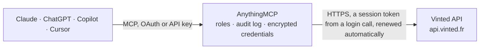

<!-- Generated by scripts/export-github-catalog.mjs in the anythingmcp-website repository. Do not edit by hand. -->

# Vinted MCP connector

Search Vinted's second-hand fashion marketplace from any AI assistant: find items by text, category, brand, size, condition, colour and price, and look up the filter IDs to do it. 3 tools, no account … The AnythingMCP connector gives Claude, ChatGPT, Microsoft Copilot, Cursor and Gemini 3 MCP tools for Vinted, all read-only.

**Category:** [E-commerce](../e-commerce.md) · **Tools:** 3 · **Setup guide:** [anythingmcp.com](https://anythingmcp.com/guides/vinted-to-mcp) · [Deutsch](https://anythingmcp.com/de/guides/vinted-to-mcp) · [Italiano](https://anythingmcp.com/it/guides/vinted-to-mcp) · [Español](https://anythingmcp.com/es/guides/vinted-to-mcp) · [日本語](https://anythingmcp.com/ja/guides/vinted-to-mcp) · [Русский](https://anythingmcp.com/ru/guides/vinted-to-mcp) · [中文](https://anythingmcp.com/zh/guides/vinted-to-mcp)

## Start without code

No installation and no terminal: AnythingMCP Cloud runs the Vinted connector for you, operated by helpcode.ai in Frankfurt, Germany.

1. **Click the button above** and create an account or sign in. The Vinted connector opens, ready to install.
2. **Paste the API key or token from your Vinted account.** Every click is in the [step-by-step guide](https://anythingmcp.com/guides/vinted-to-mcp).
3. **Click Install.** AnythingMCP shows the address of your MCP server.
4. **Add that address to your assistant:** [Claude](https://anythingmcp.com/guides/connect-vinted-to-claude) · [ChatGPT](https://anythingmcp.com/guides/connect-vinted-to-chatgpt) · [Microsoft Copilot](https://anythingmcp.com/guides/connect-vinted-to-copilot) · [Cursor](https://anythingmcp.com/guides/connect-vinted-to-cursor) · [Gemini CLI](https://anythingmcp.com/guides/connect-vinted-to-gemini) · [Meta Muse](https://anythingmcp.com/guides/connect-vinted-to-muse).
5. **Ask your first question**, for example: *Find Levi's 501 W32 L34 in very good condition, under €80, newest first*

Prefer help with the setup? [Talk to us](https://anythingmcp.com/contact).

## How it works

- **The AI client** speaks MCP (Streamable HTTP) to AnythingMCP and only sees tool names, descriptions and results. It never gets the Vinted credentials.
- **AnythingMCP** checks the client's role, builds the call from the tool definition, adds the credentials (a session token from a login call, renewed automatically), calls Vinted, logs the call and returns the result.
- **Vinted** sees an ordinary API client with the rights of the account the credentials belong to.

## Tools

| Tool | What it does | Access |
|---|---|---|
| [`vinted_search_items`](#vinted_search_items) | Search Vinted's catalog by free text, with optional category, brand, size, condition, colour, material and price filters. | read |
| [`vinted_get_filters`](#vinted_get_filters) | List the options of one Vinted search filter — brand, size, status (condition), color or material — with their IDs and how many items match, for an optional… | read |
| [`vinted_get_categories`](#vinted_get_categories) | List Vinted categories with their IDs and item counts, for an optional search text. | read |

## Tool reference

Every parameter as the AI client sees it in `tools/list`. Source: [`packages/backend/src/adapters/intl/vinted.json`](../../../packages/backend/src/adapters/intl/vinted.json).

### `vinted_search_items`

Search Vinted's catalog by free text, with optional category, brand, size, condition, colour, material and price filters. Returns up to 96 items per page with id, title, brand, size and condition, price and price with buyer fees (EUR), link, main photo and seller.

**Access:** read · **Call:** `GET /svc-catalogue/items`

| Parameter | Type | Required | Description |
|---|---|---|---|
| `search_text` | string | yes | Free-text query (e.g. 'Stone Island jacket', 'Carhartt WIP trousers'). |
| `order` | `relevance` \| `newest_first` \| `price_low_to_high` \| `price_high_to_low` | no | Sort order. |
| `page` | integer | no | Page number. A search reaches at most 960 items in total. |
| `per_page` | integer | no | Items per page (max 96). |
| `catalog_ids` | string | no | Optional comma-separated category IDs from vinted_get_categories (e.g. '5' men, '1904' women). |
| `brand_ids` | string | no | Optional comma-separated brand IDs from vinted_get_filters (filter_code=brand), e.g. '362' Carhartt. |
| `size_ids` | string | no | Optional comma-separated size IDs from vinted_get_filters (filter_code=size). Size IDs depend on the category. |
| `status_ids` | string | no | Optional condition filter, comma-separated: '6' new with tags, '1' new without tags, '2' very good, '3' good, '4' satisfactory. |
| `color_ids` | string | no | Optional comma-separated colour IDs from vinted_get_filters (filter_code=color), e.g. '1' black. |
| `material_ids` | string | no | Optional comma-separated material IDs from vinted_get_filters (filter_code=material). |
| `price_from` | number | no | Optional minimum price in EUR. |
| `price_to` | number | no | Optional maximum price in EUR. |

### `vinted_get_filters`

List the options of one Vinted search filter — brand, size, status (condition), color or material — with their IDs and how many items match, for an optional search text and category. Use the IDs in vinted_search_items.

**Access:** read · **Call:** `GET /svc-filters/filters/facets`

| Parameter | Type | Required | Description |
|---|---|---|---|
| `filter_code` | `brand` \| `size` \| `status` \| `color` \| `material` | yes | Which filter to list. |
| `search_text` | string | no | Optional: count options for this query (e.g. 'veste en jean'). |
| `catalog_ids` | string | no | Optional comma-separated category IDs from vinted_get_categories (e.g. '5' men, '1904' women). Recommended for filter_code=size, whose options depend on the category. |

### `vinted_get_categories`

List Vinted categories with their IDs and item counts, for an optional search text. Pass a category ID in catalog_ids to get its subcategories. Use the IDs as catalog_ids in vinted_search_items and vinted_get_filters.

**Access:** read · **Call:** `GET /svc-filters/faceted_categories`

| Parameter | Type | Required | Description |
|---|---|---|---|
| `search_text` | string | no | Optional: count items per category for this query. |
| `catalog_ids` | string | no | Optional category ID whose subcategories to list (e.g. '5' men, '1904' women). |

## Run it yourself

AnythingMCP is open source (AGPL-3.0). [Run it with Docker](../../../README.md#run-it-yourself), open **Connectors → Store**, pick **Vinted**, then add your MCP server URL to the AI client.

[← E-commerce connectors](../e-commerce.md) · [All categories](../README.md)
