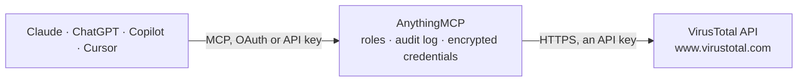

<!-- Generated by scripts/export-github-catalog.mjs in the anythingmcp-website repository. Do not edit by hand. -->

# VirusTotal MCP connector

Threat intelligence from the VirusTotal API v3: file reports by hash, URL, domain and IP reports from about 70 engines, search, relationships, sandbox behaviour, community comments and votes, URL scanning and rescans. The AnythingMCP connector gives Claude, ChatGPT, Microsoft Copilot, Cursor and Gemini 23 MCP tools for VirusTotal: 18 read and 5 can change data.

**Category:** [Monitoring](../monitoring.md) · **Tools:** 23 · **Setup guide:** [anythingmcp.com](https://anythingmcp.com/guides/virustotal-to-mcp) · [Deutsch](https://anythingmcp.com/de/guides/virustotal-to-mcp) · [Italiano](https://anythingmcp.com/it/guides/virustotal-to-mcp) · [Español](https://anythingmcp.com/es/guides/virustotal-to-mcp) · [日本語](https://anythingmcp.com/ja/guides/virustotal-to-mcp) · [Русский](https://anythingmcp.com/ru/guides/virustotal-to-mcp) · [中文](https://anythingmcp.com/zh/guides/virustotal-to-mcp)

## Start without code

No installation and no terminal: AnythingMCP Cloud runs the VirusTotal connector for you, operated by helpcode.ai in Frankfurt, Germany.

1. **Click the button above** and create an account or sign in. The VirusTotal connector opens, ready to install.
2. **Paste the API key or token from your VirusTotal account.** Every click is in the [step-by-step guide](https://anythingmcp.com/guides/virustotal-to-mcp).
3. **Click Install.** AnythingMCP shows the address of your MCP server.
4. **Add that address to your assistant:** [Claude](https://anythingmcp.com/guides/connect-virustotal-to-claude) · [ChatGPT](https://anythingmcp.com/guides/connect-virustotal-to-chatgpt) · [Microsoft Copilot](https://anythingmcp.com/guides/connect-virustotal-to-copilot) · [Cursor](https://anythingmcp.com/guides/connect-virustotal-to-cursor) · [Gemini CLI](https://anythingmcp.com/guides/connect-virustotal-to-gemini) · [Meta Muse](https://anythingmcp.com/guides/connect-virustotal-to-muse).
5. **Ask your first question**, for example: *Check file hash ad3f9b2c4e6f7a8b9c0d1e2f3a4b5c6d — is it known and what's the verdict?*

Prefer help with the setup? [Talk to us](https://anythingmcp.com/contact).

## How it works

- **The AI client** speaks MCP (Streamable HTTP) to AnythingMCP and only sees tool names, descriptions and results. It never gets the VirusTotal credentials.
- **AnythingMCP** checks the client's role, builds the call from the tool definition, adds the credentials (an API key), calls VirusTotal, logs the call and returns the result.
- **VirusTotal** sees an ordinary API client with the rights of the account the credentials belong to.

## Tools

| Tool | What it does | Access |
|---|---|---|
| [`virustotal_get_file_report`](#virustotal_get_file_report) | Report on a file already known to VirusTotal, by hash: detection stats (malicious, suspicious, harmless, undetected), each engine's verdict, the popular… | read |
| [`virustotal_get_url_report`](#virustotal_get_url_report) | Report on a URL already analysed by VirusTotal: detection stats and each engine's verdict, categories, final URL after redirects, HTTP status, title,… | read |
| [`virustotal_get_domain_report`](#virustotal_get_domain_report) | Report on a domain: detection stats and each engine's verdict, categories from several vendors, reputation, votes, last DNS records, registrar, creation… | read |
| [`virustotal_get_ip_report`](#virustotal_get_ip_report) | Report on an IPv4 or IPv6 address: detection stats and each engine's verdict, reputation, votes, ASN and owner, country and continent, network range,… | read |
| [`virustotal_get_analysis`](#virustotal_get_analysis) | Status and result of one analysis started by virustotal_scan_url, virustotal_rescan or a file submission: status (queued, in-progress, completed), stats and… | read |
| [`virustotal_search`](#virustotal_search) | Look up a file hash, a URL, a domain, an IP address or a comment tag in one call. | read |
| [`virustotal_intelligence_search`](#virustotal_intelligence_search) | VirusTotal Intelligence corpus search with search modifiers (e.g. type:peexe positives:10+ fs:2026-01-01+, entity:domain domain_regex:..., content:"..."). | read |
| [`virustotal_list_comments`](#virustotal_list_comments) | Community comments on a file, URL, domain or IP address, newest first: text, tags, date and the comment's own votes. | read |
| [`virustotal_list_votes`](#virustotal_list_votes) | Community votes on a file, URL, domain or IP address: each vote's verdict (harmless or malicious), value and date. | read |
| [`virustotal_list_related_objects`](#virustotal_list_related_objects) | Objects related to a file, URL, domain or IP address, as full objects: e.g. the domains and IPs a file contacted, files it dropped, a domain's subdomains,… | read |
| [`virustotal_list_related_ids`](#virustotal_list_related_ids) | Ids (descriptors) of the objects related to a file, URL, domain or IP address, without their attributes: much smaller than virustotal_list_related_objects. | read |
| [`virustotal_get_file_behaviour_summary`](#virustotal_get_file_behaviour_summary) | Summary of all sandbox runs of a file: processes created, files written and deleted, registry keys, mutexes, DNS lookups, IP traffic, HTTP requests, MITRE… | read |
| [`virustotal_get_file_mitre_attack`](#virustotal_get_file_mitre_attack) | MITRE ATT&CK tactics and techniques observed for a file in each sandbox, with the signatures that triggered them and their severity. | read |
| [`virustotal_list_latest_comments`](#virustotal_list_latest_comments) | Latest comments posted anywhere on VirusTotal, optionally only those with a tag (filter tag:malware). | read |
| [`virustotal_get_comment`](#virustotal_get_comment) | One comment by id: text, tags, date, votes and, with relationships=author,item, who wrote it and what it is about. | read |
| [`virustotal_get_resolution`](#virustotal_get_resolution) | One DNS resolution object: which IP a domain resolved to, when, and from which source. | read |
| [`virustotal_list_popular_threat_categories`](#virustotal_list_popular_threat_categories) | List of the threat categories antivirus verdicts commonly use (trojan, ransomware, dropper, miner, phishing, ...). | read |
| [`virustotal_get_api_usage`](#virustotal_get_api_usage) | Daily API usage of a VirusTotal user, per endpoint, between two dates (at most 30 days, default the last 30). | read |
| [`virustotal_scan_url`](#virustotal_scan_url) | Submit a URL for scanning by about 70 security engines. | write |
| [`virustotal_rescan`](#virustotal_rescan) | Ask VirusTotal to analyse again an object it already knows: a file by hash, a URL by identifier, a domain or an IP address. | write |
| [`virustotal_add_comment`](#virustotal_add_comment) | Post a public comment on a file, URL, domain or IP address under your VirusTotal account. | write |
| [`virustotal_add_vote`](#virustotal_add_vote) | Cast your public vote on a file, URL, domain or IP address: harmless or malicious. | write |
| [`virustotal_delete_comment`](#virustotal_delete_comment) | Delete one of your own public comments by id. | write |

## Tool reference

Every parameter as the AI client sees it in `tools/list`. Source: [`packages/backend/src/adapters/intl/virustotal.json`](../../../packages/backend/src/adapters/intl/virustotal.json).

### `virustotal_get_file_report`

Report on a file already known to VirusTotal, by hash: detection stats (malicious, suspicious, harmless, undetected), each engine's verdict, the popular threat label, type, size, names, first and last submission dates, reputation, community votes, tags, sandbox verdicts and crowdsourced YARA and Sigma results. Looking up a hash does not upload anything. 404 means VirusTotal has never seen the file.

**Access:** read · **Call:** `GET /files/{hash}`

| Parameter | Type | Required | Description |
|---|---|---|---|
| `hash` | string | yes | SHA-256, SHA-1 or MD5 of the file. |
| `relationships` | string | no | Optional relationships to include as descriptors in the same answer, comma-separated (e.g. contacted_domains,contacted_ips for a file; resolutions,subdomains for a domain). |

### `virustotal_get_url_report`

Report on a URL already analysed by VirusTotal: detection stats and each engine's verdict, categories, final URL after redirects, HTTP status, title, outgoing links, redirection chain, targeted brand, reputation, votes, first and last submission dates. Needs the URL identifier; when you only have the URL, use virustotal_search with the URL as query. 404 means the URL has not been analysed yet.

**Access:** read · **Call:** `GET /urls/{url_id}`

| Parameter | Type | Required | Description |
|---|---|---|---|
| `url_id` | string | yes | URL identifier: the URL in unpadded base64url (base64 with - and _ instead of + and /, trailing = removed), or the SHA-256 of the canonical URL. The id is also the middle part of an analysis id u-<id>-<timestamp>. |
| `relationships` | string | no | Optional relationships to include as descriptors in the same answer, comma-separated (e.g. contacted_domains,contacted_ips for a file; resolutions,subdomains for a domain). |

### `virustotal_get_domain_report`

Report on a domain: detection stats and each engine's verdict, categories from several vendors, reputation, votes, last DNS records, registrar, creation date, WHOIS text, popularity ranks and tags.

**Access:** read · **Call:** `GET /domains/{domain}`

| Parameter | Type | Required | Description |
|---|---|---|---|
| `domain` | string | yes | Domain name, e.g. example.com (no scheme, no path). |
| `relationships` | string | no | Optional relationships to include as descriptors in the same answer, comma-separated (e.g. contacted_domains,contacted_ips for a file; resolutions,subdomains for a domain). |

### `virustotal_get_ip_report`

Report on an IPv4 or IPv6 address: detection stats and each engine's verdict, reputation, votes, ASN and owner, country and continent, network range, regional registry, WHOIS text and tags.

**Access:** read · **Call:** `GET /ip_addresses/{ip}`

| Parameter | Type | Required | Description |
|---|---|---|---|
| `ip` | string | yes | IPv4 or IPv6 address. |
| `relationships` | string | no | Optional relationships to include as descriptors in the same answer, comma-separated (e.g. contacted_domains,contacted_ips for a file; resolutions,subdomains for a domain). |

### `virustotal_get_analysis`

Status and result of one analysis started by virustotal_scan_url, virustotal_rescan or a file submission: status (queued, in-progress, completed), stats and each engine's verdict once completed. Poll every 15 to 60 seconds until status is completed; meta.url_info or meta.file_info names the object analysed.

**Access:** read · **Call:** `GET /analyses/{analysis_id}`

| Parameter | Type | Required | Description |
|---|---|---|---|
| `analysis_id` | string | yes | Analysis id returned by a scan or rescan (data.id), e.g. u-<sha256>-<timestamp> for a URL. |

### `virustotal_search`

Look up a file hash, a URL, a domain, an IP address or a comment tag in one call. Returns the matching object (a URL query returns its URL report, so this is the easy way to get one) or, for a tag, the comments carrying it. Advanced queries with search modifiers need virustotal_intelligence_search.

**Access:** read · **Call:** `GET /search`

| Parameter | Type | Required | Description |
|---|---|---|---|
| `query` | string | yes | A hash, a full URL, a domain, an IP address, or a comment tag such as #phishing. |
| `limit` | integer | no | Number of items per page (default 10). |
| `cursor` | string | no | Cursor for the next page: meta.cursor of the previous answer. Leave empty for the first page. |

### `virustotal_intelligence_search`

VirusTotal Intelligence corpus search with search modifiers (e.g. type:peexe positives:10+ fs:2026-01-01+, entity:domain domain_regex:..., content:"..."). Premium API only: a public key answers 403.

**Access:** read · **Call:** `GET /intelligence/search`

| Parameter | Type | Required | Description |
|---|---|---|---|
| `query` | string | yes | Intelligence query with search modifiers, see https://virustotal.readme.io/docs/search-modifiers-full-list. |
| `order` | string | no | Sort order, e.g. first_submission_date-, positives-, size+ (depends on the entity searched). |
| `limit` | integer | no | Results per page (default 10, at most 300). |
| `cursor` | string | no | Cursor for the next page: meta.cursor of the previous answer. Leave empty for the first page. |
| `descriptors_only` | boolean | no | true returns only object ids and types, which is much smaller. |

### `virustotal_list_comments`

Community comments on a file, URL, domain or IP address, newest first: text, tags, date and the comment's own votes. Page with cursor.

**Access:** read · **Call:** `GET /{collection}/{id}/comments`

| Parameter | Type | Required | Description |
|---|---|---|---|
| `collection` | `files` \| `urls` \| `domains` \| `ip_addresses` | yes | Kind of object: files (id = SHA-256, SHA-1 or MD5), urls (id = URL identifier), domains (id = domain name) or ip_addresses (id = IPv4 or IPv6 address). |
| `id` | string | yes | The object's id: a file hash, a URL identifier (see the instructions), a domain name or an IP address, matching collection. |
| `limit` | integer | no | Number of items per page (default 10). |
| `cursor` | string | no | Cursor for the next page: meta.cursor of the previous answer. Leave empty for the first page. |

### `virustotal_list_votes`

Community votes on a file, URL, domain or IP address: each vote's verdict (harmless or malicious), value and date. The totals are in total_votes of the report.

**Access:** read · **Call:** `GET /{collection}/{id}/votes`

| Parameter | Type | Required | Description |
|---|---|---|---|
| `collection` | `files` \| `urls` \| `domains` \| `ip_addresses` | yes | Kind of object: files (id = SHA-256, SHA-1 or MD5), urls (id = URL identifier), domains (id = domain name) or ip_addresses (id = IPv4 or IPv6 address). |
| `id` | string | yes | The object's id: a file hash, a URL identifier (see the instructions), a domain name or an IP address, matching collection. |
| `limit` | integer | no | Number of items per page (default 10). |
| `cursor` | string | no | Cursor for the next page: meta.cursor of the previous answer. Leave empty for the first page. |

### `virustotal_list_related_objects`

Objects related to a file, URL, domain or IP address, as full objects: e.g. the domains and IPs a file contacted, files it dropped, a domain's subdomains, DNS resolutions or historical WHOIS, the files communicating with an IP. Page with cursor. Use virustotal_list_related_ids for a lighter list of ids only.

**Access:** read · **Call:** `GET /{collection}/{id}/{relationship}`

| Parameter | Type | Required | Description |
|---|---|---|---|
| `collection` | `files` \| `urls` \| `domains` \| `ip_addresses` | yes | Kind of object: files (id = SHA-256, SHA-1 or MD5), urls (id = URL identifier), domains (id = domain name) or ip_addresses (id = IPv4 or IPv6 address). |
| `id` | string | yes | The object's id: a file hash, a URL identifier (see the instructions), a domain name or an IP address, matching collection. |
| `relationship` | string | yes | Relationship name. Public API: files: behaviours, bundled_files, comments, contacted_domains, contacted_ips, contacted_urls, dropped_files, execution_parents, pe_resource_children, pe_resource_parents, votes, graphs, collections; urls: comments, last_serving_ip_address, network_location, votes, graphs, collections; domains: comments, communicating_files, historical_ssl_certificates, historical_whois, immediate_parent, parent, referrer_files, resolutions, siblings, subdomains, votes; ip_addresses: comments, communicating_files, historical_ssl_certificates, historical_whois, referrer_files, resolutions, votes. Others (similar_files, embedded_urls, downloaded_files, urls, ...) need the Premium API. |
| `limit` | integer | no | Number of items per page (default 10). |
| `cursor` | string | no | Cursor for the next page: meta.cursor of the previous answer. Leave empty for the first page. |

### `virustotal_list_related_ids`

Ids (descriptors) of the objects related to a file, URL, domain or IP address, without their attributes: much smaller than virustotal_list_related_objects. Look an id up afterwards with the matching report tool.

**Access:** read · **Call:** `GET /{collection}/{id}/relationships/{relationship}`

| Parameter | Type | Required | Description |
|---|---|---|---|
| `collection` | `files` \| `urls` \| `domains` \| `ip_addresses` | yes | Kind of object: files (id = SHA-256, SHA-1 or MD5), urls (id = URL identifier), domains (id = domain name) or ip_addresses (id = IPv4 or IPv6 address). |
| `id` | string | yes | The object's id: a file hash, a URL identifier (see the instructions), a domain name or an IP address, matching collection. |
| `relationship` | string | yes | Relationship name. Public API: files: behaviours, bundled_files, comments, contacted_domains, contacted_ips, contacted_urls, dropped_files, execution_parents, pe_resource_children, pe_resource_parents, votes, graphs, collections; urls: comments, last_serving_ip_address, network_location, votes, graphs, collections; domains: comments, communicating_files, historical_ssl_certificates, historical_whois, immediate_parent, parent, referrer_files, resolutions, siblings, subdomains, votes; ip_addresses: comments, communicating_files, historical_ssl_certificates, historical_whois, referrer_files, resolutions, votes. Others (similar_files, embedded_urls, downloaded_files, urls, ...) need the Premium API. |
| `limit` | integer | no | Number of items per page (default 10). |
| `cursor` | string | no | Cursor for the next page: meta.cursor of the previous answer. Leave empty for the first page. |

### `virustotal_get_file_behaviour_summary`

Summary of all sandbox runs of a file: processes created, files written and deleted, registry keys, mutexes, DNS lookups, IP traffic, HTTP requests, MITRE ATT&CK techniques, verdicts and tags. Empty when no sandbox has run the file.

**Access:** read · **Call:** `GET /files/{hash}/behaviour_summary`

| Parameter | Type | Required | Description |
|---|---|---|---|
| `hash` | string | yes | SHA-256, SHA-1 or MD5 of the file. |

### `virustotal_get_file_mitre_attack`

MITRE ATT&CK tactics and techniques observed for a file in each sandbox, with the signatures that triggered them and their severity.

**Access:** read · **Call:** `GET /files/{hash}/behaviour_mitre_trees`

| Parameter | Type | Required | Description |
|---|---|---|---|
| `hash` | string | yes | SHA-256, SHA-1 or MD5 of the file. |

### `virustotal_list_latest_comments`

Latest comments posted anywhere on VirusTotal, optionally only those with a tag (filter tag:malware). Each comment's id starts with the kind and id of the object it is about (f- file, u- URL, d- domain, i- IP).

**Access:** read · **Call:** `GET /comments`

| Parameter | Type | Required | Description |
|---|---|---|---|
| `filter` | string | no | Optional filter, e.g. tag:malware or tag:phishing. |
| `limit` | integer | no | Number of items per page (default 10). |
| `cursor` | string | no | Cursor for the next page: meta.cursor of the previous answer. Leave empty for the first page. |

### `virustotal_get_comment`

One comment by id: text, tags, date, votes and, with relationships=author,item, who wrote it and what it is about.

**Access:** read · **Call:** `GET /comments/{comment_id}`

| Parameter | Type | Required | Description |
|---|---|---|---|
| `comment_id` | string | yes | Comment id, e.g. f-<sha256>-<suffix> from a comment list. |
| `relationships` | string | no | Optional: author, item or author,item. |

### `virustotal_get_resolution`

One DNS resolution object: which IP a domain resolved to, when, and from which source. Its id is the IP followed by the domain (e.g. 8.8.8.8dns.google), as listed by the resolutions relationship.

**Access:** read · **Call:** `GET /resolutions/{resolution_id}`

| Parameter | Type | Required | Description |
|---|---|---|---|
| `resolution_id` | string | yes | Resolution id: the IP address immediately followed by the domain name. |

### `virustotal_list_popular_threat_categories`

List of the threat categories antivirus verdicts commonly use (trojan, ransomware, dropper, miner, phishing, ...). A cheap call, also used to check the key.

**Access:** read · **Call:** `GET /popular_threat_categories`

No parameters.

### `virustotal_get_api_usage`

Daily API usage of a VirusTotal user, per endpoint, between two dates (at most 30 days, default the last 30). The user id is your VirusTotal user name (shown on your profile).

**Access:** read · **Call:** `GET /users/{user_id}/api_usage`

| Parameter | Type | Required | Description |
|---|---|---|---|
| `user_id` | string | yes | Your VirusTotal user name. |
| `start_date` | string | no | First day, YYYYMMDD. |
| `end_date` | string | no | Last day, YYYYMMDD. |

### `virustotal_scan_url`

Submit a URL for scanning by about 70 security engines. This is a write that is shared with the community: the URL, and anything inside it (tokens, e-mail addresses, session ids in the query string), becomes visible to other VirusTotal users and cannot be withdrawn. Submit only public URLs. Returns an analysis id (data.id, u-<url_id>-<timestamp>); read the result with virustotal_get_analysis, or the full report with virustotal_get_url_report.

**Access:** write · **Call:** `POST /urls`

| Parameter | Type | Required | Description |
|---|---|---|---|
| `url` | string | yes | The full URL to scan, e.g. https://example.com/login. |

### `virustotal_rescan`

Ask VirusTotal to analyse again an object it already knows: a file by hash, a URL by identifier, a domain or an IP address. Use it when the last analysis is old. Returns an analysis id for virustotal_get_analysis. The object is already public; a rescan only refreshes its verdicts.

**Access:** write · **Call:** `POST /{collection}/{id}/analyse`

| Parameter | Type | Required | Description |
|---|---|---|---|
| `collection` | `files` \| `urls` \| `domains` \| `ip_addresses` | yes | Kind of object: files (id = SHA-256, SHA-1 or MD5), urls (id = URL identifier), domains (id = domain name) or ip_addresses (id = IPv4 or IPv6 address). |
| `id` | string | yes | The object's id: a file hash, a URL identifier (see the instructions), a domain name or an IP address, matching collection. |

### `virustotal_add_comment`

Post a public comment on a file, URL, domain or IP address under your VirusTotal account. Words starting with # become tags. Visible to everyone; it can be removed later with virustotal_delete_comment.

**Access:** write · **Call:** `POST /{collection}/{id}/comments`

| Parameter | Type | Required | Description |
|---|---|---|---|
| `collection` | `files` \| `urls` \| `domains` \| `ip_addresses` | yes | Kind of object: files (id = SHA-256, SHA-1 or MD5), urls (id = URL identifier), domains (id = domain name) or ip_addresses (id = IPv4 or IPv6 address). |
| `id` | string | yes | The object's id: a file hash, a URL identifier (see the instructions), a domain name or an IP address, matching collection. |
| `text` | string | yes | Comment text, e.g. 'Phishing page imitating a bank login #phishing'. |

### `virustotal_add_vote`

Cast your public vote on a file, URL, domain or IP address: harmless or malicious. It counts in the object's total_votes and reputation.

**Access:** write · **Call:** `POST /{collection}/{id}/votes`

| Parameter | Type | Required | Description |
|---|---|---|---|
| `collection` | `files` \| `urls` \| `domains` \| `ip_addresses` | yes | Kind of object: files (id = SHA-256, SHA-1 or MD5), urls (id = URL identifier), domains (id = domain name) or ip_addresses (id = IPv4 or IPv6 address). |
| `id` | string | yes | The object's id: a file hash, a URL identifier (see the instructions), a domain name or an IP address, matching collection. |
| `verdict` | `harmless` \| `malicious` | yes | harmless or malicious. |

### `virustotal_delete_comment`

Delete one of your own public comments by id. It cannot be undone.

**Access:** write · **Call:** `DELETE /comments/{comment_id}`

| Parameter | Type | Required | Description |
|---|---|---|---|
| `comment_id` | string | yes | Id of a comment you posted (data.id from virustotal_add_comment). |

## Run it yourself

AnythingMCP is open source (AGPL-3.0). [Run it with Docker](../../../README.md#run-it-yourself), open **Connectors → Store**, pick **VirusTotal** and enter `VIRUSTOTAL_API_KEY`, then add your MCP server URL to the AI client.

[← Monitoring connectors](../monitoring.md) · [All categories](../README.md)
