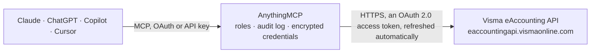

<!-- Generated by scripts/export-github-catalog.mjs in the anythingmcp-website repository. Do not edit by hand. -->

# Visma eAccounting MCP connector

Visma eAccounting — Nordic cloud bookkeeping: customers, suppliers, customer and supplier invoices, articles, and the account chart. The AnythingMCP connector gives Claude, ChatGPT, Microsoft Copilot, Cursor and Gemini 10 MCP tools for Visma eAccounting, all read-only.

**Category:** [Accounting](../accounting.md) · **Tools:** 10 · **Setup guide:** [anythingmcp.com](https://anythingmcp.com/guides/visma-eaccounting-to-mcp) · [Deutsch](https://anythingmcp.com/de/guides/visma-eaccounting-to-mcp) · [Italiano](https://anythingmcp.com/it/guides/visma-eaccounting-to-mcp) · [Español](https://anythingmcp.com/es/guides/visma-eaccounting-to-mcp) · [日本語](https://anythingmcp.com/ja/guides/visma-eaccounting-to-mcp) · [Русский](https://anythingmcp.com/ru/guides/visma-eaccounting-to-mcp) · [中文](https://anythingmcp.com/zh/guides/visma-eaccounting-to-mcp)

## Start without code

No installation and no terminal: AnythingMCP Cloud runs the Visma eAccounting connector for you, operated by helpcode.ai in Frankfurt, Germany.

1. **Click the button above** and create an account or sign in. The Visma eAccounting connector opens, ready to install.
2. **Sign in with your Visma eAccounting account** when AnythingMCP asks. The first time, an admin creates a small app in the Visma eAccounting developer console. Every click is in the [step-by-step guide](https://anythingmcp.com/guides/visma-eaccounting-to-mcp).
3. **Click Install.** AnythingMCP shows the address of your MCP server.
4. **Add that address to your assistant:** [Claude](https://anythingmcp.com/guides/connect-visma-eaccounting-to-claude) · [ChatGPT](https://anythingmcp.com/guides/connect-visma-eaccounting-to-chatgpt) · [Microsoft Copilot](https://anythingmcp.com/guides/connect-visma-eaccounting-to-copilot) · [Cursor](https://anythingmcp.com/guides/connect-visma-eaccounting-to-cursor) · [Gemini CLI](https://anythingmcp.com/guides/connect-visma-eaccounting-to-gemini) · [Meta Muse](https://anythingmcp.com/guides/connect-visma-eaccounting-to-muse).
5. **Ask your first question**, for example: *Show customer 2003 details for Sjöström Fastigheter AB, include credit limit and payment terms.*

Prefer help with the setup? [Talk to us](https://anythingmcp.com/contact).

## How it works

- **The AI client** speaks MCP (Streamable HTTP) to AnythingMCP and only sees tool names, descriptions and results. It never gets the Visma eAccounting credentials.
- **AnythingMCP** checks the client's role, builds the call from the tool definition, adds the credentials (an OAuth 2.0 access token, refreshed automatically), calls Visma eAccounting, logs the call and returns the result.
- **Visma eAccounting** sees an ordinary API client with the rights of the account the credentials belong to.

## Tools

| Tool | What it does | Access |
|---|---|---|
| [`visma_eaccounting_get_company_settings`](#visma_eaccounting_get_company_settings) | Read the connected company's settings: name, corporate identity number, VAT number, address and base currency. | read |
| [`visma_eaccounting_list_customers`](#visma_eaccounting_list_customers) | List customers with their number, name, corporate identity number, address and payment terms. | read |
| [`visma_eaccounting_get_customer`](#visma_eaccounting_get_customer) | Read one customer by id, with their addresses, delivery defaults, VAT settings and credit limit. | read |
| [`visma_eaccounting_list_customer_invoices`](#visma_eaccounting_list_customer_invoices) | List *posted* customer invoices with their number, date, due date, customer, total and remaining amount. | read |
| [`visma_eaccounting_get_customer_invoice`](#visma_eaccounting_get_customer_invoice) | Read one posted customer invoice in full: every row with article, quantity, price and VAT, the totals and the remaining amount. | read |
| [`visma_eaccounting_list_invoice_drafts`](#visma_eaccounting_list_invoice_drafts) | List *unposted* customer invoice drafts. | read |
| [`visma_eaccounting_list_supplier_invoices`](#visma_eaccounting_list_supplier_invoices) | List supplier invoices with their supplier, date, due date, total and remaining amount — the payables side. | read |
| [`visma_eaccounting_list_suppliers`](#visma_eaccounting_list_suppliers) | List suppliers with their number, name, corporate identity number and payment details, for the purchasing side of the ledger. | read |
| [`visma_eaccounting_list_articles`](#visma_eaccounting_list_articles) | List articles with their number, name, net and gross price, VAT rate and stock quantity. | read |
| [`visma_eaccounting_list_accounts`](#visma_eaccounting_list_accounts) | List the chart of accounts with each account's number, name, type and VAT code, for questions that need the ledger structure. | read |

## Tool reference

Every parameter as the AI client sees it in `tools/list`. Source: [`packages/backend/src/adapters/se/visma-eaccounting.json`](../../../packages/backend/src/adapters/se/visma-eaccounting.json).

### `visma_eaccounting_get_company_settings`

Read the connected company's settings: name, corporate identity number, VAT number, address and base currency. The fastest proof the token works.

**Access:** read · **Call:** `GET /companysettings`

No parameters.

### `visma_eaccounting_list_customers`

List customers with their number, name, corporate identity number, address and payment terms.

**Access:** read · **Call:** `GET /customers`

| Parameter | Type | Required | Description |
|---|---|---|---|
| `filter` | string | no | OData $filter expression, e.g. IsActive eq true. |
| `pagesize` | number | no | Rows per page (default 50, max 1000). |
| `page` | number | no | Page number, 1-based (default 1). |
| `orderby` | string | no | Sort expression, e.g. `Name asc`. |

### `visma_eaccounting_get_customer`

Read one customer by id, with their addresses, delivery defaults, VAT settings and credit limit.

**Access:** read · **Call:** `GET /customers/{customerId}`

| Parameter | Type | Required | Description |
|---|---|---|---|
| `customerId` | string | yes | Visma customer GUID. |

### `visma_eaccounting_list_customer_invoices`

List *posted* customer invoices with their number, date, due date, customer, total and remaining amount. Drafts are a separate collection.

**Access:** read · **Call:** `GET /customerinvoices`

| Parameter | Type | Required | Description |
|---|---|---|---|
| `filter` | string | no | OData $filter expression, e.g. InvoiceDate ge 2026-01-01T00:00:00Z. |
| `pagesize` | number | no | Rows per page (default 50, max 1000). |
| `page` | number | no | Page number, 1-based (default 1). |
| `orderby` | string | no | Sort expression, e.g. `InvoiceDate desc`. |

### `visma_eaccounting_get_customer_invoice`

Read one posted customer invoice in full: every row with article, quantity, price and VAT, the totals and the remaining amount.

**Access:** read · **Call:** `GET /customerinvoices/{invoiceId}`

| Parameter | Type | Required | Description |
|---|---|---|---|
| `invoiceId` | string | yes | Visma invoice GUID. |

### `visma_eaccounting_list_invoice_drafts`

List *unposted* customer invoice drafts. A draft is not revenue — keep it out of any figure that reports what was actually invoiced.

**Access:** read · **Call:** `GET /customerinvoicedrafts`

| Parameter | Type | Required | Description |
|---|---|---|---|
| `filter` | string | no | OData $filter expression. |
| `pagesize` | number | no | Rows per page (default 50, max 1000). |
| `page` | number | no | Page number, 1-based (default 1). |

### `visma_eaccounting_list_supplier_invoices`

List supplier invoices with their supplier, date, due date, total and remaining amount — the payables side.

**Access:** read · **Call:** `GET /supplierinvoices`

| Parameter | Type | Required | Description |
|---|---|---|---|
| `filter` | string | no | OData $filter expression. |
| `pagesize` | number | no | Rows per page (default 50, max 1000). |
| `page` | number | no | Page number, 1-based (default 1). |
| `orderby` | string | no | Sort expression. |

### `visma_eaccounting_list_suppliers`

List suppliers with their number, name, corporate identity number and payment details, for the purchasing side of the ledger.

**Access:** read · **Call:** `GET /suppliers`

| Parameter | Type | Required | Description |
|---|---|---|---|
| `filter` | string | no | OData $filter expression. |
| `pagesize` | number | no | Rows per page (default 50, max 1000). |
| `page` | number | no | Page number, 1-based (default 1). |

### `visma_eaccounting_list_articles`

List articles with their number, name, net and gross price, VAT rate and stock quantity.

**Access:** read · **Call:** `GET /articles`

| Parameter | Type | Required | Description |
|---|---|---|---|
| `filter` | string | no | OData $filter expression, e.g. IsActive eq true. |
| `pagesize` | number | no | Rows per page (default 50, max 1000). |
| `page` | number | no | Page number, 1-based (default 1). |

### `visma_eaccounting_list_accounts`

List the chart of accounts with each account's number, name, type and VAT code, for questions that need the ledger structure.

**Access:** read · **Call:** `GET /accounts`

| Parameter | Type | Required | Description |
|---|---|---|---|
| `filter` | string | no | OData $filter expression. |
| `pagesize` | number | no | Rows per page (default 50, max 1000). |
| `page` | number | no | Page number, 1-based (default 1). |

## Run it yourself

AnythingMCP is open source (AGPL-3.0). [Run it with Docker](../../../README.md#run-it-yourself), open **Connectors → Store**, pick **Visma eAccounting** and enter `VISMA_CLIENT_ID`, `VISMA_CLIENT_SECRET`, then add your MCP server URL to the AI client.

[← Accounting connectors](../accounting.md) · [All categories](../README.md)
