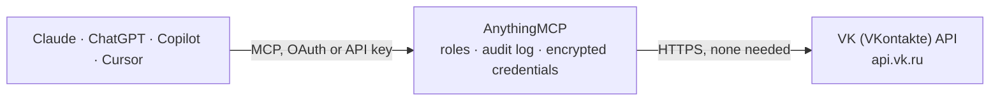

<!-- Generated by scripts/export-github-catalog.mjs in the anythingmcp-website repository. Do not edit by hand. -->

# VK (VKontakte) MCP connector

Manage a VK community from an AI agent: community info and token rights, community messages (conversations, history, replies), comments as the community, and with an admin user token the wall posts, … The AnythingMCP connector gives Claude, ChatGPT, Microsoft Copilot, Cursor and Gemini 14 MCP tools for VK (VKontakte): 9 read and 5 can change data.

**Category:** [Social Media](../social.md) · **Tools:** 14 · **Setup guide:** [anythingmcp.com](https://anythingmcp.com/guides/vk-to-mcp) · [Deutsch](https://anythingmcp.com/de/guides/vk-to-mcp) · [Italiano](https://anythingmcp.com/it/guides/vk-to-mcp) · [Español](https://anythingmcp.com/es/guides/vk-to-mcp) · [日本語](https://anythingmcp.com/ja/guides/vk-to-mcp) · [Русский](https://anythingmcp.com/ru/guides/vk-to-mcp) · [中文](https://anythingmcp.com/zh/guides/vk-to-mcp)

## Start without code

No installation and no terminal: AnythingMCP Cloud runs the VK (VKontakte) connector for you, operated by helpcode.ai in Frankfurt, Germany.

1. **Click the button above** and create an account or sign in. The VK (VKontakte) connector opens, ready to install.
2. **Nothing to enter:** this connector needs no credentials. Every click is in the [step-by-step guide](https://anythingmcp.com/guides/vk-to-mcp).
3. **Click Install.** AnythingMCP shows the address of your MCP server.
4. **Add that address to your assistant:** [Claude](https://anythingmcp.com/guides/connect-vk-to-claude) · [ChatGPT](https://anythingmcp.com/guides/connect-vk-to-chatgpt) · [Microsoft Copilot](https://anythingmcp.com/guides/connect-vk-to-copilot) · [Cursor](https://anythingmcp.com/guides/connect-vk-to-cursor) · [Gemini CLI](https://anythingmcp.com/guides/connect-vk-to-gemini) · [Meta Muse](https://anythingmcp.com/guides/connect-vk-to-muse).
5. **Ask your first question**, for example: *Who sent the unanswered message in conversations filter 'unanswered' for our community, and what's their last message?*

Prefer help with the setup? [Talk to us](https://anythingmcp.com/contact).

## How it works

- **The AI client** speaks MCP (Streamable HTTP) to AnythingMCP and only sees tool names, descriptions and results. It never gets the VK (VKontakte) credentials.
- **AnythingMCP** checks the client's role, builds the call from the tool definition, adds the credentials (none needed), calls VK (VKontakte), logs the call and returns the result.
- **VK (VKontakte)** sees an ordinary API client with the rights of the account the credentials belong to.

## Tools

| Tool | What it does | Access |
|---|---|---|
| [`vk_get_token_permissions`](#vk_get_token_permissions) | Check the community token: which rights (права) it carries, for example manage, messages, photos, wall. | read |
| [`vk_get_community`](#vk_get_community) | Get the community (сообщество): id, name, screen_name (short address), type, open or closed, description, members count, activity, site, status,… | read |
| [`vk_list_conversations`](#vk_list_conversations) | List the community's conversations (диалоги сообщества) with users: peer id, unread count, whether it is unanswered, the last message, and the users' names. | read |
| [`vk_get_conversation_history`](#vk_get_conversation_history) | Read the messages of one conversation of the community, newest first: id, date (Unix time), sender, direction (out = 1 sent by the community), text and… | read |
| [`vk_send_message`](#vk_send_message) | Send a message from the community to a user who has written to it or allowed its messages. | write |
| [`vk_create_comment`](#vk_create_comment) | Comment on a post of the community's wall, as the community. | write |
| [`vk_get_wall_posts`](#vk_get_wall_posts) | Read posts of a community wall (стена), newest first: id, date (Unix time), text, type, pinned flag, counts of comments, likes, reposts and views, and… | read |
| [`vk_get_post_comments`](#vk_get_post_comments) | Read the comments under a post of a community wall: id, author id, date (Unix time), text, reply target, number of replies and likes, with the authors' names. | read |
| [`vk_list_photo_albums`](#vk_list_photo_albums) | List the community's photo albums: id, title, description, number of photos, creation and update dates (Unix time) and the cover URL. | read |
| [`vk_publish_post`](#vk_publish_post) | Publish a post on the community wall as the community, or schedule it with publish_date. | write |
| [`vk_get_community_stats`](#vk_get_community_stats) | Community statistics per day, week or month: views, unique visitors, reach, reach among subscribers, mobile reach and activity (likes, comments, reposts,… | read |
| [`vk_list_market_products`](#vk_list_market_products) | List the products of the community shop (товары): id, title, price, availability, category, SKU, stock and date. | read |
| [`vk_delete_post`](#vk_delete_post) | Delete a post from the community wall. | write |
| [`vk_delete_comment`](#vk_delete_comment) | Delete a comment under a post of the community wall. | write |

## Tool reference

Every parameter as the AI client sees it in `tools/list`. Source: [`packages/backend/src/adapters/intl/vk.json`](../../../packages/backend/src/adapters/intl/vk.json).

### `vk_get_token_permissions`

Check the community token: which rights (права) it carries, for example manage, messages, photos, wall. Cheap and needs no arguments; call it first, and whenever a tool answers that access is denied.

**Access:** read · **Call:** `GET /groups.getTokenPermissions`

No parameters.

### `vk_get_community`

Get the community (сообщество): id, name, screen_name (short address), type, open or closed, description, members count, activity, site, status, verification, shop settings and counters. Without group_id it returns the token's own community.

**Access:** read · **Call:** `GET /groups.getById`

| Parameter | Type | Required | Description |
|---|---|---|---|
| `group_id` | string | no | Optional id or short address of another community, for example apiclub. Omit for the token's own community. |

### `vk_list_conversations`

List the community's conversations (диалоги сообщества) with users: peer id, unread count, whether it is unanswered, the last message, and the users' names. Needs the messages right on the token and community messages switched on. Use filter unanswered or unread to find messages waiting for a reply.

**Access:** read · **Call:** `GET /messages.getConversations`

| Parameter | Type | Required | Description |
|---|---|---|---|
| `filter` | `all` \| `unread` \| `unanswered` \| `important` \| `archive` | no | all (default), unread, unanswered, important or archive. |
| `count` | integer | no | Conversations per call, 1 to 200. Default 20. |
| `offset` | integer | no | Items to skip, for the next page. |

### `vk_get_conversation_history`

Read the messages of one conversation of the community, newest first: id, date (Unix time), sender, direction (out = 1 sent by the community), text and attachment types. Needs the messages right on the token.

**Access:** read · **Call:** `GET /messages.getHistory`

| Parameter | Type | Required | Description |
|---|---|---|---|
| `peer_id` | integer | yes | Conversation peer id from vk_list_conversations (a user id for a private chat). |
| `count` | integer | no | Messages per call, 1 to 200. Default 20. |
| `offset` | integer | no | Items to skip, for the next page. |
| `start_message_id` | integer | no | Optional message id to start from. |
| `rev` | `0` \| `1` | no | 1 for chronological order; 0 (default) newest first. |

### `vk_send_message`

Send a message from the community to a user who has written to it or allowed its messages. The user receives it at once and it cannot be recalled from here. Show the user the recipient and the exact text and ask for confirmation before calling. Needs the messages right on the token.

**Access:** write · **Call:** `POST /messages.send`

| Parameter | Type | Required | Description |
|---|---|---|---|
| `peer_id` | integer | yes | Recipient: the user id or peer_id from vk_list_conversations. |
| `message` | string | yes | Message text, as approved by the user. |
| `random_id` | integer | yes | A random number that identifies this message, for example 482913377. VK refuses a second message with the same random_id from the community, so a retry with the same value cannot send the message twice. Use a new value for each new message. |
| `reply_to` | integer | no | Optional id of the message this one answers. |
| `attachment` | string | no | Optional media already on VK, comma-separated, for example photo-1_456239017. |

### `vk_create_comment`

Comment on a post of the community's wall, as the community. The comment is public. Show the user the exact text and ask for confirmation before calling. Needs the wall right on the community token.

**Access:** write · **Call:** `POST /wall.createComment`

| Parameter | Type | Required | Description |
|---|---|---|---|
| `community_id` | integer | yes | Community id, a positive number (id from vk_get_community), for example 1. |
| `post_id` | integer | yes | Post id on the community wall (id from vk_get_wall_posts). |
| `message` | string | yes | Comment text, as approved by the user. |
| `reply_to_comment` | integer | no | Optional id of the comment this one answers (from vk_get_post_comments). |

### `vk_get_wall_posts`

Read posts of a community wall (стена), newest first: id, date (Unix time), text, type, pinned flag, counts of comments, likes, reposts and views, and attachment types. Needs VK_USER_TOKEN (a user token, or a service token for public communities): VK does not accept community tokens for this method.

**Access:** read · **Call:** `GET /wall.get`

| Parameter | Type | Required | Description |
|---|---|---|---|
| `domain` | string | yes | Short address of the community, the screen_name from vk_get_community (for example apiclub), or club followed by its id (club1). |
| `filter` | `all` \| `owner` \| `others` \| `postponed` \| `suggests` \| `donut` | no | all (default); owner for the community's own posts; others for visitors' posts; postponed (scheduled) and suggests (suggested) need an admin's user token. |
| `count` | integer | no | Posts per call, 1 to 100. Default 20. |
| `offset` | integer | no | Items to skip, for the next page. |

### `vk_get_post_comments`

Read the comments under a post of a community wall: id, author id, date (Unix time), text, reply target, number of replies and likes, with the authors' names. Needs VK_USER_TOKEN (a user token, or a service token for public communities).

**Access:** read · **Call:** `GET /wall.getComments`

| Parameter | Type | Required | Description |
|---|---|---|---|
| `community_id` | integer | yes | Community id, a positive number (id from vk_get_community), for example 1. |
| `post_id` | integer | yes | Post id from vk_get_wall_posts. |
| `sort` | `asc` \| `desc` | no | desc (default) newest first, asc oldest first. |
| `count` | integer | no | Comments per call, 1 to 100. Default 20. |
| `offset` | integer | no | Items to skip, for the next page. |
| `comment_id` | integer | no | Optional comment id, to read the replies in its thread. |

### `vk_list_photo_albums`

List the community's photo albums: id, title, description, number of photos, creation and update dates (Unix time) and the cover URL. Needs VK_USER_TOKEN (a user token, or a service token for public communities).

**Access:** read · **Call:** `GET /photos.getAlbums`

| Parameter | Type | Required | Description |
|---|---|---|---|
| `community_id` | integer | yes | Community id, a positive number (id from vk_get_community), for example 1. |
| `count` | integer | no | Albums per call, 1 to 100. Default 20. |
| `offset` | integer | no | Items to skip, for the next page. |

### `vk_publish_post`

Publish a post on the community wall as the community, or schedule it with publish_date. The post is public and reaches every subscriber's feed. Show the user the exact text, attachments and time and ask for confirmation before calling. Needs VK_USER_TOKEN: a user token of a community admin with the wall right (VK grants it to apps on request only); community tokens cannot post.

**Access:** write · **Call:** `POST /wall.post`

| Parameter | Type | Required | Description |
|---|---|---|---|
| `community_id` | integer | yes | Community id, a positive number (id from vk_get_community), for example 1. |
| `message` | string | no | Post text, as approved by the user. Required unless attachments is set. |
| `attachments` | string | no | Optional media already on VK or one link, comma-separated, for example photo-1_456239017,https://example.com. |
| `publish_date` | integer | no | Optional Unix time to schedule the post (отложенная запись). |
| `signed` | `0` \| `1` | no | 1 to sign the post with the admin's name. |
| `close_comments` | `0` \| `1` | no | 1 to switch comments off for this post. |
| `mute_notifications` | `0` \| `1` | no | 1 to receive no notifications about this post. |

### `vk_get_community_stats`

Community statistics per day, week or month: views, unique visitors, reach, reach among subscribers, mobile reach and activity (likes, comments, reposts, subscribed and unsubscribed). Needs VK_USER_TOKEN of a community admin with access to statistics.

**Access:** read · **Call:** `GET /stats.get`

| Parameter | Type | Required | Description |
|---|---|---|---|
| `community_id` | integer | yes | Community id, a positive number (id from vk_get_community), for example 1. |
| `timestamp_from` | integer | yes | Start of the period, Unix time in seconds. |
| `timestamp_to` | integer | no | Optional end of the period, Unix time in seconds. |
| `interval` | `day` \| `week` \| `month` \| `year` \| `all` | no | Length of one row. Default day. |
| `intervals_count` | integer | no | Optional number of intervals, counted back from timestamp_to. |

### `vk_list_market_products`

List the products of the community shop (товары): id, title, price, availability, category, SKU, stock and date. Needs VK_USER_TOKEN with the market right (VK grants it to apps on request only).

**Access:** read · **Call:** `GET /market.get`

| Parameter | Type | Required | Description |
|---|---|---|---|
| `community_id` | integer | yes | Community id, a positive number (id from vk_get_community), for example 1. |
| `count` | integer | no | Products per call, 1 to 200. Default 20. |
| `offset` | integer | no | Items to skip, for the next page. |
| `album_id` | integer | no | Optional product collection (подборка) id. |
| `with_disabled` | `0` \| `1` | no | 1 to include unavailable products. |

### `vk_delete_post`

Delete a post from the community wall. Cannot be undone. Installed switched off. Ask the user for explicit confirmation before calling. Needs VK_USER_TOKEN of a community admin.

**Access:** write · **Call:** `POST /wall.delete`

| Parameter | Type | Required | Description |
|---|---|---|---|
| `community_id` | integer | yes | Community id, a positive number (id from vk_get_community), for example 1. |
| `post_id` | integer | yes | Post id from vk_get_wall_posts. |

### `vk_delete_comment`

Delete a comment under a post of the community wall. Installed switched off. Ask the user for explicit confirmation before calling. Needs VK_USER_TOKEN of a community admin.

**Access:** write · **Call:** `POST /wall.deleteComment`

| Parameter | Type | Required | Description |
|---|---|---|---|
| `community_id` | integer | yes | Community id, a positive number (id from vk_get_community), for example 1. |
| `comment_id` | integer | yes | Comment id from vk_get_post_comments. |

## Run it yourself

AnythingMCP is open source (AGPL-3.0). [Run it with Docker](../../../README.md#run-it-yourself), open **Connectors → Store**, pick **VK (VKontakte)** and enter `VK_COMMUNITY_TOKEN`, then add your MCP server URL to the AI client.

[← Social Media connectors](../social.md) · [All categories](../README.md)
