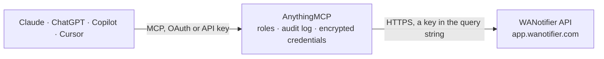

<!-- Generated by scripts/export-github-catalog.mjs in the anythingmcp-website repository. Do not edit by hand. -->

# WANotifier MCP connector

WANotifier on the official WhatsApp Business API: browse and update contacts, lists and tags, and send WhatsApp text, image and document replies inside the 24-hour conversation window. The AnythingMCP connector gives Claude, ChatGPT, Microsoft Copilot, Cursor and Gemini 8 MCP tools for WANotifier: 4 read and 4 can change data.

**Category:** [Messaging](../messaging.md) · **Tools:** 8 · **Setup guide:** [anythingmcp.com](https://anythingmcp.com/guides/wanotifier-to-mcp) · [Deutsch](https://anythingmcp.com/de/guides/wanotifier-to-mcp) · [Italiano](https://anythingmcp.com/it/guides/wanotifier-to-mcp) · [Español](https://anythingmcp.com/es/guides/wanotifier-to-mcp) · [日本語](https://anythingmcp.com/ja/guides/wanotifier-to-mcp) · [Русский](https://anythingmcp.com/ru/guides/wanotifier-to-mcp) · [中文](https://anythingmcp.com/zh/guides/wanotifier-to-mcp)

## Start without code

No installation and no terminal: AnythingMCP Cloud runs the WANotifier connector for you, operated by helpcode.ai in Frankfurt, Germany.

1. **Click the button above** and create an account or sign in. The WANotifier connector opens, ready to install.
2. **Paste the API key or token from your WANotifier account.** Every click is in the [step-by-step guide](https://anythingmcp.com/guides/wanotifier-to-mcp).
3. **Click Install.** AnythingMCP shows the address of your MCP server.
4. **Add that address to your assistant:** [Claude](https://anythingmcp.com/guides/connect-wanotifier-to-claude) · [ChatGPT](https://anythingmcp.com/guides/connect-wanotifier-to-chatgpt) · [Microsoft Copilot](https://anythingmcp.com/guides/connect-wanotifier-to-copilot) · [Cursor](https://anythingmcp.com/guides/connect-wanotifier-to-cursor) · [Gemini CLI](https://anythingmcp.com/guides/connect-wanotifier-to-gemini) · [Meta Muse](https://anythingmcp.com/guides/connect-wanotifier-to-muse).
5. **Ask your first question**, for example: *Find WhatsApp contact for customer Boulangerie Saint-Éloi SARL and which contact lists they belong to*

Prefer help with the setup? [Talk to us](https://anythingmcp.com/contact).

## How it works

- **The AI client** speaks MCP (Streamable HTTP) to AnythingMCP and only sees tool names, descriptions and results. It never gets the WANotifier credentials.
- **AnythingMCP** checks the client's role, builds the call from the tool definition, adds the credentials (a key in the query string), calls WANotifier, logs the call and returns the result.
- **WANotifier** sees an ordinary API client with the rights of the account the credentials belong to.

## Tools

| Tool | What it does | Access |
|---|---|---|
| [`wanotifier_list_contact_lists`](#wanotifier_list_contact_lists) | List the contact lists in the WANotifier account with their numeric IDs and names. | read |
| [`wanotifier_list_contact_tags`](#wanotifier_list_contact_tags) | List the contact tags in the WANotifier account with their numeric IDs and names. | read |
| [`wanotifier_list_contacts`](#wanotifier_list_contacts) | List or search WANotifier contacts with ID, name, WhatsApp number, subscription status and dates. | read |
| [`wanotifier_get_contact`](#wanotifier_get_contact) | Get one WANotifier contact by numeric ID, including WhatsApp number, subscription status, lists, tags and custom attributes. | read |
| [`wanotifier_upsert_contact`](#wanotifier_upsert_contact) | Create a contact, or update the existing contact with the same WhatsApp number: name, custom attributes, lists, tags and subscription status. | write |
| [`wanotifier_send_text_message`](#wanotifier_send_text_message) | Send a free-form WhatsApp text to a contact inside the 24-hour conversation window. | write |
| [`wanotifier_send_image_message`](#wanotifier_send_image_message) | Send an image (jpeg or png, up to 5 MB, static public HTTPS URL) to a contact inside the 24-hour window. | write |
| [`wanotifier_send_document_message`](#wanotifier_send_document_message) | Send a document (pdf, doc(x), xls(x), ppt(x) or txt, up to 100 MB, static public HTTPS URL) inside the 24-hour window. | write |

## Tool reference

Every parameter as the AI client sees it in `tools/list`. Source: [`packages/backend/src/adapters/intl/wanotifier.json`](../../../packages/backend/src/adapters/intl/wanotifier.json).

### `wanotifier_list_contact_lists`

List the contact lists in the WANotifier account with their numeric IDs and names. Use the IDs to filter contacts or to add a contact to a list.

**Access:** read · **Call:** `GET /contacts/lists`

No parameters.

### `wanotifier_list_contact_tags`

List the contact tags in the WANotifier account with their numeric IDs and names. Use the IDs to filter contacts or to tag a contact.

**Access:** read · **Call:** `GET /contacts/tags`

No parameters.

### `wanotifier_list_contacts`

List or search WANotifier contacts with ID, name, WhatsApp number, subscription status and dates. Filter by search term, list IDs or tag IDs; the answer carries total for paging.

**Access:** read · **Call:** `GET /contacts`

| Parameter | Type | Required | Description |
|---|---|---|---|
| `search` | string | no | Search term matched against contacts, e.g. a name or number. |
| `list_ids` | string | no | Comma-separated list IDs from wanotifier_list_contact_lists, e.g. 12345,23456. |
| `tag_ids` | string | no | Comma-separated tag IDs from wanotifier_list_contact_tags. |
| `per_page` | integer | no | Contacts per page. |
| `page` | integer | no | Page number of the results, e.g. 2 for the second page. |

### `wanotifier_get_contact`

Get one WANotifier contact by numeric ID, including WhatsApp number, subscription status, lists, tags and custom attributes.

**Access:** read · **Call:** `GET /contacts/{contact_id}`

| Parameter | Type | Required | Description |
|---|---|---|---|
| `contact_id` | integer | yes | Numeric contact ID from wanotifier_list_contacts. |

### `wanotifier_upsert_contact`

Create a contact, or update the existing contact with the same WhatsApp number: name, custom attributes, lists, tags and subscription status. Confirm the changes with the user before calling.

**Access:** write · **Call:** `POST /contacts`

| Parameter | Type | Required | Description |
|---|---|---|---|
| `whatsapp_number` | string | yes | E.164 number with + and country code, e.g. +919876543210. |
| `first_name` | string | no | First name of the contact. |
| `last_name` | string | no | Last name of the contact. |
| `attributes` | object | no | Custom attributes as key/value pairs; keys lowercase with underscores, e.g. {"city": "Pune"}. |
| `list_ids` | integer[] | no | List IDs to add the contact to. |
| `tag_ids` | integer[] | no | Tag IDs to assign. |
| `status` | `subscribed` \| `unsubscribed` | no | Subscription status; WANotifier defaults to subscribed. |
| `replace` | boolean | no | True replaces existing attributes, lists and tags with the ones sent; false (default) adds to them. |

### `wanotifier_send_text_message`

Send a free-form WhatsApp text to a contact inside the 24-hour conversation window. This sends a real message: confirm the recipient and the exact text with the user before calling.

**Access:** write · **Call:** `POST /messages`

| Parameter | Type | Required | Description |
|---|---|---|---|
| `whatsapp_number` | string | no | Recipient as E.164 with +, e.g. +919876543210. Needed unless contact_id is given. |
| `contact_id` | integer | no | Recipient contact ID; takes priority over whatsapp_number. |
| `body` | string | yes | Message text. |
| `preview_url` | boolean | no | Show a link preview for the first URL in the text. |

### `wanotifier_send_image_message`

Send an image (jpeg or png, up to 5 MB, static public HTTPS URL) to a contact inside the 24-hour window. This sends a real message: confirm the recipient, image and caption with the user first.

**Access:** write · **Call:** `POST /messages`

| Parameter | Type | Required | Description |
|---|---|---|---|
| `whatsapp_number` | string | no | Recipient as E.164 with +, e.g. +919876543210. Needed unless contact_id is given. |
| `contact_id` | integer | no | Recipient contact ID; takes priority over whatsapp_number. |
| `link` | string | yes | Static public HTTPS URL of the image file. |
| `caption` | string | no | Optional caption. |

### `wanotifier_send_document_message`

Send a document (pdf, doc(x), xls(x), ppt(x) or txt, up to 100 MB, static public HTTPS URL) inside the 24-hour window. This sends a real message: confirm the recipient and the file with the user first.

**Access:** write · **Call:** `POST /messages`

| Parameter | Type | Required | Description |
|---|---|---|---|
| `whatsapp_number` | string | no | Recipient as E.164 with +, e.g. +919876543210. Needed unless contact_id is given. |
| `contact_id` | integer | no | Recipient contact ID; takes priority over whatsapp_number. |
| `link` | string | yes | Static public HTTPS URL of the document. |
| `filename` | string | no | File name shown to the recipient, e.g. Invoice-1042.pdf. |
| `caption` | string | no | Optional caption. |

## Run it yourself

AnythingMCP is open source (AGPL-3.0). [Run it with Docker](../../../README.md#run-it-yourself), open **Connectors → Store**, pick **WANotifier** and enter `WANOTIFIER_API_KEY`, then add your MCP server URL to the AI client.

[← Messaging connectors](../messaging.md) · [All categories](../README.md)
