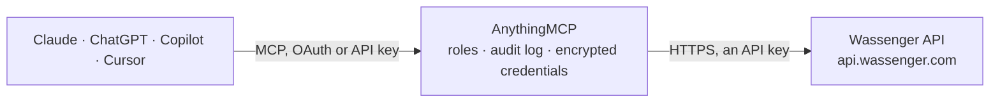

<!-- Generated by scripts/export-github-catalog.mjs in the anythingmcp-website repository. Do not edit by hand. -->

# Wassenger MCP connector

Wassenger WhatsApp API: list connected numbers and their session health, send WhatsApp text messages, track delivery, and read chats, chat history and contacts of a number. The AnythingMCP connector gives Claude, ChatGPT, Microsoft Copilot, Cursor and Gemini 11 MCP tools for Wassenger: 10 read and 1 can change data.

**Category:** [Messaging](../messaging.md) · **Tools:** 11 · **Setup guide:** [anythingmcp.com](https://anythingmcp.com/guides/wassenger-to-mcp) · [Deutsch](https://anythingmcp.com/de/guides/wassenger-to-mcp) · [Italiano](https://anythingmcp.com/it/guides/wassenger-to-mcp) · [Español](https://anythingmcp.com/es/guides/wassenger-to-mcp) · [日本語](https://anythingmcp.com/ja/guides/wassenger-to-mcp) · [Русский](https://anythingmcp.com/ru/guides/wassenger-to-mcp) · [中文](https://anythingmcp.com/zh/guides/wassenger-to-mcp)

## Start without code

No installation and no terminal: AnythingMCP Cloud runs the Wassenger connector for you, operated by helpcode.ai in Frankfurt, Germany.

1. **Click the button above** and create an account or sign in. The Wassenger connector opens, ready to install.
2. **Paste the API key or token from your Wassenger account.** Every click is in the [step-by-step guide](https://anythingmcp.com/guides/wassenger-to-mcp).
3. **Click Install.** AnythingMCP shows the address of your MCP server.
4. **Add that address to your assistant:** [Claude](https://anythingmcp.com/guides/connect-wassenger-to-claude) · [ChatGPT](https://anythingmcp.com/guides/connect-wassenger-to-chatgpt) · [Microsoft Copilot](https://anythingmcp.com/guides/connect-wassenger-to-copilot) · [Cursor](https://anythingmcp.com/guides/connect-wassenger-to-cursor) · [Gemini CLI](https://anythingmcp.com/guides/connect-wassenger-to-gemini) · [Meta Muse](https://anythingmcp.com/guides/connect-wassenger-to-muse).
5. **Ask your first question**, for example: *Which connected WhatsApp numbers are online with alias "Support ES" right now?*

Prefer help with the setup? [Talk to us](https://anythingmcp.com/contact).

## How it works

- **The AI client** speaks MCP (Streamable HTTP) to AnythingMCP and only sees tool names, descriptions and results. It never gets the Wassenger credentials.
- **AnythingMCP** checks the client's role, builds the call from the tool definition, adds the credentials (an API key), calls Wassenger, logs the call and returns the result.
- **Wassenger** sees an ordinary API client with the rights of the account the credentials belong to.

## Tools

| Tool | What it does | Access |
|---|---|---|
| [`wassenger_list_numbers`](#wassenger_list_numbers) | List the WhatsApp numbers (devices) in the Wassenger account with ID, phone, alias, connector, session status, plan and queue. | read |
| [`wassenger_get_number_health`](#wassenger_get_number_health) | Get the session health of one number: status (online, authorize, timeout, conflict...), subscription state, whether it is operative now, last sync and queue… | read |
| [`wassenger_check_number`](#wassenger_check_number) | Check in real time whether a phone number exists on WhatsApp and can receive messages. | read |
| [`wassenger_send_message`](#wassenger_send_message) | Send a WhatsApp text message to a phone number or a group through a connected number. | write |
| [`wassenger_get_message`](#wassenger_get_message) | Get one outbound message by its Wassenger ID (24 hex) or WhatsApp ID, including status, delivery status (queued, sent, delivered, read, failed) and the… | read |
| [`wassenger_search_sent_messages`](#wassenger_search_sent_messages) | Search outbound messages (sent, queued or failed) by text, recipient, number, status or delivery status, newest first. | read |
| [`wassenger_get_message_ack_info`](#wassenger_get_message_ack_info) | Get who received, read or played an outbound message sent in the last 30 days, for person and group chats. | read |
| [`wassenger_list_chats`](#wassenger_list_chats) | List or search the chats of one number (people, groups, channels) with status, unread count, labels and assigned agent. | read |
| [`wassenger_get_chat_messages`](#wassenger_get_chat_messages) | Read inbound and outbound messages of one number, across chats or within one chat, newest first. | read |
| [`wassenger_list_contacts`](#wassenger_list_contacts) | List or search the contacts stored for one number by name, phone, email, company or notes, with their WhatsApp ID, type and metadata. | read |
| [`wassenger_get_contact`](#wassenger_get_contact) | Get one contact or group of a number by WhatsApp ID or phone number, with name, profile details and stored metadata. | read |

## Tool reference

Every parameter as the AI client sees it in `tools/list`. Source: [`packages/backend/src/adapters/intl/wassenger.json`](../../../packages/backend/src/adapters/intl/wassenger.json).

### `wassenger_list_numbers`

List the WhatsApp numbers (devices) in the Wassenger account with ID, phone, alias, connector, session status, plan and queue. Call this first: the id is the device_id the other tools need.

**Access:** read · **Call:** `GET /devices`

| Parameter | Type | Required | Description |
|---|---|---|---|
| `search` | string | no | Match by phone number, alias or ID, e.g. +447911123456. |
| `sessionStatus` | `any` \| `online` \| `offline` \| `timeout` \| `timeout_sync` \| `conflict` \| `blocked` \| `error` \| `authorize` | no | Only numbers whose WhatsApp session is in this state. |
| `page` | integer | no | Page number, starting at 0. |
| `size` | integer | no | Numbers per page, up to 100 (default 20). |

### `wassenger_get_number_health`

Get the session health of one number: status (online, authorize, timeout, conflict...), subscription state, whether it is operative now, last sync and queue capacity. Use it when messages are not going out.

**Access:** read · **Call:** `GET /devices/{device_id}/health`

| Parameter | Type | Required | Description |
|---|---|---|---|
| `device_id` | string | yes | Number (device) ID from wassenger_list_numbers, 24 hex characters. |

### `wassenger_check_number`

Check in real time whether a phone number exists on WhatsApp and can receive messages. Read-only, but it uses the plan's monthly number-check quota and needs the number session online; keep under 30 checks per minute.

**Access:** read · **Call:** `POST /numbers/exists`

| Parameter | Type | Required | Description |
|---|---|---|---|
| `phone` | string | yes | Number in E.164 format with +, e.g. +447911123456. |

### `wassenger_send_message`

Send a WhatsApp text message to a phone number or a group through a connected number. This sends a real message: confirm the recipient and the exact text with the user before calling, and do not retry after an id is returned.

**Access:** write · **Call:** `POST /messages`

| Parameter | Type | Required | Description |
|---|---|---|---|
| `phone` | string | no | Recipient in E.164 format with +, e.g. +447911123456. Use group instead for a group chat. |
| `group` | string | no | Group chat WhatsApp ID, e.g. 120363012345678901@g.us. Use instead of phone. |
| `message` | string | yes | Text to send. Supports WhatsApp *bold*, _italic_ and line breaks. |
| `device` | string | no | Number (device) ID to send from; omit to use the first connected number. |
| `reference` | string | no | Optional own reference, e.g. a CRM ticket ID, returned with the message and its webhooks. |

### `wassenger_get_message`

Get one outbound message by its Wassenger ID (24 hex) or WhatsApp ID, including status, delivery status (queued, sent, delivered, read, failed) and the reason when it failed.

**Access:** read · **Call:** `GET /messages/{message_id}`

| Parameter | Type | Required | Description |
|---|---|---|---|
| `message_id` | string | yes | Message id returned by wassenger_send_message, or its WhatsApp message ID. |

### `wassenger_search_sent_messages`

Search outbound messages (sent, queued or failed) by text, recipient, number, status or delivery status, newest first. Inbound messages are not included: use wassenger_get_chat_messages for those.

**Access:** read · **Call:** `GET /messages`

| Parameter | Type | Required | Description |
|---|---|---|---|
| `search` | string | no | Text content, phone number, group or message ID to match. |
| `phone` | string | no | Only messages to this E.164 number. |
| `device` | string | no | Only messages sent from this number ID or phone. |
| `status` | string | no | Comma-separated: queued, processing, processed, failed, expired, invalid, removed. |
| `deliveryStatus` | string | no | Comma-separated: queued, sent, delivered, read, played, failed, cancelled, revoked. |
| `createdAfter` | string | no | Only messages created after this ISO 8601 date, e.g. 2026-10-01T00:00:00Z. |
| `page` | integer | no | Page number, starting at 0. |
| `size` | integer | no | Messages per page, up to 100 (default 20). |

### `wassenger_get_message_ack_info`

Get who received, read or played an outbound message sent in the last 30 days, for person and group chats. Use it to confirm a message was actually read.

**Access:** read · **Call:** `GET /chat/{device_id}/messages/{message_wid}/ackinfo`

| Parameter | Type | Required | Description |
|---|---|---|---|
| `device_id` | string | yes | Number (device) ID that sent the message. |
| `message_wid` | string | yes | WhatsApp message ID (waId of the sent message). |

### `wassenger_list_chats`

List or search the chats of one number (people, groups, channels) with status, unread count, labels and assigned agent. Filter by text, status or unread to find a conversation.

**Access:** read · **Call:** `GET /chat/{device_id}/chats`

| Parameter | Type | Required | Description |
|---|---|---|---|
| `device_id` | string | yes | Number (device) ID from wassenger_list_numbers. |
| `search` | string | no | Free text matched against phone, chat or contact name, email, company or notes. |
| `status` | string | no | Comma-separated chat status: pending, active, resolved, archived, muted, banned, removed. |
| `unread` | boolean | no | True for chats with unread messages only. |
| `type` | string | no | Comma-separated chat type: chat, group, community, channel. |
| `sort` | `date:asc` \| `date:desc` \| `lastMessage:asc` \| `lastMessage:desc` | no | Sort order. |
| `page` | integer | no | Page number, starting at 0. |
| `size` | integer | no | Chats per page, up to 500 (default 20). |

### `wassenger_get_chat_messages`

Read inbound and outbound messages of one number, across chats or within one chat, newest first. Requires a Platform plan on that number; filter by chat ID, direction, text or date.

**Access:** read · **Call:** `GET /chat/{device_id}/messages`

| Parameter | Type | Required | Description |
|---|---|---|---|
| `device_id` | string | yes | Number (device) ID from wassenger_list_numbers. |
| `chat` | string | no | Chat WhatsApp ID, e.g. 447911123456@c.us or 120363012345678901@g.us. |
| `flow` | `in` \| `out` | no | in for received, out for sent messages. |
| `search` | string | no | Partial text, contact name or media file name. |
| `after` | string | no | Only messages created after this ISO 8601 date. |
| `before` | string | no | Only messages created before this ISO 8601 date. |
| `page` | integer | no | Page number, starting at 0. |
| `size` | integer | no | Messages per page, up to 50 (default 20). |

### `wassenger_list_contacts`

List or search the contacts stored for one number by name, phone, email, company or notes, with their WhatsApp ID, type and metadata.

**Access:** read · **Call:** `GET /chat/{device_id}/contacts`

| Parameter | Type | Required | Description |
|---|---|---|---|
| `device_id` | string | yes | Number (device) ID from wassenger_list_numbers. |
| `search` | string | no | Name, phone, email, company, metadata or notes to match. |
| `phone` | string | no | Comma-separated phone numbers or WhatsApp IDs, e.g. +447911123456. |
| `page` | integer | no | Page number, starting at 0. |
| `size` | integer | no | Contacts per page, up to 500 (default 20). |

### `wassenger_get_contact`

Get one contact or group of a number by WhatsApp ID or phone number, with name, profile details and stored metadata.

**Access:** read · **Call:** `GET /chat/{device_id}/contacts/{contact_wid}`

| Parameter | Type | Required | Description |
|---|---|---|---|
| `device_id` | string | yes | Number (device) ID from wassenger_list_numbers. |
| `contact_wid` | string | yes | WhatsApp ID or phone number, e.g. 447911123456@c.us. |

## Run it yourself

AnythingMCP is open source (AGPL-3.0). [Run it with Docker](../../../README.md#run-it-yourself), open **Connectors → Store**, pick **Wassenger** and enter `WASSENGER_API_TOKEN`, then add your MCP server URL to the AI client.

[← Messaging connectors](../messaging.md) · [All categories](../README.md)
