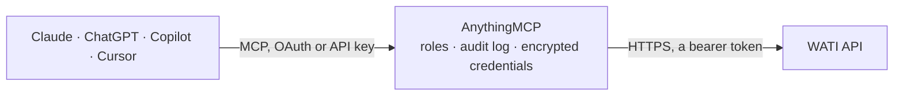

<!-- Generated by scripts/export-github-catalog.mjs in the anythingmcp-website repository. Do not edit by hand. -->

# WATI MCP connector

Run your WATI WhatsApp Business inbox from your AI: list approved templates, find, add and update contacts, read a contact's chat history, assign conversations to team members, and send a template message. The AnythingMCP connector gives Claude, ChatGPT, Microsoft Copilot, Cursor and Gemini 10 MCP tools for WATI: 3 read and 7 can change data.

**Category:** [Messaging](../messaging.md) · **Tools:** 10 · **Setup guide:** [anythingmcp.com](https://anythingmcp.com/guides/wati-to-mcp) · [Deutsch](https://anythingmcp.com/de/guides/wati-to-mcp) · [Italiano](https://anythingmcp.com/it/guides/wati-to-mcp) · [Español](https://anythingmcp.com/es/guides/wati-to-mcp) · [日本語](https://anythingmcp.com/ja/guides/wati-to-mcp) · [Русский](https://anythingmcp.com/ru/guides/wati-to-mcp) · [中文](https://anythingmcp.com/zh/guides/wati-to-mcp)

## Start without code

No installation and no terminal: AnythingMCP Cloud runs the WATI connector for you, operated by helpcode.ai in Frankfurt, Germany.

1. **Click the button above** and create an account or sign in. The WATI connector opens, ready to install.
2. **Paste the API key or token from your WATI account.** Every click is in the [step-by-step guide](https://anythingmcp.com/guides/wati-to-mcp).
3. **Click Install.** AnythingMCP shows the address of your MCP server.
4. **Add that address to your assistant:** [Claude](https://anythingmcp.com/guides/connect-wati-to-claude) · [ChatGPT](https://anythingmcp.com/guides/connect-wati-to-chatgpt) · [Microsoft Copilot](https://anythingmcp.com/guides/connect-wati-to-copilot) · [Cursor](https://anythingmcp.com/guides/connect-wati-to-cursor) · [Gemini CLI](https://anythingmcp.com/guides/connect-wati-to-gemini) · [Meta Muse](https://anythingmcp.com/guides/connect-wati-to-muse).
5. **Ask your first question**, for example: *Do we have a WhatsApp contact for customer Helga Olsen with invoice INV-2026-045?*

Prefer help with the setup? [Talk to us](https://anythingmcp.com/contact).

## How it works

- **The AI client** speaks MCP (Streamable HTTP) to AnythingMCP and only sees tool names, descriptions and results. It never gets the WATI credentials.
- **AnythingMCP** checks the client's role, builds the call from the tool definition, adds the credentials (a bearer token), calls WATI, logs the call and returns the result.
- **WATI** sees an ordinary API client with the rights of the account the credentials belong to.

## Tools

| Tool | What it does | Access |
|---|---|---|
| [`wati_list_message_templates`](#wati_list_message_templates) | List the workspace's WhatsApp message templates: id, name, category, status (APPROVED, PENDING, REJECTED), language, header, body with its placeholders,… | read |
| [`wati_list_contacts`](#wati_list_contacts) | List or search the workspace's contacts, page by page: id, WhatsApp number, name, phone, status, opt-in, broadcast permission, custom attributes, teams and… | read |
| [`wati_get_messages`](#wati_get_messages) | Read the chat history with one contact, newest first, page by page: message id, time, type, text, whether we sent it (owner), delivery status, operator and… | read |
| [`wati_add_contact`](#wati_add_contact) | Add a contact to WATI with a name and optional custom attributes. | write |
| [`wati_update_contact_attributes`](#wati_update_contact_attributes) | Set custom attributes on a contact, e.g. order status, city or lead stage; attributes you do not pass stay as they are. | write |
| [`wati_assign_operator`](#wati_assign_operator) | Assign a contact's conversation to a WATI team member by their email, or hand it back to the bot by leaving the email out. | write |
| [`wati_send_template_message`](#wati_send_template_message) | Send one approved WhatsApp template to one number, the only way to write first or after the 24-hour window. | write |
| [`wati_send_template_broadcast`](#wati_send_template_broadcast) | Send one approved template to many numbers at once (up to 1,000 per call) with values per recipient, as a WATI broadcast. | write |
| [`wati_send_session_message`](#wati_send_session_message) | Send a free-text WhatsApp message to a contact who wrote to you in the last 24 hours (open session). | write |
| [`wati_send_interactive_buttons`](#wati_send_interactive_buttons) | Send a message with up to three reply buttons to a contact in an open 24-hour session, e.g. 'Track order' or 'Talk to us'. | write |

## Tool reference

Every parameter as the AI client sees it in `tools/list`. Source: [`packages/backend/src/adapters/intl/wati.json`](../../../packages/backend/src/adapters/intl/wati.json).

### `wati_list_message_templates`

List the workspace's WhatsApp message templates: id, name, category, status (APPROVED, PENDING, REJECTED), language, header, body with its placeholders, footer, buttons and custom parameters. Only APPROVED templates can be sent. Read-only.

**Access:** read · **Call:** `GET /api/v1/getMessageTemplates`

| Parameter | Type | Required | Description |
|---|---|---|---|
| `page_size` | integer | no | Templates per page. |
| `page_number` | integer | no | Page, starting at 1. |
| `channel_phone_number` | string | no | Only for workspaces with several WhatsApp numbers: the sending number with country code, e.g. 85264318722. |

### `wati_list_contacts`

List or search the workspace's contacts, page by page: id, WhatsApp number, name, phone, status, opt-in, broadcast permission, custom attributes, teams and dates. Filter by name, an attribute condition or creation date. Read-only.

**Access:** read · **Call:** `GET /api/v1/getContacts`

| Parameter | Type | Required | Description |
|---|---|---|---|
| `name` | string | no | Only contacts whose name contains this text. |
| `attribute` | string | no | Attribute filter as JSON text, e.g. [{"name": "city", "operator": "==", "value": "Pune"}]. Operators: contain, notContain, exist, notExist, ==, !=, valid, invalid. |
| `created_date` | string | no | Only contacts created on this date, YYYY-MM-DD. |
| `page_size` | integer | no | Contacts per page. |
| `page_number` | integer | no | Page, starting at 1. |

### `wati_get_messages`

Read the chat history with one contact, newest first, page by page: message id, time, type, text, whether we sent it (owner), delivery status, operator and ticket events. Optional time window in UTC. Read-only.

**Access:** read · **Call:** `GET /api/v1/getMessages/{target}`

| Parameter | Type | Required | Description |
|---|---|---|---|
| `target` | string | yes | WhatsApp number with country code (e.g. 919876543210) or WATI contact id. |
| `page_size` | integer | no | Messages per page. |
| `page_number` | integer | no | Page, starting at 1. |
| `from` | string | no | Only messages from this time, UTC, 'YYYY-MM-DD HH:MM:SS'. |
| `to` | string | no | Only messages up to this time, UTC, 'YYYY-MM-DD HH:MM:SS'. |
| `channel_phone_number` | string | no | Only for workspaces with several WhatsApp numbers: the business number with country code. |

### `wati_add_contact`

Add a contact to WATI with a name and optional custom attributes. WATI also creates contacts on their own when you message a new number, so this is for building the list ahead. Tell the user what will be saved and confirm with the user first.

**Access:** write · **Call:** `POST /api/v1/addContact/{whatsapp_number}`

| Parameter | Type | Required | Description |
|---|---|---|---|
| `whatsapp_number` | string | yes | WhatsApp number with country code, without + or spaces, e.g. 919876543210. |
| `name` | string | yes | Contact name. |
| `custom_params` | object[] | no | Custom attributes as {name, value} pairs, e.g. [{"name": "city", "value": "Pune"}]. |

### `wati_update_contact_attributes`

Set custom attributes on a contact, e.g. order status, city or lead stage; attributes you do not pass stay as they are. Tell the user what will change and confirm with the user first.

**Access:** write · **Call:** `POST /api/v1/updateContactAttributes/{target}`

| Parameter | Type | Required | Description |
|---|---|---|---|
| `target` | string | yes | WhatsApp number with country code (e.g. 919876543210) or WATI contact id. |
| `custom_params` | object[] | yes | Attributes to set as {name, value} pairs, e.g. [{"name": "order_status", "value": "shipped"}]. |

### `wati_assign_operator`

Assign a contact's conversation to a WATI team member by their email, or hand it back to the bot by leaving the email out. Internal: the customer does not see who is assigned.

**Access:** write · **Call:** `POST /api/v1/assignOperator`

| Parameter | Type | Required | Description |
|---|---|---|---|
| `target` | string | yes | WhatsApp number with country code (e.g. 919876543210) or WATI contact id. |
| `email` | string | no | Email of the WATI user to assign. Leave empty to assign the conversation to the bot. |
| `channel_phone_number` | string | no | Only for workspaces with several WhatsApp numbers: the business number with country code. |

### `wati_send_template_message`

Send one approved WhatsApp template to one number, the only way to write first or after the 24-hour window. Meta charges per conversation and the customer receives it at once: show template, number and values and confirm with the user first.

**Access:** write · **Call:** `POST /api/v1/sendTemplateMessage`

| Parameter | Type | Required | Description |
|---|---|---|---|
| `whatsapp_number` | string | yes | Recipient's WhatsApp number with country code, without + or spaces, e.g. 919876543210. |
| `template_name` | string | yes | Template name (name in wati_list_message_templates); it must be APPROVED. |
| `parameters` | object[] | no | Values for the template's placeholders as {name, value} pairs, e.g. [{"name": "1", "value": "Anna"}]. Empty for a template without placeholders. |
| `broadcast_name` | string | no | Label the send is grouped under in WATI's reports. Does not change the message. |
| `channel_number` | string | no | Only for workspaces with several WhatsApp numbers: the business number to send from, with country code. |

### `wati_send_template_broadcast`

Send one approved template to many numbers at once (up to 1,000 per call) with values per recipient, as a WATI broadcast. Every recipient is charged and messaged: show the list, template and values and confirm with the user first. Installed switched off.

**Access:** write · **Call:** `POST /api/v1/sendTemplateMessages`

| Parameter | Type | Required | Description |
|---|---|---|---|
| `template_name` | string | yes | Template name (name in wati_list_message_templates); it must be APPROVED. |
| `broadcast_name` | string | yes | Name of the broadcast as it will appear in WATI's reports. |
| `receivers` | object[] | yes | Recipients, each {whatsappNumber, customParams}, at most 1,000. |
| `channel_number` | string | no | Only for workspaces with several WhatsApp numbers: the business number to send from. |

### `wati_send_session_message`

Send a free-text WhatsApp message to a contact who wrote to you in the last 24 hours (open session). The customer receives it at once: show the text and confirm with the user first. Installed switched off.

**Access:** write · **Call:** `POST /api/v1/sendSessionMessage/{target}`

| Parameter | Type | Required | Description |
|---|---|---|---|
| `target` | string | yes | WhatsApp number with country code (e.g. 919876543210) or WATI contact id. |
| `message_text` | string | yes | Text to send. WhatsApp formatting works: *bold*, _italic_. |
| `reply_context_id` | string | no | Optional: WhatsApp message id (wamid) of the message you answer, to quote it. |
| `channel_phone_number` | string | no | Only for workspaces with several WhatsApp numbers: the business number to send from. |

### `wati_send_interactive_buttons`

Send a message with up to three reply buttons to a contact in an open 24-hour session, e.g. 'Track order' or 'Talk to us'. The customer receives it at once: show it and confirm with the user first. Installed switched off.

**Access:** write · **Call:** `POST /api/v1/sendInteractiveButtonsMessage`

| Parameter | Type | Required | Description |
|---|---|---|---|
| `whatsapp_number` | string | yes | Recipient's WhatsApp number with country code, e.g. 919876543210. |
| `body` | string | yes | Main text of the message. |
| `buttons` | object[] | yes | One to three buttons, e.g. [{"text": "Yes"}, {"text": "No"}]. |
| `header` | object | no | Optional header, e.g. {"type": "Text", "text": "Your order"}, or an image {"type": "Image", "media": {"url": "https://...", "fileName": "order.jpg"}}. |
| `footer` | string | no | Optional small text under the message. |
| `channel_phone_number` | string | no | Only for workspaces with several WhatsApp numbers: the business number to send from. |

## Run it yourself

AnythingMCP is open source (AGPL-3.0). [Run it with Docker](../../../README.md#run-it-yourself), open **Connectors → Store**, pick **WATI** and enter `WATI_API_ENDPOINT`, `WATI_ACCESS_TOKEN`, then add your MCP server URL to the AI client.

[← Messaging connectors](../messaging.md) · [All categories](../README.md)
