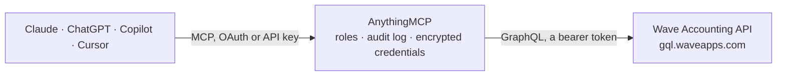

<!-- Generated by scripts/export-github-catalog.mjs in the anythingmcp-website repository. Do not edit by hand. -->

# Wave Accounting MCP connector

Query Wave Accounting (businesses, customers, products, invoices, chart of accounts) and create customers or email invoices via Wave's GraphQL API from any AI agent. 8 tools, Bearer token auth. The AnythingMCP connector gives Claude, ChatGPT, Microsoft Copilot, Cursor and Gemini 8 MCP tools for Wave Accounting: 6 read and 2 can change data.

**Category:** [Accounting](../accounting.md) · **Tools:** 8 · **Setup guide:** [anythingmcp.com](https://anythingmcp.com/guides/wave-accounting-to-mcp) · [Deutsch](https://anythingmcp.com/de/guides/wave-accounting-to-mcp) · [Italiano](https://anythingmcp.com/it/guides/wave-accounting-to-mcp) · [Español](https://anythingmcp.com/es/guides/wave-accounting-to-mcp) · [日本語](https://anythingmcp.com/ja/guides/wave-accounting-to-mcp) · [Русский](https://anythingmcp.com/ru/guides/wave-accounting-to-mcp) · [中文](https://anythingmcp.com/zh/guides/wave-accounting-to-mcp)

## Start without code

No installation and no terminal: AnythingMCP Cloud runs the Wave Accounting connector for you, operated by helpcode.ai in Frankfurt, Germany.

1. **Click the button above** and create an account or sign in. The Wave Accounting connector opens, ready to install.
2. **Paste the API key or token from your Wave Accounting account.** Every click is in the [step-by-step guide](https://anythingmcp.com/guides/wave-accounting-to-mcp).
3. **Click Install.** AnythingMCP shows the address of your MCP server.
4. **Add that address to your assistant:** [Claude](https://anythingmcp.com/guides/connect-wave-accounting-to-claude) · [ChatGPT](https://anythingmcp.com/guides/connect-wave-accounting-to-chatgpt) · [Microsoft Copilot](https://anythingmcp.com/guides/connect-wave-accounting-to-copilot) · [Cursor](https://anythingmcp.com/guides/connect-wave-accounting-to-cursor) · [Gemini CLI](https://anythingmcp.com/guides/connect-wave-accounting-to-gemini) · [Meta Muse](https://anythingmcp.com/guides/connect-wave-accounting-to-muse).
5. **Ask your first question**, for example: *Show the customer record for email maria.gonzalez@soltech.es in SolTech Installations SL*

Prefer help with the setup? [Talk to us](https://anythingmcp.com/contact).

## How it works

- **The AI client** speaks MCP (Streamable HTTP) to AnythingMCP and only sees tool names, descriptions and results. It never gets the Wave Accounting credentials.
- **AnythingMCP** checks the client's role, builds the call from the tool definition, adds the credentials (a bearer token), calls Wave Accounting, logs the call and returns the result.
- **Wave Accounting** sees an ordinary API client with the rights of the account the credentials belong to.

## Tools

| Tool | What it does | Access |
|---|---|---|
| [`wave_get_businesses`](#wave_get_businesses) | List the businesses the token can access (id, name, currency, whether it is a personal business). | read |
| [`wave_list_customers`](#wave_list_customers) | List the customers of a business, newest first, optionally filtered by email address. | read |
| [`wave_create_customer`](#wave_create_customer) | Create a customer in a business. | write |
| [`wave_list_invoices`](#wave_list_invoices) | List the invoices of a business, newest first. | read |
| [`wave_get_invoice`](#wave_get_invoice) | Get one invoice of a business with its line items, totals, memo and links to view it or download the PDF. | read |
| [`wave_list_products`](#wave_list_products) | List the products and services of a business (name, description, unit price, whether sold and/or bought). | read |
| [`wave_list_accounts`](#wave_list_accounts) | List the chart of accounts (ledger accounts) of a business: id, name, type, subtype and currency. | read |
| [`wave_send_invoice`](#wave_send_invoice) | Email an invoice to one or more addresses through Wave. | write |

## Tool reference

Every parameter as the AI client sees it in `tools/list`. Source: [`packages/backend/src/adapters/intl/wave-accounting.json`](../../../packages/backend/src/adapters/intl/wave-accounting.json).

### `wave_get_businesses`

List the businesses the token can access (id, name, currency, whether it is a personal business). Start here: every other tool needs a business ID from this result.

**Access:** read · **Call:** `query query Businesses { businesses(page: 1, pageSize: 50) { pageInfo { currentPage totalPages totalCount } edges { node { id name isPersonal isArchived currency { code } } } } }`

No parameters.

### `wave_list_customers`

List the customers of a business, newest first, optionally filtered by email address. Page-based: see pageInfo.totalPages.

**Access:** read · **Call:** `query query ListCustomers($businessId: ID!, $email: String, $page: Int = 1, $pageSize: Int = 45) { business(id: $businessId) { customers(email: $email, page: $page, pageSize: $pageSize) { pageInfo { currentPage totalPages totalCount } edges { node { id name email firstName lastName currency { code } } } } } }`

| Parameter | Type | Required | Description |
|---|---|---|---|
| `business_id` | string | yes | Wave business ID, from wave_get_businesses. |
| `email` | string | no | Only customers with this email address. |
| `page` | integer | no | 1-based page number (default 1). |
| `page_size` | integer | no | Results per page (Wave's default is 45). |

### `wave_create_customer`

Create a customer in a business. Returns the customer, or didSucceed false with inputErrors explaining why Wave refused it.

**Access:** write · **Call:** `mutation mutation CreateCustomer($businessId: ID!, $name: String!, $email: String, $currency: CurrencyCode) { customerCreate(input: { businessId: $businessId, name: $name, email: $email, currency: $currency }) { didSucceed inputErrors { path message code } customer { id name email currency { code } } } }`

| Parameter | Type | Required | Description |
|---|---|---|---|
| `business_id` | string | yes | Wave business ID, from wave_get_businesses. |
| `name` | string | yes | Customer name. |
| `email` | string | no | Email. |
| `currency` | string | yes | ISO 4217 currency code, e.g. USD or CAD. |

### `wave_list_invoices`

List the invoices of a business, newest first. Filter by status (DRAFT, UNSENT, SAVED, SENT, VIEWED, PARTIAL, OVERDUE, PAID, OVERPAID) and/or customer. Page-based: see pageInfo.totalPages.

**Access:** read · **Call:** `query query ListInvoices($businessId: ID!, $status: InvoiceStatus, $customerId: ID, $page: Int = 1, $pageSize: Int = 45) { business(id: $businessId) { invoices(status: $status, customerId: $customerId, page: $page, pageSize: $pageSize) { pageInfo { currentPage totalPages totalCount } edges { node { id invoiceNumber status customer { id name } invoiceDate dueDate total { value currency { code } } amountDue { value } } } } } }`

| Parameter | Type | Required | Description |
|---|---|---|---|
| `business_id` | string | yes | Wave business ID, from wave_get_businesses. |
| `status` | string | no | Invoice status: DRAFT, UNSENT, SAVED, SENT, VIEWED, PARTIAL, OVERDUE, PAID or OVERPAID. |
| `customer_id` | string | no | Only invoices of this customer (ID from wave_list_customers). |
| `page` | integer | no | 1-based page number (default 1). |
| `page_size` | integer | no | Results per page (Wave's default is 45). |

### `wave_get_invoice`

Get one invoice of a business with its line items, totals, memo and links to view it or download the PDF.

**Access:** read · **Call:** `query query GetInvoice($businessId: ID!, $invoiceId: ID!) { business(id: $businessId) { invoice(id: $invoiceId) { id invoiceNumber status title customer { id name email } invoiceDate dueDate items { product { id name } description quantity unitPrice subtotal { value } total { value } } subtotal { value } taxTotal { value } total { value currency { code } } amountDue { value } amountPaid { value } memo footer viewUrl pdfUrl lastSentAt } } }`

| Parameter | Type | Required | Description |
|---|---|---|---|
| `business_id` | string | yes | Wave business ID, from wave_get_businesses. |
| `invoice_id` | string | yes | Invoice ID, from wave_list_invoices. |

### `wave_list_products`

List the products and services of a business (name, description, unit price, whether sold and/or bought). Page-based: see pageInfo.totalPages.

**Access:** read · **Call:** `query query ListProducts($businessId: ID!, $page: Int = 1, $pageSize: Int = 45) { business(id: $businessId) { products(page: $page, pageSize: $pageSize) { pageInfo { currentPage totalPages totalCount } edges { node { id name description unitPrice isSold isBought isArchived } } } } }`

| Parameter | Type | Required | Description |
|---|---|---|---|
| `business_id` | string | yes | Wave business ID, from wave_get_businesses. |
| `page` | integer | no | 1-based page number (default 1). |
| `page_size` | integer | no | Results per page (Wave's default is 45). |

### `wave_list_accounts`

List the chart of accounts (ledger accounts) of a business: id, name, type, subtype and currency. Returns up to 200 active accounts.

**Access:** read · **Call:** `query query ListAccounts($businessId: ID!) { business(id: $businessId) { accounts(page: 1, pageSize: 200) { pageInfo { currentPage totalPages totalCount } edges { node { id name type { value name } subtype { value name } currency { code } } } } } }`

| Parameter | Type | Required | Description |
|---|---|---|---|
| `business_id` | string | yes | Wave business ID, from wave_get_businesses. |

### `wave_send_invoice`

Email an invoice to one or more addresses through Wave. Returns didSucceed, or inputErrors explaining why Wave refused it.

**Access:** write · **Call:** `mutation mutation SendInvoice($invoiceId: ID!, $to: [String!]!, $subject: String, $message: String, $attachPDF: Boolean = false) { invoiceSend(input: { invoiceId: $invoiceId, to: $to, subject: $subject, message: $message, attachPDF: $attachPDF }) { didSucceed inputErrors { path message code } } }`

| Parameter | Type | Required | Description |
|---|---|---|---|
| `invoice_id` | string | yes | Invoice ID, from wave_list_invoices. |
| `to` | string[] | yes | Recipient email addresses. |
| `subject` | string | no | Email subject (Wave's default if omitted). |
| `message` | string | no | Email body (Wave's default if omitted). |
| `attach_pdf` | boolean | no | Attach the invoice as a PDF (default false). |

## Run it yourself

AnythingMCP is open source (AGPL-3.0). [Run it with Docker](../../../README.md#run-it-yourself), open **Connectors → Store**, pick **Wave Accounting** and enter `WAVE_ACCESS_TOKEN`, `WAVE_BUSINESS_ID`, then add your MCP server URL to the AI client.

[← Accounting connectors](../accounting.md) · [All categories](../README.md)
