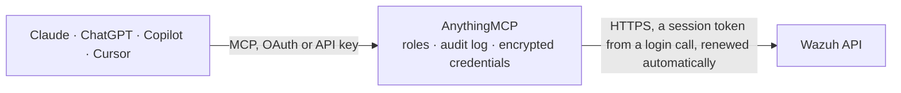

<!-- Generated by scripts/export-github-catalog.mjs in the anythingmcp-website repository. Do not edit by hand. -->

# Wazuh MCP connector

Let your AI read your Wazuh 4.x security platform through the server API: manager version and daemon status, agents and their connection status, the detection rules and decoders, Security … The AnythingMCP connector gives Claude, ChatGPT, Microsoft Copilot, Cursor and Gemini 15 MCP tools for Wazuh, all read-only.

**Category:** [Monitoring](../monitoring.md) · **Tools:** 15 · **Setup guide:** [anythingmcp.com](https://anythingmcp.com/guides/wazuh-to-mcp) · [Deutsch](https://anythingmcp.com/de/guides/wazuh-to-mcp) · [Italiano](https://anythingmcp.com/it/guides/wazuh-to-mcp) · [Español](https://anythingmcp.com/es/guides/wazuh-to-mcp) · [日本語](https://anythingmcp.com/ja/guides/wazuh-to-mcp) · [Русский](https://anythingmcp.com/ru/guides/wazuh-to-mcp) · [中文](https://anythingmcp.com/zh/guides/wazuh-to-mcp)

## Start without code

No installation and no terminal: AnythingMCP Cloud runs the Wazuh connector for you, operated by helpcode.ai in Frankfurt, Germany.

1. **Click the button above** and create an account or sign in. The Wazuh connector opens, ready to install.
2. **Paste the API key or token from your Wazuh account.** Every click is in the [step-by-step guide](https://anythingmcp.com/guides/wazuh-to-mcp).
3. **Click Install.** AnythingMCP shows the address of your MCP server.
4. **Add that address to your assistant:** [Claude](https://anythingmcp.com/guides/connect-wazuh-to-claude) · [ChatGPT](https://anythingmcp.com/guides/connect-wazuh-to-chatgpt) · [Microsoft Copilot](https://anythingmcp.com/guides/connect-wazuh-to-copilot) · [Cursor](https://anythingmcp.com/guides/connect-wazuh-to-cursor) · [Gemini CLI](https://anythingmcp.com/guides/connect-wazuh-to-gemini) · [Meta Muse](https://anythingmcp.com/guides/connect-wazuh-to-muse).
5. **Ask your first question**, for example: *Is the packing station agent pack-station-07 at Nordhafen Logistik GmbH still connected, and which agent version and OS is it on?*

Prefer help with the setup? [Talk to us](https://anythingmcp.com/contact).

## How it works

- **The AI client** speaks MCP (Streamable HTTP) to AnythingMCP and only sees tool names, descriptions and results. It never gets the Wazuh credentials.
- **AnythingMCP** checks the client's role, builds the call from the tool definition, adds the credentials (a session token from a login call, renewed automatically), calls Wazuh, logs the call and returns the result.
- **Wazuh** sees an ordinary API client with the rights of the account the credentials belong to.

## Tools

| Tool | What it does | Access |
|---|---|---|
| [`wazuh_get_api_info`](#wazuh_get_api_info) | Get the Wazuh server API's own info: API version (e.g. 4.14.9), revision, license, hostname and server time. | read |
| [`wazuh_get_manager_info`](#wazuh_get_manager_info) | Get the Wazuh manager's basic information: version, installation path, type (server), max agents, OpenSSL support, time zone and uuid. | read |
| [`wazuh_get_manager_status`](#wazuh_get_manager_status) | Get the state of every Wazuh manager daemon (wazuh-analysisd, wazuh-remoted, wazuh-db, wazuh-modulesd, wazuh-apid and others): running or stopped. | read |
| [`wazuh_list_agents`](#wazuh_list_agents) | List Wazuh agents with id, name, IP, status, OS name and version, agent version, last keep-alive, groups, cluster node and registration date, plus the total. | read |
| [`wazuh_get_agent`](#wazuh_get_agent) | Get one Wazuh agent by id with every field Wazuh keeps: name, IP and registration IP, status, OS (name, version, platform, arch, uname), agent version,… | read |
| [`wazuh_get_agents_summary`](#wazuh_get_agents_summary) | Count Wazuh agents by connection status (active, disconnected, never_connected, pending, total) and by configuration sync state (synced, not_synced). | read |
| [`wazuh_get_agents_os_summary`](#wazuh_get_agents_os_summary) | List the operating system platforms present among the Wazuh agents, e.g. ubuntu, windows, darwin, with the total. | read |
| [`wazuh_list_outdated_agents`](#wazuh_list_outdated_agents) | List Wazuh agents whose version is older than the manager's, with id, name and version, plus the total. | read |
| [`wazuh_list_rules`](#wazuh_list_rules) | Search the Wazuh ruleset: rule id, level, description, groups, file, status and MITRE technique ids, plus the total. | read |
| [`wazuh_list_rule_groups`](#wazuh_list_rule_groups) | List the group names used in the Wazuh ruleset (e.g. authentication_failed, syscheck, web), plus the total; a group is what wazuh_list_rules takes as group. | read |
| [`wazuh_list_decoders`](#wazuh_list_decoders) | List Wazuh decoders: name, file, directory, status and parent decoder, plus the total. | read |
| [`wazuh_list_sca_policies`](#wazuh_list_sca_policies) | List the Security Configuration Assessment (SCA) policies scanned on one agent, e.g. a CIS benchmark: policy_id, name, passed, failed and invalid (not… | read |
| [`wazuh_list_sca_checks`](#wazuh_list_sca_checks) | List the checks of one SCA policy on one agent: check id, title, result (passed, failed, not applicable), rationale and remediation, plus the total. | read |
| [`wazuh_list_syscheck_files`](#wazuh_list_syscheck_files) | List what File Integrity Monitoring (FIM, syscheck) recorded on one agent: file or registry path, type, size, owner, permissions, hashes, modification time,… | read |
| [`wazuh_get_syscheck_last_scan`](#wazuh_get_syscheck_last_scan) | Get the start and end time of the last File Integrity Monitoring (syscheck) scan on one agent. | read |

## Tool reference

Every parameter as the AI client sees it in `tools/list`. Source: [`packages/backend/src/adapters/intl/wazuh.json`](../../../packages/backend/src/adapters/intl/wazuh.json).

### `wazuh_get_api_info`

Get the Wazuh server API's own info: API version (e.g. 4.14.9), revision, license, hostname and server time. Use it to confirm the server runs Wazuh 4.x. Read-only.

**Access:** read · **Call:** `GET /`

No parameters.

### `wazuh_get_manager_info`

Get the Wazuh manager's basic information: version, installation path, type (server), max agents, OpenSSL support, time zone and uuid. Used to check the connection. Needs manager:read. Read-only.

**Access:** read · **Call:** `GET /manager/info`

No parameters.

### `wazuh_get_manager_status`

Get the state of every Wazuh manager daemon (wazuh-analysisd, wazuh-remoted, wazuh-db, wazuh-modulesd, wazuh-apid and others): running or stopped. Needs manager:read. Read-only.

**Access:** read · **Call:** `GET /manager/status`

No parameters.

### `wazuh_list_agents`

List Wazuh agents with id, name, IP, status, OS name and version, agent version, last keep-alive, groups, cluster node and registration date, plus the total. Filter by status, name, IP, group, OS platform or version; page with limit and offset. Needs agent:read. Read-only.

**Access:** read · **Call:** `GET /agents`

| Parameter | Type | Required | Description |
|---|---|---|---|
| `status` | string | no | Optional: agent status, one of active, pending, never_connected, disconnected, or several separated by commas, e.g. active,disconnected. |
| `name` | string | no | Optional: exact agent name. |
| `ip` | string | no | Optional: agent IP address, e.g. 10.0.0.12. |
| `group` | string | no | Optional: agent group name, e.g. default. |
| `os_platform` | string | no | Optional: OS platform as Wazuh reports it, e.g. ubuntu, windows, darwin, amzn. |
| `version` | string | no | Optional: agent version, e.g. Wazuh v4.14.9. |
| `node_name` | string | no | Optional: cluster node the agent reports to, e.g. node01. |
| `older_than` | string | no | Optional: only agents whose last keep-alive (or registration, when never connected) is older than this, e.g. 7d, 12h, 30m. |
| `search` | string | no | Optional: free-text search over all fields; start with - to exclude matches. |
| `q` | string | no | Optional Wazuh query filter, e.g. status=active;os.platform=ubuntu (; is AND, , is OR, operators = != < > ~ for 'like'). |
| `sort` | string | no | Optional: fields to sort by, + ascending or - descending, comma separated, e.g. -lastKeepAlive or +name. |
| `limit` | integer | no | Optional: how many items to return, 1 to 500 (default 50). |
| `offset` | integer | no | Optional: how many items to skip, for the next page (offset = previous offset + limit). |

### `wazuh_get_agent`

Get one Wazuh agent by id with every field Wazuh keeps: name, IP and registration IP, status, OS (name, version, platform, arch, uname), agent version, groups, configuration sync state, manager, cluster node, registration and last keep-alive dates. Answers an error when the agent does not exist. Needs agent:read. Read-only.

**Access:** read · **Call:** `GET /agents`

| Parameter | Type | Required | Description |
|---|---|---|---|
| `agent_id` | string | yes | Agent id with at least three digits, e.g. 001, from wazuh_list_agents. 000 is the Wazuh manager itself. |

### `wazuh_get_agents_summary`

Count Wazuh agents by connection status (active, disconnected, never_connected, pending, total) and by configuration sync state (synced, not_synced). The manager itself (000) is not counted. Best first call for 'how are my agents'. Needs agent:read. Read-only.

**Access:** read · **Call:** `GET /agents/summary/status`

No parameters.

### `wazuh_get_agents_os_summary`

List the operating system platforms present among the Wazuh agents, e.g. ubuntu, windows, darwin, with the total. Empty when only the manager is registered. Needs agent:read. Read-only.

**Access:** read · **Call:** `GET /agents/summary/os`

No parameters.

### `wazuh_list_outdated_agents`

List Wazuh agents whose version is older than the manager's, with id, name and version, plus the total. Needs agent:read. Read-only.

**Access:** read · **Call:** `GET /agents/outdated`

| Parameter | Type | Required | Description |
|---|---|---|---|
| `search` | string | no | Optional: free-text search over all fields; start with - to exclude matches. |
| `q` | string | no | Optional Wazuh query filter, e.g. status=active;os.platform=ubuntu (; is AND, , is OR, operators = != < > ~ for 'like'). |
| `sort` | string | no | Optional: fields to sort by, + ascending or - descending, comma separated, e.g. +version. |
| `limit` | integer | no | Optional: how many items to return, 1 to 500 (default 50). |
| `offset` | integer | no | Optional: how many items to skip, for the next page (offset = previous offset + limit). |

### `wazuh_list_rules`

Search the Wazuh ruleset: rule id, level, description, groups, file, status and MITRE technique ids, plus the total. Filter by level or level range, group, file, compliance mapping (PCI DSS, GDPR, HIPAA, NIST 800-53, TSC) or MITRE id. Needs rules:read. Read-only.

**Access:** read · **Call:** `GET /rules`

| Parameter | Type | Required | Description |
|---|---|---|---|
| `rule_ids` | string | no | Optional: rule ids separated by commas, e.g. 5710,5712. |
| `level` | string | no | Optional: rule level or range, e.g. 12 or 10-15 (levels go from 0 to 16). |
| `group` | string | no | Optional: rule group from wazuh_list_rule_groups, e.g. authentication_failed. |
| `filename` | string | no | Optional: rule file name, e.g. 0095-sshd_rules.xml. |
| `status` | `enabled` \| `disabled` \| `all` | no | Optional: enabled (default in Wazuh), disabled or all. |
| `pci_dss` | string | no | Optional: PCI DSS requirement, e.g. 10.2.4. |
| `gdpr` | string | no | Optional: GDPR article, e.g. IV_35.7.d. |
| `hipaa` | string | no | Optional: HIPAA section, e.g. 164.312.b. |
| `nist_800_53` | string | no | Optional: NIST 800-53 control, e.g. AU.6. |
| `tsc` | string | no | Optional: TSC criterion, e.g. CC6.1. |
| `mitre` | string | no | Optional: MITRE ATT&CK technique id, e.g. T1110. |
| `search` | string | no | Optional: free-text search over all fields; start with - to exclude matches. |
| `q` | string | no | Optional Wazuh query filter, e.g. status=active;os.platform=ubuntu (; is AND, , is OR, operators = != < > ~ for 'like'). |
| `sort` | string | no | Optional: fields to sort by, + ascending or - descending, comma separated, e.g. -level. |
| `limit` | integer | no | Optional: how many items to return, 1 to 500 (default 50). |
| `offset` | integer | no | Optional: how many items to skip, for the next page (offset = previous offset + limit). |

### `wazuh_list_rule_groups`

List the group names used in the Wazuh ruleset (e.g. authentication_failed, syscheck, web), plus the total; a group is what wazuh_list_rules takes as group. Needs rules:read. Read-only.

**Access:** read · **Call:** `GET /rules/groups`

| Parameter | Type | Required | Description |
|---|---|---|---|
| `search` | string | no | Optional: free-text search over all fields; start with - to exclude matches. |
| `limit` | integer | no | Optional: how many items to return, 1 to 500 (default 50). |
| `offset` | integer | no | Optional: how many items to skip, for the next page (offset = previous offset + limit). |

### `wazuh_list_decoders`

List Wazuh decoders: name, file, directory, status and parent decoder, plus the total. Filter by decoder names, file or status. Needs decoders:read. Read-only.

**Access:** read · **Call:** `GET /decoders`

| Parameter | Type | Required | Description |
|---|---|---|---|
| `decoder_names` | string | no | Optional: decoder names separated by commas, e.g. sshd,pam. |
| `filename` | string | no | Optional: decoder file name, e.g. 0310-ssh_decoders.xml. |
| `status` | `enabled` \| `disabled` \| `all` | no | Optional: enabled, disabled or all. |
| `search` | string | no | Optional: free-text search over all fields; start with - to exclude matches. |
| `q` | string | no | Optional Wazuh query filter, e.g. status=active;os.platform=ubuntu (; is AND, , is OR, operators = != < > ~ for 'like'). |
| `sort` | string | no | Optional: fields to sort by, + ascending or - descending, comma separated, e.g. +name. |
| `limit` | integer | no | Optional: how many items to return, 1 to 500 (default 50). |
| `offset` | integer | no | Optional: how many items to skip, for the next page (offset = previous offset + limit). |

### `wazuh_list_sca_policies`

List the Security Configuration Assessment (SCA) policies scanned on one agent, e.g. a CIS benchmark: policy_id, name, passed, failed and invalid (not applicable) checks, score, total checks and the scan start and end. Needs sca:read. Read-only.

**Access:** read · **Call:** `GET /sca/{agent_id}`

| Parameter | Type | Required | Description |
|---|---|---|---|
| `agent_id` | string | yes | Agent id with at least three digits, e.g. 001, from wazuh_list_agents. 000 is the Wazuh manager itself. |
| `name` | string | no | Optional: exact policy name. |
| `search` | string | no | Optional: free-text search over all fields; start with - to exclude matches. |
| `q` | string | no | Optional Wazuh query filter, e.g. status=active;os.platform=ubuntu (; is AND, , is OR, operators = != < > ~ for 'like'). |
| `limit` | integer | no | Optional: how many items to return, 1 to 500 (default 50). |
| `offset` | integer | no | Optional: how many items to skip, for the next page (offset = previous offset + limit). |

### `wazuh_list_sca_checks`

List the checks of one SCA policy on one agent: check id, title, result (passed, failed, not applicable), rationale and remediation, plus the total. Use result=failed to see what to fix. Needs sca:read. Read-only.

**Access:** read · **Call:** `GET /sca/{agent_id}/checks/{policy_id}`

| Parameter | Type | Required | Description |
|---|---|---|---|
| `agent_id` | string | yes | Agent id with at least three digits, e.g. 001, from wazuh_list_agents. 000 is the Wazuh manager itself. |
| `policy_id` | string | yes | Policy id from wazuh_list_sca_policies, e.g. cis_ubuntu22-04. |
| `result` | `passed` \| `failed` \| `not applicable` | no | Optional: only checks with this result. |
| `title` | string | no | Optional: exact check title. |
| `search` | string | no | Optional: free-text search over all fields; start with - to exclude matches. |
| `q` | string | no | Optional Wazuh query filter, e.g. status=active;os.platform=ubuntu (; is AND, , is OR, operators = != < > ~ for 'like'). |
| `limit` | integer | no | Optional: how many items to return, 1 to 500 (default 50). |
| `offset` | integer | no | Optional: how many items to skip, for the next page (offset = previous offset + limit). |

### `wazuh_list_syscheck_files`

List what File Integrity Monitoring (FIM, syscheck) recorded on one agent: file or registry path, type, size, owner, permissions, hashes, modification time, number of changes and date, plus the total. summary=true returns only path, mtime and date. Needs syscheck:read. Read-only.

**Access:** read · **Call:** `GET /syscheck/{agent_id}`

| Parameter | Type | Required | Description |
|---|---|---|---|
| `agent_id` | string | yes | Agent id with at least three digits, e.g. 001, from wazuh_list_agents. 000 is the Wazuh manager itself. |
| `file` | string | no | Optional: full path of one file or registry key, e.g. /etc/passwd. |
| `type` | `file` \| `registry_key` \| `registry_value` | no | Optional: file, or registry_key or registry_value on Windows agents. |
| `hash` | string | no | Optional: an MD5, SHA1 or SHA256 hash to look for. |
| `summary` | boolean | no | Optional: true returns only file, mtime and date per entry. |
| `search` | string | no | Optional: free-text search over all fields; start with - to exclude matches. |
| `q` | string | no | Optional Wazuh query filter, e.g. status=active;os.platform=ubuntu (; is AND, , is OR, operators = != < > ~ for 'like'). |
| `sort` | string | no | Optional: fields to sort by, + ascending or - descending, comma separated, e.g. -date. |
| `limit` | integer | no | Optional: how many items to return, 1 to 500 (default 50). |
| `offset` | integer | no | Optional: how many items to skip, for the next page (offset = previous offset + limit). |

### `wazuh_get_syscheck_last_scan`

Get the start and end time of the last File Integrity Monitoring (syscheck) scan on one agent. An end older than the start means a scan is running. Needs syscheck:read. Read-only.

**Access:** read · **Call:** `GET /syscheck/{agent_id}/last_scan`

| Parameter | Type | Required | Description |
|---|---|---|---|
| `agent_id` | string | yes | Agent id with at least three digits, e.g. 001, from wazuh_list_agents. 000 is the Wazuh manager itself. |

## Run it yourself

AnythingMCP is open source (AGPL-3.0). [Run it with Docker](../../../README.md#run-it-yourself), open **Connectors → Store**, pick **Wazuh** and enter `WAZUH_URL`, `WAZUH_USERNAME`, `WAZUH_PASSWORD`, then add your MCP server URL to the AI client.

[← Monitoring connectors](../monitoring.md) · [All categories](../README.md)
