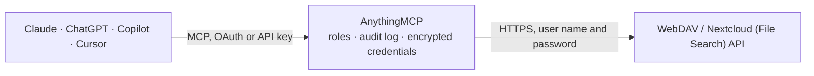

<!-- Generated by scripts/export-github-catalog.mjs in the anythingmcp-website repository. Do not edit by hand. -->

# WebDAV / Nextcloud (File Search) MCP connector

Search inside the files of Nextcloud, ownCloud or any WebDAV server from your AI client: full-text index of PDF, Excel, Word and Outlook files, synced by AnythingMCP File Search. The AnythingMCP connector gives Claude, ChatGPT, Microsoft Copilot, Cursor and Gemini 10 MCP tools for WebDAV / Nextcloud (File Search).

**Category:** [File Storage](../storage.md) · **Tools:** 10 · **Setup guide:** [anythingmcp.com](https://anythingmcp.com/marketplace/webdav)

## Start without code

No installation and no terminal: AnythingMCP Cloud runs the WebDAV / Nextcloud (File Search) connector for you, operated by helpcode.ai in Frankfurt, Germany.

1. **Click the button above** and create an account or sign in. The WebDAV / Nextcloud (File Search) connector opens, ready to install.
2. **Paste the API key or token from your WebDAV / Nextcloud (File Search) account.** Every click is in the [step-by-step guide](https://anythingmcp.com/marketplace/webdav).
3. **Click Install.** AnythingMCP shows the address of your MCP server.
4. **Add that address to your assistant:** [Claude](https://anythingmcp.com/guides/connect-webdav-to-claude) · [ChatGPT](https://anythingmcp.com/guides/connect-webdav-to-chatgpt) · [Microsoft Copilot](https://anythingmcp.com/guides/connect-webdav-to-copilot) · [Cursor](https://anythingmcp.com/guides/connect-webdav-to-cursor) · [Gemini CLI](https://anythingmcp.com/guides/connect-webdav-to-gemini) · [Meta Muse](https://anythingmcp.com/guides/connect-webdav-to-muse).
5. **Ask your first question**, for example: *Find invoice INV-2026-0421 for customer Bergstrom Transport and show the invoice page with totals.*

Prefer help with the setup? [Talk to us](https://anythingmcp.com/contact).

## How it works

- **The AI client** speaks MCP (Streamable HTTP) to AnythingMCP and only sees tool names, descriptions and results. It never gets the WebDAV / Nextcloud (File Search) credentials.
- **AnythingMCP** checks the client's role, builds the call from the tool definition, adds the credentials (user name and password), calls WebDAV / Nextcloud (File Search), logs the call and returns the result.
- **WebDAV / Nextcloud (File Search)** sees an ordinary API client with the rights of the account the credentials belong to.

## Run it yourself

AnythingMCP is open source (AGPL-3.0). [Run it with Docker](../../../README.md#run-it-yourself), open **Connectors → Store**, pick **WebDAV / Nextcloud (File Search)**, then add your MCP server URL to the AI client.

[← File Storage connectors](../storage.md) · [All categories](../README.md)
