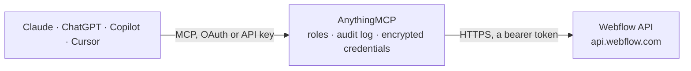

<!-- Generated by scripts/export-github-catalog.mjs in the anythingmcp-website repository. Do not edit by hand. -->

# Webflow MCP connector

Let your AI work on a Webflow site: read the site, its pages and SEO settings, CMS collections and items, forms and submissions, assets, and e-commerce products and orders; draft and update CMS … The AnythingMCP connector gives Claude, ChatGPT, Microsoft Copilot, Cursor and Gemini 32 MCP tools for Webflow: 23 read and 9 can change data.

**Category:** [CMS](../cms.md) · **Tools:** 32 · **Setup guide:** [anythingmcp.com](https://anythingmcp.com/guides/webflow-to-mcp) · [Deutsch](https://anythingmcp.com/de/guides/webflow-to-mcp) · [Italiano](https://anythingmcp.com/it/guides/webflow-to-mcp) · [Español](https://anythingmcp.com/es/guides/webflow-to-mcp) · [日本語](https://anythingmcp.com/ja/guides/webflow-to-mcp) · [Русский](https://anythingmcp.com/ru/guides/webflow-to-mcp) · [中文](https://anythingmcp.com/zh/guides/webflow-to-mcp)

## Start without code

No installation and no terminal: AnythingMCP Cloud runs the Webflow connector for you, operated by helpcode.ai in Frankfurt, Germany.

1. **Click the button above** and create an account or sign in. The Webflow connector opens, ready to install.
2. **Paste the API key or token from your Webflow account.** Every click is in the [step-by-step guide](https://anythingmcp.com/guides/webflow-to-mcp).
3. **Click Install.** AnythingMCP shows the address of your MCP server.
4. **Add that address to your assistant:** [Claude](https://anythingmcp.com/guides/connect-webflow-to-claude) · [ChatGPT](https://anythingmcp.com/guides/connect-webflow-to-chatgpt) · [Microsoft Copilot](https://anythingmcp.com/guides/connect-webflow-to-copilot) · [Cursor](https://anythingmcp.com/guides/connect-webflow-to-cursor) · [Gemini CLI](https://anythingmcp.com/guides/connect-webflow-to-gemini) · [Meta Muse](https://anythingmcp.com/guides/connect-webflow-to-muse).
5. **Ask your first question**, for example: *Show order ORD-2026-1147: status, items, totals and shipping tracking number.*

Prefer help with the setup? [Talk to us](https://anythingmcp.com/contact).

## How it works

- **The AI client** speaks MCP (Streamable HTTP) to AnythingMCP and only sees tool names, descriptions and results. It never gets the Webflow credentials.
- **AnythingMCP** checks the client's role, builds the call from the tool definition, adds the credentials (a bearer token), calls Webflow, logs the call and returns the result.
- **Webflow** sees an ordinary API client with the rights of the account the credentials belong to.

## Tools

| Tool | What it does | Access |
|---|---|---|
| [`webflow_get_token_info`](#webflow_get_token_info) | Check the connected token: its scopes (comma-separated), the site ids it is authorized for, its rate limit per minute, grant type, and when it was created… | read |
| [`webflow_list_sites`](#webflow_list_sites) | List the sites the token can reach: id, displayName, shortName, workspaceId, lastPublished, lastUpdated, timeZone, customDomains and locales. | read |
| [`webflow_get_site`](#webflow_get_site) | Read one site: displayName, shortName, lastPublished, lastUpdated, timeZone, customDomains (id and url) and locales (primary and secondary, each with id,… | read |
| [`webflow_list_custom_domains`](#webflow_list_custom_domains) | List the site's custom domains with id, url and lastPublished. | read |
| [`webflow_publish_site`](#webflow_publish_site) | Publish the site (or one page with page_id) to its custom domains and/or the webflow.io subdomain: every staged change, pages and CMS items, goes live on… | write |
| [`webflow_list_pages`](#webflow_list_pages) | List the site's pages: id, title, slug, parentId, collectionId (set for CMS template pages), publishedPath, draft, archived, lastUpdated, and the seo and… | read |
| [`webflow_get_page`](#webflow_get_page) | Read one page's settings: title, slug, publishedPath, draft, archived, collectionId, lastUpdated, seo (title, description) and openGraph (title, description… | read |
| [`webflow_update_page_settings`](#webflow_update_page_settings) | Change a page's title, slug, SEO title and description, or Open Graph title and description, optionally for one locale. | write |
| [`webflow_list_collections`](#webflow_list_collections) | List the site's CMS collections: id, displayName, singularName, slug, createdOn and lastUpdated. | read |
| [`webflow_get_collection`](#webflow_get_collection) | Read a collection's schema: displayName, singularName, slug and fields, each with id, slug, displayName, type (PlainText, RichText, Image, Reference,… | read |
| [`webflow_list_items`](#webflow_list_items) | List a collection's staged items (drafts and published ones, as editors see them): id, fieldData, isDraft, isArchived, lastPublished (null if never… | read |
| [`webflow_get_item`](#webflow_get_item) | Read one staged item: id, fieldData (keyed by field slug), isDraft, isArchived, lastPublished, lastUpdated, createdOn and cmsLocaleId, optionally in one locale. | read |
| [`webflow_create_item`](#webflow_create_item) | Create a staged CMS item; nothing appears on the public site. | write |
| [`webflow_update_item`](#webflow_update_item) | Change a staged item: only the fields in field_data change. | write |
| [`webflow_delete_item`](#webflow_delete_item) | Delete an item from the CMS for good (in the primary locale, or in the given locales). | write |
| [`webflow_publish_items`](#webflow_publish_items) | Publish staged items to the live site without publishing the rest of it: their current staged content becomes public and drafts stop being drafts. | write |
| [`webflow_list_live_items`](#webflow_list_live_items) | List a collection's published items as visitors see them: id, fieldData, lastPublished, lastUpdated, createdOn and cmsLocaleId. | read |
| [`webflow_get_live_item`](#webflow_get_live_item) | Read the published version of one item: id, fieldData, lastPublished, lastUpdated and cmsLocaleId. | read |
| [`webflow_create_live_item`](#webflow_create_live_item) | Create an item and publish it on the live website at once, skipping the draft stage. | write |
| [`webflow_update_live_item`](#webflow_update_live_item) | Change a published item and push the change to the live website immediately: only the fields in field_data change. | write |
| [`webflow_unpublish_live_item`](#webflow_unpublish_live_item) | Take a published item off the live website (primary locale, or the given locales). | write |
| [`webflow_list_forms`](#webflow_list_forms) | List the site's forms: id, displayName, pageId, pageName, formElementId, fields (name and type per field), createdOn and lastUpdated. | read |
| [`webflow_get_form`](#webflow_get_form) | Read one form's schema: displayName, the page it sits on, formElementId, its fields with their types, and responseSettings (notification and redirect settings). | read |
| [`webflow_list_form_submissions`](#webflow_list_form_submissions) | List the site's form submissions: id, displayName (the form name), dateSubmitted, formResponse (the submitted values by field name) and localeId. | read |
| [`webflow_list_form_submissions_by_form`](#webflow_list_form_submissions_by_form) | List the submissions of one form by its form id: id, dateSubmitted, formResponse (the submitted values by field name) and localeId. | read |
| [`webflow_get_form_submission`](#webflow_get_form_submission) | Read one form submission: form name, dateSubmitted, localeId and formResponse with every submitted value by field name. | read |
| [`webflow_list_assets`](#webflow_list_assets) | List the files uploaded to the site: id, displayName, originalFileName, contentType, size in bytes, hostedUrl, altText, folderId, variants (responsive… | read |
| [`webflow_get_asset`](#webflow_get_asset) | Read one asset: displayName, originalFileName, contentType, size, hostedUrl (the public file URL), altText, variants and dates. | read |
| [`webflow_list_products`](#webflow_list_products) | List e-commerce products, each with its product fieldData (name, slug, description, ...) and its SKUs (variants with price, SKU code and options). | read |
| [`webflow_get_product`](#webflow_get_product) | Read one e-commerce product with all its SKUs: the product's fieldData and, per SKU, price, compare-at price, SKU code and option values. | read |
| [`webflow_list_orders`](#webflow_list_orders) | List e-commerce orders: orderId, status, acceptedOn, fulfilledOn, customerInfo, shipping and billing address, purchasedItems, totals, customerPaid and… | read |
| [`webflow_get_order`](#webflow_get_order) | Read one e-commerce order: status, dates, customerInfo, addresses, purchasedItems, totals with taxes and shipping, payment details, comments and shipping… | read |

## Tool reference

Every parameter as the AI client sees it in `tools/list`. Source: [`packages/backend/src/adapters/intl/webflow.json`](../../../packages/backend/src/adapters/intl/webflow.json).

### `webflow_get_token_info`

Check the connected token: its scopes (comma-separated), the site ids it is authorized for, its rate limit per minute, grant type, and when it was created and last used. Needs no scope; a quick test that the token works.

**Access:** read · **Call:** `GET /token/introspect`

No parameters.

### `webflow_list_sites`

List the sites the token can reach: id, displayName, shortName, workspaceId, lastPublished, lastUpdated, timeZone, customDomains and locales. A site token reaches only its own site, so this returns that one site. No pagination.

**Access:** read · **Call:** `GET /sites`

No parameters.

### `webflow_get_site`

Read one site: displayName, shortName, lastPublished, lastUpdated, timeZone, customDomains (id and url) and locales (primary and secondary, each with id, cmsLocaleId, tag and subdirectory). The locale ids are what the locale_id and cms_locale_id arguments take.

**Access:** read · **Call:** `GET /sites/{site_id}`

| Parameter | Type | Required | Description |
|---|---|---|---|
| `site_id` | string | yes | The site id (webflow_list_sites returns it as id). |

### `webflow_list_custom_domains`

List the site's custom domains with id, url and lastPublished. The ids are what webflow_publish_site takes as custom_domain_ids. A site without custom domains returns an empty list.

**Access:** read · **Call:** `GET /sites/{site_id}/custom_domains`

| Parameter | Type | Required | Description |
|---|---|---|---|
| `site_id` | string | yes | The site id (webflow_list_sites returns it as id). |

### `webflow_publish_site`

Publish the site (or one page with page_id) to its custom domains and/or the webflow.io subdomain: every staged change, pages and CMS items, goes live on the public website. Confirm with the user first. Not idempotent, and Webflow allows one successful publish per minute. Returns the domains published to and publishScope.

**Access:** write · **Call:** `POST /sites/{site_id}/publish`

| Parameter | Type | Required | Description |
|---|---|---|---|
| `site_id` | string | yes | The site id (webflow_list_sites returns it as id). |
| `custom_domain_ids` | string[] | no | Custom domain ids to publish to (webflow_list_custom_domains). Give this, publish_to_webflow_subdomain, or both. |
| `publish_to_webflow_subdomain` | boolean | no | true to publish to the site's webflow.io subdomain. |
| `page_id` | string | no | Publish only this page (webflow_list_pages) instead of the whole site. |

### `webflow_list_pages`

List the site's pages: id, title, slug, parentId, collectionId (set for CMS template pages), publishedPath, draft, archived, lastUpdated, and the seo and openGraph settings. Pages with offset and limit; pagination.total gives the count.

**Access:** read · **Call:** `GET /sites/{site_id}/pages`

| Parameter | Type | Required | Description |
|---|---|---|---|
| `site_id` | string | yes | The site id (webflow_list_sites returns it as id). |
| `locale_id` | string | no | Locale id (the locale's id in webflow_get_site, not its cmsLocaleId) for a localized site; the primary locale when omitted. |
| `offset` | integer | no | Number of records to skip, for paging (0 for the first page). |
| `limit` | integer | no | Records per page, at most 100 (Webflow's default is 100). |

### `webflow_get_page`

Read one page's settings: title, slug, publishedPath, draft, archived, collectionId, lastUpdated, seo (title, description) and openGraph (title, description and whether each is copied from the SEO value), optionally for one locale.

**Access:** read · **Call:** `GET /pages/{page_id}`

| Parameter | Type | Required | Description |
|---|---|---|---|
| `page_id` | string | yes | The page id (webflow_list_pages). |
| `locale_id` | string | no | Locale id (the locale's id in webflow_get_site, not its cmsLocaleId) for a localized site; the primary locale when omitted. |

### `webflow_update_page_settings`

Change a page's title, slug, SEO title and description, or Open Graph title and description, optionally for one locale. Only the fields given change. This is what search engines and social previews show, so confirm the new text with the user first; it reaches the public site with the next publish. Returns the updated page.

**Access:** write · **Call:** `PUT /pages/{page_id}`

| Parameter | Type | Required | Description |
|---|---|---|---|
| `page_id` | string | yes | The page id (webflow_list_pages). |
| `locale_id` | string | no | Locale id (the locale's id in webflow_get_site, not its cmsLocaleId) for a localized site; the primary locale when omitted. |
| `title` | string | no | New page title (the page name in Webflow). |
| `slug` | string | no | New URL slug. Ignored for the home page, CMS template pages and utility pages; changing it breaks links to the old URL. |
| `seo` | object | no | Search result texts, e.g. {"title": "Spring sale \| Acme", "description": "Ten days of spring deals."}. Either key may be left out. |
| `open_graph` | object | no | Social preview texts, e.g. {"title": "Spring sale", "titleCopied": false, "description": "Ten days only", "descriptionCopied": false}. Set titleCopied or descriptionCopied to true to reuse the SEO value instead. |

### `webflow_list_collections`

List the site's CMS collections: id, displayName, singularName, slug, createdOn and lastUpdated. A site without CMS collections returns an empty list. No pagination.

**Access:** read · **Call:** `GET /sites/{site_id}/collections`

| Parameter | Type | Required | Description |
|---|---|---|---|
| `site_id` | string | yes | The site id (webflow_list_sites returns it as id). |

### `webflow_get_collection`

Read a collection's schema: displayName, singularName, slug and fields, each with id, slug, displayName, type (PlainText, RichText, Image, Reference, Option, ...), isRequired, isEditable, helpText and validations (option ids, referenced collection). Call it before writing items: fieldData is keyed by these slugs.

**Access:** read · **Call:** `GET /collections/{collection_id}`

| Parameter | Type | Required | Description |
|---|---|---|---|
| `collection_id` | string | yes | The collection id (webflow_list_collections). |

### `webflow_list_items`

List a collection's staged items (drafts and published ones, as editors see them): id, fieldData, isDraft, isArchived, lastPublished (null if never published), lastUpdated, createdOn and cmsLocaleId. Filter by name, slug or custom fields, sort, and page with offset and limit; pagination.total gives the count. An empty collection returns an empty items list.

**Access:** read · **Call:** `GET /collections/{collection_id}/items`

| Parameter | Type | Required | Description |
|---|---|---|---|
| `collection_id` | string | yes | The collection id (webflow_list_collections). |
| `cms_locale_id` | string | no | CMS locale id (cmsLocaleId in webflow_get_site), several comma-separated; the primary locale when omitted. |
| `name` | string | no | Only items with exactly this name. |
| `slug` | string | no | Only the item with exactly this slug. |
| `sort_by` | `createdOn` \| `lastPublished` \| `lastUpdated` \| `name` \| `slug` | no | Sort by createdOn, lastPublished, lastUpdated, name or slug. |
| `sort_order` | `asc` \| `desc` | no | asc or desc. |
| `filter_query` | string | no | Filters and sorts on custom fields as a query string in bracket notation, with field slugs from webflow_get_collection, e.g. "filter[price][gte]=10&filter[title][contains]=shirt&sort[price]=desc". Operators: eq, ne, gt, gte, lt, lte, in and nin (comma-separated values), contains, ncontains, exists. Up to 10 filter terms (2 of them text searches) and 3 sort fields, combined with AND. |
| `offset` | integer | no | Number of records to skip, for paging (0 for the first page). |
| `limit` | integer | no | Records per page, at most 100 (default 25 here). |

### `webflow_get_item`

Read one staged item: id, fieldData (keyed by field slug), isDraft, isArchived, lastPublished, lastUpdated, createdOn and cmsLocaleId, optionally in one locale.

**Access:** read · **Call:** `GET /collections/{collection_id}/items/{item_id}`

| Parameter | Type | Required | Description |
|---|---|---|---|
| `collection_id` | string | yes | The collection id (webflow_list_collections). |
| `item_id` | string | yes | The item id (webflow_list_items or webflow_list_live_items). |
| `cms_locale_id` | string | no | CMS locale id (cmsLocaleId of a locale in webflow_get_site) for a localized site; the primary locale when omitted. |

### `webflow_create_item`

Create a staged CMS item; nothing appears on the public site. It is a draft unless is_draft is false, which queues it for the next site publish. field_data needs name and slug plus the collection's required fields. Returns items with the new id. To put it live, use webflow_publish_items after the user agrees.

**Access:** write · **Call:** `POST /collections/{collection_id}/items/insert`

| Parameter | Type | Required | Description |
|---|---|---|---|
| `collection_id` | string | yes | The collection id (webflow_list_collections). |
| `field_data` | object | yes | Field values keyed by field slug (webflow_get_collection), e.g. {"name": "Spring sale", "slug": "spring-sale", "summary": "Ten days only", "post-body": "
Hello
"}. |
| `is_draft` | boolean | no | true (default) keeps the item a draft; false queues it to go live with the next site publish. |
| `is_archived` | boolean | no | true to create it archived. |
| `cms_locale_ids` | string[] | no | CMS locale ids to create the item in (cmsLocaleId in webflow_get_site); the primary locale when omitted. |

### `webflow_update_item`

Change a staged item: only the fields in field_data change. A published item keeps its live version until it is published again (status "changes in draft"), so the public site does not change. Returns the updated item.

**Access:** write · **Call:** `PATCH /collections/{collection_id}/items`

| Parameter | Type | Required | Description |
|---|---|---|---|
| `collection_id` | string | yes | The collection id (webflow_list_collections). |
| `item_id` | string | yes | The item id (webflow_list_items or webflow_list_live_items). |
| `field_data` | object | no | Field values to change, keyed by field slug (webflow_get_collection), e.g. {"summary": "Now twelve days"}. |
| `is_draft` | boolean | no | true holds the changes as a draft; false queues the item for the next site publish. Does not unpublish a live item. |
| `is_archived` | boolean | no | true archives the item (it leaves the live site at the next site publish), false restores it. |
| `cms_locale_id` | string | no | CMS locale id (cmsLocaleId of a locale in webflow_get_site) for a localized site; the primary locale when omitted. |

### `webflow_delete_item`

Delete an item from the CMS for good (in the primary locale, or in the given locales). Cannot be undone: confirm the item with the user first. To only take it off the website, use webflow_unpublish_live_item. Installed switched off.

**Access:** write · **Call:** `DELETE /collections/{collection_id}/items`

| Parameter | Type | Required | Description |
|---|---|---|---|
| `collection_id` | string | yes | The collection id (webflow_list_collections). |
| `item_id` | string | yes | The item id (webflow_list_items or webflow_list_live_items). |
| `cms_locale_ids` | string[] | no | Delete only these locale versions (cmsLocaleId in webflow_get_site); the primary locale when omitted. |

### `webflow_publish_items`

Publish staged items to the live site without publishing the rest of it: their current staged content becomes public and drafts stop being drafts. Confirm with the user first. Give item_ids for the primary locale, or items for specific locales. Returns publishedItemIds, and errors for ids that failed.

**Access:** write · **Call:** `POST /collections/{collection_id}/items/publish`

| Parameter | Type | Required | Description |
|---|---|---|---|
| `collection_id` | string | yes | The collection id (webflow_list_collections). |
| `item_ids` | string[] | no | Item ids to publish in the primary locale, up to 100. |
| `items` | object[] | no | Instead of item_ids, per locale: [{"id": "<item id>", "cmsLocaleIds": ["<cmsLocaleId>"]}]. |

### `webflow_list_live_items`

List a collection's published items as visitors see them: id, fieldData, lastPublished, lastUpdated, createdOn and cmsLocaleId. Same filters and paging as webflow_list_items; pagination.total gives the count. A collection with nothing published returns an empty items list.

**Access:** read · **Call:** `GET /collections/{collection_id}/items/live`

| Parameter | Type | Required | Description |
|---|---|---|---|
| `collection_id` | string | yes | The collection id (webflow_list_collections). |
| `cms_locale_id` | string | no | CMS locale id (cmsLocaleId in webflow_get_site), several comma-separated; the primary locale when omitted. |
| `name` | string | no | Only items with exactly this name. |
| `slug` | string | no | Only the item with exactly this slug. |
| `sort_by` | `createdOn` \| `lastPublished` \| `lastUpdated` \| `name` \| `slug` | no | Sort by createdOn, lastPublished, lastUpdated, name or slug. |
| `sort_order` | `asc` \| `desc` | no | asc or desc. |
| `filter_query` | string | no | Filters and sorts on custom fields as a query string in bracket notation, with field slugs from webflow_get_collection, e.g. "filter[price][gte]=10&filter[title][contains]=shirt&sort[price]=desc". Operators: eq, ne, gt, gte, lt, lte, in and nin (comma-separated values), contains, ncontains, exists. Up to 10 filter terms (2 of them text searches) and 3 sort fields, combined with AND. |
| `offset` | integer | no | Number of records to skip, for paging (0 for the first page). |
| `limit` | integer | no | Records per page, at most 100 (default 25 here). |

### `webflow_get_live_item`

Read the published version of one item: id, fieldData, lastPublished, lastUpdated and cmsLocaleId. Answers 404 when the item was never published or was unpublished.

**Access:** read · **Call:** `GET /collections/{collection_id}/items/{item_id}/live`

| Parameter | Type | Required | Description |
|---|---|---|---|
| `collection_id` | string | yes | The collection id (webflow_list_collections). |
| `item_id` | string | yes | The item id (webflow_list_items or webflow_list_live_items). |
| `cms_locale_id` | string | no | CMS locale id (cmsLocaleId of a locale in webflow_get_site) for a localized site; the primary locale when omitted. |

### `webflow_create_live_item`

Create an item and publish it on the live website at once, skipping the draft stage. Confirm the content with the user first, or prefer webflow_create_item for a draft. field_data needs name and slug plus the collection's required fields. Returns the new item with its id.

**Access:** write · **Call:** `POST /collections/{collection_id}/items/live`

| Parameter | Type | Required | Description |
|---|---|---|---|
| `collection_id` | string | yes | The collection id (webflow_list_collections). |
| `field_data` | object | yes | Field values keyed by field slug (webflow_get_collection), e.g. {"name": "Spring sale", "slug": "spring-sale", "summary": "Ten days only", "post-body": "
Hello
"}. |
| `cms_locale_id` | string | no | CMS locale id (cmsLocaleId of a locale in webflow_get_site) for a localized site; the primary locale when omitted. |

### `webflow_update_live_item`

Change a published item and push the change to the live website immediately: only the fields in field_data change. This overwrites public content, so confirm the change with the user first. Returns the updated items.

**Access:** write · **Call:** `PATCH /collections/{collection_id}/items/live`

| Parameter | Type | Required | Description |
|---|---|---|---|
| `collection_id` | string | yes | The collection id (webflow_list_collections). |
| `item_id` | string | yes | The item id (webflow_list_items or webflow_list_live_items). |
| `field_data` | object | yes | Field values to change, keyed by field slug (webflow_get_collection), e.g. {"price-note": "Sold out"}. |
| `cms_locale_id` | string | no | CMS locale id (cmsLocaleId of a locale in webflow_get_site) for a localized site; the primary locale when omitted. |

### `webflow_unpublish_live_item`

Take a published item off the live website (primary locale, or the given locales). It stays in the CMS as a draft and can be published again. Confirm with the user first. Installed switched off.

**Access:** write · **Call:** `DELETE /collections/{collection_id}/items/live`

| Parameter | Type | Required | Description |
|---|---|---|---|
| `collection_id` | string | yes | The collection id (webflow_list_collections). |
| `item_id` | string | yes | The item id (webflow_list_items or webflow_list_live_items). |
| `cms_locale_ids` | string[] | no | Unpublish only these locale versions (cmsLocaleId in webflow_get_site); the primary locale when omitted. |

### `webflow_list_forms`

List the site's forms: id, displayName, pageId, pageName, formElementId, fields (name and type per field), createdOn and lastUpdated. Pages with offset and limit; pagination.total gives the count. A site without forms returns an empty list. A site that has never been published answers 409 forms_require_republish: publish it once in Webflow, then list again.

**Access:** read · **Call:** `GET /sites/{site_id}/forms`

| Parameter | Type | Required | Description |
|---|---|---|---|
| `site_id` | string | yes | The site id (webflow_list_sites returns it as id). |
| `offset` | integer | no | Number of records to skip, for paging (0 for the first page). |
| `limit` | integer | no | Records per page, at most 100 (Webflow's default is 100). |

### `webflow_get_form`

Read one form's schema: displayName, the page it sits on, formElementId, its fields with their types, and responseSettings (notification and redirect settings).

**Access:** read · **Call:** `GET /forms/{form_id}`

| Parameter | Type | Required | Description |
|---|---|---|---|
| `form_id` | string | yes | The form id (webflow_list_forms). |

### `webflow_list_form_submissions`

List the site's form submissions: id, displayName (the form name), dateSubmitted, formResponse (the submitted values by field name) and localeId. element_id narrows it to one form wherever it is used, components included. Pages with offset and limit; pagination.total gives the count. A site without submissions returns an empty list.

**Access:** read · **Call:** `GET /sites/{site_id}/form_submissions`

| Parameter | Type | Required | Description |
|---|---|---|---|
| `site_id` | string | yes | The site id (webflow_list_sites returns it as id). |
| `element_id` | string | no | Only this form: its formElementId from webflow_list_forms. |
| `offset` | integer | no | Number of records to skip, for paging (0 for the first page). |
| `limit` | integer | no | Records per page, at most 100 (Webflow's default is 100). |

### `webflow_list_form_submissions_by_form`

List the submissions of one form by its form id: id, dateSubmitted, formResponse (the submitted values by field name) and localeId. Pages with offset and limit; pagination.total gives the count. For a form inside a component prefer webflow_list_form_submissions with element_id.

**Access:** read · **Call:** `GET /sites/{site_id}/forms/{form_id}/submissions`

| Parameter | Type | Required | Description |
|---|---|---|---|
| `site_id` | string | yes | The site id (webflow_list_sites returns it as id). |
| `form_id` | string | yes | The form id (webflow_list_forms). |
| `offset` | integer | no | Number of records to skip, for paging (0 for the first page). |
| `limit` | integer | no | Records per page, at most 100 (Webflow's default is 100). |

### `webflow_get_form_submission`

Read one form submission: form name, dateSubmitted, localeId and formResponse with every submitted value by field name.

**Access:** read · **Call:** `GET /sites/{site_id}/form_submissions/{form_submission_id}`

| Parameter | Type | Required | Description |
|---|---|---|---|
| `site_id` | string | yes | The site id (webflow_list_sites returns it as id). |
| `form_submission_id` | string | yes | The submission id (webflow_list_form_submissions). |

### `webflow_list_assets`

List the files uploaded to the site: id, displayName, originalFileName, contentType, size in bytes, hostedUrl, altText, folderId, variants (responsive sizes) and dates. Pages with offset and limit; pagination.total gives the count. A site without assets returns an empty list.

**Access:** read · **Call:** `GET /sites/{site_id}/assets`

| Parameter | Type | Required | Description |
|---|---|---|---|
| `site_id` | string | yes | The site id (webflow_list_sites returns it as id). |
| `folder_id` | string | no | Only assets in this asset folder and its subfolders (a 24-character id). |
| `locale_id` | string | no | Locale id (the locale's id in webflow_get_site, not its cmsLocaleId) for a localized site; the primary locale when omitted. |
| `offset` | integer | no | Number of records to skip, for paging (0 for the first page). |
| `limit` | integer | no | Records per page, at most 100 (Webflow's default is 100). |

### `webflow_get_asset`

Read one asset: displayName, originalFileName, contentType, size, hostedUrl (the public file URL), altText, variants and dates.

**Access:** read · **Call:** `GET /assets/{asset_id}`

| Parameter | Type | Required | Description |
|---|---|---|---|
| `asset_id` | string | yes | The asset id (webflow_list_assets). |
| `locale_id` | string | no | Locale id (the locale's id in webflow_get_site, not its cmsLocaleId) for a localized site; the primary locale when omitted. |

### `webflow_list_products`

List e-commerce products, each with its product fieldData (name, slug, description, ...) and its SKUs (variants with price, SKU code and options). Pages with offset and limit over products; pagination.total counts products, not SKUs. Needs an e-commerce site plan; other sites answer 409.

**Access:** read · **Call:** `GET /sites/{site_id}/products`

| Parameter | Type | Required | Description |
|---|---|---|---|
| `site_id` | string | yes | The site id (webflow_list_sites returns it as id). |
| `offset` | integer | no | Number of records to skip, for paging (0 for the first page). |
| `limit` | integer | no | Records per page, at most 100 (Webflow's default is 100). |

### `webflow_get_product`

Read one e-commerce product with all its SKUs: the product's fieldData and, per SKU, price, compare-at price, SKU code and option values. Needs an e-commerce site plan.

**Access:** read · **Call:** `GET /sites/{site_id}/products/{product_id}`

| Parameter | Type | Required | Description |
|---|---|---|---|
| `site_id` | string | yes | The site id (webflow_list_sites returns it as id). |
| `product_id` | string | yes | The product id (webflow_list_products). |

### `webflow_list_orders`

List e-commerce orders: orderId, status, acceptedOn, fulfilledOn, customerInfo, shipping and billing address, purchasedItems, totals, customerPaid and shipping tracking. Filter by status; pages with offset and limit; pagination.total gives the count. Needs an e-commerce site plan; other sites answer 409.

**Access:** read · **Call:** `GET /sites/{site_id}/orders`

| Parameter | Type | Required | Description |
|---|---|---|---|
| `site_id` | string | yes | The site id (webflow_list_sites returns it as id). |
| `status` | `pending` \| `unfulfilled` \| `fulfilled` \| `disputed` \| `dispute-lost` \| `refunded` | no | Only orders with this status: pending, unfulfilled, fulfilled, disputed, dispute-lost or refunded. |
| `offset` | integer | no | Number of records to skip, for paging (0 for the first page). |
| `limit` | integer | no | Records per page, at most 100 (default 25 here). |

### `webflow_get_order`

Read one e-commerce order: status, dates, customerInfo, addresses, purchasedItems, totals with taxes and shipping, payment details, comments and shipping tracking. Needs an e-commerce site plan.

**Access:** read · **Call:** `GET /sites/{site_id}/orders/{order_id}`

| Parameter | Type | Required | Description |
|---|---|---|---|
| `site_id` | string | yes | The site id (webflow_list_sites returns it as id). |
| `order_id` | string | yes | The order id (orderId in webflow_list_orders). |

## Run it yourself

AnythingMCP is open source (AGPL-3.0). [Run it with Docker](../../../README.md#run-it-yourself), open **Connectors → Store**, pick **Webflow** and enter `WEBFLOW_API_TOKEN`, then add your MCP server URL to the AI client.

[← CMS connectors](../cms.md) · [All categories](../README.md)
