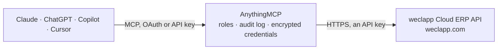

<!-- Generated by scripts/export-github-catalog.mjs in the anythingmcp-website repository. Do not edit by hand. -->

# weclapp Cloud ERP MCP connector

Read and write weclapp Cloud ERP data: customers, suppliers, contacts and leads, quotations, sales orders, invoices, articles, stock, purchase orders, tasks and time records. The AnythingMCP connector gives Claude, ChatGPT, Microsoft Copilot, Cursor and Gemini 90 MCP tools for weclapp Cloud ERP: 43 read and 47 can change data.

**Category:** [ERP](../erp.md) · **Tools:** 90 · **Setup guide:** [anythingmcp.com](https://anythingmcp.com/guides/weclapp-to-mcp) · [Deutsch](https://anythingmcp.com/de/guides/weclapp-to-mcp) · [Italiano](https://anythingmcp.com/it/guides/weclapp-to-mcp) · [Español](https://anythingmcp.com/es/guides/weclapp-to-mcp) · [日本語](https://anythingmcp.com/ja/guides/weclapp-to-mcp) · [Русский](https://anythingmcp.com/ru/guides/weclapp-to-mcp) · [中文](https://anythingmcp.com/zh/guides/weclapp-to-mcp)

## Start without code

No installation and no terminal: AnythingMCP Cloud runs the weclapp Cloud ERP connector for you, operated by helpcode.ai in Frankfurt, Germany.

1. **Click the button above** and create an account or sign in. The weclapp Cloud ERP connector opens, ready to install.
2. **Paste the API key or token from your weclapp Cloud ERP account.** Every click is in the [step-by-step guide](https://anythingmcp.com/guides/weclapp-to-mcp).
3. **Click Install.** AnythingMCP shows the address of your MCP server.
4. **Add that address to your assistant:** [Claude](https://anythingmcp.com/guides/connect-weclapp-to-claude) · [ChatGPT](https://anythingmcp.com/guides/connect-weclapp-to-chatgpt) · [Microsoft Copilot](https://anythingmcp.com/guides/connect-weclapp-to-copilot) · [Cursor](https://anythingmcp.com/guides/connect-weclapp-to-cursor) · [Gemini CLI](https://anythingmcp.com/guides/connect-weclapp-to-gemini) · [Meta Muse](https://anythingmcp.com/guides/connect-weclapp-to-muse).
5. **Ask your first question**, for example: *Show me invoice RE-2026-045 for Hoffmann Gebäudetechnik GmbH — is it still open and what's the amount?*

Prefer help with the setup? [Talk to us](https://anythingmcp.com/contact).

## How it works

- **The AI client** speaks MCP (Streamable HTTP) to AnythingMCP and only sees tool names, descriptions and results. It never gets the weclapp Cloud ERP credentials.
- **AnythingMCP** checks the client's role, builds the call from the tool definition, adds the credentials (an API key), calls weclapp Cloud ERP, logs the call and returns the result.
- **weclapp Cloud ERP** sees an ordinary API client with the rights of the account the credentials belong to.

## Tools

| Tool | What it does | Access |
|---|---|---|
| [`weclapp_list_customers`](#weclapp_list_customers) | List parties (customers/suppliers/contacts) from weclapp ERP. | read |
| [`weclapp_get_customer`](#weclapp_get_customer) | Get a specific party (customer/supplier/contact) by ID. | read |
| [`weclapp_list_sales_orders`](#weclapp_list_sales_orders) | List sales orders from weclapp ERP. | read |
| [`weclapp_list_invoices`](#weclapp_list_invoices) | List sales invoices from weclapp ERP. | read |
| [`weclapp_list_articles`](#weclapp_list_articles) | List articles (products) from weclapp ERP. | read |
| [`weclapp_get_article`](#weclapp_get_article) | Get a specific article (product) by ID, including pricing, supply sources and stock settings (not the quantity on hand). | read |
| [`weclapp_list_quotations`](#weclapp_list_quotations) | List sales quotations (Angebote) from weclapp ERP. | read |
| [`weclapp_get_quotation`](#weclapp_get_quotation) | Get a single sales quotation (Angebot) by ID, including positions, amounts and status. | read |
| [`weclapp_list_recurring_invoices`](#weclapp_list_recurring_invoices) | List recurring invoices (wiederkehrende Rechnungen / Abo-Rechnungen) from weclapp ERP: the templates that periodically generate sales invoices. | read |
| [`weclapp_get_recurring_invoice`](#weclapp_get_recurring_invoice) | Get a single recurring invoice (wiederkehrende Rechnung) by ID, including its interval, next execution date and template positions. | read |
| [`weclapp_list_opportunities`](#weclapp_list_opportunities) | List sales opportunities (Verkaufschancen) from weclapp CRM. | read |
| [`weclapp_list_reference_data`](#weclapp_list_reference_data) | Look up the records other weclapp records point to by id, to turn a name into the id a write tool needs: users (responsibleUserId, task assignees, time… | read |
| [`weclapp_get_reference_record`](#weclapp_get_reference_record) | Read one record of a weclapp reference list by its id, for an id another record points to: e.g. resource=tax with the taxId of an order position,… | read |
| [`weclapp_list_comments`](#weclapp_list_comments) | List the comments on one weclapp record (sales order, quotation, invoice, party, task, ticket...), newest first with sort='-createdDate'. | read |
| [`weclapp_list_sales_open_items`](#weclapp_list_sales_open_items) | List the open items (Offene Posten) of sales invoices and credit notes: amount, amountOpen, amountPaid, amountDiscount, cleared, clearanceDate,… | read |
| [`weclapp_get_current_user`](#weclapp_get_current_user) | Return the weclapp user the API token belongs to: id, name, e-mail, username, status and roles. | read |
| [`weclapp_get_property_translations`](#weclapp_get_property_translations) | Read the translated texts of one record, e.g. an article's name and descriptions in English or French as maintained in weclapp. | read |
| [`weclapp_list_warehouse_stock_movements`](#weclapp_list_warehouse_stock_movements) | List warehouse stock movements (Lagerbewegungen): which article moved, how much, in or out, when, from or to which storage place, and the order, shipment,… | read |
| [`weclapp_list_production_orders`](#weclapp_list_production_orders) | List production orders (Fertigungsaufträge): number, article, target and actual quantity, target and actual start and end dates, status, warehouse, the… | read |
| [`weclapp_list_notifications`](#weclapp_list_notifications) | List the weclapp notifications the API token can see: title, description, priority (NORMAL or CRITICAL), read flag and the record they are about… | read |
| [`weclapp_list_external_connections`](#weclapp_list_external_connections) | List the external connections set up in weclapp (shops, marketplaces, shipping, payment and other integrations such as Shopify, Shopware, Amazon, eBay, DHL,… | read |
| [`weclapp_get_external_connection`](#weclapp_get_external_connection) | Get one weclapp external connection (shop, marketplace or service integration) by id: name and connectionType. | read |
| [`weclapp_list_active_sales_channels`](#weclapp_list_active_sales_channels) | List the sales channels active in this weclapp tenant: key (GROSS1, NET1 and so on) and the name shown in weclapp. | read |
| [`weclapp_add_party`](#weclapp_add_party) | Create a customer or supplier (a party) in weclapp. | write |
| [`weclapp_add_contact_person`](#weclapp_add_contact_person) | Create a contact person (a party of type PERSON) in weclapp. | write |
| [`weclapp_add_lead`](#weclapp_add_lead) | Create a lead in weclapp: a party with a lead status that is not a customer yet. | write |
| [`weclapp_edit_party`](#weclapp_edit_party) | Change fields of a customer, supplier, contact person or lead; fields you do not send keep their values (weclapp partial update, ignoreMissingProperties=true). | write |
| [`weclapp_add_quotation`](#weclapp_add_quotation) | Create a sales quotation (Angebot) for a customer, with its positions in the same call. | write |
| [`weclapp_edit_quotation`](#weclapp_edit_quotation) | Change fields of a sales quotation; fields you do not send keep their values (weclapp partial update). | write |
| [`weclapp_set_quotation_status`](#weclapp_set_quotation_status) | Set the status of a sales quotation through weclapp's own status action: OPEN, ENTRY_COMPLETED, INQUIRED, ACCEPTED, REJECTED or CANCELLED. | write |
| [`weclapp_add_sales_order`](#weclapp_add_sales_order) | Create a sales order (Auftrag) for a customer, with its positions in the same call. | write |
| [`weclapp_edit_sales_order`](#weclapp_edit_sales_order) | Change fields of a sales order; fields you do not send keep their values (weclapp partial update), e.g. set the responsible user, the planned delivery date… | write |
| [`weclapp_set_sales_order_status`](#weclapp_set_sales_order_status) | Set the status of a sales order: ORDER_CONFIRMATION_PRINTED marks it as confirmed, ORDER_ENTRY_IN_PROGRESS reopens it for changes. | write |
| [`weclapp_cancel_sales_order`](#weclapp_cancel_sales_order) | Cancel a sales order, or close it manually when parts of it were already shipped or invoiced (weclapp's cancelOrManuallyClose action). | write |
| [`weclapp_invoice_sales_order`](#weclapp_invoice_sales_order) | Create a sales invoice from a sales order (weclapp's createSalesInvoice action), optionally combining further orders of the same customer into one invoice. | write |
| [`weclapp_edit_sales_invoice`](#weclapp_edit_sales_invoice) | Change fields of a sales invoice; fields you do not send keep their values (weclapp partial update), e.g. set the responsible user or the due date of a draft. | write |
| [`weclapp_add_task`](#weclapp_add_task) | Create a task (Aufgabe) in weclapp, optionally assigned to users and linked to a customer or a record such as a sales order. | write |
| [`weclapp_edit_task`](#weclapp_edit_task) | Change fields of a task; fields you do not send keep their values (weclapp partial update), e.g. mark it done with {"taskStatus": "COMPLETED"} or move the… | write |
| [`weclapp_add_comment`](#weclapp_add_comment) | Add a comment to a weclapp record (sales order, quotation, sales invoice, party, task, ticket...). | write |
| [`weclapp_add_time_record`](#weclapp_add_time_record) | Book working time (Zeiterfassung) for a user in weclapp, optionally on a customer, a sales order, a task or a ticket. | write |
| [`weclapp_add_article`](#weclapp_add_article) | Create an article (product or service) in weclapp, optionally with its sales prices. | write |
| [`weclapp_edit_article`](#weclapp_edit_article) | Change fields of an article (product); fields you do not send keep their values (weclapp partial update), e.g. name, EAN, manufacturer part number, minimum… | write |
| [`weclapp_set_article_prices`](#weclapp_set_article_prices) | Change the sales prices of an article. | write |
| [`weclapp_book_stock_in`](#weclapp_book_stock_in) | Book stock into a storage place (weclapp's bookIncomingMovement), e.g. goods received without a purchase order or an upward inventory correction. | write |
| [`weclapp_book_stock_out`](#weclapp_book_stock_out) | Book stock out of a storage place (weclapp's bookOutgoingMovement), e.g. breakage, own use or a downward inventory correction. | write |
| [`weclapp_add_purchase_order`](#weclapp_add_purchase_order) | Create a purchase order (Bestellung) to a supplier, with its positions in the same call. | write |
| [`weclapp_set_sales_invoice_responsible`](#weclapp_set_sales_invoice_responsible) | Set the responsible user (e.g. the field sales rep) of a sales invoice and nothing else; every other field keeps its value (partial PUT with… | write |
| [`weclapp_set_sales_order_responsible`](#weclapp_set_sales_order_responsible) | Set the responsible user (e.g. the field sales rep) of a sales order and nothing else; every other field keeps its value (partial PUT with… | write |
| [`weclapp_set_party_responsible`](#weclapp_set_party_responsible) | Set the responsible user (e.g. the field sales rep) of a customer, supplier or lead and, optionally, its fixed-responsible flag (fixedResponsibleUser),… | write |
| [`weclapp_add_supply_source`](#weclapp_add_supply_source) | Create a supply source (Lieferquelle) for purchasing: which supplier sells the article, under which number, at which purchase price. | write |
| [`weclapp_add_manufacturer`](#weclapp_add_manufacturer) | Create a manufacturer (Hersteller) in the master data. | write |
| [`weclapp_add_article_item_group`](#weclapp_add_article_item_group) | Create an item group (Positionsgruppe): a named set of articles with quantities that is added to quotations and orders in one step. | write |
| [`weclapp_set_party_emails`](#weclapp_set_party_emails) | Maintain a customer's or supplier's e-mail addresses for documents (master data, E-Mail-Adressen) and choose which entry weclapp uses for sales orders,… | write |
| [`weclapp_set_sales_open_item_payment_state`](#weclapp_set_sales_open_item_payment_state) | Mark one sales open item as paid (PAID, with the payment date) or back to unpaid (UNPAID), through weclapp's updatePaymentState action. | write |
| [`weclapp_delete_party`](#weclapp_delete_party) | Delete a customer, supplier, contact person or lead. | write |
| [`weclapp_delete_quotation`](#weclapp_delete_quotation) | Delete a sales quotation. | write |
| [`weclapp_delete_sales_order`](#weclapp_delete_sales_order) | Delete a sales order. | write |
| [`weclapp_delete_task`](#weclapp_delete_task) | Delete a task. | write |
| [`weclapp_delete_comment`](#weclapp_delete_comment) | Delete a comment from a record. | write |
| [`weclapp_delete_time_record`](#weclapp_delete_time_record) | Delete a time record. | write |
| [`weclapp_find_shipments`](#weclapp_find_shipments) | List shipments (Lieferungen / Warenausgänge): shipment number, type, status, the sales orders it ships (salesOrders, mainSalesOrderId), recipient and… | read |
| [`weclapp_get_shipment`](#weclapp_get_shipment) | Get one shipment by its id with every field: items with quantities, picks, recipient and invoice address, carrier, parcels and tracking. | read |
| [`weclapp_download_delivery_note_pdf`](#weclapp_download_delivery_note_pdf) | Download the latest delivery note (Lieferschein) PDF of a shipment. | read |
| [`weclapp_download_sales_invoice_pdf`](#weclapp_download_sales_invoice_pdf) | Download the latest PDF of a sales invoice (Rechnung) as an attachment, not as text. | read |
| [`weclapp_read_sales_order`](#weclapp_read_sales_order) | Get one sales order by its id with every field, including orderItems, addresses, status history, the invoiced and shipped flags and amounts. | read |
| [`weclapp_read_sales_invoice`](#weclapp_read_sales_invoice) | Get one sales invoice by its id with every field: positions, amounts, payment status, due date, addresses and the sales orders it bills. | read |
| [`weclapp_get_production_order`](#weclapp_get_production_order) | Get one production order (Fertigungsauftrag) by its id: article, target and actual quantity, target and actual dates, status, warehouse, components to pick… | read |
| [`weclapp_list_requisitions`](#weclapp_list_requisitions) | List purchase requisitions (Bestellvorschläge), the demand the material planning run computes: article, required and proposed quantity, earliest and latest… | read |
| [`weclapp_find_warehouse_stock`](#weclapp_find_warehouse_stock) | List current stock (Lagerbestand) per article and storage place: quantity on hand, warehouse, storage place, batch number, serial numbers, inbound date,… | read |
| [`weclapp_find_batch_numbers`](#weclapp_find_batch_numbers) | List batch numbers (Chargen) of batch-managed articles: batch number, article, expiry date and DDS number. | read |
| [`weclapp_read_batch_number`](#weclapp_read_batch_number) | Get one batch number record by its id: batch number, article, expiry date, DDS number and custom attributes. | read |
| [`weclapp_find_purchase_orders`](#weclapp_find_purchase_orders) | List purchase orders (Bestellungen) to suppliers: number, type, status, supplier, order and planned delivery dates, positions, amounts, warehouse, and the… | read |
| [`weclapp_read_purchase_order`](#weclapp_read_purchase_order) | Get one purchase order by its id with every field, including purchaseOrderItems with ordered and received quantities, addresses and status history. | read |
| [`weclapp_list_purchase_invoices`](#weclapp_list_purchase_invoices) | List purchase invoices (Eingangsrechnungen) from suppliers: invoice number, internal number, type, status, payment status, supplier, invoice, booking and… | read |
| [`weclapp_find_incoming_goods`](#weclapp_find_incoming_goods) | List incoming goods (Wareneingänge): goods received from suppliers against purchase orders, customer returns and internal transfers. | read |
| [`weclapp_find_purchase_open_items`](#weclapp_find_purchase_open_items) | List the open items (offene Posten) of purchase invoices, i.e. what the company still owes suppliers: amount, amount paid, amount open, discount, cleared… | read |
| [`weclapp_find_article_prices`](#weclapp_find_article_prices) | List sales prices of articles (Artikelpreise): price, currency, sales channel (NET1, GROSS1...), validity start and end date, price scale (quantity… | read |
| [`weclapp_find_bank_transactions`](#weclapp_find_bank_transactions) | List bank transactions imported into weclapp (bank statements, PayPal, Stripe, Amazon, POS...): amount, currency, effective date, description (purpose… | read |
| [`weclapp_list_variant_articles`](#weclapp_list_variant_articles) | List variant articles (Variantenartikel): the parent article of a product family with its name, number, primary article and the variants (the articles per… | read |
| [`weclapp_count_records`](#weclapp_count_records) | Count the records of a weclapp list without loading them, optionally with the same filter as the list tools, e.g. how many open sales orders, active… | read |
| [`weclapp_create_shipment_from_sales_order`](#weclapp_create_shipment_from_sales_order) | Create a shipment (Lieferung) from a sales order, weclapp's createShipment action, optionally combining further orders of the same customer into one shipment. | write |
| [`weclapp_edit_shipment`](#weclapp_edit_shipment) | Change fields of a shipment; fields you do not send keep their values (weclapp partial update, ignoreMissingProperties=true), e.g. add the tracking number… | write |
| [`weclapp_convert_requisition_to_production_order`](#weclapp_convert_requisition_to_production_order) | Turn a purchase requisition (Bestellvorschlag) of a production article into a production order, weclapp's createProductionOrder action. | write |
| [`weclapp_run_material_planning`](#weclapp_run_material_planning) | Start weclapp's material planning run (Disposition): weclapp recalculates demand from sales orders, production orders and minimum stock and creates or… | write |
| [`weclapp_add_production_order`](#weclapp_add_production_order) | Create a production order (Fertigungsauftrag) for a production article: what to make, how many, in which warehouse and when. | write |
| [`weclapp_edit_production_order`](#weclapp_edit_production_order) | Change fields of a production order; fields you do not send keep their values (weclapp partial update, ignoreMissingProperties=true), e.g. move the target… | write |
| [`weclapp_book_stock_transfer`](#weclapp_book_stock_transfer) | Move stock from one storage place to another in one booking (weclapp's bookDirectStockTransfer), e.g. from the goods-in area to a shelf or between two… | write |
| [`weclapp_edit_batch_number`](#weclapp_edit_batch_number) | Change the expiry date, DDS number or custom attributes of a batch number. | write |
| [`weclapp_set_purchase_open_item_payment_state`](#weclapp_set_purchase_open_item_payment_state) | Mark one purchase open item (what is owed to a supplier) as paid (PAID, with the payment date) or back to unpaid (UNPAID), through weclapp's… | write |
| [`weclapp_apply_bank_transaction_to_purchase_open_item`](#weclapp_apply_bank_transaction_to_purchase_open_item) | Clear a purchase open item with a bank or cash account transaction that is already in weclapp (weclapp's createPaymentApplication): the transaction is… | write |

## Tool reference

Every parameter as the AI client sees it in `tools/list`. Source: [`packages/backend/src/adapters/de/weclapp.json`](../../../packages/backend/src/adapters/de/weclapp.json).

### `weclapp_list_customers`

List parties (customers/suppliers/contacts) from weclapp ERP. In API v2 customers and suppliers are unified under /party: pass filter='customerNumber-notnull=' to restrict to customers, or filter='supplierNumber-notnull=' for suppliers (the -null/-notnull operators take an EMPTY value, NOT '=true'). Leave `properties` empty unless the user asks for specific fields: a guessed field name fails the call (the address, city included, is inside `addresses`).

**Access:** read · **Call:** `GET /party`

| Parameter | Type | Required | Description |
|---|---|---|---|
| `page` | number | no | Page number (1-based) |
| `pageSize` | number | no | Results per page (default: 100, max: 1000) |
| `properties` | string | no | Leave empty (the default): weclapp then returns every field, which is what almost every question needs. Set it only when the user asks for specific fields or a large list must be trimmed, and then use only names from the list below: any other name fails with 400 "unknown property". Top-level names only: nested objects (addresses, contacts) come back whole, and a dotted path such as addresses.city is rejected. Valid party (customers, suppliers, contacts, leads) fields (weclapp API v2): id, partyType, customer, supplier, customerNumber, supplierNumber, company, company2, salutation, firstName, lastName, email, phone, mobilePhone1, fax, website, addresses, contacts, primaryAddressId, invoiceAddressId, deliveryAddressId, responsibleUserId, customerCategoryId, customerCurrentSalesStageId, customerTermOfPaymentId, customerPaymentMethodId, customerSalesChannel, customerBlocked, customerActive, supplierActive, leadStatus, leadSourceId, leadRatingId, sectorId, vatIdentificationNumber, tags, description, createdDate, lastModifiedDate. Not party fields: city/street/zipcode (inside `addresses`), mobilePhone (`mobilePhone1`), paymentMethodId (`customerPaymentMethodId`), termOfPaymentId (`customerTermOfPaymentId`), salesChannel (`customerSalesChannel`), salesStageId (`customerCurrentSalesStageId`), contactType. |
| `filter` | string | no | weclapp v2 filter expression. The property+operator IS the param name (no 'filter=' wrapper). Examples: 'partyType-eq=ORGANIZATION', 'customerNumber-notnull='. Note that the -null/-notnull operators take an EMPTY value, not '=true'. |
| `sort` | string | no | Sort field, prefix with '-' for descending (e.g. '-createdDate') |

### `weclapp_get_customer`

Get a specific party (customer/supplier/contact) by ID. In API v2 this maps to /party/id/{id}.

**Access:** read · **Call:** `GET /party/id/{partyId}`

| Parameter | Type | Required | Description |
|---|---|---|---|
| `partyId` | string | yes | The weclapp party ID (numeric string) |

### `weclapp_list_sales_orders`

List sales orders from weclapp ERP. Returns order numbers, amounts, status and the record address. NOTE: salesOrder has NO 'customerName' field: do not request it in `properties` (weclapp returns 400). The customer's name is in `recordAddress`; the customer link is `customerId`. Use `filter` to narrow results and leave `properties` empty (e.g. 'orderNumber-eq=SO-1042'). Date fields are Unix epoch milliseconds (e.g. 'orderDate-gt=1767225600000').

**Access:** read · **Call:** `GET /salesOrder`

| Parameter | Type | Required | Description |
|---|---|---|---|
| `page` | number | no | Page number (1-based) |
| `pageSize` | number | no | Results per page (default: 100, max: 1000) |
| `properties` | string | no | Leave empty (the default): weclapp then returns every field, which is what almost every question needs. Set it only when the user asks for specific fields or a large list must be trimmed, and then use only names from the list below: any other name fails with 400 "unknown property". Top-level names only: nested objects (recordAddress, deliveryAddress, orderItems) come back whole, and a dotted path such as orderItems.articleNumber is rejected. Valid salesOrder fields (weclapp API v2): id, orderNumber, orderDate, status, customerId, orderNumberAtCustomer, recordAddress, invoiceAddress, deliveryAddress, orderItems, netAmount, grossAmount, netAmountInCompanyCurrency, recordCurrencyId, quotationId, invoiced, shipped, plannedDeliveryDate, plannedShippingDate, warehouseId, shipmentMethodId, defaultShippingCarrierId, paymentMethodId, termOfPaymentId, salesChannel, responsibleUserId, creatorId, commission, description, tags, createdDate, lastModifiedDate. Not sales order fields: customerNumber (filter by `customerId`), salesOrderItems (`orderItems`), shippingAddress (`deliveryAddress`), shippingCarrierId (`defaultShippingCarrierId`), currencyId (`recordCurrencyId`), quotationNumber (`quotationId`), customerPurchaseOrderNumber (`orderNumberAtCustomer`), customerContactId. |
| `filter` | string | no | weclapp v2 filter expression (e.g. 'status-eq=ORDER_ENTRY_IN_PROGRESS') |
| `sort` | string | no | Sort field, prefix with '-' for descending |

### `weclapp_list_invoices`

List sales invoices from weclapp ERP. Returns invoice numbers, amounts, due dates, and payment status. NOTE: invoice has NO 'customerName' field: do not request it in `properties` (weclapp returns 400); the name is in `recordAddress`, the link is `customerId`. Other common 400 traps: line items are `salesInvoiceItems` (not `invoiceItems`); the invoice-type field/filter is `salesInvoiceType` (not `invoiceType`); there is no `currencyName` (currency is `recordCurrencyId`, amounts are `netAmount`/`grossAmount`/`netAmountInCompanyCurrency`); a cancelled invoice is `status-eq=CANCELLED`, not an invoiceType. Use `filter` for queries like 'paid-eq=false'. To find the invoices of a sales order, filter on its id with 'salesOrders.id-eq=<sales order id>': an invoice has no `salesOrderId` filter (weclapp answers 400 "unexpected filter property"). Date fields are Unix epoch milliseconds (e.g. 'invoiceDate-gt=1767225600000' for 2026-01-01).

**Access:** read · **Call:** `GET /salesInvoice`

| Parameter | Type | Required | Description |
|---|---|---|---|
| `page` | number | no | Page number (1-based) |
| `pageSize` | number | no | Results per page (default: 100, max: 1000) |
| `properties` | string | no | Leave empty (the default): weclapp then returns every field, which is what almost every question needs. Set it only when the user asks for specific fields or a large list must be trimmed, and then use only names from the list below: any other name fails with 400 "unknown property". Top-level names only: nested objects (recordAddress, salesInvoiceItems) come back whole, and a dotted path such as recordAddress.company is rejected. Valid salesInvoice fields (weclapp API v2): id, invoiceNumber, invoiceDate, dueDate, status, paymentStatus, paid, salesInvoiceType, customerId, recordAddress, deliveryAddress, salesInvoiceItems, netAmount, grossAmount, vatAmount, netAmountInCompanyCurrency, grossAmountInCompanyCurrency, recordCurrencyId, salesOrders, quotationId, recurringInvoiceId, orderNumberAtCustomer, deliveryDate, bookingDate, cancellationNumber, dunningBlockState, paymentMethodId, termOfPaymentId, salesChannel, responsibleUserId, creatorId, commission, description, tags, createdDate, lastModifiedDate. Not invoice fields: openAmount and paidAmount (an invoice has no open amount; `paymentStatus` and `paid` say whether it is settled), customerNumber (filter by `customerId`), createdById (`creatorId`), recordCurrencyName (`recordCurrencyId`), salesOrderId and salesOrderNumber (the linked orders are in `salesOrders`), dunningLevel, shipments. |
| `filter` | string | no | weclapp filter. The property+operator IS the param name, so pass it as `property-operator=value` (NOT a `filter=` wrapper). Operators: -eq -ne -gt -lt -ge -le -like -ilike -in -notin -null -notnull (the -null/-notnull operators take an EMPTY value, e.g. 'articleNumber-notnull='). The -in/-notin operators need a BRACKETED comma list: 'id-in=[6501,84566]', NOT 'id-in=6501,84566' (that returns 400 'invalid parameter value'). Examples: 'articleNumber-eq=A5101', 'productionArticle-eq=true', 'name-ilike=%hammer%'. Combine with '&'. |
| `sort` | string | no | Sort field, prefix with '-' for descending |

### `weclapp_list_articles`

List articles (products) from weclapp ERP. Returns article numbers, names, prices and stock settings (minimum and target stock; the quantity on hand is not an article field, so do not ask for stockQuantity or availableQuantity). Use `filter` like 'articleNumber-eq=ABC123' for SKU lookups. NOTE on prices: an article has NO direct `salesPrice`/`purchasePrice`/`lastPurchasePrice`/`averagePurchasePrice`/`valuationPrice` property (those return 400 'unknown property'). Sales prices live in the `articlePrices` sub-entity and purchase prices in `supplySources` (note: `supplySources`, not `articleSupplySources`); request those names in `properties` to get the nested price objects.

**Access:** read · **Call:** `GET /article`

| Parameter | Type | Required | Description |
|---|---|---|---|
| `page` | number | no | Page number (1-based) |
| `pageSize` | number | no | Results per page (default: 100, max: 1000) |
| `properties` | string | no | Leave empty (the default): weclapp then returns every field, which is what almost every question needs. Set it only when the user asks for specific fields or a large list must be trimmed, and then use only names from the list below: any other name fails with 400 "unknown property". Top-level names only: nested objects (articlePrices, supplySources) come back whole, and a dotted path such as articlePrices.price is rejected. Valid article fields (weclapp API v2): id, articleNumber, name, description, shortDescription1, shortDescription2, articleType, active, unitId, ean, barcode, manufacturerPartNumber, manufacturerId, articleCategoryId, articlePrices, articleCalculationPrices, taxRateType, availableInSale, supplySources, primarySupplySourceId, minimumStockQuantity, targetStockQuantity, defaultStoragePlaces, batchNumberRequired, serialNumberRequired, productionArticle, articleNetWeight, articleGrossWeight, customsTariffNumberId, countryOfOriginCode, tags, createdDate, lastModifiedDate. Not article fields: unitName (`unitId`; the unit's name comes from weclapp_list_reference_data with resource=unit), stockQuantity, availableQuantity and availableStockQuantity (stock is not stored on the article), salesDescription, descriptionFixed. |
| `filter` | string | no | weclapp filter. The property+operator IS the param name, so pass it as `property-operator=value` (NOT a `filter=` wrapper). Operators: -eq -ne -gt -lt -ge -le -like -ilike -in -notin -null -notnull (the -null/-notnull operators take an EMPTY value, e.g. 'articleNumber-notnull='). The -in/-notin operators need a BRACKETED comma list: 'id-in=[6501,84566]', NOT 'id-in=6501,84566' (that returns 400 'invalid parameter value'). Examples: 'articleNumber-eq=A5101', 'productionArticle-eq=true', 'name-ilike=%hammer%'. Combine with '&'. |
| `sort` | string | no | Sort field, prefix with '-' for descending |

### `weclapp_get_article`

Get a specific article (product) by ID, including pricing, supply sources and stock settings (not the quantity on hand).

**Access:** read · **Call:** `GET /article/id/{articleId}`

| Parameter | Type | Required | Description |
|---|---|---|---|
| `articleId` | string | yes | The weclapp article ID (numeric string) |

### `weclapp_list_quotations`

List sales quotations (Angebote) from weclapp ERP. Returns quotation numbers, amounts, status and the record address. NOTE: a quotation has NO 'customerName' field: the customer's name is in `recordAddress`, the link is `customerId`; do not request 'customerName' in `properties`. Date fields are Unix epoch milliseconds (e.g. 'quotationDate-gt=1767225600000' for 2026-01-01).

**Access:** read · **Call:** `GET /quotation`

| Parameter | Type | Required | Description |
|---|---|---|---|
| `page` | number | no | Page number (1-based) |
| `pageSize` | number | no | Results per page (default: 100, max: 1000) |
| `properties` | string | no | Leave empty (the default): weclapp then returns every field, which is what almost every question needs. Set it only when the user asks for specific fields or a large list must be trimmed, and then use only names from the list below: any other name fails with 400 "unknown property". Top-level names only: nested objects (recordAddress, quotationItems) come back whole, and a dotted path such as recordAddress.contactId is rejected. Valid quotation fields (weclapp API v2): id, quotationNumber, quotationDate, quotationVersion, status, customerId, opportunityId, recordAddress, invoiceAddress, deliveryAddress, quotationItems, netAmount, grossAmount, netAmountInCompanyCurrency, recordCurrencyId, validFrom, validTo, salesProbability, salesStageId, expectedSignatureDate, publicLink, rejectionReason, responsibleUserId, creatorId, description, tags, createdDate, lastModifiedDate. Not quotation fields: validUntil (`validTo`), publicPageUrl (`publicLink`), contactId and customerContactId (a quotation has no contact-person field). |
| `filter` | string | no | weclapp filter. The property+operator IS the param name, so pass it as `property-operator=value` (NOT a `filter=` wrapper). Operators: -eq -ne -gt -lt -ge -le -like -ilike -in -notin -null -notnull (the -null/-notnull operators take an EMPTY value, e.g. 'quotationNumber-notnull='). Examples: 'status-eq=ORDER_CONFIRMATION_PRINTED', 'quotationNumber-eq=AN-1042'. Combine with '&'. |
| `sort` | string | no | Sort field, prefix with '-' for descending |

### `weclapp_get_quotation`

Get a single sales quotation (Angebot) by ID, including positions, amounts and status.

**Access:** read · **Call:** `GET /quotation/id/{quotationId}`

| Parameter | Type | Required | Description |
|---|---|---|---|
| `quotationId` | string | yes | The weclapp quotation ID (numeric string) |

### `weclapp_list_recurring_invoices`

List recurring invoices (wiederkehrende Rechnungen / Abo-Rechnungen) from weclapp ERP: the templates that periodically generate sales invoices. Returns interval, next run, amounts and status. NOTE: no 'customerName' field: the name is in `recordAddress`, the link is `customerId`. Date fields are Unix epoch milliseconds.

**Access:** read · **Call:** `GET /recurringInvoice`

| Parameter | Type | Required | Description |
|---|---|---|---|
| `page` | number | no | Page number (1-based) |
| `pageSize` | number | no | Results per page (default: 100, max: 1000) |
| `properties` | string | no | Leave empty (the default): weclapp then returns every field. Set it only when the user asks for specific fields, with names you have seen in a response of this tool: a name the record does not have fails with 400 "unknown property". |
| `filter` | string | no | weclapp filter. The property+operator IS the param name, so pass it as `property-operator=value` (NOT a `filter=` wrapper). Operators: -eq -ne -gt -lt -ge -le -like -ilike -in -notin -null -notnull (the -null/-notnull operators take an EMPTY value, e.g. 'customerId-notnull='). Combine with '&'. |
| `sort` | string | no | Sort field, prefix with '-' for descending |

### `weclapp_get_recurring_invoice`

Get a single recurring invoice (wiederkehrende Rechnung) by ID, including its interval, next execution date and template positions.

**Access:** read · **Call:** `GET /recurringInvoice/id/{recurringInvoiceId}`

| Parameter | Type | Required | Description |
|---|---|---|---|
| `recurringInvoiceId` | string | yes | The weclapp recurring invoice ID (numeric string) |

### `weclapp_list_opportunities`

List sales opportunities (Verkaufschancen) from weclapp CRM. Returns name, stage/status, expected value and the linked customer. NOTE: the linked party is referenced by `customerId` / `contactId`, not a name field. Date fields are Unix epoch milliseconds.

**Access:** read · **Call:** `GET /opportunity`

| Parameter | Type | Required | Description |
|---|---|---|---|
| `page` | number | no | Page number (1-based) |
| `pageSize` | number | no | Results per page (default: 100, max: 1000) |
| `properties` | string | no | Leave empty (the default): weclapp then returns every field, which is what almost every question needs. Set it only when the user asks for specific fields or a large list must be trimmed, and then use only names from the list below: any other name fails with 400 "unknown property". Top-level names only: nested objects (salesStageHistory) come back whole, and a dotted path such as salesStageHistory.salesStageId is rejected. Valid opportunity fields (weclapp API v2): id, opportunityNumber, name, customerId, contactId, description, revenue, salesProbability, salesStageId, salesStageHistory, salesChannel, hotLead, startDate, expectedSignatureDate, expectedDeliveryDate, nextCallDate, responsibleUserId, creatorId, winLossReasonId, winLossDescription, topics, tags, createdDate, lastModifiedDate. Not opportunity fields: expectedCloseDate (`expectedSignatureDate`), salesStage (`salesStageId`), expectedValue (`revenue`). |
| `filter` | string | no | weclapp filter. The property+operator IS the param name, so pass it as `property-operator=value` (NOT a `filter=` wrapper). Operators: -eq -ne -gt -lt -ge -le -like -ilike -in -notin -null -notnull (the -null/-notnull operators take an EMPTY value, e.g. 'customerId-notnull='). Combine with '&'. |
| `sort` | string | no | Sort field, prefix with '-' for descending |

### `weclapp_list_reference_data`

Look up the records other weclapp records point to by id, to turn a name into the id a write tool needs: users (responsibleUserId, task assignees, time records), warehouses and storage places, units, tax rates, currencies, terms of payment, payment and shipment methods, carriers, customer categories, sectors, lead sources and ratings, sales stages, titles, departments and roles of contact persons, cost centers, article categories and task lists, plus the custom attribute definitions (the meaning of the customAttributes ids on records) and serial numbers (serialNumber-eq=... gives the articleId). Read-only. Example: resource=user with filter='lastName-ilike=%meier%' to find a user's id.

**Access:** read · **Call:** `GET /{resource}`

| Parameter | Type | Required | Description |
|---|---|---|---|
| `resource` | `user` \| `warehouse` \| `storagePlace` \| `unit` \| `tax` \| `currency` \| `termOfPayment` \| `paymentMethod` \| `shipmentMethod` \| `shippingCarrier` \| `customerCategory` \| `sector` \| `leadSource` \| `leadRating` \| `salesStage` \| `customerLeadLossReason` \| `customerTopic` \| `legalForm` \| `title` \| `personDepartment` \| `personRole` \| `companySize` \| `commercialLanguage` \| `costCenter` \| `placeOfService` \| `articleCategory` \| `taskList` \| `manufacturer` \| `articleSupplySource` \| `articleItemGroup` \| `customAttributeDefinition` \| `serialNumber` | yes | Which list to read. |
| `page` | number | no | Page number (1-based) |
| `pageSize` | number | no | Results per page (default: 100, max: 1000) |
| `properties` | string | no | Leave empty (the default): every field comes back. Most lists have `id` and `name`; users have `id,firstName,lastName,email,username`. A name the list does not have fails with 400 "unknown property". |
| `filter` | string | no | weclapp filter as query parameters: `property-operator=value`, joined with `&` (NOT a `filter=` wrapper). Operators: -eq -ne -gt -lt -ge -le -like -ilike -in -notin -null -notnull; -null/-notnull take an EMPTY value, -in/-notin a bracketed list (`id-in=[1,2]`). Examples: 'name-ilike=%netto%', 'email-eq=anna@example.com'. |
| `sort` | string | no | Sort field, prefix with '-' for descending |

### `weclapp_get_reference_record`

Read one record of a weclapp reference list by its id, for an id another record points to: e.g. resource=tax with the taxId of an order position, resource=articleCategory with an article's articleCategoryId, resource=user with a responsibleUserId. Same resources as weclapp_list_reference_data. Read-only.

**Access:** read · **Call:** `GET /{resource}/id/{id}`

| Parameter | Type | Required | Description |
|---|---|---|---|
| `resource` | `user` \| `warehouse` \| `storagePlace` \| `unit` \| `tax` \| `currency` \| `termOfPayment` \| `paymentMethod` \| `shipmentMethod` \| `shippingCarrier` \| `customerCategory` \| `sector` \| `leadSource` \| `leadRating` \| `salesStage` \| `customerLeadLossReason` \| `customerTopic` \| `legalForm` \| `title` \| `personDepartment` \| `personRole` \| `companySize` \| `commercialLanguage` \| `costCenter` \| `placeOfService` \| `articleCategory` \| `taskList` \| `manufacturer` \| `articleSupplySource` \| `articleItemGroup` \| `customAttributeDefinition` \| `serialNumber` | yes | Which list the record belongs to. |
| `id` | string | yes | The record id (numeric string), e.g. a taxId or articleCategoryId from another record. |

### `weclapp_list_comments`

List the comments on one weclapp record (sales order, quotation, invoice, party, task, ticket...), newest first with sort='-createdDate'. Also shows how weclapp spells the entityName of a record type before you add a comment with weclapp_add_comment.

**Access:** read · **Call:** `GET /comment`

| Parameter | Type | Required | Description |
|---|---|---|---|
| `entityName` | string | yes | Record type in weclapp's API spelling, e.g. salesOrder, quotation, salesInvoice, party, task, opportunity, ticket. |
| `entityId` | string | yes | ID of that record. |
| `page` | number | no | Page number (1-based) |
| `pageSize` | number | no | Results per page (default: 100, max: 1000) |
| `sort` | string | no | Sort field, prefix with '-' for descending, e.g. '-createdDate'. |

### `weclapp_list_sales_open_items`

List the open items (Offene Posten) of sales invoices and credit notes: amount, amountOpen, amountPaid, amountDiscount, cleared, clearanceDate, openItemNumber, openItemType, the payments applied to it and salesInvoiceId. Use it to see what a customer still owes, or to get the open item id that weclapp_set_sales_open_item_payment_state needs (that tool takes the open item id, not the invoice id). Read-only.

**Access:** read · **Call:** `GET /salesOpenItem`

| Parameter | Type | Required | Description |
|---|---|---|---|
| `page` | number | no | Page number (1-based) |
| `pageSize` | number | no | Results per page (default: 100, max: 1000) |
| `properties` | string | no | Leave empty (the default): every field comes back. Set it only to trim a large list, and then use only names from this list: any other name fails with 400 "unknown property". Valid fields (weclapp API v2): id, version, createdDate, lastModifiedDate, amount, amountDiscount, amountOpen, amountPaid, clearanceDate, cleared, openItemNumber, openItemType, paymentApplications, salesInvoiceId. |
| `filter` | string | no | weclapp filter as query parameters: `property-operator=value`, joined with `&` (NOT a `filter=` wrapper). Operators: -eq -ne -gt -lt -ge -le -like -ilike -in -notin -null -notnull; -null/-notnull take an EMPTY value, -in/-notin a bracketed list (`id-in=[1,2]`). Examples: 'name-ilike=%netto%', 'email-eq=anna@example.com'. Examples: 'salesInvoiceId-eq=4711', 'salesInvoiceId-in=[4711,4712]', 'cleared-eq=false' for items not settled yet. |
| `sort` | string | no | Sort field, prefix with '-' for descending |

### `weclapp_get_current_user`

Return the weclapp user the API token belongs to: id, name, e-mail, username, status and roles. Use its id as responsibleUserId or task assignee when the user means themselves, and to check whose permissions the connector has. Read-only.

**Access:** read · **Call:** `GET /user/currentUser`

No parameters.

### `weclapp_get_property_translations`

Read the translated texts of one record, e.g. an article's name and descriptions in English or French as maintained in weclapp. Returns per property its texts per locale. weclapp marks this endpoint as deprecated but still serves it. Read-only.

**Access:** read · **Call:** `GET /propertyTranslation/readPropertyTranslations`

| Parameter | Type | Required | Description |
|---|---|---|---|
| `entityName` | string | yes | The weclapp entity, e.g. article, articleCategory, unit, termOfPayment. |
| `entityId` | string | yes | Id of the record (numeric string). |
| `locale` | string | no | Optional language code, e.g. en or fr. Leave out for every language. |
| `propertyNames` | string[] | no | Optional property names to read, e.g. ["name", "description"]. Leave out for every translated property. |

### `weclapp_list_warehouse_stock_movements`

List warehouse stock movements (Lagerbewegungen): which article moved, how much, in or out, when, from or to which storage place, and the order, shipment, production order or user behind it. Use it to explain a stock level or trace a serial or batch number. Filter by article and date, the full history is long. Read-only; stock is booked with weclapp_book_stock_in and weclapp_book_stock_out.

**Access:** read · **Call:** `GET /warehouseStockMovement`

| Parameter | Type | Required | Description |
|---|---|---|---|
| `page` | number | no | Page number (1-based) |
| `pageSize` | number | no | Results per page (default: 100, max: 1000) |
| `properties` | string | no | Leave empty (the default): every field comes back. Set it only to trim a large list, and then use only names from this list: any other name fails with 400 "unknown property". Valid fields (weclapp API v2): id, version, createdDate, lastModifiedDate, customAttributes, articleId, batchNumberId, costCenterId, incomingGoodsItemId, internalTransportReferenceId, movementNote, movementNumber, postingDate, productionOrderId, quantity, salesOrderItemId, serialNumbers, shipmentItemId, stockMovementType, storagePlaceId, transportationOrderId, userId, valuationPrice. |
| `filter` | string | no | weclapp filter as query parameters: `property-operator=value`, joined with `&` (NOT a `filter=` wrapper). Operators: -eq -ne -gt -lt -ge -le -like -ilike -in -notin -null -notnull; -null/-notnull take an EMPTY value, -in/-notin a bracketed list (`id-in=[1,2]`). Examples: 'name-ilike=%netto%', 'email-eq=anna@example.com'. Examples: 'articleId-eq=5101&postingDate-ge=1767225600000', 'stockMovementType-eq=OUT_SHIPMENT'. stockMovementType values start with IN or OUT, e.g. IN_PURCHASE_ORDER, IN_INVENTORY, OUT_SHIPMENT, OUT_PRODUCTION_ORDER, IN_TRANSFER. |
| `sort` | string | no | Sort field, prefix with '-' for descending |

### `weclapp_list_production_orders`

List production orders (Fertigungsaufträge): number, article, target and actual quantity, target and actual start and end dates, status, warehouse, the components to pick (productionOrderItems) and work items, and the sales or purchase order item it was created for. Read-only.

**Access:** read · **Call:** `GET /productionOrder`

| Parameter | Type | Required | Description |
|---|---|---|---|
| `page` | number | no | Page number (1-based) |
| `pageSize` | number | no | Results per page (default: 100, max: 1000) |
| `properties` | string | no | Leave empty (the default): every field comes back. Set it only to trim a large list, and then use only names from this list: any other name fails with 400 "unknown property". Valid fields (weclapp API v2): id, version, createdDate, lastModifiedDate, customAttributes, actualEndDate, actualQuantity, actualStartDate, articleId, assemblyStoragePlaceId, pickingInstructions, picksComplete, productionOrderItems, productionOrderNumber, purchaseOrderItemId, salesOrderItemId, status, statusHistory, targetEndDate, targetQuantity, targetStartDate, warehouseId, workItems. |
| `filter` | string | no | weclapp filter as query parameters: `property-operator=value`, joined with `&` (NOT a `filter=` wrapper). Operators: -eq -ne -gt -lt -ge -le -like -ilike -in -notin -null -notnull; -null/-notnull take an EMPTY value, -in/-notin a bracketed list (`id-in=[1,2]`). Examples: 'name-ilike=%netto%', 'email-eq=anna@example.com'. Examples: 'productionOrderNumber-eq=FA-1001', 'status-in=[NEW,STARTED]', 'articleId-eq=5101'. Status values: NEW, ENTRY_IN_PROGRESS, DOCUMENTS_PRINTED, STARTED, INTERRUPTED, CLOSED, CANCELLED. |
| `sort` | string | no | Sort field, prefix with '-' for descending |

### `weclapp_list_notifications`

List the weclapp notifications the API token can see: title, description, priority (NORMAL or CRITICAL), read flag and the record they are about (entityName, entityId). Unread ones with filter='read-eq=false', newest first with sort='-createdDate'. Read-only.

**Access:** read · **Call:** `GET /notification`

| Parameter | Type | Required | Description |
|---|---|---|---|
| `page` | number | no | Page number (1-based) |
| `pageSize` | number | no | Results per page (default: 100, max: 1000) |
| `filter` | string | no | weclapp filter as query parameters: `property-operator=value`, joined with `&` (NOT a `filter=` wrapper), e.g. 'read-eq=false' or 'priority-eq=CRITICAL'. -null/-notnull take an EMPTY value. |
| `sort` | string | no | Sort field, prefix with '-' for descending |

### `weclapp_list_external_connections`

List the external connections set up in weclapp (shops, marketplaces, shipping, payment and other integrations such as Shopify, Shopware, Amazon, eBay, DHL, Stripe): id, name and connectionType. Read-only; it does not start a synchronisation.

**Access:** read · **Call:** `GET /externalConnection`

| Parameter | Type | Required | Description |
|---|---|---|---|
| `page` | number | no | Page number (1-based) |
| `pageSize` | number | no | Results per page (default: 100, max: 1000) |
| `filter` | string | no | weclapp filter as query parameters: `property-operator=value`, joined with `&` (NOT a `filter=` wrapper), e.g. 'connectionType-eq=SHOPIFY'. -null/-notnull take an EMPTY value. |
| `sort` | string | no | Sort field, prefix with '-' for descending |

### `weclapp_get_external_connection`

Get one weclapp external connection (shop, marketplace or service integration) by id: name and connectionType. Read-only.

**Access:** read · **Call:** `GET /externalConnection/id/{externalConnectionId}`

| Parameter | Type | Required | Description |
|---|---|---|---|
| `externalConnectionId` | string | yes | Id from weclapp_list_external_connections. |

### `weclapp_list_active_sales_channels`

List the sales channels active in this weclapp tenant: key (GROSS1, NET1 and so on) and the name shown in weclapp. The key is the value sales records carry as salesChannel and parties as customerSalesChannel, so use it to name a channel or to filter by one. Read-only.

**Access:** read · **Call:** `GET /salesChannel/activeSalesChannels`

No parameters.

### `weclapp_add_party`

Create a customer or supplier (a party) in weclapp. Set customer: true for a customer, supplier: true for a supplier (both is allowed). weclapp assigns the customer or supplier number from its number range when you leave it out. Returns the new party with its id. Search with weclapp_list_customers first so you do not create a duplicate, and confirm the details with the user before creating.

**Access:** write · **Call:** `POST /party`

| Parameter | Type | Required | Description |
|---|---|---|---|
| `partyType` | `ORGANIZATION` \| `PERSON` | yes | ORGANIZATION for a company (use company), PERSON for a private person (use firstName/lastName). |
| `customer` | boolean | no | true to make the party a customer. |
| `supplier` | boolean | no | true to make the party a supplier. |
| `company` | string | no | Company name (ORGANIZATION). |
| `company2` | string | no | Second company line, e.g. the legal entity of a branch. |
| `salutation` | `COMPANY` \| `FAMILY` \| `MR` \| `MRS` \| `NO_SALUTATION` | no | Salutation. |
| `firstName` | string | no | First name (PERSON). |
| `lastName` | string | no | Last name (PERSON). |
| `email` | string | no | Email address. |
| `phone` | string | no | Phone number. |
| `mobilePhone1` | string | no | Mobile number. |
| `website` | string | no | Website. |
| `responsibleUserId` | string | no | User responsible for this party (weclapp_list_reference_data resource=user). |
| `customerNumber` | string | no | Customer number; leave out to let weclapp assign the next one. |
| `supplierNumber` | string | no | Supplier number; leave out to let weclapp assign the next one. |
| `vatIdentificationNumber` | string | no | VAT ID, e.g. DE123456789. |
| `addresses` | object[] | no | Addresses; mark the main one with primaryAddress: true. Every address needs countryCode. |
| `fields` | object | no | Further party fields by their weclapp names, e.g. {"customerPaymentMethodId": "4711", "customerTermOfPaymentId": "4712", "customerCategoryId": "4713", "tags": ["Messe"]}. |
| `dryRun` | boolean | no | true makes weclapp check the request and answer as if it had saved it, without saving anything. Use it to test an unusual or large write first. |

### `weclapp_add_contact_person`

Create a contact person (a party of type PERSON) in weclapp. Returns the new person with its id. To attach the person to a company, call weclapp_edit_party on the company with fields {"contacts": [...]} listing the id of EVERY contact it already has plus the new one: weclapp replaces the list, so a contact you leave out is detached. Confirm the details with the user before creating.

**Access:** write · **Call:** `POST /party`

| Parameter | Type | Required | Description |
|---|---|---|---|
| `firstName` | string | no | First name. |
| `lastName` | string | yes | Last name. |
| `salutation` | `MR` \| `MRS` \| `FAMILY` \| `NO_SALUTATION` | no | Salutation. |
| `email` | string | no | Email address. |
| `phone` | string | no | Phone number. |
| `mobilePhone1` | string | no | Mobile number. |
| `responsibleUserId` | string | no | User responsible for this party (weclapp_list_reference_data resource=user). |
| `personCompany` | string | no | Company name shown with the person. |
| `personDepartmentId` | string | no | Department ID (weclapp_list_reference_data resource=personDepartment). |
| `personRoleId` | string | no | Role ID (weclapp_list_reference_data resource=personRole). |
| `fields` | object | no | Further party fields by their weclapp names, e.g. {"titleId": "3200", "addresses": [...]}. |
| `dryRun` | boolean | no | true makes weclapp check the request and answer as if it had saved it, without saving anything. Use it to test an unusual or large write first. |

### `weclapp_add_lead`

Create a lead in weclapp: a party with a lead status that is not a customer yet. List leads with weclapp_list_customers and filter='lead-eq=true'. To convert a lead later, call weclapp_edit_party with fields {"customer": true, "leadStatus": "CONVERTED"}. Returns the new party with its id. Confirm the details with the user before creating.

**Access:** write · **Call:** `POST /party`

| Parameter | Type | Required | Description |
|---|---|---|---|
| `partyType` | `ORGANIZATION` \| `PERSON` | yes | ORGANIZATION for a company (use company), PERSON for a private person. |
| `leadStatus` | `NEW` \| `PREQUALIFIED` \| `QUALIFIED` \| `DISQUALIFIED` | no | Lead status; NEW by default. |
| `company` | string | no | Company name (ORGANIZATION). |
| `salutation` | `COMPANY` \| `FAMILY` \| `MR` \| `MRS` \| `NO_SALUTATION` | no | Salutation. |
| `firstName` | string | no | First name. |
| `lastName` | string | no | Last name. |
| `email` | string | no | Email address. |
| `phone` | string | no | Phone number. |
| `mobilePhone1` | string | no | Mobile number. |
| `website` | string | no | Website. |
| `responsibleUserId` | string | no | User responsible for this party (weclapp_list_reference_data resource=user). |
| `leadSourceId` | string | no | Where the lead came from (weclapp_list_reference_data resource=leadSource). |
| `leadRatingId` | string | no | Lead rating (weclapp_list_reference_data resource=leadRating). |
| `addresses` | object[] | no | Addresses; mark the main one with primaryAddress: true. Every address needs countryCode. |
| `fields` | object | no | Further party fields by their weclapp names, e.g. {"sectorId": "4100", "description": "Met at the fair"}. |
| `dryRun` | boolean | no | true makes weclapp check the request and answer as if it had saved it, without saving anything. Use it to test an unusual or large write first. |

### `weclapp_edit_party`

Change fields of a customer, supplier, contact person or lead; fields you do not send keep their values (weclapp partial update, ignoreMissingProperties=true). Returns the updated party. Read it first (weclapp_get_customer), tell the user what will change and wait for their confirmation. Send only fields you change: copying a whole record back fails, because read-only fields such as createdDate or statusHistory are refused. A list field (addresses, contacts, partyEmailAddresses, orderItems...) is replaced as a whole: send every entry to keep, existing ones by their `id` (the id alone keeps an entry unchanged), new ones without an id; an entry you leave out is deleted.

**Access:** write · **Call:** `PUT /party/id/{partyId}`

| Parameter | Type | Required | Description |
|---|---|---|---|
| `partyId` | string | yes | The weclapp party ID (numeric string), not the document number. |
| `fields` | object | yes | Fields to change by their weclapp names, e.g. {"responsibleUserId": "3555"}, {"vatIdentificationNumber": "NL803234168B01"}, {"customerNonStandardTaxId": "3621"}, {"customer": true}, {"salesInvoiceEmailAddressesId": "9001"}. |
| `version` | string | no | The record's `version` from your last read. weclapp then refuses the change (409 optimistic lock error) if someone else changed the record in the meantime: read it again and retry. Leave it out to skip that check. |
| `dryRun` | boolean | no | true makes weclapp check the request and answer as if it had saved it, without saving anything. Use it to test an unusual or large write first. |

### `weclapp_add_quotation`

Create a sales quotation (Angebot) for a customer, with its positions in the same call. weclapp assigns the quotation number and fills addresses, currency and terms from the customer. Returns the new quotation with its id and amounts. Read the customer and articles first, and confirm customer, articles, quantities and prices with the user before creating.

**Access:** write · **Call:** `POST /quotation`

| Parameter | Type | Required | Description |
|---|---|---|---|
| `customerId` | string | yes | Customer party ID (weclapp_list_customers). |
| `quotationItems` | object[] | no | Positions. To set your own price send unitPrice with manualUnitPrice: true; otherwise weclapp prices the article for the customer. |
| `quotationDate` | integer | no | Quotation date; defaults to today. Unix epoch milliseconds. |
| `validTo` | integer | no | Valid until. Unix epoch milliseconds. |
| `responsibleUserId` | string | no | Responsible user (weclapp_list_reference_data resource=user). |
| `opportunityId` | string | no | Opportunity to link the quotation to. |
| `description` | string | no | Internal description of the quotation. |
| `fields` | object | no | Further quotation fields by their weclapp names, e.g. {"termOfPaymentId": "4712", "headerDiscount": "5", "recordOpening": "
Dear ...
"}. |
| `dryRun` | boolean | no | true makes weclapp check the request and answer as if it had saved it, without saving anything. Use it to test an unusual or large write first. |

### `weclapp_edit_quotation`

Change fields of a sales quotation; fields you do not send keep their values (weclapp partial update). Returns the updated quotation. Change the status with weclapp_set_quotation_status instead. Read it first (weclapp_get_quotation), tell the user what will change and wait for their confirmation. Send only fields you change: copying a whole record back fails, because read-only fields such as createdDate or statusHistory are refused. A list field (addresses, contacts, partyEmailAddresses, orderItems...) is replaced as a whole: send every entry to keep, existing ones by their `id` (the id alone keeps an entry unchanged), new ones without an id; an entry you leave out is deleted.

**Access:** write · **Call:** `PUT /quotation/id/{quotationId}`

| Parameter | Type | Required | Description |
|---|---|---|---|
| `quotationId` | string | yes | The weclapp quotation ID (numeric string), not the document number. |
| `fields` | object | yes | Fields to change by their weclapp names, e.g. {"validTo": 1767225600000}, {"responsibleUserId": "3555"}, or {"quotationItems": [{"id": "7001"}, {"id": "7002", "quantity": "3"}, {"articleId": "5101", "quantity": "1"}]}. |
| `version` | string | no | The record's `version` from your last read. weclapp then refuses the change (409 optimistic lock error) if someone else changed the record in the meantime: read it again and retry. Leave it out to skip that check. |
| `dryRun` | boolean | no | true makes weclapp check the request and answer as if it had saved it, without saving anything. Use it to test an unusual or large write first. |

### `weclapp_set_quotation_status`

Set the status of a sales quotation through weclapp's own status action: OPEN, ENTRY_COMPLETED, INQUIRED, ACCEPTED, REJECTED or CANCELLED. Returns the quotation. Confirm the change with the user first.

**Access:** write · **Call:** `POST /quotation/id/{quotationId}/updateStatus`

| Parameter | Type | Required | Description |
|---|---|---|---|
| `quotationId` | string | yes | The weclapp quotation ID (numeric string), not the document number. |
| `status` | `OPEN` \| `ENTRY_COMPLETED` \| `INQUIRED` \| `ACCEPTED` \| `REJECTED` \| `CANCELLED` | yes | New status. |

### `weclapp_add_sales_order`

Create a sales order (Auftrag) for a customer, with its positions in the same call. weclapp assigns the order number and takes addresses, payment type and terms from the customer unless you set them. Returns the new order with its id and amounts. Read the customer and articles first, and confirm customer, articles, quantities and prices with the user before creating.

**Access:** write · **Call:** `POST /salesOrder`

| Parameter | Type | Required | Description |
|---|---|---|---|
| `customerId` | string | yes | Customer party ID (weclapp_list_customers). |
| `orderItems` | object[] | no | Positions. To set your own price send unitPrice with manualUnitPrice: true; otherwise weclapp prices the article for the customer. |
| `orderDate` | integer | no | Order date; defaults to today. Unix epoch milliseconds. |
| `orderNumberAtCustomer` | string | no | The customer's own order or PO number. |
| `plannedDeliveryDate` | integer | no | Planned delivery date. Unix epoch milliseconds. |
| `responsibleUserId` | string | no | Responsible user (weclapp_list_reference_data resource=user). |
| `warehouseId` | string | no | Warehouse to ship from (weclapp_list_reference_data resource=warehouse); defaults to the standard warehouse. |
| `quotationId` | string | no | Quotation this order comes from. |
| `fields` | object | no | Further sales order fields by their weclapp names, e.g. {"termOfPaymentId": "4712", "shipmentMethodId": "4720", "deliveryAddress": {...}, "note": "..."}. |
| `dryRun` | boolean | no | true makes weclapp check the request and answer as if it had saved it, without saving anything. Use it to test an unusual or large write first. |

### `weclapp_edit_sales_order`

Change fields of a sales order; fields you do not send keep their values (weclapp partial update), e.g. set the responsible user, the planned delivery date or the customer's order number. Returns the updated order. Change the status with weclapp_set_sales_order_status, not here: weclapp refuses a reopen combined with other changes. Find the id with weclapp_list_sales_orders, tell the user what will change and wait for their confirmation. Send only fields you change: copying a whole record back fails, because read-only fields such as createdDate or statusHistory are refused. A list field (addresses, contacts, partyEmailAddresses, orderItems...) is replaced as a whole: send every entry to keep, existing ones by their `id` (the id alone keeps an entry unchanged), new ones without an id; an entry you leave out is deleted.

**Access:** write · **Call:** `PUT /salesOrder/id/{salesOrderId}`

| Parameter | Type | Required | Description |
|---|---|---|---|
| `salesOrderId` | string | yes | The weclapp sales order ID (numeric string), not the document number. |
| `fields` | object | yes | Fields to change by their weclapp names, e.g. {"responsibleUserId": "3555"}, {"plannedDeliveryDate": 1767225600000}, {"orderNumberAtCustomer": "PO-778"}. |
| `version` | string | no | The record's `version` from your last read. weclapp then refuses the change (409 optimistic lock error) if someone else changed the record in the meantime: read it again and retry. Leave it out to skip that check. |
| `dryRun` | boolean | no | true makes weclapp check the request and answer as if it had saved it, without saving anything. Use it to test an unusual or large write first. |

### `weclapp_set_sales_order_status`

Set the status of a sales order: ORDER_CONFIRMATION_PRINTED marks it as confirmed, ORDER_ENTRY_IN_PROGRESS reopens it for changes. weclapp only accepts transitions its workflow allows and answers 400 otherwise; to cancel or close an order use weclapp_cancel_sales_order. Sends the status alone, as weclapp requires for a reopen. Returns the order. Confirm the change with the user first.

**Access:** write · **Call:** `PUT /salesOrder/id/{salesOrderId}`

| Parameter | Type | Required | Description |
|---|---|---|---|
| `salesOrderId` | string | yes | The weclapp sales order ID (numeric string), not the document number. |
| `status` | `ORDER_ENTRY_IN_PROGRESS` \| `ORDER_CONFIRMATION_PRINTED` | yes | New status. |
| `version` | string | no | The record's `version` from your last read. weclapp then refuses the change (409 optimistic lock error) if someone else changed the record in the meantime: read it again and retry. Leave it out to skip that check. |

### `weclapp_cancel_sales_order`

Cancel a sales order, or close it manually when parts of it were already shipped or invoiced (weclapp's cancelOrManuallyClose action). This ends the order and cannot simply be undone. Returns the order with its new status. Read the order first, tell the user exactly which order will be cancelled and wait for their explicit confirmation.

**Access:** write · **Call:** `POST /salesOrder/id/{salesOrderId}/cancelOrManuallyClose`

| Parameter | Type | Required | Description |
|---|---|---|---|
| `salesOrderId` | string | yes | The weclapp sales order ID (numeric string), not the document number. |

### `weclapp_invoice_sales_order`

Create a sales invoice from a sales order (weclapp's createSalesInvoice action), optionally combining further orders of the same customer into one invoice. The invoice is created as a draft with the open positions of the order(s); weclapp does not send it. Returns the new invoice under `result`. Every call creates another invoice, so first check the order's `invoiced` flag (weclapp_list_sales_orders with filter 'id-eq=<id>') and confirm with the user before invoicing.

**Access:** write · **Call:** `POST /salesOrder/id/{salesOrderId}/createSalesInvoice`

| Parameter | Type | Required | Description |
|---|---|---|---|
| `salesOrderId` | string | yes | The weclapp sales order ID (numeric string), not the document number. |
| `additionalSalesOrderIds` | string[] | no | IDs of further sales orders of the same customer to put on the same invoice. |

### `weclapp_edit_sales_invoice`

Change fields of a sales invoice; fields you do not send keep their values (weclapp partial update), e.g. set the responsible user or the due date of a draft. weclapp refuses most changes to an invoice that is already booked or sent. Returns the updated invoice. Find the id with weclapp_list_invoices, tell the user what will change and wait for their confirmation. Send only fields you change: copying a whole record back fails, because read-only fields such as createdDate or statusHistory are refused. A list field (addresses, contacts, partyEmailAddresses, orderItems...) is replaced as a whole: send every entry to keep, existing ones by their `id` (the id alone keeps an entry unchanged), new ones without an id; an entry you leave out is deleted.

**Access:** write · **Call:** `PUT /salesInvoice/id/{salesInvoiceId}`

| Parameter | Type | Required | Description |
|---|---|---|---|
| `salesInvoiceId` | string | yes | The weclapp sales invoice ID (numeric string), not the document number. |
| `fields` | object | yes | Fields to change by their weclapp names, e.g. {"responsibleUserId": "3555"} or {"recordComment": "
...
"}. |
| `version` | string | no | The record's `version` from your last read. weclapp then refuses the change (409 optimistic lock error) if someone else changed the record in the meantime: read it again and retry. Leave it out to skip that check. |
| `dryRun` | boolean | no | true makes weclapp check the request and answer as if it had saved it, without saving anything. Use it to test an unusual or large write first. |

### `weclapp_add_task`

Create a task (Aufgabe) in weclapp, optionally assigned to users and linked to a customer or a record such as a sales order. Returns the new task with its id. Confirm subject, assignees and dates with the user before creating.

**Access:** write · **Call:** `POST /task`

| Parameter | Type | Required | Description |
|---|---|---|---|
| `subject` | string | yes | Task subject. |
| `description` | string | no | Task description (HTML allowed). |
| `dateFrom` | integer | no | Start date. Unix epoch milliseconds. |
| `dateTo` | integer | no | Due date. Unix epoch milliseconds. |
| `taskPriority` | `LOW` \| `MEDIUM` \| `HIGH` | no | Priority. |
| `taskStatus` | `NOT_STARTED` \| `IN_PROGRESS` \| `WAITING_ON_OTHERS` \| `DEFERRED` \| `COMPLETED` | no | Status; NOT_STARTED for a new task. |
| `assignees` | object[] | no | Users to assign: [{"userId": "3555"}] (weclapp_list_reference_data resource=user). |
| `customerId` | string | no | Customer party the task is about. |
| `entityReferences` | object[] | no | Records the task belongs to, e.g. [{"entityName": "salesOrder", "entityId": "4400"}]. |
| `fields` | object | no | Further task fields by their weclapp names, e.g. {"taskVisibilityType": "PRIVATE", "taskLists": [{"id": "88"}]}. |
| `dryRun` | boolean | no | true makes weclapp check the request and answer as if it had saved it, without saving anything. Use it to test an unusual or large write first. |

### `weclapp_edit_task`

Change fields of a task; fields you do not send keep their values (weclapp partial update), e.g. mark it done with {"taskStatus": "COMPLETED"} or move the due date. Returns the updated task. Confirm the change with the user first. Send only fields you change: copying a whole record back fails, because read-only fields such as createdDate or statusHistory are refused. A list field (addresses, contacts, partyEmailAddresses, orderItems...) is replaced as a whole: send every entry to keep, existing ones by their `id` (the id alone keeps an entry unchanged), new ones without an id; an entry you leave out is deleted.

**Access:** write · **Call:** `PUT /task/id/{taskId}`

| Parameter | Type | Required | Description |
|---|---|---|---|
| `taskId` | string | yes | The weclapp task ID (numeric string), not the document number. |
| `fields` | object | yes | Fields to change by their weclapp names, e.g. {"taskStatus": "COMPLETED"}, {"dateTo": 1767225600000}, {"assignees": [{"id": "91"}, {"userId": "3555"}]}. |
| `version` | string | no | The record's `version` from your last read. weclapp then refuses the change (409 optimistic lock error) if someone else changed the record in the meantime: read it again and retry. Leave it out to skip that check. |
| `dryRun` | boolean | no | true makes weclapp check the request and answer as if it had saved it, without saving anything. Use it to test an unusual or large write first. |

### `weclapp_add_comment`

Add a comment to a weclapp record (sales order, quotation, sales invoice, party, task, ticket...). weclapp requires exactly one of privateComment and publicComment to be true, so set one of them. It is not sent to the customer unless publicComment is true. Returns the new comment. Confirm the text with the user before posting.

**Access:** write · **Call:** `POST /comment`

| Parameter | Type | Required | Description |
|---|---|---|---|
| `entityName` | string | yes | Record type in weclapp's API spelling, e.g. salesOrder, quotation, salesInvoice, party, task, opportunity, ticket. weclapp_list_comments on a record that already has comments shows the spelling. |
| `entityId` | string | yes | ID of that record. |
| `comment` | string | yes | Comment text. |
| `htmlComment` | string | no | The same comment as HTML, when it needs formatting. |
| `privateComment` | boolean | no | true makes it visible to you only. Set this or publicComment to true, not both: weclapp rejects a comment that is neither. |
| `publicComment` | boolean | no | true makes it visible outside the company, e.g. on a ticket in the customer portal. Set this or privateComment to true, not both. |
| `solution` | boolean | no | true marks it as the solution of a ticket. |
| `parentCommentId` | string | no | Comment to reply to. |
| `dryRun` | boolean | no | true makes weclapp check the request and answer as if it had saved it, without saving anything. Use it to test an unusual or large write first. |

### `weclapp_add_time_record`

Book working time (Zeiterfassung) for a user in weclapp, optionally on a customer, a sales order, a task or a ticket. Durations are in seconds (1.5 hours = 5400). Returns the new time record. Confirm user, date, duration and what it is booked on with the user before booking.

**Access:** write · **Call:** `POST /timeRecord`

| Parameter | Type | Required | Description |
|---|---|---|---|
| `userId` | string | yes | User the time belongs to (weclapp_list_reference_data resource=user). |
| `startDate` | integer | yes | When the work started. Unix epoch milliseconds. |
| `durationSeconds` | integer | yes | Worked time in seconds. |
| `billableDurationSeconds` | integer | yes | Billable part in seconds; usually the same as durationSeconds, 0 for non-billable work. |
| `description` | string | no | What was done. |
| `customerId` | string | no | Customer party the time is for. |
| `salesOrderId` | string | no | Sales order to book on. |
| `taskId` | string | no | Task to book on. |
| `ticketId` | string | no | Ticket to book on. |
| `articleId` | string | no | Service article that prices the time. |
| `hourlyRate` | string | no | Hourly rate as a decimal string, when it differs from the article's. |
| `fields` | object | no | Further time record fields by their weclapp names, e.g. {"placeOfServiceId": "12", "printOnPerformanceRecord": false}. |
| `dryRun` | boolean | no | true makes weclapp check the request and answer as if it had saved it, without saving anything. Use it to test an unusual or large write first. |

### `weclapp_add_article`

Create an article (product or service) in weclapp, optionally with its sales prices. Returns the new article with its id. Search with weclapp_list_articles first (filter 'articleNumber-eq=...') so you do not create a duplicate, and confirm number, name, type, unit and prices with the user before creating.

**Access:** write · **Call:** `POST /article`

| Parameter | Type | Required | Description |
|---|---|---|---|
| `articleNumber` | string | yes | Article number, unique in the tenant. |
| `name` | string | yes | Article name (up to 300 characters). |
| `articleType` | `STORABLE` \| `BASIC` \| `SERVICE` \| `SALES_BILL_OF_MATERIAL` \| `SHIPPING_COST` | yes | STORABLE for stocked goods, BASIC for goods without stock keeping, SERVICE for work and fees, SALES_BILL_OF_MATERIAL for a set, SHIPPING_COST for freight. |
| `unitId` | string | yes | Unit ID, e.g. piece or hour (weclapp_list_reference_data resource=unit). |
| `taxRateType` | `STANDARD` \| `REDUCED` \| `SLIGHTLY_REDUCED` \| `SUPER_REDUCED` \| `ZERO` | yes | VAT rate type; STANDARD is the full rate (19% in Germany), REDUCED the reduced one. |
| `articlePrices` | object[] | no | Sales prices, e.g. [{"price": "49.90", "currencyId": "<EUR id>", "salesChannel": "NET1", "priceScaleType": "SCALE_FROM", "priceScaleValue": "0"}]. |
| `availableInSale` | boolean | no | true to offer it in sales documents. |
| `ean` | string | no | EAN / GTIN barcode. |
| `manufacturerPartNumber` | string | no | Manufacturer part number. |
| `articleCategoryId` | string | no | Article category (weclapp_list_reference_data resource=articleCategory). |
| `description` | string | no | Description (HTML allowed). |
| `fields` | object | no | Further article fields by their weclapp names, e.g. {"manufacturerId": "812", "minimumStockQuantity": "10", "countryOfOriginCode": "DE"}. |
| `dryRun` | boolean | no | true makes weclapp check the request and answer as if it had saved it, without saving anything. Use it to test an unusual or large write first. |

### `weclapp_edit_article`

Change fields of an article (product); fields you do not send keep their values (weclapp partial update), e.g. name, EAN, manufacturer part number, minimum stock or whether it is sold. For sales prices use weclapp_set_article_prices; stock changes go through weclapp_book_stock_in and weclapp_book_stock_out, not through the article. Returns the updated article. Read it first (weclapp_get_article), tell the user what will change and wait for their confirmation. Send only fields you change: copying a whole record back fails, because read-only fields such as createdDate or statusHistory are refused. A list field (addresses, contacts, partyEmailAddresses, orderItems...) is replaced as a whole: send every entry to keep, existing ones by their `id` (the id alone keeps an entry unchanged), new ones without an id; an entry you leave out is deleted.

**Access:** write · **Call:** `PUT /article/id/{articleId}`

| Parameter | Type | Required | Description |
|---|---|---|---|
| `articleId` | string | yes | The weclapp article ID (numeric string), not the document number. |
| `fields` | object | yes | Fields to change by their weclapp names, e.g. {"name": "Hammer 500 g"}, {"ean": "4006381333931"}, {"minimumStockQuantity": "20"}, {"active": false}, or the production bill of materials {"productionBillOfMaterialItems": [...]} (the whole list). |
| `version` | string | no | The record's `version` from your last read. weclapp then refuses the change (409 optimistic lock error) if someone else changed the record in the meantime: read it again and retry. Leave it out to skip that check. |
| `dryRun` | boolean | no | true makes weclapp check the request and answer as if it had saved it, without saving anything. Use it to test an unusual or large write first. |

### `weclapp_set_article_prices`

Change the sales prices of an article. weclapp keeps them as one list (articlePrices) and replaces it as a whole, so read the article first with properties='id,version,articlePrices' and send EVERY price that should remain: an existing price by its id (the id alone keeps it unchanged, id plus price changes it), a new price without an id; a price you leave out is deleted. Returns the updated article. Show the user the old and new prices and wait for their confirmation.

**Access:** write · **Call:** `PUT /article/id/{articleId}`

| Parameter | Type | Required | Description |
|---|---|---|---|
| `articleId` | string | yes | The weclapp article ID (numeric string), not the document number. |
| `articlePrices` | object[] | yes | The complete list of sales prices after the change. |
| `version` | string | no | The record's `version` from your last read. weclapp then refuses the change (409 optimistic lock error) if someone else changed the record in the meantime: read it again and retry. Leave it out to skip that check. |
| `dryRun` | boolean | no | true makes weclapp check the request and answer as if it had saved it, without saving anything. Use it to test an unusual or large write first. |

### `weclapp_book_stock_in`

Book stock into a storage place (weclapp's bookIncomingMovement), e.g. goods received without a purchase order or an upward inventory correction. Takes effect at once and has no dry run; a wrong booking is corrected with weclapp_book_stock_out. Returns the stock movement. Confirm article, quantity and storage place with the user before booking.

**Access:** write · **Call:** `POST /warehouseStockMovement/bookIncomingMovement`

| Parameter | Type | Required | Description |
|---|---|---|---|
| `articleId` | string | yes | Article ID (weclapp_list_articles). |
| `quantity` | string | yes | Quantity as a decimal string, e.g. "80". |
| `movementNote` | string | no | Booking note, e.g. the reason for the correction. |
| `batchNumber` | string | no | Batch number, for articles managed in batches. |
| `serialNumbers` | string[] | no | Serial numbers, for articles with serial numbers (one per unit). |
| `targetStoragePlaceId` | string | no | Storage place to book into (weclapp_list_reference_data resource=storagePlace); defaults to the standard place. |
| `batchNumberExpirationDate` | integer | no | Expiry date of the batch. Unix epoch milliseconds. |
| `articleValuationPrice` | string | no | Valuation price per unit as a decimal string. |

### `weclapp_book_stock_out`

Book stock out of a storage place (weclapp's bookOutgoingMovement), e.g. breakage, own use or a downward inventory correction. Takes effect at once and has no dry run; a wrong booking is corrected with weclapp_book_stock_in. Returns the stock movement. Confirm article, quantity and storage place with the user before booking.

**Access:** write · **Call:** `POST /warehouseStockMovement/bookOutgoingMovement`

| Parameter | Type | Required | Description |
|---|---|---|---|
| `articleId` | string | yes | Article ID (weclapp_list_articles). |
| `quantity` | string | yes | Quantity as a decimal string, e.g. "80". |
| `movementNote` | string | no | Booking note, e.g. the reason for the correction. |
| `batchNumber` | string | no | Batch number, for articles managed in batches. |
| `serialNumbers` | string[] | no | Serial numbers, for articles with serial numbers (one per unit). |
| `sourceStoragePlaceId` | string | no | Storage place to book out of (weclapp_list_reference_data resource=storagePlace). |
| `costCenterId` | string | no | Cost center to charge (weclapp_list_reference_data resource=costCenter). |

### `weclapp_add_purchase_order`

Create a purchase order (Bestellung) to a supplier, with its positions in the same call. weclapp assigns the number and takes the supplier's terms; the order is not sent to the supplier. Returns the new purchase order with its id. Confirm supplier, articles, quantities, prices and delivery date with the user before creating.

**Access:** write · **Call:** `POST /purchaseOrder`

| Parameter | Type | Required | Description |
|---|---|---|---|
| `supplierId` | string | yes | Supplier party ID (weclapp_list_customers with filter 'supplier-eq=true'). |
| `purchaseOrderItems` | object[] | no | Positions. unitPrice is the purchase price; without it weclapp uses the article's supply source price. |
| `warehouseId` | string | no | Receiving warehouse (weclapp_list_reference_data resource=warehouse). weclapp needs one; leave out only if the tenant has a default. |
| `orderDate` | integer | no | Order date; defaults to today. Unix epoch milliseconds. |
| `plannedDeliveryDate` | integer | no | Planned delivery date. Unix epoch milliseconds. |
| `responsibleUserId` | string | no | Responsible user (weclapp_list_reference_data resource=user). |
| `salesOrderId` | string | no | Sales order this purchase is for. |
| `purchaseOrderType` | `NORMAL` \| `DROPSHIPPING` \| `SALES_ORDER_COMMISSION` | no | Type; NORMAL by default. |
| `fields` | object | no | Further purchase order fields by their weclapp names, e.g. {"note": "...", "termOfPaymentId": "4712", "externalPurchaseOrderNumber": "..."}. |
| `dryRun` | boolean | no | true makes weclapp check the request and answer as if it had saved it, without saving anything. Use it to test an unusual or large write first. |

### `weclapp_set_sales_invoice_responsible`

Set the responsible user (e.g. the field sales rep) of a sales invoice and nothing else; every other field keeps its value (partial PUT with ignoreMissingProperties=true). Get user ids from weclapp_list_reference_data with resource=user. weclapp refuses most changes to a booked invoice, but the responsible user can usually still be set. Confirm with the user before changing it.

**Access:** write · **Call:** `PUT /salesInvoice/id/{salesInvoiceId}`

| Parameter | Type | Required | Description |
|---|---|---|---|
| `salesInvoiceId` | string | yes | The weclapp sales invoice ID (numeric string), not the document number. |
| `responsibleUserId` | string | yes | ID of the user to make responsible. |
| `dryRun` | boolean | no | true makes weclapp check the request and answer as if it had saved it, without saving anything. |

### `weclapp_set_sales_order_responsible`

Set the responsible user (e.g. the field sales rep) of a sales order and nothing else; every other field keeps its value (partial PUT with ignoreMissingProperties=true). Get user ids from weclapp_list_reference_data with resource=user. Confirm with the user before changing it.

**Access:** write · **Call:** `PUT /salesOrder/id/{salesOrderId}`

| Parameter | Type | Required | Description |
|---|---|---|---|
| `salesOrderId` | string | yes | The weclapp sales order ID (numeric string), not the document number. |
| `responsibleUserId` | string | yes | ID of the user to make responsible. |
| `dryRun` | boolean | no | true makes weclapp check the request and answer as if it had saved it, without saving anything. |

### `weclapp_set_party_responsible`

Set the responsible user (e.g. the field sales rep) of a customer, supplier or lead and, optionally, its fixed-responsible flag (fixedResponsibleUser), nothing else; every other field keeps its value (partial PUT with ignoreMissingProperties=true). Get user ids from weclapp_list_reference_data with resource=user. Confirm with the user before changing it.

**Access:** write · **Call:** `PUT /party/id/{partyId}`

| Parameter | Type | Required | Description |
|---|---|---|---|
| `partyId` | string | yes | The weclapp party ID (numeric string), not the document number. |
| `responsibleUserId` | string | yes | ID of the user to make responsible. |
| `fixedResponsibleUser` | boolean | no | Optional. weclapp's "fixed responsible user" flag of the party (fixedResponsibleUser). Send true to fix this user as the party's responsible user, false to clear the flag; leave it out to keep the current setting. |
| `dryRun` | boolean | no | true makes weclapp check the request and answer as if it had saved it, without saving anything. |

### `weclapp_add_supply_source`

Create a supply source (Lieferquelle) for purchasing: which supplier sells the article, under which number, at which purchase price. Returns the new supply source with its id, which an article references in `supplySources` ([{"articleSupplySourceId": "<id>"}]) and `primarySupplySourceId` (pass them in weclapp_add_article or weclapp_edit_article). Check existing ones with weclapp_list_reference_data resource=articleSupplySource first, and confirm supplier and price with the user.

**Access:** write · **Call:** `POST /articleSupplySource`

| Parameter | Type | Required | Description |
|---|---|---|---|
| `supplierId` | string | yes | weclapp party ID of the supplier (a party with supplier=true). |
| `name` | string | yes | Article name at the supplier, usually the same as the article. |
| `unitId` | string | yes | Unit ID (weclapp_list_reference_data resource=unit). |
| `articleNumber` | string | no | The supplier's article number, optional. |
| `ean` | string | no | EAN/GTIN, optional. |
| `articlePrices` | object[] | no | Purchase prices, e.g. [{"price": "0.28", "currencyId": "<currency id>", "priceScaleType": "SCALE_FROM", "priceScaleValue": "0"}]. Prices are decimal strings. |
| `dryRun` | boolean | no | true makes weclapp check the request and answer as if it had saved it, without saving anything. |

### `weclapp_add_manufacturer`

Create a manufacturer (Hersteller) in the master data. Returns it with its id, which an article references as `manufacturerId` (weclapp_add_article, or weclapp_edit_article to set it on an existing article). Check with weclapp_list_reference_data resource=manufacturer that it does not exist yet, and confirm the name with the user.

**Access:** write · **Call:** `POST /manufacturer`

| Parameter | Type | Required | Description |
|---|---|---|---|
| `name` | string | yes | Manufacturer name. |
| `email` | string | no | Email address, optional. |
| `active` | boolean | no | Default true. |
| `dryRun` | boolean | no | true makes weclapp check the request and answer as if it had saved it, without saving anything. |

### `weclapp_add_article_item_group`

Create an item group (Positionsgruppe): a named set of articles with quantities that is added to quotations and orders in one step. Returns the new group with its id. Check with weclapp_list_reference_data resource=articleItemGroup first, and confirm the positions with the user.

**Access:** write · **Call:** `POST /articleItemGroup`

| Parameter | Type | Required | Description |
|---|---|---|---|
| `name` | string | yes | Name of the group. |
| `items` | object[] | yes | Positions in order: [{"articleId": "<article id>", "quantity": "1"}, ...]. Quantities are decimal strings. |
| `dryRun` | boolean | no | true makes weclapp check the request and answer as if it had saved it, without saving anything. |

### `weclapp_set_party_emails`

Maintain a customer's or supplier's e-mail addresses for documents (master data, E-Mail-Adressen) and choose which entry weclapp uses for sales orders, invoices, quotations, delivery notes, dunning letters and purchase documents. Partial PUT with ignoreMissingProperties=true: fields you do not send keep their values. It is two steps when the address is new: (1) send `partyEmailAddresses` with every entry to keep by its `id` plus the new entry without an id, then read the id weclapp gave the new entry from the answer; (2) call again with that id in `salesOrderEmailAddressesId`, `salesInvoiceEmailAddressesId` or another `...EmailAddressesId` field. `partyEmailAddresses` replaces the whole list: an existing entry you leave out is deleted, so read the party first (weclapp_get_customer). The plain `email` field of the party is changed with weclapp_edit_party. Tell the user what will change and confirm before calling.

**Access:** write · **Call:** `PUT /party/id/{partyId}`

| Parameter | Type | Required | Description |
|---|---|---|---|
| `partyId` | string | yes | The weclapp party ID (numeric string), not the customer number. |
| `partyEmailAddresses` | object[] | no | Optional. The full list of e-mail address entries. Existing entries by `id` (with their addresses), new ones without an id. Each entry has `toAddresses` and optionally `ccAddresses` and `bccAddresses`; several addresses in one field are separated by a semicolon. |
| `salesOrderEmailAddressesId` | string | no | Optional. Id of the partyEmailAddresses entry used for sales orders (order confirmations). |
| `salesInvoiceEmailAddressesId` | string | no | Optional. Id of the entry used for sales invoices. |
| `quotationEmailAddressesId` | string | no | Optional. Id of the entry used for quotations. |
| `deliveryEmailAddressesId` | string | no | Optional. Id of the entry used for delivery notes and shipments. |
| `dunningEmailAddressesId` | string | no | Optional. Id of the entry used for dunning letters. |
| `purchaseEmailAddressesId` | string | no | Optional. Id of the entry used for purchase orders to a supplier. |
| `version` | string | no | The record's `version` from your last read. weclapp then refuses the change (409 optimistic lock error) if someone else changed the record in the meantime. Leave it out to skip that check. |
| `dryRun` | boolean | no | true makes weclapp check the request and answer as if it had saved it, without saving anything. |

### `weclapp_set_sales_open_item_payment_state`

Mark one sales open item as paid (PAID, with the payment date) or back to unpaid (UNPAID), through weclapp's updatePaymentState action. It changes the receivables of the company: it records no amount and no cash discount, the open item simply counts as settled or open again, and it does not book a bank transaction. Take the id from weclapp_list_sales_open_items (filter by salesInvoiceId), not the invoice id. Only after the payment has been checked against the bank or remittance advice: show the user the open item and the date, and confirm before calling. Installed switched off.

**Access:** write · **Call:** `POST /salesOpenItem/id/{salesOpenItemId}/updatePaymentState`

| Parameter | Type | Required | Description |
|---|---|---|---|
| `salesOpenItemId` | string | yes | Id of the open item (numeric string) from weclapp_list_sales_open_items, not the invoice id. |
| `paymentState` | `PAID` \| `UNPAID` | yes | PAID to settle the open item, UNPAID to reopen it. |
| `datePaid` | integer | no | Payment date as Unix epoch milliseconds, e.g. 1767225600000 for 2026-01-01. Send it with PAID. |

### `weclapp_delete_party`

Delete a customer, supplier, contact person or lead. weclapp refuses when documents still refer to the party; block or deactivate it with weclapp_edit_party instead. Installed switched off: turn it on only if the AI should delete in weclapp, and confirm every deletion with the user.

**Access:** write · **Call:** `DELETE /party/id/{partyId}`

| Parameter | Type | Required | Description |
|---|---|---|---|
| `partyId` | string | yes | The weclapp party ID (numeric string), not the document number. |
| `dryRun` | boolean | no | true makes weclapp check the request and answer as if it had saved it, without saving anything. Use it to test an unusual or large write first. |

### `weclapp_delete_quotation`

Delete a sales quotation. To keep it on record, set it to CANCELLED or REJECTED with weclapp_set_quotation_status instead. Installed switched off: turn it on only if the AI should delete in weclapp, and confirm every deletion with the user.

**Access:** write · **Call:** `DELETE /quotation/id/{quotationId}`

| Parameter | Type | Required | Description |
|---|---|---|---|
| `quotationId` | string | yes | The weclapp quotation ID (numeric string), not the document number. |
| `dryRun` | boolean | no | true makes weclapp check the request and answer as if it had saved it, without saving anything. Use it to test an unusual or large write first. |

### `weclapp_delete_sales_order`

Delete a sales order. weclapp refuses once the order has shipments or invoices; use weclapp_cancel_sales_order then. Installed switched off: turn it on only if the AI should delete in weclapp, and confirm every deletion with the user.

**Access:** write · **Call:** `DELETE /salesOrder/id/{salesOrderId}`

| Parameter | Type | Required | Description |
|---|---|---|---|
| `salesOrderId` | string | yes | The weclapp sales order ID (numeric string), not the document number. |
| `dryRun` | boolean | no | true makes weclapp check the request and answer as if it had saved it, without saving anything. Use it to test an unusual or large write first. |

### `weclapp_delete_task`

Delete a task. To keep it, set taskStatus COMPLETED or DEFERRED with weclapp_edit_task instead. Installed switched off: turn it on only if the AI should delete in weclapp, and confirm every deletion with the user.

**Access:** write · **Call:** `DELETE /task/id/{taskId}`

| Parameter | Type | Required | Description |
|---|---|---|---|
| `taskId` | string | yes | The weclapp task ID (numeric string), not the document number. |
| `dryRun` | boolean | no | true makes weclapp check the request and answer as if it had saved it, without saving anything. Use it to test an unusual or large write first. |

### `weclapp_delete_comment`

Delete a comment from a record. Installed switched off: turn it on only if the AI should delete in weclapp, and confirm every deletion with the user.

**Access:** write · **Call:** `DELETE /comment/id/{commentId}`

| Parameter | Type | Required | Description |
|---|---|---|---|
| `commentId` | string | yes | The weclapp comment ID (numeric string), not the document number. |
| `dryRun` | boolean | no | true makes weclapp check the request and answer as if it had saved it, without saving anything. Use it to test an unusual or large write first. |

### `weclapp_delete_time_record`

Delete a time record. weclapp refuses once the time is invoiced. Installed switched off: turn it on only if the AI should delete in weclapp, and confirm every deletion with the user.

**Access:** write · **Call:** `DELETE /timeRecord/id/{timeRecordId}`

| Parameter | Type | Required | Description |
|---|---|---|---|
| `timeRecordId` | string | yes | The weclapp time record ID (numeric string), not the document number. |
| `dryRun` | boolean | no | true makes weclapp check the request and answer as if it had saved it, without saving anything. Use it to test an unusual or large write first. |

### `weclapp_find_shipments`

List shipments (Lieferungen / Warenausgänge): shipment number, type, status, the sales orders it ships (salesOrders, mainSalesOrderId), recipient and address, warehouse, items, carrier, shipping and delivery date, tracking numbers and parcels. Use it to answer "has order X shipped, with which tracking number" or to find the shipment id for weclapp_download_delivery_note_pdf. Read-only.

**Access:** read · **Call:** `GET /shipment`

| Parameter | Type | Required | Description |
|---|---|---|---|
| `page` | number | no | Page number (1-based) |
| `pageSize` | number | no | Results per page (default: 100, max: 1000) |
| `properties` | string | no | Leave empty (the default): every field comes back. Set it only to trim a large list, and then use only names from this list: any other name fails with 400 "unknown property". Valid fields (weclapp API v2): id, version, createdDate, lastModifiedDate, customAttributes, shipmentNumber, shipmentType, status, statusHistory, salesOrders, mainSalesOrderId, purchaseOrders, recipientPartyId, recipientCustomerNumber, recipientSupplierNumber, recipientAddress, invoiceAddress, invoiceRecipientId, shippedFromAddress, warehouseId, destinationWarehouseId, destinationStoragePlaceId, consolidationStoragePlaceId, shipmentItems, shipmentMethodId, shippingCarrierId, shippingReturnCarrierId, shippingDate, deliveryDate, packageTrackingNumber, packageTrackingUrl, packageReturnTrackingNumber, packageReturnTrackingUrl, packageReferenceNumber, packageWeight, packageHeight, packageLength, packageWidth, parcels, totalWeight, picksComplete, pickingInstructions, customerPurchaseOrderNumber, declaredValueAmount, declaredValueAmountCurrencyId, additionalDeliveryInformation, responsibleUserId, creatorId, lastStatusChangeUserId, sentToRecipient, shippingLabelsCount, shippingReturnLabelsCount, recordEmailAddresses, salesInvoiceEmailAddresses, dhlReceiverId, description, recordComment, recordFreeText, recordOpening, commercialLanguage, disableRecordEmailingRule, tags. |
| `filter` | string | no | weclapp filter as query parameters: `property-operator=value`, joined with `&` (NOT a `filter=` wrapper). Operators: -eq -ne -gt -lt -ge -le -like -ilike -in -notin -null -notnull; -null/-notnull take an EMPTY value, -in/-notin a bracketed list (`id-in=[1,2]`). Dates are Unix epoch milliseconds. Examples: 'shipmentNumber-eq=LS-1042', 'mainSalesOrderId-eq=3346', 'status-in=[NEW,DELIVERY_NOTE_PRINTED]', 'shippingDate-ge=1767225600000', 'packageTrackingNumber-notnull='. Status values: NEW, DELIVERY_NOTE_PRINTED, SHIPPED, IN_ROUTE, DELIVERED, CANCELLED (and INCOMING_* for returns). shipmentType: STANDARD, INTERNAL, SUPPLIER_RETURN, CONSIGNMENT, CONSIGNMENT_RETURN, CUSTOMER_COMPENSATION. |
| `sort` | string | no | Sort field, prefix with '-' for descending, e.g. '-createdDate'. |

### `weclapp_get_shipment`

Get one shipment by its id with every field: items with quantities, picks, recipient and invoice address, carrier, parcels and tracking. Read-only.

**Access:** read · **Call:** `GET /shipment/id/{shipmentId}`

| Parameter | Type | Required | Description |
|---|---|---|---|
| `shipmentId` | string | yes | The weclapp shipment ID (numeric string), not the shipment number. |

### `weclapp_download_delivery_note_pdf`

Download the latest delivery note (Lieferschein) PDF of a shipment. The file is handed over as an attachment, not as text. weclapp answers 404 when no delivery note was printed for the shipment yet. Take the shipment id from weclapp_find_shipments (filter mainSalesOrderId-eq=<sales order id>). Read-only.

**Access:** read · **Call:** `GET /shipment/id/{shipmentId}/downloadLatestDeliveryNotePdf`

| Parameter | Type | Required | Description |
|---|---|---|---|
| `shipmentId` | string | yes | The weclapp shipment ID (numeric string), not the shipment number. |

### `weclapp_download_sales_invoice_pdf`

Download the latest PDF of a sales invoice (Rechnung) as an attachment, not as text. weclapp answers 404 while the invoice has no printed document yet. Take the id from weclapp_list_invoices (filter invoiceNumber-eq=...). Read-only.

**Access:** read · **Call:** `GET /salesInvoice/id/{salesInvoiceId}/downloadLatestSalesInvoicePdf`

| Parameter | Type | Required | Description |
|---|---|---|---|
| `salesInvoiceId` | string | yes | The weclapp sales invoice ID (numeric string), not the invoice number. |

### `weclapp_read_sales_order`

Get one sales order by its id with every field, including orderItems, addresses, status history, the invoiced and shipped flags and amounts. To find the id from an order number use weclapp_list_sales_orders with filter orderNumber-eq=.... Read-only.

**Access:** read · **Call:** `GET /salesOrder/id/{salesOrderId}`

| Parameter | Type | Required | Description |
|---|---|---|---|
| `salesOrderId` | string | yes | The weclapp sales order ID (numeric string), not the order number. |

### `weclapp_read_sales_invoice`

Get one sales invoice by its id with every field: positions, amounts, payment status, due date, addresses and the sales orders it bills. Read-only.

**Access:** read · **Call:** `GET /salesInvoice/id/{salesInvoiceId}`

| Parameter | Type | Required | Description |
|---|---|---|---|
| `salesInvoiceId` | string | yes | The weclapp sales invoice ID (numeric string), not the invoice number. |

### `weclapp_get_production_order`

Get one production order (Fertigungsauftrag) by its id: article, target and actual quantity, target and actual dates, status, warehouse, components to pick (productionOrderItems) and work items. Read it before weclapp_edit_production_order. Read-only.

**Access:** read · **Call:** `GET /productionOrder/id/{productionOrderId}`

| Parameter | Type | Required | Description |
|---|---|---|---|
| `productionOrderId` | string | yes | The weclapp production order ID (numeric string), not the production order number. |

### `weclapp_list_requisitions`

List purchase requisitions (Bestellvorschläge), the demand the material planning run computes: article, required and proposed quantity, earliest and latest required date, proposed date, warehouse, preferred supplier, status, and the purchase order, production order or internal shipment it was turned into. Use it to see what must be bought or produced, then weclapp_convert_requisition_to_production_order for production articles. Read-only.

**Access:** read · **Call:** `GET /purchaseRequisition`

| Parameter | Type | Required | Description |
|---|---|---|---|
| `page` | number | no | Page number (1-based) |
| `pageSize` | number | no | Results per page (default: 100, max: 1000) |
| `properties` | string | no | Leave empty (the default): every field comes back. Set it only to trim a large list, and then use only names from this list: any other name fails with 400 "unknown property". Valid fields (weclapp API v2): id, version, createdDate, lastModifiedDate, customAttributes, requisitionNumber, articleId, status, statusHistory, requirementQuantity, proposedQuantity, proposedDate, earliestRequiredDate, latestRequiredDate, packagingUnitToOrderId, supplierId, warehouseId, salesOrderItemId, productionOrderId, productionOrderItemId, purchaseOrderId, internalShipmentId. |
| `filter` | string | no | weclapp filter as query parameters: `property-operator=value`, joined with `&` (NOT a `filter=` wrapper). Operators: -eq -ne -gt -lt -ge -le -like -ilike -in -notin -null -notnull; -null/-notnull take an EMPTY value, -in/-notin a bracketed list (`id-in=[1,2]`). Dates are Unix epoch milliseconds. Examples: 'status-eq=NEW', 'articleId-eq=5101', 'latestRequiredDate-le=1767225600000', 'productionOrderId-null='. Status values: NEW, APPROVED, CLOSED, CANCELLED. |
| `sort` | string | no | Sort field, prefix with '-' for descending, e.g. '-createdDate'. |

### `weclapp_find_warehouse_stock`

List current stock (Lagerbestand) per article and storage place: quantity on hand, warehouse, storage place, batch number, serial numbers, inbound date, picks reserved for sales orders and packaging units. This is where the quantity on hand lives (an article has no stock field). Filter by articleId and add up `quantity` over the rows for the total of an article. Read-only.

**Access:** read · **Call:** `GET /warehouseStock`

| Parameter | Type | Required | Description |
|---|---|---|---|
| `page` | number | no | Page number (1-based) |
| `pageSize` | number | no | Results per page (default: 100, max: 1000) |
| `properties` | string | no | Leave empty (the default): every field comes back. Set it only to trim a large list, and then use only names from this list: any other name fails with 400 "unknown property". Valid fields (weclapp API v2): id, version, createdDate, lastModifiedDate, articleId, quantity, warehouseId, storagePlaceId, batchNumberId, serialNumbers, inboundDate, picks, packagingUnits, salesOrderItemId, internalTransportReferenceId. |
| `filter` | string | no | weclapp filter as query parameters: `property-operator=value`, joined with `&` (NOT a `filter=` wrapper). Operators: -eq -ne -gt -lt -ge -le -like -ilike -in -notin -null -notnull; -null/-notnull take an EMPTY value, -in/-notin a bracketed list (`id-in=[1,2]`). Dates are Unix epoch milliseconds. Examples: 'articleId-eq=5101', 'warehouseId-eq=2201&quantity-gt=0', 'storagePlaceId-eq=4410', 'batchNumberId-eq=9001'. |
| `sort` | string | no | Sort field, prefix with '-' for descending, e.g. '-createdDate'. |

### `weclapp_find_batch_numbers`

List batch numbers (Chargen) of batch-managed articles: batch number, article, expiry date and DDS number. Use it to find a batch id, or batches that expire soon (expirationDate-le=...); the stock per batch is in weclapp_find_warehouse_stock (filter batchNumberId-eq=...). Read-only.

**Access:** read · **Call:** `GET /batchNumber`

| Parameter | Type | Required | Description |
|---|---|---|---|
| `page` | number | no | Page number (1-based) |
| `pageSize` | number | no | Results per page (default: 100, max: 1000) |
| `properties` | string | no | Leave empty (the default): every field comes back. Set it only to trim a large list, and then use only names from this list: any other name fails with 400 "unknown property". Valid fields (weclapp API v2): id, version, createdDate, lastModifiedDate, customAttributes, articleId, batchNumber, expirationDate, ddsNumber. |
| `filter` | string | no | weclapp filter as query parameters: `property-operator=value`, joined with `&` (NOT a `filter=` wrapper). Operators: -eq -ne -gt -lt -ge -le -like -ilike -in -notin -null -notnull; -null/-notnull take an EMPTY value, -in/-notin a bracketed list (`id-in=[1,2]`). Dates are Unix epoch milliseconds. Examples: 'batchNumber-eq=CH-2026-07', 'articleId-eq=5101', 'expirationDate-le=1767225600000'. |
| `sort` | string | no | Sort field, prefix with '-' for descending, e.g. '-createdDate'. |

### `weclapp_read_batch_number`

Get one batch number record by its id: batch number, article, expiry date, DDS number and custom attributes. Read-only.

**Access:** read · **Call:** `GET /batchNumber/id/{batchNumberId}`

| Parameter | Type | Required | Description |
|---|---|---|---|
| `batchNumberId` | string | yes | The weclapp batch number ID (numeric string), e.g. the batchNumberId of a stock row, not the batch number text. |

### `weclapp_find_purchase_orders`

List purchase orders (Bestellungen) to suppliers: number, type, status, supplier, order and planned delivery dates, positions, amounts, warehouse, and the received, invoiced and paid flags. Use it for "what is still to be delivered" (received-eq=false) or to find a purchase order id. Read-only; create one with weclapp_add_purchase_order.

**Access:** read · **Call:** `GET /purchaseOrder`

| Parameter | Type | Required | Description |
|---|---|---|---|
| `page` | number | no | Page number (1-based) |
| `pageSize` | number | no | Results per page (default: 100, max: 1000) |
| `properties` | string | no | Leave empty (the default): every field comes back. Set it only to trim a large list, and then use only names from this list: any other name fails with 400 "unknown property". Valid fields (weclapp API v2): id, version, createdDate, lastModifiedDate, customAttributes, purchaseOrderNumber, purchaseOrderType, status, statusHistory, supplierId, orderDate, plannedDeliveryDate, plannedShippingDate, shippingNotificationDate, purchaseOrderItems, shippingCostItems, netAmount, grossAmount, vatAmount, netAmountInCompanyCurrency, grossAmountInCompanyCurrency, recordCurrencyId, warehouseId, salesOrderId, invoiced, received, paid, advancePaymentStatus, confirmationNumber, supplierQuotationNumber, externalPurchaseOrderNumber, packageTrackingNumber, packageTrackingUrl, shipmentMethodId, shippingCarrierId, paymentMethodId, termOfPaymentId, recordAddress, invoiceAddress, deliveryAddress, responsibleUserId, creatorId, note, description, tags. |
| `filter` | string | no | weclapp filter as query parameters: `property-operator=value`, joined with `&` (NOT a `filter=` wrapper). Operators: -eq -ne -gt -lt -ge -le -like -ilike -in -notin -null -notnull; -null/-notnull take an EMPTY value, -in/-notin a bracketed list (`id-in=[1,2]`). Dates are Unix epoch milliseconds. Examples: 'purchaseOrderNumber-eq=BE-1042', 'supplierId-eq=3346', 'status-in=[ORDER_ENTRY_COMPLETED,CONFIRMED]', 'received-eq=false', 'plannedDeliveryDate-le=1767225600000'. Status values: ORDER_ENTRY_IN_PROGRESS, ORDER_ENTRY_COMPLETED, ORDER_DOCUMENTS_PRINTED, CONFIRMED, CLOSED, MANUALLY_CLOSED, CANCELLED. |
| `sort` | string | no | Sort field, prefix with '-' for descending, e.g. '-createdDate'. |

### `weclapp_read_purchase_order`

Get one purchase order by its id with every field, including purchaseOrderItems with ordered and received quantities, addresses and status history. Read-only.

**Access:** read · **Call:** `GET /purchaseOrder/id/{purchaseOrderId}`

| Parameter | Type | Required | Description |
|---|---|---|---|
| `purchaseOrderId` | string | yes | The weclapp purchase order ID (numeric string), not the purchase order number. |

### `weclapp_list_purchase_invoices`

List purchase invoices (Eingangsrechnungen) from suppliers: invoice number, internal number, type, status, payment status, supplier, invoice, booking and due date, positions, amounts, the purchase orders they bill, and payment blocks. Use paymentStatus-eq=OPEN for unpaid supplier invoices; leave credit notes (purchaseInvoiceType CREDIT_NOTE) out of cost totals. Read-only.

**Access:** read · **Call:** `GET /purchaseInvoice`

| Parameter | Type | Required | Description |
|---|---|---|---|
| `page` | number | no | Page number (1-based) |
| `pageSize` | number | no | Results per page (default: 100, max: 1000) |
| `properties` | string | no | Leave empty (the default): every field comes back. Set it only to trim a large list, and then use only names from this list: any other name fails with 400 "unknown property". Valid fields (weclapp API v2): id, version, createdDate, lastModifiedDate, customAttributes, invoiceNumber, internalInvoiceNumber, purchaseInvoiceType, status, statusHistory, paymentStatus, supplierId, invoiceDate, bookingDate, dueDate, deliveryDate, shippingDate, cancellationDate, servicePeriodFrom, servicePeriodTo, purchaseInvoiceItems, shippingCostItems, purchaseOrders, netAmount, grossAmount, vatAmount, netAmountInCompanyCurrency, grossAmountInCompanyCurrency, recordCurrencyId, paymentBlock, paymentBlockNote, paymentMethodId, termOfPaymentId, costCenterId, costTypeId, bookingText, createdViaOcr, precedingPurchaseInvoiceId, recordAddress, invoiceAddress, deliveryAddress, vatRegistrationNumber, responsibleUserId, creatorId, description, tags. |
| `filter` | string | no | weclapp filter as query parameters: `property-operator=value`, joined with `&` (NOT a `filter=` wrapper). Operators: -eq -ne -gt -lt -ge -le -like -ilike -in -notin -null -notnull; -null/-notnull take an EMPTY value, -in/-notin a bracketed list (`id-in=[1,2]`). Dates are Unix epoch milliseconds. Examples: 'invoiceNumber-eq=2026-0815', 'supplierId-eq=3346', 'paymentStatus-eq=OPEN', 'dueDate-lt=1767225600000', 'status-eq=INVOICE_CHECKED'. paymentStatus: OPEN, PAID, NO_OPEN_ITEM, CLEARED_WITH_CREDIT_NOTE, CREDIT_NOTE_CLEARED, UNKNOWN. Status: NEW, INVOICE_RECEIVED, INVOICE_VERIFICATION, INVOICE_CHECKED, ENTRY_COMPLETED, OPEN_ITEM_CREATED, DOCUMENT_CREATED, CANCELLED. |
| `sort` | string | no | Sort field, prefix with '-' for descending, e.g. '-createdDate'. |

### `weclapp_find_incoming_goods`

List incoming goods (Wareneingänge): goods received from suppliers against purchase orders, customer returns and internal transfers. Returns number, type, status, sender, the supplier delivery note number, warehouse, items and linked purchase or sales orders. Read-only.

**Access:** read · **Call:** `GET /incomingGoods`

| Parameter | Type | Required | Description |
|---|---|---|---|
| `page` | number | no | Page number (1-based) |
| `pageSize` | number | no | Results per page (default: 100, max: 1000) |
| `properties` | string | no | Leave empty (the default): every field comes back. Set it only to trim a large list, and then use only names from this list: any other name fails with 400 "unknown property". Valid fields (weclapp API v2): id, version, createdDate, lastModifiedDate, customAttributes, incomingGoodsNumber, incomingGoodsType, status, statusHistory, senderPartyId, senderSupplierNumber, senderCustomerNumber, deliveryNoteNumber, warehouseId, sourceWarehouseId, incomingGoodsItems, purchaseOrders, salesOrders, relatedShipmentId, dropshippingShipmentId, recipientAddress, returnAddress, invoiceAddress, customerDeliveryAddress, customerInvoiceAddress, invoiceRecipientId, shippingReturnCarrierId, responsibleUserId, creatorId, description, tags. |
| `filter` | string | no | weclapp filter as query parameters: `property-operator=value`, joined with `&` (NOT a `filter=` wrapper). Operators: -eq -ne -gt -lt -ge -le -like -ilike -in -notin -null -notnull; -null/-notnull take an EMPTY value, -in/-notin a bracketed list (`id-in=[1,2]`). Dates are Unix epoch milliseconds. Examples: 'incomingGoodsType-eq=CUSTOMER_RETURN', 'senderPartyId-eq=3346', 'createdDate-ge=1767225600000', 'deliveryNoteNumber-eq=LS-77812'. incomingGoodsType: STANDARD, CUSTOMER_RETURN, INTERNAL, SUPPLIER_COMPENSATION. |
| `sort` | string | no | Sort field, prefix with '-' for descending, e.g. '-createdDate'. |

### `weclapp_find_purchase_open_items`

List the open items (offene Posten) of purchase invoices, i.e. what the company still owes suppliers: amount, amount paid, amount open, discount, cleared flag and clearance date, payment applications and the purchase invoice. Filter by purchaseInvoiceId to see one invoice. Read-only.

**Access:** read · **Call:** `GET /purchaseOpenItem`

| Parameter | Type | Required | Description |
|---|---|---|---|
| `page` | number | no | Page number (1-based) |
| `pageSize` | number | no | Results per page (default: 100, max: 1000) |
| `properties` | string | no | Leave empty (the default): every field comes back. Set it only to trim a large list, and then use only names from this list: any other name fails with 400 "unknown property". Valid fields (weclapp API v2): id, version, createdDate, lastModifiedDate, openItemNumber, openItemType, purchaseInvoiceId, amount, amountOpen, amountPaid, amountDiscount, cleared, clearanceDate, paymentApplications. |
| `filter` | string | no | weclapp filter as query parameters: `property-operator=value`, joined with `&` (NOT a `filter=` wrapper). Operators: -eq -ne -gt -lt -ge -le -like -ilike -in -notin -null -notnull; -null/-notnull take an EMPTY value, -in/-notin a bracketed list (`id-in=[1,2]`). Dates are Unix epoch milliseconds. Examples: 'purchaseInvoiceId-eq=8812', 'cleared-eq=false', 'amountOpen-gt=0'. |
| `sort` | string | no | Sort field, prefix with '-' for descending, e.g. '-createdDate'. |

### `weclapp_find_article_prices`

List sales prices of articles (Artikelpreise): price, currency, sales channel (NET1, GROSS1...), validity start and end date, price scale (quantity from/to), customer-specific prices (customerId) and reductions or additions. Use it to quote the valid price of an article for a customer and quantity. Read-only; change prices with weclapp_set_article_prices.

**Access:** read · **Call:** `GET /articlePrice`

| Parameter | Type | Required | Description |
|---|---|---|---|
| `page` | number | no | Page number (1-based) |
| `pageSize` | number | no | Results per page (default: 100, max: 1000) |
| `properties` | string | no | Leave empty (the default): every field comes back. Set it only to trim a large list, and then use only names from this list: any other name fails with 400 "unknown property". Valid fields (weclapp API v2): id, version, createdDate, lastModifiedDate, articleId, price, currencyId, salesChannel, customerId, startDate, endDate, priceScaleType, priceScaleValue, reductionAdditions, description, lastModifiedByUserId. |
| `filter` | string | no | weclapp filter as query parameters: `property-operator=value`, joined with `&` (NOT a `filter=` wrapper). Operators: -eq -ne -gt -lt -ge -le -like -ilike -in -notin -null -notnull; -null/-notnull take an EMPTY value, -in/-notin a bracketed list (`id-in=[1,2]`). Dates are Unix epoch milliseconds. Examples: 'articleId-eq=5101', 'customerId-eq=3346', 'salesChannel-eq=NET1', 'customerId-null='. priceScaleType: SCALE_FROM, SCALE_TO. |
| `sort` | string | no | Sort field, prefix with '-' for descending, e.g. '-createdDate'. |

### `weclapp_find_bank_transactions`

List bank transactions imported into weclapp (bank statements, PayPal, Stripe, Amazon, POS...): amount, currency, effective date, description (purpose text), payment type RECEIPT or DISBURSEMENT, origin, party, payment method and whether it is cleared against an open item. Use it to match payments to invoices. Read-only.

**Access:** read · **Call:** `GET /bankTransaction`

| Parameter | Type | Required | Description |
|---|---|---|---|
| `page` | number | no | Page number (1-based) |
| `pageSize` | number | no | Results per page (default: 100, max: 1000) |
| `properties` | string | no | Leave empty (the default): every field comes back. Set it only to trim a large list, and then use only names from this list: any other name fails with 400 "unknown property". Valid fields (weclapp API v2): id, version, createdDate, lastModifiedDate, amount, currencyId, effectiveDate, description, paymentType, origin, partyId, paymentMethodId, cleared, externalRecordNumber, ecommerceId, additionalEcommerceId, externalConnectionId, createdById, amountCostsOfMonetaryTraffic, accountForCostsOfMonetaryTrafficId, accountForDunningFeeId, paymentToleranceAccountId. |
| `filter` | string | no | weclapp filter as query parameters: `property-operator=value`, joined with `&` (NOT a `filter=` wrapper). Operators: -eq -ne -gt -lt -ge -le -like -ilike -in -notin -null -notnull; -null/-notnull take an EMPTY value, -in/-notin a bracketed list (`id-in=[1,2]`). Dates are Unix epoch milliseconds. Examples: 'cleared-eq=false', 'effectiveDate-ge=1767225600000', 'paymentType-eq=RECEIPT', 'description-ilike=%RE-1042%'. origin values include CAMT053, MT940_PROVIDE, FINAPI, PAYPAL, STRIPE, AMAZON, EBAY, SHOPIFY, MANUALLY. |
| `sort` | string | no | Sort field, prefix with '-' for descending, e.g. '-createdDate'. |

### `weclapp_list_variant_articles`

List variant articles (Variantenartikel): the parent article of a product family with its name, number, primary article and the variants (the articles per attribute combination such as size or colour). Use the variant article ids with weclapp_get_article. Read-only.

**Access:** read · **Call:** `GET /variantArticle`

| Parameter | Type | Required | Description |
|---|---|---|---|
| `page` | number | no | Page number (1-based) |
| `pageSize` | number | no | Results per page (default: 100, max: 1000) |
| `properties` | string | no | Leave empty (the default): every field comes back. Set it only to trim a large list, and then use only names from this list: any other name fails with 400 "unknown property". Valid fields (weclapp API v2): id, version, createdDate, lastModifiedDate, variantArticleName, variantArticleNumber, primaryArticleId, variants. |
| `filter` | string | no | weclapp filter as query parameters: `property-operator=value`, joined with `&` (NOT a `filter=` wrapper). Operators: -eq -ne -gt -lt -ge -le -like -ilike -in -notin -null -notnull; -null/-notnull take an EMPTY value, -in/-notin a bracketed list (`id-in=[1,2]`). Dates are Unix epoch milliseconds. Examples: 'variantArticleNumber-eq=TSHIRT-01', 'variantArticleName-ilike=%shirt%'. |
| `sort` | string | no | Sort field, prefix with '-' for descending, e.g. '-createdDate'. |

### `weclapp_count_records`

Count the records of a weclapp list without loading them, optionally with the same filter as the list tools, e.g. how many open sales orders, active customers or unpaid purchase invoices there are. Returns `{"result": <number>}`. Read-only.

**Access:** read · **Call:** `GET /{resource}/count`

| Parameter | Type | Required | Description |
|---|---|---|---|
| `resource` | `party` \| `article` \| `salesOrder` \| `salesInvoice` \| `quotation` \| `opportunity` \| `purchaseOrder` \| `purchaseInvoice` \| `purchaseRequisition` \| `shipment` \| `incomingGoods` \| `productionOrder` \| `warehouseStock` \| `warehouseStockMovement` \| `batchNumber` \| `serialNumber` \| `salesOpenItem` \| `purchaseOpenItem` \| `bankTransaction` \| `task` \| `comment` \| `timeRecord` \| `employee` \| `user` | yes | Which list to count. |
| `filter` | string | no | weclapp filter as query parameters: `property-operator=value`, joined with `&` (NOT a `filter=` wrapper). Operators: -eq -ne -gt -lt -ge -le -like -ilike -in -notin -null -notnull; -null/-notnull take an EMPTY value, -in/-notin a bracketed list (`id-in=[1,2]`). Dates are Unix epoch milliseconds. Examples: 'customer-eq=true' (resource party), 'status-eq=ORDER_CONFIRMATION_PRINTED' (salesOrder), 'paymentStatus-eq=OPEN' (purchaseInvoice). |

### `weclapp_create_shipment_from_sales_order`

Create a shipment (Lieferung) from a sales order, weclapp's createShipment action, optionally combining further orders of the same customer into one shipment. The shipment gets the open positions of the order(s) and starts in status NEW; the delivery note and the stock booking follow when the shipment is processed in weclapp. Returns the new shipment under `result` (its id is what weclapp_download_delivery_note_pdf takes once a delivery note exists). Use it on confirmed orders (status ORDER_CONFIRMATION_PRINTED); weclapp answers 400 when the order cannot be shipped in its current status. Every call creates another shipment, so first check the order's `shipped` flag and existing shipments (weclapp_find_shipments with filter mainSalesOrderId-eq=<id>), and confirm with the user.

**Access:** write · **Call:** `POST /salesOrder/id/{salesOrderId}/createShipment`

| Parameter | Type | Required | Description |
|---|---|---|---|
| `salesOrderId` | string | yes | The weclapp sales order ID (numeric string), not the order number. |
| `additionalSalesOrderIds` | string[] | no | IDs of further sales orders of the same customer to ship together. |

### `weclapp_edit_shipment`

Change fields of a shipment; fields you do not send keep their values (weclapp partial update, ignoreMissingProperties=true), e.g. add the tracking number and URL, the package weight, the carrier or the shipping date. Returns the updated shipment. Read it first (weclapp_get_shipment), tell the user what will change and wait for their confirmation. Send only fields you change: copying a whole record back fails, because read-only fields such as createdDate or statusHistory are refused. A list field is replaced as a whole: send every entry to keep, existing ones by their `id`, new ones without an id; an entry you leave out is deleted.

**Access:** write · **Call:** `PUT /shipment/id/{shipmentId}`

| Parameter | Type | Required | Description |
|---|---|---|---|
| `shipmentId` | string | yes | The weclapp shipment ID (numeric string), not the shipment number. |
| `fields` | object | yes | Fields to change by their weclapp names, e.g. {"packageTrackingNumber": "00340434161234567890", "packageTrackingUrl": "https://...", "shippingCarrierId": "4711"}, {"packageWeight": "2.5"}, {"shippingDate": 1767225600000}, {"status": "SHIPPED"}. |
| `version` | string | no | The record's `version` from your last read. weclapp then refuses the change (409 optimistic lock error) if someone else changed the record in the meantime: read it again and retry. Leave it out to skip that check. |
| `dryRun` | boolean | no | true makes weclapp check the request and answer as if it had saved it, without saving anything. Use it to test an unusual or large write first. |

### `weclapp_convert_requisition_to_production_order`

Turn a purchase requisition (Bestellvorschlag) of a production article into a production order, weclapp's createProductionOrder action. weclapp creates the production order with the requisition's article, quantity and dates, then closes the requisition and links it to the new order. Returns the production order under `result`. Each requisition can be turned into an order once; check its status (NEW or APPROVED) with weclapp_list_requisitions and confirm with the user first.

**Access:** write · **Call:** `POST /purchaseRequisition/id/{purchaseRequisitionId}/createProductionOrder`

| Parameter | Type | Required | Description |
|---|---|---|---|
| `purchaseRequisitionId` | string | yes | The purchase requisition ID (numeric string) from weclapp_list_requisitions, not the requisition number. |

### `weclapp_run_material_planning`

Start weclapp's material planning run (Disposition): weclapp recalculates demand from sales orders, production orders and minimum stock and creates or updates purchase requisitions for the given warehouses. It runs as a background job: the answer is the job result, not the requisitions; read them afterwards with weclapp_list_requisitions. Confirm with the user, because it changes the requisition list the purchasing team works from.

**Access:** write · **Call:** `POST /purchaseRequisition/startMaterialPlanningRun`

| Parameter | Type | Required | Description |
|---|---|---|---|
| `warehouseIds` | string[] | no | Warehouse IDs to plan (weclapp_list_reference_data resource=warehouse). |

### `weclapp_add_production_order`

Create a production order (Fertigungsauftrag) for a production article: what to make, how many, in which warehouse and when. weclapp fills the components and work steps from the article's bill of materials and work schedule. Returns the new production order with its id. Confirm article, quantity, warehouse and dates with the user before creating.

**Access:** write · **Call:** `POST /productionOrder`

| Parameter | Type | Required | Description |
|---|---|---|---|
| `articleId` | string | yes | The production article to make (weclapp_list_articles with filter productionArticle-eq=true). |
| `targetQuantity` | string | yes | Quantity to produce as a decimal string, e.g. "50". |
| `warehouseId` | string | yes | Warehouse that produces and receives the goods (weclapp_list_reference_data resource=warehouse). |
| `targetStartDate` | integer | yes | Planned start. Unix epoch milliseconds. |
| `targetEndDate` | integer | yes | Planned end. Unix epoch milliseconds. |
| `productionOrderNumber` | string | no | Your own production order number. Leave it out to take the next number of the tenant's number range; if weclapp then answers 400 for a missing number, pass one. |
| `status` | `NEW` \| `ENTRY_IN_PROGRESS` | no | Initial status; NEW by default. |
| `assemblyStoragePlaceId` | string | no | Storage place where the finished goods are assembled (weclapp_list_reference_data resource=storagePlace). |
| `pickingInstructions` | string | no | Picking instructions for the warehouse. |
| `fields` | object | no | Further production order fields by their weclapp names, e.g. {"productionOrderItems": [...], "customAttributes": [...]}. |
| `dryRun` | boolean | no | true makes weclapp check the request and answer as if it had saved it, without saving anything. Use it to test an unusual or large write first. |

### `weclapp_edit_production_order`

Change fields of a production order; fields you do not send keep their values (weclapp partial update, ignoreMissingProperties=true), e.g. move the target dates, change the target quantity, set the status or the picking instructions. Returns the updated production order. Read it first (weclapp_get_production_order), tell the user what will change and wait for their confirmation. Send only fields you change: copying a whole record back fails, because read-only fields such as createdDate or statusHistory are refused. A list field is replaced as a whole: send every entry to keep, existing ones by their `id`, new ones without an id; an entry you leave out is deleted.

**Access:** write · **Call:** `PUT /productionOrder/id/{productionOrderId}`

| Parameter | Type | Required | Description |
|---|---|---|---|
| `productionOrderId` | string | yes | The weclapp production order ID (numeric string), not the production order number. |
| `fields` | object | yes | Fields to change by their weclapp names, e.g. {"targetStartDate": 1767225600000, "targetEndDate": 1767830400000}, {"targetQuantity": "40"}, {"status": "STARTED"}, {"pickingInstructions": "..."}. Status values: NEW, ENTRY_IN_PROGRESS, DOCUMENTS_PRINTED, STARTED, INTERRUPTED, CLOSED, CANCELLED. |
| `version` | string | no | The record's `version` from your last read. weclapp then refuses the change (409 optimistic lock error) if someone else changed the record in the meantime: read it again and retry. Leave it out to skip that check. |
| `dryRun` | boolean | no | true makes weclapp check the request and answer as if it had saved it, without saving anything. Use it to test an unusual or large write first. |

### `weclapp_book_stock_transfer`

Move stock from one storage place to another in one booking (weclapp's bookDirectStockTransfer), e.g. from the goods-in area to a shelf or between two warehouses' places. Takes effect at once and has no dry run; a wrong move is undone with a transfer back. Returns the stock movement. Check the source stock with weclapp_find_warehouse_stock and confirm article, quantity and both places with the user before booking.

**Access:** write · **Call:** `POST /warehouseStockMovement/bookDirectStockTransfer`

| Parameter | Type | Required | Description |
|---|---|---|---|
| `articleId` | string | yes | Article ID (weclapp_list_articles). |
| `quantity` | string | yes | Quantity to move as a decimal string, e.g. "12". |
| `sourceStoragePlaceId` | string | yes | Storage place the goods leave (weclapp_list_reference_data resource=storagePlace, or the storagePlaceId of a weclapp_find_warehouse_stock row). |
| `destinationStoragePlaceId` | string | yes | Storage place the goods go to. |
| `batchNumber` | string | no | Batch number (the text), for articles managed in batches. |
| `serialNumbers` | string[] | no | Serial numbers, for articles with serial numbers (one per unit). |
| `internalTransportReferenceId` | string | no | Internal transport reference (pallet, box) the goods are on, if any. |

### `weclapp_edit_batch_number`

Change the expiry date, DDS number or custom attributes of a batch number. The batch number text and its article cannot be changed. Returns the updated batch. Read it first (weclapp_read_batch_number) and confirm the change with the user.

**Access:** write · **Call:** `PUT /batchNumber/id/{batchNumberId}`

| Parameter | Type | Required | Description |
|---|---|---|---|
| `batchNumberId` | string | yes | The weclapp batch number ID (numeric string) from weclapp_find_batch_numbers. |
| `expirationDate` | integer | no | New expiry date. Unix epoch milliseconds. |
| `ddsNumber` | string | no | DDS number (due diligence statement reference under the EU deforestation regulation). |
| `customAttributes` | object[] | no | Custom attribute values, e.g. [{"attributeDefinitionId": "4711", "stringValue": "..."}]. The list is replaced as a whole. |
| `version` | string | no | The record's `version` from your last read. weclapp then refuses the change (409 optimistic lock error) if someone else changed the record in the meantime: read it again and retry. Leave it out to skip that check. |
| `dryRun` | boolean | no | true makes weclapp check the request and answer as if it had saved it, without saving anything. Use it to test an unusual or large write first. |

### `weclapp_set_purchase_open_item_payment_state`

Mark one purchase open item (what is owed to a supplier) as paid (PAID, with the payment date) or back to unpaid (UNPAID), through weclapp's updatePaymentState action. It changes the payables of the company: it records no amount and books no bank transaction, and no money is sent. Take the id from weclapp_find_purchase_open_items (filter by purchaseInvoiceId), not the invoice id. Only after the payment was checked against the bank: show the user the open item and the date, and confirm before calling. Installed switched off.

**Access:** write · **Call:** `POST /purchaseOpenItem/id/{purchaseOpenItemId}/updatePaymentState`

| Parameter | Type | Required | Description |
|---|---|---|---|
| `purchaseOpenItemId` | string | yes | Id of the purchase open item (numeric string) from weclapp_find_purchase_open_items, not the invoice id. |
| `paymentState` | `PAID` \| `UNPAID` | yes | PAID to settle the open item, UNPAID to reopen it. |
| `datePaid` | integer | no | Payment date as Unix epoch milliseconds, e.g. 1767225600000 for 2026-01-01. Send it with PAID. |

### `weclapp_apply_bank_transaction_to_purchase_open_item`

Clear a purchase open item with a bank or cash account transaction that is already in weclapp (weclapp's createPaymentApplication): the transaction is assigned to the open item as its payment. Bookkeeping only, no money is sent. Take the open item from weclapp_find_purchase_open_items and the transaction from weclapp_find_bank_transactions (cleared-eq=false); check that amount and supplier match and confirm with the user. Installed switched off.

**Access:** write · **Call:** `POST /purchaseOpenItem/id/{purchaseOpenItemId}/createPaymentApplication`

| Parameter | Type | Required | Description |
|---|---|---|---|
| `purchaseOpenItemId` | string | yes | Id of the purchase open item (numeric string). |
| `bankTransactionId` | string | no | Id of the bank transaction that paid it (weclapp_find_bank_transactions). Send this or cashAccountTransactionId. |
| `cashAccountTransactionId` | string | no | Id of a cash account transaction instead of a bank transaction. |

## Run it yourself

AnythingMCP is open source (AGPL-3.0). [Run it with Docker](../../../README.md#run-it-yourself), open **Connectors → Store**, pick **weclapp Cloud ERP** and enter `WECLAPP_TENANT`, `WECLAPP_API_TOKEN`, then add your MCP server URL to the AI client.

[← ERP connectors](../erp.md) · [All categories](../README.md)
