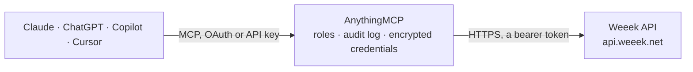

<!-- Generated by scripts/export-github-catalog.mjs in the anythingmcp-website repository. Do not edit by hand. -->

# Weeek MCP connector

Manage Weeek projects and the CRM from your AI: find and update tasks, move them across boards, assign people, comment and log time, and work with deals, contacts and organizations, with confirmation before changes. The AnythingMCP connector gives Claude, ChatGPT, Microsoft Copilot, Cursor and Gemini 47 MCP tools for Weeek: 20 read and 27 can change data.

**Category:** [Project Management](../project-management.md) · **Tools:** 47 · **Setup guide:** [anythingmcp.com](https://anythingmcp.com/guides/weeek-to-mcp) · [Deutsch](https://anythingmcp.com/de/guides/weeek-to-mcp) · [Italiano](https://anythingmcp.com/it/guides/weeek-to-mcp) · [Español](https://anythingmcp.com/es/guides/weeek-to-mcp) · [日本語](https://anythingmcp.com/ja/guides/weeek-to-mcp) · [Русский](https://anythingmcp.com/ru/guides/weeek-to-mcp) · [中文](https://anythingmcp.com/zh/guides/weeek-to-mcp)

## Start without code

No installation and no terminal: AnythingMCP Cloud runs the Weeek connector for you, operated by helpcode.ai in Frankfurt, Germany.

1. **Click the button above** and create an account or sign in. The Weeek connector opens, ready to install.
2. **Paste the API key or token from your Weeek account.** Every click is in the [step-by-step guide](https://anythingmcp.com/guides/weeek-to-mcp).
3. **Click Install.** AnythingMCP shows the address of your MCP server.
4. **Add that address to your assistant:** [Claude](https://anythingmcp.com/guides/connect-weeek-to-claude) · [ChatGPT](https://anythingmcp.com/guides/connect-weeek-to-chatgpt) · [Microsoft Copilot](https://anythingmcp.com/guides/connect-weeek-to-copilot) · [Cursor](https://anythingmcp.com/guides/connect-weeek-to-cursor) · [Gemini CLI](https://anythingmcp.com/guides/connect-weeek-to-gemini) · [Meta Muse](https://anythingmcp.com/guides/connect-weeek-to-muse).
5. **Ask your first question**, for example: *Find task for invoice INV-2026-0415 for customer Nordic Solar OY — show task id, status, due date and assignees.*

Prefer help with the setup? [Talk to us](https://anythingmcp.com/contact).

## How it works

- **The AI client** speaks MCP (Streamable HTTP) to AnythingMCP and only sees tool names, descriptions and results. It never gets the Weeek credentials.
- **AnythingMCP** checks the client's role, builds the call from the tool definition, adds the credentials (a bearer token), calls Weeek, logs the call and returns the result.
- **Weeek** sees an ordinary API client with the rights of the account the credentials belong to.

## Tools

| Tool | What it does | Access |
|---|---|---|
| [`weeek_get_profile`](#weeek_get_profile) | Get the Weeek user the API token belongs to: id, e-mail, name, language and time zone. | read |
| [`weeek_get_workspace`](#weeek_get_workspace) | Get the workspace the API token belongs to: id, title, description and whether it is a personal workspace. | read |
| [`weeek_list_members`](#weeek_list_members) | List the members of the workspace with their user id (a UUID), e-mail, name and position. | read |
| [`weeek_list_tags`](#weeek_list_tags) | List the workspace tags with their id, title and colour. | read |
| [`weeek_create_tag`](#weeek_create_tag) | Create a workspace tag and return it with its id. | write |
| [`weeek_list_portfolios`](#weeek_list_portfolios) | List portfolios (groups of projects) with id, name, parent and privacy. | read |
| [`weeek_list_projects`](#weeek_list_projects) | List the projects of the workspace with id, name, description, colour, privacy and team members. | read |
| [`weeek_get_project`](#weeek_get_project) | Get one project by id with its name, description, privacy and team. | read |
| [`weeek_create_project`](#weeek_create_project) | Create a project, optionally inside a portfolio, and return it with its id. | write |
| [`weeek_update_project`](#weeek_update_project) | Rename a project or change its privacy or colour. | write |
| [`weeek_list_boards`](#weeek_list_boards) | List the boards (kanban boards) of one project with their id, name and privacy. | read |
| [`weeek_create_board`](#weeek_create_board) | Create a board in a project and return it with its id. | write |
| [`weeek_rename_board`](#weeek_rename_board) | Rename a board. | write |
| [`weeek_list_board_columns`](#weeek_list_board_columns) | List the columns (stages such as To do, In progress, Done) of one board with their id and name, in board order. | read |
| [`weeek_create_board_column`](#weeek_create_board_column) | Add a column to a board and return it with its id. | write |
| [`weeek_rename_board_column`](#weeek_rename_board_column) | Rename a board column. | write |
| [`weeek_move_board_column`](#weeek_move_board_column) | Reorder a column on its board: it is placed right after the column given in upperBoardColumnId, or first when that is null. | write |
| [`weeek_list_tasks`](#weeek_list_tasks) | Find tasks by project, board, column, assignee, type, priority, text, due day or date range, open or completed. | read |
| [`weeek_get_task`](#weeek_get_task) | Get one task by id with description, dates, duration, priority, assignees, watchers, locations, tags, subtasks, time entries, custom fields and attachments. | read |
| [`weeek_create_task`](#weeek_create_task) | Create a task in one or more projects, optionally in a board column, as a subtask or planned for a day. | write |
| [`weeek_update_task`](#weeek_update_task) | Change a task: title, priority, type, start and due date or date-time, time estimate, tags or custom fields. | write |
| [`weeek_complete_task`](#weeek_complete_task) | Mark a task as completed. | write |
| [`weeek_reopen_task`](#weeek_reopen_task) | Mark a completed task as open again. | write |
| [`weeek_move_task_to_column`](#weeek_move_task_to_column) | Move a task to another column of its board, for example from In progress to Done. | write |
| [`weeek_move_task_to_board`](#weeek_move_task_to_board) | Move a task to another board. | write |
| [`weeek_add_task_to_project`](#weeek_add_task_to_project) | Add a task to a further project, optionally into a board column. | write |
| [`weeek_remove_task_from_project`](#weeek_remove_task_from_project) | Take a task out of one of its projects (and that project's board); the task itself is not deleted and can be put back with weeek_add_task_to_project. | write |
| [`weeek_add_task_assignees`](#weeek_add_task_assignees) | Assign one or more workspace members to a task. | write |
| [`weeek_remove_task_assignees`](#weeek_remove_task_assignees) | Unassign one or more members from a task; the task itself stays. | write |
| [`weeek_add_task_watchers`](#weeek_add_task_watchers) | Add watchers to a task; they are notified of its changes. | write |
| [`weeek_set_task_parent`](#weeek_set_task_parent) | Make a task a subtask of another task, or a top-level task again with parentId null. | write |
| [`weeek_list_task_comments`](#weeek_list_task_comments) | List the comments of a task with author id, Markdown text, reply parent and dates. | read |
| [`weeek_add_task_comment`](#weeek_add_task_comment) | Post a comment on a task, or a reply to a comment, as the token's user. | write |
| [`weeek_log_time`](#weeek_log_time) | Log time spent on a task for a member on a given day. | write |
| [`weeek_delete_task`](#weeek_delete_task) | Delete a task. | write |
| [`weeek_list_funnels`](#weeek_list_funnels) | List the CRM sales funnels (pipelines) with id, name, currency and deal counts. | read |
| [`weeek_list_funnel_statuses`](#weeek_list_funnel_statuses) | List the statuses (pipeline stages) of one funnel with id, name, deal count and deal amount. | read |
| [`weeek_list_deals`](#weeek_list_deals) | List the deals in one funnel status with title, amount, win status, assignees, contacts, organizations and tags; returns hasMoreDeals for paging with limit… | read |
| [`weeek_get_deal`](#weeek_get_deal) | Get one deal by id with amount, win status, description, assignees, contacts, organizations, tags, tasks and custom fields. | read |
| [`weeek_create_deal`](#weeek_create_deal) | Create a deal in a funnel status, optionally with amount, assignees, contacts, organizations and tags. | write |
| [`weeek_update_deal`](#weeek_update_deal) | Change fields of a deal: title, amount, description, win status (won, lost, archived), assignees, contacts, organizations, tags or custom fields. | write |
| [`weeek_list_contacts`](#weeek_list_contacts) | List CRM contacts (people) with name, e-mails, phones, organizations and tags. | read |
| [`weeek_get_contact`](#weeek_get_contact) | Get one CRM contact by id with e-mails, phones, organizations and tags. | read |
| [`weeek_create_contact`](#weeek_create_contact) | Create a CRM contact with name, e-mails, phones, organizations and tags. | write |
| [`weeek_list_organizations`](#weeek_list_organizations) | List CRM organizations (companies) with name, addresses, e-mails, phones and responsible user. | read |
| [`weeek_get_organization`](#weeek_get_organization) | Get one CRM organization by id with addresses, e-mails, phones, contacts and tags. | read |
| [`weeek_create_organization`](#weeek_create_organization) | Create a CRM organization with name, addresses, e-mails, phones and responsible users. | write |

## Tool reference

Every parameter as the AI client sees it in `tools/list`. Source: [`packages/backend/src/adapters/intl/weeek.json`](../../../packages/backend/src/adapters/intl/weeek.json).

### `weeek_get_profile`

Get the Weeek user the API token belongs to: id, e-mail, name, language and time zone. Writes are made on behalf of this user. Takes no input; the cheapest call to check the connection. Read-only.

**Access:** read · **Call:** `GET /user/me`

No parameters.

### `weeek_get_workspace`

Get the workspace the API token belongs to: id, title, description and whether it is a personal workspace. Read-only.

**Access:** read · **Call:** `GET /ws`

No parameters.

### `weeek_list_members`

List the members of the workspace with their user id (a UUID), e-mail, name and position. Use these ids for assignees, watchers, userId filters and time entries. Read-only.

**Access:** read · **Call:** `GET /ws/members`

No parameters.

### `weeek_list_tags`

List the workspace tags with their id, title and colour. Tasks, deals and contacts refer to tags by these ids. Read-only.

**Access:** read · **Call:** `GET /ws/tags`

No parameters.

### `weeek_create_tag`

Create a workspace tag and return it with its id. Check weeek_list_tags first that it does not exist. Changes the shared Weeek workspace: tell the user what will change and get their confirmation before calling.

**Access:** write · **Call:** `POST /ws/tags`

| Parameter | Type | Required | Description |
|---|---|---|---|
| `title` | string | yes | Tag title. |

### `weeek_list_portfolios`

List portfolios (groups of projects) with id, name, parent and privacy. Filter by name; page with limit and offset while hasMore is true. Read-only.

**Access:** read · **Call:** `GET /tm/portfolios`

| Parameter | Type | Required | Description |
|---|---|---|---|
| `search` | string | no | Only portfolios whose name contains this text. |
| `parentId` | integer | no | Only the portfolios inside this parent portfolio. |
| `limit` | integer | no | Portfolios per page, up to 100. |
| `offset` | integer | no | How many portfolios to skip. |

### `weeek_list_projects`

List the projects of the workspace with id, name, description, colour, privacy and team members. Project ids are needed for boards and new tasks. Read-only.

**Access:** read · **Call:** `GET /tm/projects`

No parameters.

### `weeek_get_project`

Get one project by id with its name, description, privacy and team. Read-only.

**Access:** read · **Call:** `GET /tm/projects/{id}`

| Parameter | Type | Required | Description |
|---|---|---|---|
| `id` | integer | yes | Project id from weeek_list_projects. |

### `weeek_create_project`

Create a project, optionally inside a portfolio, and return it with its id. Changes the shared Weeek workspace: tell the user what will change and get their confirmation before calling.

**Access:** write · **Call:** `POST /tm/projects`

| Parameter | Type | Required | Description |
|---|---|---|---|
| `name` | string | yes | Project name. |
| `isPrivate` | `0` \| `1` | yes | 1 makes the project private to its members, 0 visible to the workspace. Weeek expects 0 or 1, not true or false. |
| `description` | string | no | Project description. |
| `portfolioId` | integer | no | Portfolio id from weeek_list_portfolios to place the project in. |

### `weeek_update_project`

Rename a project or change its privacy or colour. Weeek requires name and isPrivate on every update, so send the current values for what should stay. Changes the shared Weeek workspace: tell the user what will change and get their confirmation before calling.

**Access:** write · **Call:** `PUT /tm/projects/{id}`

| Parameter | Type | Required | Description |
|---|---|---|---|
| `id` | integer | yes | Project id. |
| `name` | string | yes | Project name (send the current one to keep it). |
| `isPrivate` | `0` \| `1` | yes | 1 private, 0 visible to the workspace (send the current value to keep it). |
| `color` | string | no | Colour as a hex code, for example #003C93. |

### `weeek_list_boards`

List the boards (kanban boards) of one project with their id, name and privacy. Read-only.

**Access:** read · **Call:** `GET /tm/boards`

| Parameter | Type | Required | Description |
|---|---|---|---|
| `projectId` | integer | yes | Project id from weeek_list_projects. |

### `weeek_create_board`

Create a board in a project and return it with its id. Changes the shared Weeek workspace: tell the user what will change and get their confirmation before calling.

**Access:** write · **Call:** `POST /tm/boards`

| Parameter | Type | Required | Description |
|---|---|---|---|
| `name` | string | yes | Board name. |
| `projectId` | integer | yes | Project id the board belongs to. |

### `weeek_rename_board`

Rename a board. Changes the shared Weeek workspace: tell the user what will change and get their confirmation before calling.

**Access:** write · **Call:** `PUT /tm/boards/{id}`

| Parameter | Type | Required | Description |
|---|---|---|---|
| `id` | integer | yes | Board id from weeek_list_boards. |
| `name` | string | yes | New board name. |

### `weeek_list_board_columns`

List the columns (stages such as To do, In progress, Done) of one board with their id and name, in board order. Column ids are needed to place or move tasks. Read-only.

**Access:** read · **Call:** `GET /tm/board-columns`

| Parameter | Type | Required | Description |
|---|---|---|---|
| `boardId` | integer | yes | Board id from weeek_list_boards. |

### `weeek_create_board_column`

Add a column to a board and return it with its id. Changes the shared Weeek workspace: tell the user what will change and get their confirmation before calling.

**Access:** write · **Call:** `POST /tm/board-columns`

| Parameter | Type | Required | Description |
|---|---|---|---|
| `name` | string | yes | Column name. |
| `boardId` | integer | yes | Board id. |

### `weeek_rename_board_column`

Rename a board column. Changes the shared Weeek workspace: tell the user what will change and get their confirmation before calling.

**Access:** write · **Call:** `PUT /tm/board-columns/{id}`

| Parameter | Type | Required | Description |
|---|---|---|---|
| `id` | integer | yes | Column id from weeek_list_board_columns. |
| `name` | string | yes | New column name. |

### `weeek_move_board_column`

Reorder a column on its board: it is placed right after the column given in upperBoardColumnId, or first when that is null. Changes the shared Weeek workspace: tell the user what will change and get their confirmation before calling.

**Access:** write · **Call:** `POST /tm/board-columns/{id}/move`

| Parameter | Type | Required | Description |
|---|---|---|---|
| `id` | integer | yes | Id of the column to move. |
| `upperBoardColumnId` | integer,null | yes | Id of the column that should come just before it; null puts it first. |

### `weeek_list_tasks`

Find tasks by project, board, column, assignee, type, priority, text, due day or date range, open or completed. Returns tasks with title, dates, priority, assignees, locations and tags, plus hasMore; page with perPage and offset. Read-only.

**Access:** read · **Call:** `GET /tm/tasks`

| Parameter | Type | Required | Description |
|---|---|---|---|
| `projectId` | integer | no | Only tasks of this project. |
| `boardId` | integer | no | Only tasks on this board. |
| `boardColumnId` | integer | no | Only tasks in this board column. |
| `userId` | string | no | Only tasks of this user id (a UUID from weeek_list_members). |
| `search` | string | no | Text to find in the title or description. |
| `completed` | `0` \| `1` | no | 1 only completed tasks, 0 only open ones. |
| `all` | `0` \| `1` | no | 1 returns every task including completed and deleted ones; completed is then ignored. |
| `type` | `action` \| `meet` \| `call` | no | Task type: action (default), meet or call. |
| `priority` | `0` \| `1` \| `2` \| `3` | no | Priority: 0 low, 1 medium, 2 high, 3 hold. |
| `day` | string | no | Only tasks planned for this day, dd.mm.yyyy. |
| `startDate` | string | no | Start of a date range, dd.mm.yyyy; needs endDate. |
| `endDate` | string | no | End of a date range, dd.mm.yyyy; needs startDate. |
| `completedAtFrom` | string | no | Only tasks completed on or after this day, dd.mm.yyyy. |
| `completedAtTo` | string | no | Only tasks completed on or before this day, dd.mm.yyyy. |
| `sortBy` | `name` \| `type` \| `priority` \| `duration` \| `overdue` \| `created` \| `date` \| `start` \| `-name` \| `-type` \| `-priority` \| `-duration` \| `-overdue` \| `-created` \| `-date` \| `-start` | no | Sort field, ascending; a leading minus sorts descending, for example -created. |
| `perPage` | integer | no | Tasks per page (default 50). |
| `offset` | integer | no | How many tasks to skip, for the next page while hasMore is true. |

### `weeek_get_task`

Get one task by id with description, dates, duration, priority, assignees, watchers, locations, tags, subtasks, time entries, custom fields and attachments. Read-only.

**Access:** read · **Call:** `GET /tm/tasks/{id}`

| Parameter | Type | Required | Description |
|---|---|---|---|
| `id` | integer | yes | Task id (the number in the task link, also returned by weeek_list_tasks). |

### `weeek_create_task`

Create a task in one or more projects, optionally in a board column, as a subtask or planned for a day. Returns the task with its id. Changes the shared Weeek workspace: tell the user what will change and get their confirmation before calling.

**Access:** write · **Call:** `POST /tm/tasks`

| Parameter | Type | Required | Description |
|---|---|---|---|
| `title` | string | yes | Task title. |
| `locations` | object[] | yes | Where the task lives: [{"projectId": 12, "boardColumnId": 34}]. boardColumnId may be null for a project without a board column. Get ids from weeek_list_projects and weeek_list_board_columns. |
| `description` | string | no | Task description. |
| `day` | string | no | Day the task is planned for, dd.mm.yyyy. |
| `userId` | string | no | Assignee user id (UUID from weeek_list_members). |
| `parentId` | integer | no | Parent task id, to create a subtask. |
| `type` | `action` \| `meet` \| `call` | no | Task type: action (default), meet or call. |
| `priority` | `0` \| `1` \| `2` \| `3` | no | Priority: 0 low, 1 medium, 2 high, 3 hold. |
| `customFields` | object | no | Custom field values keyed by custom field id, for example {"<field id>": "text", "<select field id>": "<option id>", "<member field id>": ["<user id>"]}. |

### `weeek_update_task`

Change a task: title, priority, type, start and due date or date-time, time estimate, tags or custom fields. Use dates (startDate, dueDate) or date-times (startDateTime, dueDateTime), not both. Changes the shared Weeek workspace: tell the user what will change and get their confirmation before calling.

**Access:** write · **Call:** `PUT /tm/tasks/{id}`

| Parameter | Type | Required | Description |
|---|---|---|---|
| `id` | integer | yes | Task id (the number in the task link, also returned by weeek_list_tasks). |
| `title` | string | no | New title, up to 255 characters. |
| `priority` | `0` \| `1` \| `2` \| `3` | no | Priority: 0 low, 1 medium, 2 high, 3 hold. |
| `type` | `action` \| `meet` \| `call` | no | Task type: action (default), meet or call. |
| `startDate` | string | no | Start date, YYYY-MM-DD. |
| `dueDate` | string | no | Due date, YYYY-MM-DD. |
| `startDateTime` | string | no | Start date and time, ISO 8601, for example 2026-10-20T09:00:00+03:00. |
| `dueDateTime` | string | no | Due date and time, ISO 8601. |
| `duration` | integer | no | Time estimate in minutes. |
| `tags` | integer[] | no | The complete list of tag ids the task should carry (from weeek_list_tags). |
| `customFields` | object | no | Custom field values keyed by custom field id, for example {"<field id>": "text", "<select field id>": "<option id>", "<member field id>": ["<user id>"]}. |

### `weeek_complete_task`

Mark a task as completed. weeek_reopen_task undoes it. Changes the shared Weeek workspace: tell the user what will change and get their confirmation before calling.

**Access:** write · **Call:** `POST /tm/tasks/{id}/complete`

| Parameter | Type | Required | Description |
|---|---|---|---|
| `id` | integer | yes | Task id (the number in the task link, also returned by weeek_list_tasks). |

### `weeek_reopen_task`

Mark a completed task as open again. Changes the shared Weeek workspace: tell the user what will change and get their confirmation before calling.

**Access:** write · **Call:** `POST /tm/tasks/{id}/un-complete`

| Parameter | Type | Required | Description |
|---|---|---|---|
| `id` | integer | yes | Task id (the number in the task link, also returned by weeek_list_tasks). |

### `weeek_move_task_to_column`

Move a task to another column of its board, for example from In progress to Done. Changes the shared Weeek workspace: tell the user what will change and get their confirmation before calling.

**Access:** write · **Call:** `POST /tm/tasks/{id}/board-column`

| Parameter | Type | Required | Description |
|---|---|---|---|
| `id` | integer | yes | Task id (the number in the task link, also returned by weeek_list_tasks). |
| `boardColumnId` | integer | yes | Target column id from weeek_list_board_columns. |

### `weeek_move_task_to_board`

Move a task to another board. Changes the shared Weeek workspace: tell the user what will change and get their confirmation before calling.

**Access:** write · **Call:** `POST /tm/tasks/{id}/board`

| Parameter | Type | Required | Description |
|---|---|---|---|
| `id` | integer | yes | Task id (the number in the task link, also returned by weeek_list_tasks). |
| `boardId` | integer | yes | Target board id from weeek_list_boards. |

### `weeek_add_task_to_project`

Add a task to a further project, optionally into a board column. A task can live in several projects. Changes the shared Weeek workspace: tell the user what will change and get their confirmation before calling.

**Access:** write · **Call:** `POST /tm/tasks/{id}/locations`

| Parameter | Type | Required | Description |
|---|---|---|---|
| `id` | integer | yes | Task id (the number in the task link, also returned by weeek_list_tasks). |
| `projectId` | integer | yes | Project id to add the task to. |
| `boardColumnId` | integer,null | no | Board column in that project; null keeps it off the board. |

### `weeek_remove_task_from_project`

Take a task out of one of its projects (and that project's board); the task itself is not deleted and can be put back with weeek_add_task_to_project. Changes the shared Weeek workspace: tell the user what will change and get their confirmation before calling.

**Access:** write · **Call:** `DELETE /tm/tasks/{id}/locations`

| Parameter | Type | Required | Description |
|---|---|---|---|
| `id` | integer | yes | Task id (the number in the task link, also returned by weeek_list_tasks). |
| `projectId` | integer | yes | Project id to remove the task from (one of the task's locations, see weeek_get_task). |

### `weeek_add_task_assignees`

Assign one or more workspace members to a task. Changes the shared Weeek workspace: tell the user what will change and get their confirmation before calling.

**Access:** write · **Call:** `POST /tm/tasks/{id}/assignees`

| Parameter | Type | Required | Description |
|---|---|---|---|
| `id` | integer | yes | Task id (the number in the task link, also returned by weeek_list_tasks). |
| `assignees` | string[] | yes | User ids (UUIDs from weeek_list_members). |

### `weeek_remove_task_assignees`

Unassign one or more members from a task; the task itself stays. Changes the shared Weeek workspace: tell the user what will change and get their confirmation before calling.

**Access:** write · **Call:** `DELETE /tm/tasks/{id}/assignees`

| Parameter | Type | Required | Description |
|---|---|---|---|
| `id` | integer | yes | Task id (the number in the task link, also returned by weeek_list_tasks). |
| `assignees` | string[] | yes | User ids (UUIDs) to unassign. |

### `weeek_add_task_watchers`

Add watchers to a task; they are notified of its changes. Changes the shared Weeek workspace: tell the user what will change and get their confirmation before calling.

**Access:** write · **Call:** `POST /tm/tasks/{id}/watchers`

| Parameter | Type | Required | Description |
|---|---|---|---|
| `id` | integer | yes | Task id (the number in the task link, also returned by weeek_list_tasks). |
| `watchers` | string[] | yes | User ids (UUIDs from weeek_list_members). |

### `weeek_set_task_parent`

Make a task a subtask of another task, or a top-level task again with parentId null. Changes the shared Weeek workspace: tell the user what will change and get their confirmation before calling.

**Access:** write · **Call:** `POST /tm/tasks/{id}/parent`

| Parameter | Type | Required | Description |
|---|---|---|---|
| `id` | integer | yes | Task id (the number in the task link, also returned by weeek_list_tasks). |
| `parentId` | integer,null | yes | Id of the new parent task; null makes it a top-level task. |

### `weeek_list_task_comments`

List the comments of a task with author id, Markdown text, reply parent and dates. Page with limit and offset while hasMore is true. Read-only.

**Access:** read · **Call:** `GET /tm/tasks/{id}/comments`

| Parameter | Type | Required | Description |
|---|---|---|---|
| `id` | integer | yes | Task id (the number in the task link, also returned by weeek_list_tasks). |
| `limit` | integer | no | Comments per page, 1 to 100 (default 50). |
| `offset` | integer | no | How many comments to skip. |

### `weeek_add_task_comment`

Post a comment on a task, or a reply to a comment, as the token's user. Visible to everyone on the task. Changes the shared Weeek workspace: tell the user what will change and get their confirmation before calling.

**Access:** write · **Call:** `POST /tm/tasks/{id}/comments`

| Parameter | Type | Required | Description |
|---|---|---|---|
| `id` | integer | yes | Task id (the number in the task link, also returned by weeek_list_tasks). |
| `markdown` | string | yes | Comment text in Markdown. Attachments are not supported. |
| `parentId` | integer | no | Comment id to reply to. |

### `weeek_log_time`

Log time spent on a task for a member on a given day. Changes the shared Weeek workspace: tell the user what will change and get their confirmation before calling.

**Access:** write · **Call:** `POST /tm/tasks/{id}/time-entries`

| Parameter | Type | Required | Description |
|---|---|---|---|
| `id` | integer | yes | Task id (the number in the task link, also returned by weeek_list_tasks). |
| `userId` | string | yes | User id (UUID) the time belongs to. |
| `date` | string | yes | Day of the work, YYYY-MM-DD. |
| `duration` | integer | yes | Minutes worked, between 2 and 1439. |
| `isOvertime` | `0` \| `1` | yes | 1 marks the entry as overtime, 0 regular time. |

### `weeek_delete_task`

Delete a task. Installed switched off; completing it with weeek_complete_task is usually what the user wants. Confirm the task title with the user before calling.

**Access:** write · **Call:** `DELETE /tm/tasks/{id}`

| Parameter | Type | Required | Description |
|---|---|---|---|
| `id` | integer | yes | Task id (the number in the task link, also returned by weeek_list_tasks). |

### `weeek_list_funnels`

List the CRM sales funnels (pipelines) with id, name, currency and deal counts. Read-only.

**Access:** read · **Call:** `GET /crm/funnels`

No parameters.

### `weeek_list_funnel_statuses`

List the statuses (pipeline stages) of one funnel with id, name, deal count and deal amount. Deals are listed and created per status. Read-only.

**Access:** read · **Call:** `GET /crm/funnels/{funnelId}/statuses`

| Parameter | Type | Required | Description |
|---|---|---|---|
| `funnelId` | string | yes | Funnel id from weeek_list_funnels. |

### `weeek_list_deals`

List the deals in one funnel status with title, amount, win status, assignees, contacts, organizations and tags; returns hasMoreDeals for paging with limit and offset. Read-only.

**Access:** read · **Call:** `GET /crm/statuses/{statusId}/deals`

| Parameter | Type | Required | Description |
|---|---|---|---|
| `statusId` | string | yes | Funnel status id from weeek_list_funnel_statuses. |
| `search` | string | no | Text to find in the deal. |
| `sort` | `title` \| `amount` \| `commented` \| `createdAt` \| `updatedAt` \| `-title` \| `-amount` \| `-commented` \| `-createdAt` \| `-updatedAt` | no | Sort field; a leading minus sorts descending. |
| `limit` | integer | no | Deals per page. |
| `offset` | integer | no | How many deals to skip. |

### `weeek_get_deal`

Get one deal by id with amount, win status, description, assignees, contacts, organizations, tags, tasks and custom fields. Read-only.

**Access:** read · **Call:** `GET /crm/deals/{id}`

| Parameter | Type | Required | Description |
|---|---|---|---|
| `id` | string | yes | Deal id. |

### `weeek_create_deal`

Create a deal in a funnel status, optionally with amount, assignees, contacts, organizations and tags. Changes the shared Weeek workspace: tell the user what will change and get their confirmation before calling.

**Access:** write · **Call:** `POST /crm/statuses/{statusId}/deals`

| Parameter | Type | Required | Description |
|---|---|---|---|
| `statusId` | string | yes | Funnel status id the deal starts in. |
| `title` | string | yes | Deal title. |
| `amount` | number | no | Deal amount in the funnel currency. |
| `description` | string | no | Deal description. |
| `assignees` | string[] | no | User ids (UUIDs) responsible for the deal. |
| `contacts` | string[] | no | Contact ids (UUIDs) from weeek_list_contacts. |
| `organizations` | string[] | no | Organization ids (UUIDs) from weeek_list_organizations. |
| `tags` | integer[] | no | Tag ids. |
| `customFields` | object | no | Custom field values keyed by custom field id, for example {"<field id>": "text", "<select field id>": "<option id>", "<member field id>": ["<user id>"]}. |

### `weeek_update_deal`

Change fields of a deal: title, amount, description, win status (won, lost, archived), assignees, contacts, organizations, tags or custom fields. Only the fields you pass change; lists you pass replace the current ones. Changes the shared Weeek workspace: tell the user what will change and get their confirmation before calling.

**Access:** write · **Call:** `PATCH /crm/deals/{id}`

| Parameter | Type | Required | Description |
|---|---|---|---|
| `id` | string | yes | Deal id. |
| `title` | string | no | New title. |
| `amount` | number | no | New amount. |
| `description` | string | no | New description. |
| `winStatus` | `won` \| `lost` \| `archived` \| `null` | no | won, lost or archived; null reopens the deal. |
| `assignees` | string[] | no | Complete list of responsible user ids. |
| `contacts` | string[] | no | Complete list of contact ids. |
| `organizations` | string[] | no | Complete list of organization ids. |
| `tags` | integer[] | no | Complete list of tag ids. |
| `customFields` | object | no | Custom field values keyed by custom field id, for example {"<field id>": "text", "<select field id>": "<option id>", "<member field id>": ["<user id>"]}. |

### `weeek_list_contacts`

List CRM contacts (people) with name, e-mails, phones, organizations and tags. Filter by text; page with limit and offset. Read-only.

**Access:** read · **Call:** `GET /crm/contacts`

| Parameter | Type | Required | Description |
|---|---|---|---|
| `search` | string | no | Text to find in the contact. |
| `sort` | `alphabet` \| `updatedAt` \| `-alphabet` \| `-updatedAt` | no | Sort order; a leading minus sorts descending. |
| `limit` | integer | no | Contacts per page. |
| `offset` | integer | no | How many contacts to skip. |

### `weeek_get_contact`

Get one CRM contact by id with e-mails, phones, organizations and tags. Read-only.

**Access:** read · **Call:** `GET /crm/contacts/{id}`

| Parameter | Type | Required | Description |
|---|---|---|---|
| `id` | string | yes | Contact id (UUID). |

### `weeek_create_contact`

Create a CRM contact with name, e-mails, phones, organizations and tags. Check weeek_list_contacts first that it does not exist. Changes the shared Weeek workspace: tell the user what will change and get their confirmation before calling.

**Access:** write · **Call:** `POST /crm/contacts`

| Parameter | Type | Required | Description |
|---|---|---|---|
| `firstName` | string | yes | First name. |
| `lastName` | string | no | Last name. |
| `middleName` | string | no | Middle name. |
| `emails` | string[] | no | E-mail addresses. |
| `phones` | string[] | no | Phone numbers. |
| `organizations` | string[] | no | Organization ids (UUIDs). |
| `tags` | integer[] | no | Tag ids. |

### `weeek_list_organizations`

List CRM organizations (companies) with name, addresses, e-mails, phones and responsible user. Filter by text; page with limit and offset. Read-only.

**Access:** read · **Call:** `GET /crm/organizations`

| Parameter | Type | Required | Description |
|---|---|---|---|
| `search` | string | no | Text to find in the organization. |
| `sort` | `alphabet` \| `updatedAt` \| `-alphabet` \| `-updatedAt` | no | Sort order; a leading minus sorts descending. |
| `limit` | integer | no | Organizations per page. |
| `offset` | integer | no | How many organizations to skip. |

### `weeek_get_organization`

Get one CRM organization by id with addresses, e-mails, phones, contacts and tags. Read-only.

**Access:** read · **Call:** `GET /crm/organizations/{id}`

| Parameter | Type | Required | Description |
|---|---|---|---|
| `id` | string | yes | Organization id (UUID). |

### `weeek_create_organization`

Create a CRM organization with name, addresses, e-mails, phones and responsible users. Check weeek_list_organizations first that it does not exist. Changes the shared Weeek workspace: tell the user what will change and get their confirmation before calling.

**Access:** write · **Call:** `POST /crm/organizations`

| Parameter | Type | Required | Description |
|---|---|---|---|
| `name` | string | yes | Organization name. |
| `addresses` | string[] | no | Addresses, one string each. |
| `emails` | string[] | no | E-mail addresses. |
| `phones` | string[] | no | Phone numbers. |
| `responsibles` | string[] | no | Responsible user ids (UUIDs). |

## Run it yourself

AnythingMCP is open source (AGPL-3.0). [Run it with Docker](../../../README.md#run-it-yourself), open **Connectors → Store**, pick **Weeek** and enter `WEEEK_API_TOKEN`, then add your MCP server URL to the AI client.

[← Project Management connectors](../project-management.md) · [All categories](../README.md)
