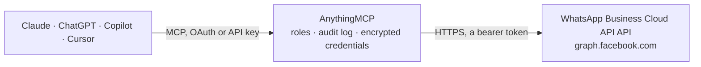

<!-- Generated by scripts/export-github-catalog.mjs in the anythingmcp-website repository. Do not edit by hand. -->

# WhatsApp Business Cloud API MCP connector

Send WhatsApp messages (text, templates, images, audio/voice notes, video, documents, location, interactive buttons) from a WhatsApp Business account using Meta's Cloud API. The AnythingMCP connector gives Claude, ChatGPT, Microsoft Copilot, Cursor and Gemini 14 MCP tools for WhatsApp Business Cloud API: 5 read and 9 can change data.

[](https://cloud.anythingmcp.com/login?mode=register&redirect=%2Fconnectors%2Fstore%3Finstall%3Dwhatsapp-business&utm_source=github&utm_medium=catalog&utm_campaign=whatsapp-business)

**Category:** [Messaging](../messaging.md) · **Tools:** 14 · **Setup guide:** [anythingmcp.com](https://anythingmcp.com/guides/whatsapp-business-to-mcp) · [Deutsch](https://anythingmcp.com/de/guides/whatsapp-business-to-mcp) · [Italiano](https://anythingmcp.com/it/guides/whatsapp-business-to-mcp) · [Español](https://anythingmcp.com/es/guides/whatsapp-business-to-mcp) · [日本語](https://anythingmcp.com/ja/guides/whatsapp-business-to-mcp) · [Русский](https://anythingmcp.com/ru/guides/whatsapp-business-to-mcp) · [中文](https://anythingmcp.com/zh/guides/whatsapp-business-to-mcp)

## Start without code

No installation and no terminal: AnythingMCP Cloud runs the WhatsApp Business Cloud API connector for you, operated by helpcode.ai in Frankfurt, Germany.

1. **Click the button above** and create an account or sign in. The WhatsApp Business Cloud API connector opens, ready to install.
2. **Paste the API key or token from your WhatsApp Business Cloud API account.** Every click is in the [step-by-step guide](https://anythingmcp.com/guides/whatsapp-business-to-mcp).
3. **Click Install.** AnythingMCP shows the address of your MCP server.
4. **Add that address to your assistant:** [Claude](https://anythingmcp.com/guides/connect-whatsapp-business-to-claude) · [ChatGPT](https://anythingmcp.com/guides/connect-whatsapp-business-to-chatgpt) · [Microsoft Copilot](https://anythingmcp.com/guides/connect-whatsapp-business-to-copilot) · [Cursor](https://anythingmcp.com/guides/connect-whatsapp-business-to-cursor) · [Gemini CLI](https://anythingmcp.com/guides/connect-whatsapp-business-to-gemini) · [Meta Muse](https://anythingmcp.com/guides/connect-whatsapp-business-to-muse).
5. **Ask your first question**, for example: *Give me the phoneNumberId and quality rating for our Hamburg support number 4915155512345*

Prefer help with the setup? [Talk to us](https://anythingmcp.com/contact).

## How it works



- **The AI client** speaks MCP (Streamable HTTP) to AnythingMCP and only sees tool names, descriptions and results. It never gets the WhatsApp Business Cloud API credentials.
- **AnythingMCP** checks the client's role, builds the call from the tool definition, adds the credentials (a bearer token), calls WhatsApp Business Cloud API, logs the call and returns the result.
- **WhatsApp Business Cloud API** sees an ordinary API client with the rights of the account the credentials belong to.

## Tools

| Tool | What it does | Access |
|---|---|---|
| [`whatsapp_list_phone_numbers`](#whatsapp_list_phone_numbers) | List all phone numbers registered on the WhatsApp Business Account. | read |
| [`whatsapp_list_message_templates`](#whatsapp_list_message_templates) | List the message templates approved on the WhatsApp Business Account. | read |
| [`whatsapp_get_message_template`](#whatsapp_get_message_template) | Fetch a single message template by its ID. | read |
| [`whatsapp_send_text_message`](#whatsapp_send_text_message) | Send a plain text message to a recipient. | write |
| [`whatsapp_send_template_message`](#whatsapp_send_template_message) | Send a pre-approved message template. | write |
| [`whatsapp_send_image`](#whatsapp_send_image) | Send an image (JPG or PNG, max 5 MB). | write |
| [`whatsapp_send_audio`](#whatsapp_send_audio) | Send an audio file or voice note (OGG-Opus, AMR or MP3, max 16 MB). | write |
| [`whatsapp_send_video`](#whatsapp_send_video) | Send a video (MP4 or 3GPP, max 16 MB). | write |
| [`whatsapp_send_document`](#whatsapp_send_document) | Send a document (PDF, DOC(X), XLS(X), PPT(X), TXT — max 100 MB). | write |
| [`whatsapp_send_location`](#whatsapp_send_location) | Send a location pin to a recipient. | write |
| [`whatsapp_send_interactive_buttons`](#whatsapp_send_interactive_buttons) | Send an interactive message with 1–3 reply buttons. | write |
| [`whatsapp_mark_message_as_read`](#whatsapp_mark_message_as_read) | Mark an incoming message as read (shows the double blue tick to the sender). | read |
| [`whatsapp_get_business_profile`](#whatsapp_get_business_profile) | Get the public business profile attached to a phone number (about text, address, description, email, websites, vertical, profile picture URL). | read |
| [`whatsapp_update_business_profile`](#whatsapp_update_business_profile) | Update fields of the public business profile attached to a phone number. | write |

## Tool reference

Every parameter as the AI client sees it in `tools/list`. Source: [`packages/backend/src/adapters/intl/whatsapp-business.json`](../../../packages/backend/src/adapters/intl/whatsapp-business.json).

### `whatsapp_list_phone_numbers`

List all phone numbers registered on the WhatsApp Business Account. Returns each number's `id` (the phoneNumberId you pass to send tools), `display_phone_number`, `verified_name` and `quality_rating`. Call this once after setup to discover which phoneNumberId to use. The WABA ID is taken automatically from the WHATSAPP_BUSINESS_ACCOUNT_ID configured on this connector — you do NOT pass it.

**Access:** read · **Call:** `GET /{{WHATSAPP_BUSINESS_ACCOUNT_ID}}/phone_numbers`

| Parameter | Type | Required | Description |
|---|---|---|---|
| `limit` | integer | no | Max phone numbers to return per page (default 20, max 100). |

### `whatsapp_list_message_templates`

List the message templates approved on the WhatsApp Business Account. Returns each template's `id`, `name`, `language`, `status` (APPROVED / PENDING / REJECTED) and `components` (header/body/footer/buttons structure). Use this to discover which templates you can send via whatsapp_send_template_message. The WABA ID is taken automatically from the WHATSAPP_BUSINESS_ACCOUNT_ID configured on this connector — you do NOT pass it.

**Access:** read · **Call:** `GET /{{WHATSAPP_BUSINESS_ACCOUNT_ID}}/message_templates`

| Parameter | Type | Required | Description |
|---|---|---|---|
| `limit` | integer | no | Max templates per page (default 20, max 100). |
| `fields` | string | no | Comma-separated list of fields to return. Default: 'name,language,status,category,components,id'. |

### `whatsapp_get_message_template`

Fetch a single message template by its ID. Returns the full template definition including components, sample variables and approval status.

**Access:** read · **Call:** `GET /{templateId}`

| Parameter | Type | Required | Description |
|---|---|---|---|
| `templateId` | string | yes | The template ID returned by whatsapp_list_message_templates. |
| `fields` | string | no | Comma-separated list of fields to return. Default: 'name,language,status,category,components,id'. |

### `whatsapp_send_text_message`

Send a plain text message to a recipient. Only allowed inside the 24-hour customer service window (i.e. the user must have messaged your business number in the last 24h). For first contact or outside the window, use whatsapp_send_template_message instead.

**Access:** write · **Call:** `POST /{phoneNumberId}/messages`

| Parameter | Type | Required | Description |
|---|---|---|---|
| `phoneNumberId` | string | yes | The sending phone number ID (from whatsapp_list_phone_numbers). |
| `to` | string | yes | Recipient phone number in international format without '+', e.g. '15551234567'. |
| `body` | string | yes | Message text. Max 4096 characters. Supports WhatsApp markdown: *bold*, _italic_, ~strikethrough~, ```monospace```. |
| `previewUrl` | boolean | no | If true and `body` contains an http(s) URL, show a link preview card. Default false. |

### `whatsapp_send_template_message`

Send a pre-approved message template. This is the only way to message a user OUTSIDE the 24-hour customer service window or to initiate first contact. The template must already be APPROVED in Meta Business Suite (check via whatsapp_list_message_templates).

**Access:** write · **Call:** `POST /{phoneNumberId}/messages`

| Parameter | Type | Required | Description |
|---|---|---|---|
| `phoneNumberId` | string | yes | The sending phone number ID. |
| `to` | string | yes | Recipient phone number in international format without '+'. |
| `templateName` | string | yes | The exact template name (e.g. 'order_confirmation'). Names are case-sensitive. |
| `languageCode` | string | yes | BCP-47 language tag of the approved template, e.g. 'en_US', 'de', 'it', 'pt_BR'. |
| `components` | any[] | no | Optional array of component objects that fill in template variables. Example for a body with two {{1}} {{2}} placeholders: [{"type":"body","parameters":[{"type":"text","text":"John"},{"type":"text","text":"ORD-123"}]}]. Omit if the template has no variables. See https://developers.facebook.com/docs/whatsapp/cloud-api/guides/send-message-templates for full component schema (header, body, button, etc.). |

### `whatsapp_send_image`

Send an image (JPG or PNG, max 5 MB). Provide EITHER `link` (a public HTTPS URL — recommended on AnythingMCP) OR `mediaId` (returned by a prior media upload). Only allowed inside the 24-hour customer service window.

**Access:** write · **Call:** `POST /{phoneNumberId}/messages`

| Parameter | Type | Required | Description |
|---|---|---|---|
| `phoneNumberId` | string | yes | The sending phone number ID. |
| `to` | string | yes | Recipient phone number in international format without '+'. |
| `link` | string | no | Public HTTPS URL of the image. Use either this OR `mediaId`. |
| `mediaId` | string | no | ID of a previously uploaded image. Use either this OR `link`. |
| `caption` | string | no | Optional caption shown under the image. Max 1024 chars. |

### `whatsapp_send_audio`

Send an audio file or voice note (OGG-Opus, AMR or MP3, max 16 MB). OGG-Opus renders as a true voice message (waveform + play button). Provide EITHER `link` (a public HTTPS URL — recommended on AnythingMCP) OR `mediaId`. Only allowed inside the 24-hour customer service window.

**Access:** write · **Call:** `POST /{phoneNumberId}/messages`

| Parameter | Type | Required | Description |
|---|---|---|---|
| `phoneNumberId` | string | yes | The sending phone number ID. |
| `to` | string | yes | Recipient phone number in international format without '+'. |
| `link` | string | no | Public HTTPS URL of the audio file. Use either this OR `mediaId`. For a voice-note appearance use OGG-Opus. |
| `mediaId` | string | no | ID of a previously uploaded audio file. Use either this OR `link`. |

### `whatsapp_send_video`

Send a video (MP4 or 3GPP, max 16 MB). Provide EITHER `link` (a public HTTPS URL — recommended on AnythingMCP) OR `mediaId`. Only allowed inside the 24-hour customer service window.

**Access:** write · **Call:** `POST /{phoneNumberId}/messages`

| Parameter | Type | Required | Description |
|---|---|---|---|
| `phoneNumberId` | string | yes | The sending phone number ID. |
| `to` | string | yes | Recipient phone number in international format without '+'. |
| `link` | string | no | Public HTTPS URL of the video. Use either this OR `mediaId`. |
| `mediaId` | string | no | ID of a previously uploaded video. Use either this OR `link`. |
| `caption` | string | no | Optional caption shown under the video. Max 1024 chars. |

### `whatsapp_send_document`

Send a document (PDF, DOC(X), XLS(X), PPT(X), TXT — max 100 MB). Provide EITHER `link` (a public HTTPS URL — recommended on AnythingMCP) OR `mediaId`. Only allowed inside the 24-hour customer service window.

**Access:** write · **Call:** `POST /{phoneNumberId}/messages`

| Parameter | Type | Required | Description |
|---|---|---|---|
| `phoneNumberId` | string | yes | The sending phone number ID. |
| `to` | string | yes | Recipient phone number in international format without '+'. |
| `link` | string | no | Public HTTPS URL of the document. Use either this OR `mediaId`. |
| `mediaId` | string | no | ID of a previously uploaded document. Use either this OR `link`. |
| `filename` | string | no | Optional filename shown in the WhatsApp UI (e.g. 'invoice.pdf'). Recommended for documents. |
| `caption` | string | no | Optional caption shown under the document. Max 1024 chars. |

### `whatsapp_send_location`

Send a location pin to a recipient. Only allowed inside the 24-hour customer service window.

**Access:** write · **Call:** `POST /{phoneNumberId}/messages`

| Parameter | Type | Required | Description |
|---|---|---|---|
| `phoneNumberId` | string | yes | The sending phone number ID. |
| `to` | string | yes | Recipient phone number in international format without '+'. |
| `latitude` | number | yes | Latitude in decimal degrees, e.g. 37.4847 |
| `longitude` | number | yes | Longitude in decimal degrees, e.g. -122.1477 |
| `name` | string | no | Optional place name shown above the pin. |
| `address` | string | no | Optional street address shown below the pin. |

### `whatsapp_send_interactive_buttons`

Send an interactive message with 1–3 reply buttons. The user taps a button and your webhook receives the selected button id. Only allowed inside the 24-hour customer service window.

**Access:** write · **Call:** `POST /{phoneNumberId}/messages`

| Parameter | Type | Required | Description |
|---|---|---|---|
| `phoneNumberId` | string | yes | The sending phone number ID. |
| `to` | string | yes | Recipient phone number in international format without '+'. |
| `bodyText` | string | yes | Main message text shown above the buttons. Max 1024 chars. |
| `buttons` | any[] | yes | Array of 1–3 button objects in the exact shape WhatsApp expects: [{"type":"reply","reply":{"id":"yes","title":"Yes"}},{"type":"reply","reply":{"id":"no","title":"No"}}]. Each title max 20 chars, each id max 256 chars. |

### `whatsapp_mark_message_as_read`

Mark an incoming message as read (shows the double blue tick to the sender). Pass the `messageId` (wamid) from the webhook event that delivered the message.

**Access:** read · **Call:** `POST /{phoneNumberId}/messages`

| Parameter | Type | Required | Description |
|---|---|---|---|
| `phoneNumberId` | string | yes | The sending phone number ID that received the message. |
| `messageId` | string | yes | The wamid (WhatsApp message ID) of the incoming message to mark as read. |

### `whatsapp_get_business_profile`

Get the public business profile attached to a phone number (about text, address, description, email, websites, vertical, profile picture URL).

**Access:** read · **Call:** `GET /{phoneNumberId}/whatsapp_business_profile`

| Parameter | Type | Required | Description |
|---|---|---|---|
| `phoneNumberId` | string | yes | The phone number ID whose profile to fetch. |

### `whatsapp_update_business_profile`

Update fields of the public business profile attached to a phone number. Only the fields you pass are updated.

**Access:** write · **Call:** `POST /{phoneNumberId}/whatsapp_business_profile`

| Parameter | Type | Required | Description |
|---|---|---|---|
| `phoneNumberId` | string | yes | The phone number ID whose profile to update. |
| `about` | string | no | Short status text shown under the business name. Max 139 chars. |
| `address` | string | no | Street address. Max 256 chars. |
| `description` | string | no | Longer description of the business. Max 512 chars. |
| `email` | string | no | Contact email. Max 128 chars. |
| `websites` | any[] | no | Up to 2 URLs. |
| `vertical` | string | no | Industry vertical. One of: UNDEFINED, OTHER, AUTO, BEAUTY, APPAREL, EDU, ENTERTAIN, EVENT_PLAN, FINANCE, GROCERY, GOVT, HOTEL, HEALTH, NONPROFIT, PROF_SERVICES, RETAIL, TRAVEL, RESTAURANT, NOT_A_BIZ. |

## Run it yourself

AnythingMCP is open source (AGPL-3.0). [Run it with Docker](../../../README.md#run-it-yourself), open **Connectors → Store**, pick **WhatsApp Business Cloud API** and enter `WHATSAPP_ACCESS_TOKEN`, `WHATSAPP_BUSINESS_ACCOUNT_ID`, then add your MCP server URL to the AI client.

[← Messaging connectors](../messaging.md) · [All categories](../README.md)
