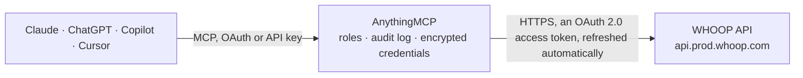

<!-- Generated by scripts/export-github-catalog.mjs in the anythingmcp-website repository. Do not edit by hand. -->

# WHOOP MCP connector

Read a WHOOP member's recovery, HRV, resting heart rate, sleep and naps with stages, day strain per cycle, workouts with heart rate zones, profile and body measurements through the WHOOP Developer API v2 with OAuth. The AnythingMCP connector gives Claude, ChatGPT, Microsoft Copilot, Cursor and Gemini 11 MCP tools for WHOOP, all read-only.

**Category:** [Sports](../sports.md) · **Tools:** 11 · **Setup guide:** [anythingmcp.com](https://anythingmcp.com/guides/whoop-to-mcp) · [Deutsch](https://anythingmcp.com/de/guides/whoop-to-mcp) · [Italiano](https://anythingmcp.com/it/guides/whoop-to-mcp) · [Español](https://anythingmcp.com/es/guides/whoop-to-mcp) · [日本語](https://anythingmcp.com/ja/guides/whoop-to-mcp) · [Русский](https://anythingmcp.com/ru/guides/whoop-to-mcp) · [中文](https://anythingmcp.com/zh/guides/whoop-to-mcp)

## Start without code

No installation and no terminal: AnythingMCP Cloud runs the WHOOP connector for you, operated by helpcode.ai in Frankfurt, Germany.

1. **Click the button above** and create an account or sign in. The WHOOP connector opens, ready to install.
2. **Sign in with your WHOOP account** when AnythingMCP asks. The first time, an admin creates a small app in the WHOOP developer console. Every click is in the [step-by-step guide](https://anythingmcp.com/guides/whoop-to-mcp).
3. **Click Install.** AnythingMCP shows the address of your MCP server.
4. **Add that address to your assistant:** [Claude](https://anythingmcp.com/guides/connect-whoop-to-claude) · [ChatGPT](https://anythingmcp.com/guides/connect-whoop-to-chatgpt) · [Microsoft Copilot](https://anythingmcp.com/guides/connect-whoop-to-copilot) · [Cursor](https://anythingmcp.com/guides/connect-whoop-to-cursor) · [Gemini CLI](https://anythingmcp.com/guides/connect-whoop-to-gemini) · [Meta Muse](https://anythingmcp.com/guides/connect-whoop-to-muse).
5. **Ask your first question**, for example: *What's Emma Bates's latest recovery score, resting heart rate and HRV on her WHOOP account?*

Prefer help with the setup? [Talk to us](https://anythingmcp.com/contact).

## How it works

- **The AI client** speaks MCP (Streamable HTTP) to AnythingMCP and only sees tool names, descriptions and results. It never gets the WHOOP credentials.
- **AnythingMCP** checks the client's role, builds the call from the tool definition, adds the credentials (an OAuth 2.0 access token, refreshed automatically), calls WHOOP, logs the call and returns the result.
- **WHOOP** sees an ordinary API client with the rights of the account the credentials belong to.

## Tools

| Tool | What it does | Access |
|---|---|---|
| [`whoop_get_profile`](#whoop_get_profile) | The signed-in WHOOP member: user_id, email, first and last name. | read |
| [`whoop_get_body_measurement`](#whoop_get_body_measurement) | The member's body measurements as stored in WHOOP: height_meter, weight_kilogram and the max_heart_rate WHOOP calculated. | read |
| [`whoop_list_cycles`](#whoop_list_cycles) | Physiological cycles (one WHOOP day, from waking to waking), newest first: id, start, end (missing for the current cycle), timezone_offset, score_state and… | read |
| [`whoop_get_cycle`](#whoop_get_cycle) | One physiological cycle by id: start, end, score_state and score (strain, kilojoule, average and max heart rate). | read |
| [`whoop_get_cycle_sleep`](#whoop_get_cycle_sleep) | The main sleep that belongs to a cycle (the sleep before that WHOOP day), with stages, sleep need, performance, consistency and efficiency. | read |
| [`whoop_get_cycle_recovery`](#whoop_get_cycle_recovery) | The recovery of a cycle: recovery_score (0 to 100 %), resting_heart_rate, hrv_rmssd_milli, and on WHOOP 4.0 or newer spo2_percentage and skin_temp_celsius;… | read |
| [`whoop_list_recoveries`](#whoop_list_recoveries) | Recoveries, newest first (by the start of their cycle): cycle_id, sleep_id, score_state and score with recovery_score (0 to 100 %), resting_heart_rate,… | read |
| [`whoop_list_sleeps`](#whoop_list_sleeps) | Sleeps and naps, newest first: id (UUID), cycle_id, start, end, nap, score_state and score with time in bed and per stage (light, slow wave, REM, awake) in… | read |
| [`whoop_get_sleep`](#whoop_get_sleep) | One sleep or nap by its UUID, with the full score (stage summary, sleep need, performance, consistency, efficiency, respiratory rate). | read |
| [`whoop_list_workouts`](#whoop_list_workouts) | Workouts, newest first: id (UUID), sport_name, start, end, score_state and score with strain, average and max heart rate, kilojoule, percent_recorded,… | read |
| [`whoop_get_workout`](#whoop_get_workout) | One workout by its UUID: sport, times, strain, heart rate, kilojoule, distance, altitude and heart rate zone durations. | read |

## Tool reference

Every parameter as the AI client sees it in `tools/list`. Source: [`packages/backend/src/adapters/intl/whoop.json`](../../../packages/backend/src/adapters/intl/whoop.json).

### `whoop_get_profile`

The signed-in WHOOP member: user_id, email, first and last name. Use it to check the connection.

**Access:** read · **Call:** `GET /v2/user/profile/basic`

No parameters.

### `whoop_get_body_measurement`

The member's body measurements as stored in WHOOP: height_meter, weight_kilogram and the max_heart_rate WHOOP calculated.

**Access:** read · **Call:** `GET /v2/user/measurement/body`

No parameters.

### `whoop_list_cycles`

Physiological cycles (one WHOOP day, from waking to waking), newest first: id, start, end (missing for the current cycle), timezone_offset, score_state and score with day strain (0 to 21), kilojoule, average and max heart rate, plus step_count when the strap reports steps. Paged with next_token.

**Access:** read · **Call:** `GET /v2/cycle`

| Parameter | Type | Required | Description |
|---|---|---|---|
| `start` | string | no | Only cycles that started at or after this time (ISO 8601 with time zone, e.g. 2026-10-01T00:00:00Z). Without it there is no lower bound. |
| `end` | string | no | Only cycles before this time (ISO 8601, exclusive). Defaults to now. |
| `limit` | integer | no | Records per page, 1 to 25 (default 10). |
| `next_token` | string | no | The next_token of the previous page, to read the next one. Leave empty for the first page. |

### `whoop_get_cycle`

One physiological cycle by id: start, end, score_state and score (strain, kilojoule, average and max heart rate).

**Access:** read · **Call:** `GET /v2/cycle/{cycle_id}`

| Parameter | Type | Required | Description |
|---|---|---|---|
| `cycle_id` | integer | yes | Cycle id (an integer) from whoop_list_cycles, or cycle_id on a sleep or recovery. |

### `whoop_get_cycle_sleep`

The main sleep that belongs to a cycle (the sleep before that WHOOP day), with stages, sleep need, performance, consistency and efficiency.

**Access:** read · **Call:** `GET /v2/cycle/{cycle_id}/sleep`

| Parameter | Type | Required | Description |
|---|---|---|---|
| `cycle_id` | integer | yes | Cycle id (an integer) from whoop_list_cycles, or cycle_id on a sleep or recovery. |

### `whoop_get_cycle_recovery`

The recovery of a cycle: recovery_score (0 to 100 %), resting_heart_rate, hrv_rmssd_milli, and on WHOOP 4.0 or newer spo2_percentage and skin_temp_celsius; sleep_id links the sleep it was computed from.

**Access:** read · **Call:** `GET /v2/cycle/{cycle_id}/recovery`

| Parameter | Type | Required | Description |
|---|---|---|---|
| `cycle_id` | integer | yes | Cycle id (an integer) from whoop_list_cycles, or cycle_id on a sleep or recovery. |

### `whoop_list_recoveries`

Recoveries, newest first (by the start of their cycle): cycle_id, sleep_id, score_state and score with recovery_score (0 to 100 %), resting_heart_rate, hrv_rmssd_milli, user_calibrating, spo2_percentage and skin_temp_celsius. Paged with next_token.

**Access:** read · **Call:** `GET /v2/recovery`

| Parameter | Type | Required | Description |
|---|---|---|---|
| `start` | string | no | Only recoveries whose cycle that started at or after this time (ISO 8601 with time zone, e.g. 2026-10-01T00:00:00Z). Without it there is no lower bound. |
| `end` | string | no | Only recoveries whose cycle before this time (ISO 8601, exclusive). Defaults to now. |
| `limit` | integer | no | Records per page, 1 to 25 (default 10). |
| `next_token` | string | no | The next_token of the previous page, to read the next one. Leave empty for the first page. |

### `whoop_list_sleeps`

Sleeps and naps, newest first: id (UUID), cycle_id, start, end, nap, score_state and score with time in bed and per stage (light, slow wave, REM, awake) in milliseconds, sleep cycles, disturbances, respiratory rate, sleep need, and performance, consistency and efficiency percentages. Paged with next_token.

**Access:** read · **Call:** `GET /v2/activity/sleep`

| Parameter | Type | Required | Description |
|---|---|---|---|
| `start` | string | no | Only sleeps that started at or after this time (ISO 8601 with time zone, e.g. 2026-10-01T00:00:00Z). Without it there is no lower bound. |
| `end` | string | no | Only sleeps before this time (ISO 8601, exclusive). Defaults to now. |
| `limit` | integer | no | Records per page, 1 to 25 (default 10). |
| `next_token` | string | no | The next_token of the previous page, to read the next one. Leave empty for the first page. |

### `whoop_get_sleep`

One sleep or nap by its UUID, with the full score (stage summary, sleep need, performance, consistency, efficiency, respiratory rate).

**Access:** read · **Call:** `GET /v2/activity/sleep/{sleep_id}`

| Parameter | Type | Required | Description |
|---|---|---|---|
| `sleep_id` | string | yes | Sleep id (a UUID) from whoop_list_sleeps, or sleep_id on a recovery. |

### `whoop_list_workouts`

Workouts, newest first: id (UUID), sport_name, start, end, score_state and score with strain, average and max heart rate, kilojoule, percent_recorded, distance_meter and altitude when recorded, and time per heart rate zone (zone_zero_milli to zone_five_milli). Paged with next_token.

**Access:** read · **Call:** `GET /v2/activity/workout`

| Parameter | Type | Required | Description |
|---|---|---|---|
| `start` | string | no | Only workouts that started at or after this time (ISO 8601 with time zone, e.g. 2026-10-01T00:00:00Z). Without it there is no lower bound. |
| `end` | string | no | Only workouts before this time (ISO 8601, exclusive). Defaults to now. |
| `limit` | integer | no | Records per page, 1 to 25 (default 10). |
| `next_token` | string | no | The next_token of the previous page, to read the next one. Leave empty for the first page. |

### `whoop_get_workout`

One workout by its UUID: sport, times, strain, heart rate, kilojoule, distance, altitude and heart rate zone durations.

**Access:** read · **Call:** `GET /v2/activity/workout/{workout_id}`

| Parameter | Type | Required | Description |
|---|---|---|---|
| `workout_id` | string | yes | Workout id (a UUID) from whoop_list_workouts. |

## Run it yourself

AnythingMCP is open source (AGPL-3.0). [Run it with Docker](../../../README.md#run-it-yourself), open **Connectors → Store**, pick **WHOOP** and enter `WHOOP_CLIENT_ID`, `WHOOP_CLIENT_SECRET`, then add your MCP server URL to the AI client.

[← Sports connectors](../sports.md) · [All categories](../README.md)
