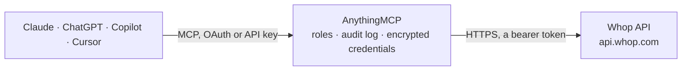

<!-- Generated by scripts/export-github-catalog.mjs in the anythingmcp-website repository. Do not edit by hand. -->

# Whop MCP connector

Let your AI work with your Whop business: products and plans, memberships and license keys, members, payments, promo codes, experiences, forum posts and webhooks, with cancellations and refunds kept … The AnythingMCP connector gives Claude, ChatGPT, Microsoft Copilot, Cursor and Gemini 20 MCP tools for Whop: 18 read and 2 can change data.

**Category:** [Payments](../payments.md) · **Tools:** 20 · **Setup guide:** [anythingmcp.com](https://anythingmcp.com/guides/whop-to-mcp) · [Deutsch](https://anythingmcp.com/de/guides/whop-to-mcp) · [Italiano](https://anythingmcp.com/it/guides/whop-to-mcp) · [Español](https://anythingmcp.com/es/guides/whop-to-mcp) · [日本語](https://anythingmcp.com/ja/guides/whop-to-mcp) · [Русский](https://anythingmcp.com/ru/guides/whop-to-mcp) · [中文](https://anythingmcp.com/zh/guides/whop-to-mcp)

## Start without code

No installation and no terminal: AnythingMCP Cloud runs the Whop connector for you, operated by helpcode.ai in Frankfurt, Germany.

1. **Click the button above** and create an account or sign in. The Whop connector opens, ready to install.
2. **Paste the API key or token from your Whop account.** Every click is in the [step-by-step guide](https://anythingmcp.com/guides/whop-to-mcp).
3. **Click Install.** AnythingMCP shows the address of your MCP server.
4. **Add that address to your assistant:** [Claude](https://anythingmcp.com/guides/connect-whop-to-claude) · [ChatGPT](https://anythingmcp.com/guides/connect-whop-to-chatgpt) · [Microsoft Copilot](https://anythingmcp.com/guides/connect-whop-to-copilot) · [Cursor](https://anythingmcp.com/guides/connect-whop-to-cursor) · [Gemini CLI](https://anythingmcp.com/guides/connect-whop-to-gemini) · [Meta Muse](https://anythingmcp.com/guides/connect-whop-to-muse).
5. **Ask your first question**, for example: *Get the payment record for pay_2026-03-11-77 and show totals, buyer and related membership.*

Prefer help with the setup? [Talk to us](https://anythingmcp.com/contact).

## How it works

- **The AI client** speaks MCP (Streamable HTTP) to AnythingMCP and only sees tool names, descriptions and results. It never gets the Whop credentials.
- **AnythingMCP** checks the client's role, builds the call from the tool definition, adds the credentials (a bearer token), calls Whop, logs the call and returns the result.
- **Whop** sees an ordinary API client with the rights of the account the credentials belong to.

## Tools

| Tool | What it does | Access |
|---|---|---|
| [`whop_get_account`](#whop_get_account) | Get the Whop business (account) behind the API key: id (biz_), title, business name, route, email, country, status, level, website, owner and creation date. | read |
| [`whop_list_products`](#whop_list_products) | List the products of the configured Whop business with id (prod_), title, headline, route, visibility, member count, review rating and default plan. | read |
| [`whop_get_product`](#whop_get_product) | Get one Whop product with its description, visibility, plans (variants), affiliate settings, member count and owner. | read |
| [`whop_list_plans`](#whop_list_plans) | List the plans (Whop now calls them variants) of the configured business: id (plan_), title, product, plan type (renewal or one_time), initial and renewal… | read |
| [`whop_get_plan`](#whop_get_plan) | Get one Whop plan (variant) with price, currency, billing period, trial, stock, visibility, tax settings, internal notes and purchase URL. | read |
| [`whop_list_memberships`](#whop_list_memberships) | List memberships (purchases and subscriptions, mem_) newest first, with status, product, plan, user, member, prices, current period, cancel flags and… | read |
| [`whop_get_membership`](#whop_get_membership) | Get one Whop membership by its mem_ id or by its license key: status, product, plan, user and member, prices, billing period, cancellation details, metadata… | read |
| [`whop_validate_license_key`](#whop_validate_license_key) | Check a software license key sold through Whop: returns valid (true when the membership status is active, trialing or completed), status, the membership,… | read |
| [`whop_cancel_membership`](#whop_cancel_membership) | Cancel a Whop membership, either at the end of the current billing period (cancel_at_period_end true, access continues until then) or immediately (access… | write |
| [`whop_list_members`](#whop_list_members) | List the members of the configured business (one per buyer, mber_) with name, email (needs member:email:read), access level, status, most recent action,… | read |
| [`whop_get_member`](#whop_get_member) | Get one member (mber_) of the business: name, email (with member:email:read), phone, user, access level, status, most recent action, total spent and token… | read |
| [`whop_get_user`](#whop_get_user) | Get a Whop user's public profile by user_ id or username: name, username, bio, level, verification and creation date. | read |
| [`whop_check_user_access`](#whop_check_user_access) | Check whether a Whop user has access to a product (prod_), an experience (exp_) or the business (biz_). | read |
| [`whop_list_payments`](#whop_list_payments) | List the business's payments newest first, with status, total, subtotal, refunded amount, currency, billing reason, buyer, product, plan, membership and dates. | read |
| [`whop_get_payment`](#whop_get_payment) | Get one Whop payment with its line items, totals, tax, fees, refunded amount, status, failure message, buyer and related membership, product and plan ids. | read |
| [`whop_refund_payment`](#whop_refund_payment) | Refund all or part of a Whop payment through the processor that charged it. | write |
| [`whop_list_promo_codes`](#whop_list_promo_codes) | List the business's promo codes with code, status, discount type and amount (percentages as a fraction, e.g. 0.1), duration, uses, stock, product… | read |
| [`whop_list_experiences`](#whop_list_experiences) | List the business's experiences (the apps inside a whop: courses, forums, chats, files and so on) with id (exp_), name, the app that powers it, whether it… | read |
| [`whop_list_forum_posts`](#whop_list_forum_posts) | List the posts of a forum experience, or the replies to one post with parent_id, with title, content, author, like, comment and view counts and pinned flag. | read |
| [`whop_list_webhooks`](#whop_list_webhooks) | List the business's webhook endpoints with URL, subscribed events, API version, enabled flag and failure state (consecutive failures, failing since,… | read |

## Tool reference

Every parameter as the AI client sees it in `tools/list`. Source: [`packages/backend/src/adapters/intl/whop.json`](../../../packages/backend/src/adapters/intl/whop.json).

### `whop_get_account`

Get the Whop business (account) behind the API key: id (biz_), title, business name, route, email, country, status, level, website, owner and creation date. Needs the company:balance:read permission. Read-only.

**Access:** read · **Call:** `GET /accounts/me`

No parameters.

### `whop_list_products`

List the products of the configured Whop business with id (prod_), title, headline, route, visibility, member count, review rating and default plan. Filter by text, creation date or order. Read-only. Paginate with after = page_info.end_cursor while has_next_page is true.

**Access:** read · **Call:** `GET /products`

| Parameter | Type | Required | Description |
|---|---|---|---|
| `query` | string | no | Filter products by text in the title or description. |
| `order` | string | no | Sort field, e.g. created_at (default). |
| `direction` | `asc` \| `desc` | no | Sort direction. Default desc. |
| `created_after` | string | no | Only products created after this ISO 8601 time. |
| `created_before` | string | no | Only products created before this ISO 8601 time. |
| `first` | integer | no | Products per page, 1 to 100. Default 20. |
| `after` | string | no | page_info.end_cursor from the previous page. |

### `whop_get_product`

Get one Whop product with its description, visibility, plans (variants), affiliate settings, member count and owner. Read-only.

**Access:** read · **Call:** `GET /products/{id}`

| Parameter | Type | Required | Description |
|---|---|---|---|
| `id` | string | yes | The product id, prefixed prod_. |

### `whop_list_plans`

List the plans (Whop now calls them variants) of the configured business: id (plan_), title, product, plan type (renewal or one_time), initial and renewal price, currency, billing period, trial days, visibility, stock, member count and purchase URL. Read-only. Paginate with after = page_info.end_cursor.

**Access:** read · **Call:** `GET /variants`

| Parameter | Type | Required | Description |
|---|---|---|---|
| `product_id` | string | no | Only plans of this product (prod_ id). |
| `order` | `id` \| `active_members_count` \| `created_at` \| `internal_notes` \| `expiration_days` | no | Sort field. Default created_at. |
| `direction` | `asc` \| `desc` | no | Sort direction. Default desc. |
| `first` | integer | no | Plans per page, 1 to 100. Default 20. |
| `after` | string | no | page_info.end_cursor from the previous page. |

### `whop_get_plan`

Get one Whop plan (variant) with price, currency, billing period, trial, stock, visibility, tax settings, internal notes and purchase URL. Read-only.

**Access:** read · **Call:** `GET /variants/{id}`

| Parameter | Type | Required | Description |
|---|---|---|---|
| `id` | string | yes | The plan id, prefixed plan_. |

### `whop_list_memberships`

List memberships (purchases and subscriptions, mem_) newest first, with status, product, plan, user, member, prices, current period, cancel flags and license key. Filter by status, product, plan, user, member or creation date. Read-only. Paginate with after = page_info.end_cursor while has_next_page is true.

**Access:** read · **Call:** `GET /memberships`

| Parameter | Type | Required | Description |
|---|---|---|---|
| `status` | `active` \| `trialing` \| `past_due` \| `completed` \| `canceled` \| `expired` \| `canceling` \| `paused` \| `expiring` \| `one_time` \| `unclaimed` \| `banned` | no | Only memberships in this state. |
| `product_id` | string | no | Only memberships of this product (prod_). |
| `plan_id` | string | no | Only memberships of this plan (plan_). |
| `user_id` | string | no | Only memberships of this user (user_). |
| `member_id` | string | no | Only memberships of this member (mber_). |
| `created_after` | string | no | Only memberships created after this ISO 8601 time. |
| `created_before` | string | no | Only memberships created before this ISO 8601 time. |
| `direction` | `asc` \| `desc` | no | Sort direction by creation date. Default desc. |
| `first` | integer | no | Memberships per page, 1 to 100. Default 20. |
| `after` | string | no | page_info.end_cursor from the previous page. |

### `whop_get_membership`

Get one Whop membership by its mem_ id or by its license key: status, product, plan, user and member, prices, billing period, cancellation details, metadata (for example a bound machine id) and the buyer's manage URL. Read-only.

**Access:** read · **Call:** `GET /memberships/{id}`

| Parameter | Type | Required | Description |
|---|---|---|---|
| `id` | string | yes | The membership id (mem_) or a license key. |

### `whop_validate_license_key`

Check a software license key sold through Whop: returns valid (true when the membership status is active, trialing or completed), status, the membership, product, plan and user ids, period end, cancel flag and metadata such as a bound machine id. A key Whop does not know answers 404. Read-only; it does not bind or reset the key.

**Access:** read · **Call:** `GET /memberships/{license_key}`

| Parameter | Type | Required | Description |
|---|---|---|---|
| `license_key` | string | yes | The license key the customer received with the purchase. |

### `whop_cancel_membership`

Cancel a Whop membership, either at the end of the current billing period (cancel_at_period_end true, access continues until then) or immediately (access revoked now). Installed switched off. Confirm with the user first, naming the membership, the buyer and the timing. Buy-now-pay-later and non-trial split-pay memberships cannot be cancelled. Returns the updated membership.

**Access:** write · **Call:** `POST /memberships/{id}/cancel`

| Parameter | Type | Required | Description |
|---|---|---|---|
| `id` | string | yes | The membership id, prefixed mem_. |
| `cancel_at_period_end` | boolean | yes | true stops renewal and keeps access until the period ends; false or left out revokes access immediately. Ask the user which. |
| `reason` | string | no | Free-text note recorded on the membership, e.g. "customer request by email". |

### `whop_list_members`

List the members of the configured business (one per buyer, mber_) with name, email (needs member:email:read), access level, status, most recent action, total spent in USD and join date. Search by name, username or exact email; filter by product, access or activity. Read-only. Paginate with after = page_info.end_cursor.

**Access:** read · **Call:** `GET /members`

| Parameter | Type | Required | Description |
|---|---|---|---|
| `query` | string | no | Search by name or username; an exact email also matches with member:email:read. |
| `access_level` | `no_access` \| `admin` \| `customer` | no | Only members with this access. |
| `status` | `joined` \| `left` | no | joined for current members, left for former ones. |
| `membership_status` | `active` \| `inactive` | no | active: holds at least one membership that grants access now; inactive: holds none. |
| `order` | `created_at` \| `joined_at` \| `last_accessed_at` \| `most_recent_action_at` \| `usd_total_spent` | no | Sort field. Default created_at. |
| `direction` | `asc` \| `desc` | no | Sort direction. Default desc. |
| `created_after` | string | no | Only members who joined after this ISO 8601 time. |
| `created_before` | string | no | Only members who joined before this ISO 8601 time. |
| `first` | integer | no | Members per page, 1 to 100. Default 20. |
| `after` | string | no | page_info.end_cursor from the previous page. |

### `whop_get_member`

Get one member (mber_) of the business: name, email (with member:email:read), phone, user, access level, status, most recent action, total spent and token balance. List their memberships with whop_list_memberships and member_id. Read-only.

**Access:** read · **Call:** `GET /members/{id}`

| Parameter | Type | Required | Description |
|---|---|---|---|
| `id` | string | yes | The member id, prefixed mber_. |

### `whop_get_user`

Get a Whop user's public profile by user_ id or username: name, username, bio, level, verification and creation date. Private fields such as email and balance stay empty for other users. Read-only.

**Access:** read · **Call:** `GET /users/{id}`

| Parameter | Type | Required | Description |
|---|---|---|---|
| `id` | string | yes | The user id (user_) or username. |

### `whop_check_user_access`

Check whether a Whop user has access to a product (prod_), an experience (exp_) or the business (biz_). Returns has_access and access_level (customer, admin or no_access). Read-only.

**Access:** read · **Call:** `GET /users/{user_id}/access/{resource_id}`

| Parameter | Type | Required | Description |
|---|---|---|---|
| `user_id` | string | yes | The user id, prefixed user_. |
| `resource_id` | string | yes | The product (prod_), experience (exp_) or business (biz_) id. |

### `whop_list_payments`

List the business's payments newest first, with status, total, subtotal, refunded amount, currency, billing reason, buyer, product, plan, membership and dates. Filter by status, buyer, member, membership, product, plan, currency, search text or date. Read-only. Paginate with after = page_info.end_cursor while has_next_page is true.

**Access:** read · **Call:** `GET /payments`

| Parameter | Type | Required | Description |
|---|---|---|---|
| `status` | `open` \| `authorized` \| `paid` \| `pending` \| `uncollectible` \| `unresolved` \| `void` | no | Only payments in this state. |
| `billing_reason` | `subscription_create` \| `subscription_cycle` \| `subscription_update` \| `one_time` \| `manual` \| `subscription` | no | Only payments charged for this reason; subscription_cycle are renewals. |
| `query` | string | no | Search by user id, membership id, email, name or username (email needs member:email:read). |
| `user_id` | string | no | Only payments by this buyer (user_). |
| `member_id` | string | no | Only payments by this member (mber_). |
| `membership_id` | string | no | Only payments of this membership (mem_). |
| `product_id` | string | no | Only payments for this product (prod_). |
| `plan_id` | string | no | Only payments for this plan (plan_). |
| `currency` | string | no | Only payments in this three-letter currency, e.g. usd or eur. |
| `created_after` | string | no | Only payments created after this ISO 8601 time. |
| `created_before` | string | no | Only payments created before this ISO 8601 time. |
| `order` | `created_at` \| `paid_at` | no | Sort field. |
| `direction` | `asc` \| `desc` | no | Sort direction. |
| `first` | integer | no | Payments per page, 1 to 100. Default 20. |
| `after` | string | no | page_info.end_cursor from the previous page. |

### `whop_get_payment`

Get one Whop payment with its line items, totals, tax, fees, refunded amount, status, failure message, buyer and related membership, product and plan ids. Card details, client secret, IP address and risk signals are left out. Read-only.

**Access:** read · **Call:** `GET /payments/{id}`

| Parameter | Type | Required | Description |
|---|---|---|---|
| `id` | string | yes | The payment id, prefixed pay_. |

### `whop_refund_payment`

Refund all or part of a Whop payment through the processor that charged it. The buyer is emailed, the affiliate commission is clawed back, the membership is updated and an open dispute case is closed; it cannot be undone. Installed switched off. Confirm the payment, the buyer and the exact amount with the user first. Returns the updated payment.

**Access:** write · **Call:** `POST /payments/{id}/refund`

| Parameter | Type | Required | Description |
|---|---|---|---|
| `id` | string | yes | The payment id, prefixed pay_. |
| `partial_amount` | number | no | Amount to refund in the payment's currency, e.g. 10.5. Leave out to refund everything still refundable. |

### `whop_list_promo_codes`

List the business's promo codes with code, status, discount type and amount (percentages as a fraction, e.g. 0.1), duration, uses, stock, product restriction and expiry. Read-only. Paginate with after = page_info.end_cursor.

**Access:** read · **Call:** `GET /promo_codes`

| Parameter | Type | Required | Description |
|---|---|---|---|
| `status` | `active` \| `inactive` \| `archived` \| `expired` | no | Only codes in this state; expired covers inactive and archived. |
| `direction` | `asc` \| `desc` | no | Sort direction by creation date. Default desc. |
| `first` | integer | no | Codes per page, 1 to 100. Default 20. |
| `after` | string | no | page_info.end_cursor from the previous page. |

### `whop_list_experiences`

List the business's experiences (the apps inside a whop: courses, forums, chats, files and so on) with id (exp_), name, the app that powers it, whether it is public and its order. Filter by product or app. Read-only. Paginate with after = page_info.end_cursor.

**Access:** read · **Call:** `GET /experiences`

| Parameter | Type | Required | Description |
|---|---|---|---|
| `product_id` | string | no | Only experiences attached to this product (prod_). |
| `app_id` | string | no | Only experiences powered by this app (app_). |
| `first` | integer | no | Experiences per page. Default 20. |
| `after` | string | no | page_info.end_cursor from the previous page. |

### `whop_list_forum_posts`

List the posts of a forum experience, or the replies to one post with parent_id, with title, content, author, like, comment and view counts and pinned flag. Needs the forum:read permission and a forum experience id from whop_list_experiences. Read-only. Paginate with after = page_info.end_cursor.

**Access:** read · **Call:** `GET /forum_posts`

| Parameter | Type | Required | Description |
|---|---|---|---|
| `experience_id` | string | yes | The forum experience id, prefixed exp_. |
| `parent_id` | string | no | A post id, to list its replies instead of the top-level posts. |
| `pinned` | boolean | no | true for pinned posts only. |
| `first` | integer | no | Posts per page. Default 20. |
| `after` | string | no | page_info.end_cursor from the previous page. |

### `whop_list_webhooks`

List the business's webhook endpoints with URL, subscribed events, API version, enabled flag and failure state (consecutive failures, failing since, disabled reason). Signing secrets are left out. Needs developer:manage_webhook. Read-only.

**Access:** read · **Call:** `GET /webhooks`

| Parameter | Type | Required | Description |
|---|---|---|---|
| `has_failures` | boolean | no | true for endpoints that are currently failing only. |
| `include_app_webhooks` | boolean | no | Also list webhooks of the business's apps. |
| `first` | integer | no | Webhooks per page, 1 to 100. Default 20. |
| `after` | string | no | page_info.end_cursor from the previous page. |

## Run it yourself

AnythingMCP is open source (AGPL-3.0). [Run it with Docker](../../../README.md#run-it-yourself), open **Connectors → Store**, pick **Whop** and enter `WHOP_API_KEY`, `WHOP_ACCOUNT_ID`, then add your MCP server URL to the AI client.

[← Payments connectors](../payments.md) · [All categories](../README.md)
