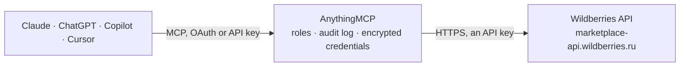

<!-- Generated by scripts/export-github-catalog.mjs in the anythingmcp-website repository. Do not edit by hand. -->

# Wildberries MCP connector

Run a Wildberries seller account from an AI agent: FBS orders and their statuses, seller warehouses and stock levels, statistics on orders and sales, stock on WB warehouses, the sales report detail, … The AnythingMCP connector gives Claude, ChatGPT, Microsoft Copilot, Cursor and Gemini 34 MCP tools for Wildberries: 27 read and 7 can change data.

**Category:** [E-commerce](../e-commerce.md) · **Tools:** 34 · **Setup guide:** [anythingmcp.com](https://anythingmcp.com/guides/wildberries-to-mcp) · [Deutsch](https://anythingmcp.com/de/guides/wildberries-to-mcp) · [Italiano](https://anythingmcp.com/it/guides/wildberries-to-mcp) · [Español](https://anythingmcp.com/es/guides/wildberries-to-mcp) · [日本語](https://anythingmcp.com/ja/guides/wildberries-to-mcp) · [Русский](https://anythingmcp.com/ru/guides/wildberries-to-mcp) · [中文](https://anythingmcp.com/zh/guides/wildberries-to-mcp)

## Start without code

No installation and no terminal: AnythingMCP Cloud runs the Wildberries connector for you, operated by helpcode.ai in Frankfurt, Germany.

1. **Click the button above** and create an account or sign in. The Wildberries connector opens, ready to install.
2. **Paste the API key or token from your Wildberries account.** Every click is in the [step-by-step guide](https://anythingmcp.com/guides/wildberries-to-mcp).
3. **Click Install.** AnythingMCP shows the address of your MCP server.
4. **Add that address to your assistant:** [Claude](https://anythingmcp.com/guides/connect-wildberries-to-claude) · [ChatGPT](https://anythingmcp.com/guides/connect-wildberries-to-chatgpt) · [Microsoft Copilot](https://anythingmcp.com/guides/connect-wildberries-to-copilot) · [Cursor](https://anythingmcp.com/guides/connect-wildberries-to-cursor) · [Gemini CLI](https://anythingmcp.com/guides/connect-wildberries-to-gemini) · [Meta Muse](https://anythingmcp.com/guides/connect-wildberries-to-muse).
5. **Ask your first question**, for example: *What's the current status of FBS order 876543210 from warehouse 42?*

Prefer help with the setup? [Talk to us](https://anythingmcp.com/contact).

## How it works

- **The AI client** speaks MCP (Streamable HTTP) to AnythingMCP and only sees tool names, descriptions and results. It never gets the Wildberries credentials.
- **AnythingMCP** checks the client's role, builds the call from the tool definition, adds the credentials (an API key), calls Wildberries, logs the call and returns the result.
- **Wildberries** sees an ordinary API client with the rights of the account the credentials belong to.

## Tools

| Tool | What it does | Access |
|---|---|---|
| [`wildberries_ping`](#wildberries_ping) | Check that the API token is valid and reaches the WB API. | read |
| [`wildberries_get_seller_info`](#wildberries_get_seller_info) | Get the seller account behind the token: legal name, seller id (sid), tax number and trade mark. | read |
| [`wildberries_list_new_orders`](#wildberries_list_new_orders) | List every new FBS assembly order (order to pack and ship from your own warehouse) that exists right now: id, nmId, chrtId, article, price, warehouseId,… | read |
| [`wildberries_list_orders`](#wildberries_list_orders) | List FBS assembly orders created in a period (at most 30 days per call, up to 3 months back), without their current status. | read |
| [`wildberries_get_order_statuses`](#wildberries_get_order_statuses) | Get the current status of up to 1000 FBS assembly orders by id: supplierStatus (new, confirm, complete, cancel), wbStatus (waiting, sorted, sold,… | read |
| [`wildberries_list_supplies`](#wildberries_list_supplies) | List FBS supplies (shipments that group assembly orders for hand-over to Wildberries): id, name, done, created and closed dates, cargo type. | read |
| [`wildberries_list_warehouses`](#wildberries_list_warehouses) | List the seller's own warehouses (id, name, linked WB office, cargo and delivery type). | read |
| [`wildberries_list_wb_offices`](#wildberries_list_wb_offices) | List Wildberries offices (WB warehouses and sorting centres) that a seller warehouse can be linked to: id, name, city, address, coordinates, cargo type. | read |
| [`wildberries_get_stocks`](#wildberries_get_stocks) | Read the stock on one seller warehouse for up to 1000 product sizes. | read |
| [`wildberries_update_stocks`](#wildberries_update_stocks) | Overwrite the stock of up to 1000 product sizes on one seller warehouse. | write |
| [`wildberries_list_statistics_orders`](#wildberries_list_statistics_orders) | Orders statistics from the statistics host: one row per ordered unit with date, lastChangeDate, warehouse, region, article, nmId, barcode, prices, discount,… | read |
| [`wildberries_list_statistics_sales`](#wildberries_list_statistics_sales) | Sales and returns statistics: one row per sold or returned unit with saleID (S for sale, R for return), dates, warehouse, article, nmId, prices, forPay and… | read |
| [`wildberries_get_wb_warehouse_stocks`](#wildberries_get_wb_warehouse_stocks) | Current stock on Wildberries warehouses (FBW), one row per product size per WB warehouse, updated every 30 minutes. | read |
| [`wildberries_create_stock_report`](#wildberries_create_stock_report) | Start generating the WB warehouses inventory report (stock per product on Wildberries warehouses), which also works with a Base token. | read |
| [`wildberries_get_stock_report_status`](#wildberries_get_stock_report_status) | Check whether a WB warehouses inventory report task is ready. | read |
| [`wildberries_download_stock_report`](#wildberries_download_stock_report) | Download a finished WB warehouses inventory report: per product (brand, subject, vendorCode, nmId, barcode, size) the quantity on each Wildberries… | read |
| [`wildberries_get_sales_report_detail`](#wildberries_get_sales_report_detail) | Detail lines of the sales (realisation) reports for a period: sales, returns, logistics, storage, fines and payouts per line, from 29 January 2024 on. | read |
| [`wildberries_list_product_cards`](#wildberries_list_product_cards) | List product cards (listings) with nmID, vendorCode, brand, title, subject, characteristics, photos and sizes (chrtID, barcodes). | read |
| [`wildberries_list_prices`](#wildberries_list_prices) | List products with their prices: nmID, vendorCode, currency, discount, WB Club discount and per-size price and discounted price. | read |
| [`wildberries_set_prices`](#wildberries_set_prices) | Set prices and discounts for up to 1000 products in one upload. | write |
| [`wildberries_get_price_upload_status`](#wildberries_get_price_upload_status) | Get the state of a processed price and discount upload by its id: status, upload and activation dates, total and failed product counts. | read |
| [`wildberries_get_card_limits`](#wildberries_get_card_limits) | Get the free and paid limits for creating product cards. | read |
| [`wildberries_count_unanswered_feedbacks`](#wildberries_count_unanswered_feedbacks) | Count the feedbacks (product reviews) still waiting for the seller's answer: countUnanswered over all time and countUnansweredToday. | read |
| [`wildberries_count_unanswered_questions`](#wildberries_count_unanswered_questions) | Count the buyer questions still waiting for the seller's answer: countUnanswered over all time and countUnansweredToday. | read |
| [`wildberries_check_new_feedbacks_questions`](#wildberries_check_new_feedbacks_questions) | Tell whether there are feedbacks or questions the seller has not seen yet (hasNewFeedbacks, hasNewQuestions). | read |
| [`wildberries_list_feedbacks`](#wildberries_list_feedbacks) | List product feedbacks (reviews) with their id, text, pros, cons, rating (productValuation), product (nmId, name), date and the seller's answer if any. | read |
| [`wildberries_get_feedback`](#wildberries_get_feedback) | Read one feedback by its id: text, pros, cons, rating, photos, product and the seller's answer. | read |
| [`wildberries_answer_feedback`](#wildberries_answer_feedback) | Publish the seller's answer to a feedback; buyers see it on the product page. | write |
| [`wildberries_edit_feedback_answer`](#wildberries_edit_feedback_answer) | Replace the seller's published answer to a feedback. | write |
| [`wildberries_list_questions`](#wildberries_list_questions) | List buyer questions about products with their id, text, product (nmId, name), date and the seller's answer if any. | read |
| [`wildberries_answer_question`](#wildberries_answer_question) | Answer a buyer question, or change an answer already given (once, within 60 days); the question is then shown with the answer on the product page after… | write |
| [`wildberries_reject_question`](#wildberries_reject_question) | Reject a buyer question so it does not appear on the product page (state none). | write |
| [`wildberries_list_return_claims`](#wildberries_list_return_claims) | List buyer return applications (claims) of the last 14 days: id, product (nm_id, imt_name), buyer comment, photos, status, dates and actions, the decisions… | read |
| [`wildberries_answer_return_claim`](#wildberries_answer_return_claim) | Decide on a buyer return application: send one of the values in the claim's actions array from wildberries_list_return_claims, such as approve1 (refund once… | write |

## Tool reference

Every parameter as the AI client sees it in `tools/list`. Source: [`packages/backend/src/adapters/intl/wildberries.json`](../../../packages/backend/src/adapters/intl/wildberries.json).

### `wildberries_ping`

Check that the API token is valid and reaches the WB API. Returns a timestamp and Status OK. Cheap (3 requests per 30 seconds, burst 99); use it to test the connection.

**Access:** read · **Call:** `GET https://common-api.wildberries.ru/ping`

No parameters.

### `wildberries_get_seller_info`

Get the seller account behind the token: legal name, seller id (sid), tax number and trade mark. Works with a token of any category, but a Base token may call it only once a day.

**Access:** read · **Call:** `GET https://common-api.wildberries.ru/api/v1/seller-info`

No parameters.

### `wildberries_list_new_orders`

List every new FBS assembly order (order to pack and ship from your own warehouse) that exists right now: id, nmId, chrtId, article, price, warehouseId, delivery type, required marking codes. Start here for daily order processing.

**Access:** read · **Call:** `GET /api/v3/orders/new`

No parameters.

### `wildberries_list_orders`

List FBS assembly orders created in a period (at most 30 days per call, up to 3 months back), without their current status. Returns orders and a next cursor; call again with next until the list is empty.

**Access:** read · **Call:** `GET /api/v3/orders`

| Parameter | Type | Required | Description |
|---|---|---|---|
| `limit` | integer | yes | Orders per page, 1 to 1000. |
| `next` | integer | yes | Pagination cursor. 0 for the first page, then the next value from the previous answer. |
| `date_from` | integer | no | Start of the period as a Unix timestamp in seconds (UTC). Default: 30 days ago. |
| `date_to` | integer | no | End of the period as a Unix timestamp in seconds (UTC). The period may not exceed 30 days. |

### `wildberries_get_order_statuses`

Get the current status of up to 1000 FBS assembly orders by id: supplierStatus (new, confirm, complete, cancel), wbStatus (waiting, sorted, sold, canceled...) and whether the order can still be cancelled.

**Access:** read · **Call:** `POST /api/v3/orders/status`

| Parameter | Type | Required | Description |
|---|---|---|---|
| `order_ids` | integer[] | yes | Assembly order ids from wildberries_list_new_orders or wildberries_list_orders, for example [5632423]. |

### `wildberries_list_supplies`

List FBS supplies (shipments that group assembly orders for hand-over to Wildberries): id, name, done, created and closed dates, cargo type. Paginate with next until the list is empty.

**Access:** read · **Call:** `GET /api/v3/supplies`

| Parameter | Type | Required | Description |
|---|---|---|---|
| `limit` | integer | yes | Supplies per page, 1 to 1000. |
| `next` | integer | yes | Pagination cursor. 0 for the first page, then the next value from the previous answer. |

### `wildberries_list_warehouses`

List the seller's own warehouses (id, name, linked WB office, cargo and delivery type). The id is the warehouse_id that the stock tools need.

**Access:** read · **Call:** `GET /api/v3/warehouses`

No parameters.

### `wildberries_list_wb_offices`

List Wildberries offices (WB warehouses and sorting centres) that a seller warehouse can be linked to: id, name, city, address, coordinates, cargo type. Reference data, changes rarely.

**Access:** read · **Call:** `GET /api/v3/offices`

No parameters.

### `wildberries_get_stocks`

Read the stock on one seller warehouse for up to 1000 product sizes. Returns chrtId and amount per size. Use before and after wildberries_update_stocks.

**Access:** read · **Call:** `POST /api/v3/stocks/{warehouse_id}`

| Parameter | Type | Required | Description |
|---|---|---|---|
| `warehouse_id` | integer | yes | Seller warehouse id from wildberries_list_warehouses. |
| `chrt_ids` | integer[] | yes | Size ids (chrtID in sizes[] of wildberries_list_product_cards), for example [12345678]. |

### `wildberries_update_stocks`

Overwrite the stock of up to 1000 product sizes on one seller warehouse. Each entry sets the absolute amount, it does not add. Changes what buyers can order; read the stock back afterwards.

**Access:** write · **Call:** `PUT /api/v3/stocks/{warehouse_id}`

| Parameter | Type | Required | Description |
|---|---|---|---|
| `warehouse_id` | integer | yes | Seller warehouse id from wildberries_list_warehouses. |
| `stocks` | object[] | yes | List of size stock entries, for example [{"chrtId": 12345678, "amount": 10}]. amount is 0 to 100000. |

### `wildberries_list_statistics_orders`

Orders statistics from the statistics host: one row per ordered unit with date, lastChangeDate, warehouse, region, article, nmId, barcode, prices, discount, cancellation and srid. Data updates every 30 minutes and is kept 90 days. Strict limit: 1 call a minute (Base token: 1 per 3 hours).

**Access:** read · **Call:** `GET https://statistics-api.wildberries.ru/api/v1/supplier/orders`

| Parameter | Type | Required | Description |
|---|---|---|---|
| `date_from` | string | yes | RFC3339 date or date-time in Moscow time, for example 2026-10-01 or 2026-10-01T00:00:00. Rows changed at or after this moment are returned. For the next batch pass lastChangeDate of the last row. |
| `flag` | `0` \| `1` | no | 0 (default): rows whose lastChangeDate is at or after date_from, up to 80,000. 1: all orders placed on the day of date_from; the time part is ignored. |

### `wildberries_list_statistics_sales`

Sales and returns statistics: one row per sold or returned unit with saleID (S for sale, R for return), dates, warehouse, article, nmId, prices, forPay and srid. Preliminary figures; use the sales report detail for accounting. Strict limit: 1 call a minute (Base token: 1 per 3 hours).

**Access:** read · **Call:** `GET https://statistics-api.wildberries.ru/api/v1/supplier/sales`

| Parameter | Type | Required | Description |
|---|---|---|---|
| `date_from` | string | yes | RFC3339 date or date-time in Moscow time, for example 2026-10-01. Rows changed at or after this moment are returned. For the next batch pass lastChangeDate of the last row. |
| `flag` | `0` \| `1` | no | 0 (default): rows whose lastChangeDate is at or after date_from, up to 80,000. 1: all sales and returns of the day of date_from. |

### `wildberries_get_wb_warehouse_stocks`

Current stock on Wildberries warehouses (FBW), one row per product size per WB warehouse, updated every 30 minutes. Needs the Analytics category and a Personal, Service or Base-with-secret token. Limit: 3 calls a minute.

**Access:** read · **Call:** `POST https://seller-analytics-api.wildberries.ru/api/analytics/v1/stocks-report/wb-warehouses`

| Parameter | Type | Required | Description |
|---|---|---|---|
| `nm_ids` | integer[] | no | Optional WB articles (nmID) to restrict the report to. Omit for all products. |
| `chrt_ids` | integer[] | no | Optional size ids; only applied to the articles given in nm_ids. |
| `limit` | integer | no | Rows per answer, up to 250000. Keep it small (for example 1000) when only a sample is needed. |
| `offset` | integer | no | Rows to skip, for the next page. |

### `wildberries_create_stock_report`

Start generating the WB warehouses inventory report (stock per product on Wildberries warehouses), which also works with a Base token. Returns data.taskId; then poll wildberries_get_stock_report_status and fetch it with wildberries_download_stock_report.

**Access:** read · **Call:** `GET https://seller-analytics-api.wildberries.ru/api/v1/warehouse_remains`

| Parameter | Type | Required | Description |
|---|---|---|---|
| `group_by_nm` | boolean | no | Break down by WB article (nmId). true is the usual choice. |
| `group_by_size` | boolean | no | Break down by size as well. |
| `group_by_barcode` | boolean | no | Break down by barcode. |
| `group_by_sa` | boolean | no | Break down by seller article (vendorCode). |
| `locale` | `ru` \| `en` \| `zh` | no | Language of subjectName and warehouseName: ru (default), en or zh. |

### `wildberries_get_stock_report_status`

Check whether a WB warehouses inventory report task is ready. Returns data.status (new, processing, done, purged, canceled). Call wildberries_download_stock_report once it is done.

**Access:** read · **Call:** `GET https://seller-analytics-api.wildberries.ru/api/v1/warehouse_remains/tasks/{task_id}/status`

| Parameter | Type | Required | Description |
|---|---|---|---|
| `task_id` | string | yes | data.taskId returned by wildberries_create_stock_report. |

### `wildberries_download_stock_report`

Download a finished WB warehouses inventory report: per product (brand, subject, vendorCode, nmId, barcode, size) the quantity on each Wildberries warehouse, including in transit to and from buyers.

**Access:** read · **Call:** `GET https://seller-analytics-api.wildberries.ru/api/v1/warehouse_remains/tasks/{task_id}/download`

| Parameter | Type | Required | Description |
|---|---|---|---|
| `task_id` | string | yes | data.taskId returned by wildberries_create_stock_report, after the status is done. |

### `wildberries_get_sales_report_detail`

Detail lines of the sales (realisation) reports for a period: sales, returns, logistics, storage, fines and payouts per line, from 29 January 2024 on. The source for accounting. Needs the Finance category. Limit: 1 call a minute (Base token: 2 a day).

**Access:** read · **Call:** `POST https://finance-api.wildberries.ru/api/finance/v1/sales-reports/detailed`

| Parameter | Type | Required | Description |
|---|---|---|---|
| `date_from` | string | yes | Start date of the report, RFC3339, for example 2026-09-01. |
| `date_to` | string | yes | End date of the report, RFC3339, for example 2026-09-30. |
| `period` | `weekly` \| `daily` | no | Report periodicity: weekly (default) or daily. |
| `limit` | integer | no | Lines per answer, up to 100000. |
| `rrd_id` | integer | no | Line id to continue from: 0 for the first call, then rrdId of the last line received. |

### `wildberries_list_product_cards`

List product cards (listings) with nmID, vendorCode, brand, title, subject, characteristics, photos and sizes (chrtID, barcodes). Up to 100 per call; for the next page pass cursor.updatedAt and cursor.nmID from the answer. Search by article or barcode with text_search.

**Access:** read · **Call:** `POST https://content-api.wildberries.ru/content/v2/get/cards/list`

| Parameter | Type | Required | Description |
|---|---|---|---|
| `limit` | integer | no | Cards per page, up to 100. |
| `text_search` | string | no | Search by seller article (vendorCode), WB article (nmID) or barcode. |
| `with_photo` | `-1` \| `0` \| `1` | no | Photo filter: -1 any card (default here), 0 only cards without photos, 1 only cards with photos. |
| `ascending` | boolean | no | Sort by updatedAt ascending (true) or descending (false, default). Use true for a full export. |
| `updated_at` | string | no | Cursor for the next page: cursor.updatedAt from the previous answer. |
| `nm_id` | integer | no | Cursor for the next page: cursor.nmID from the previous answer. |
| `locale` | `ru` \| `en` \| `zh` | no | Language of name, value and object fields: ru (default), en or zh. |

### `wildberries_list_prices`

List products with their prices: nmID, vendorCode, currency, discount, WB Club discount and per-size price and discounted price. One article via nm_id, or all products page by page with limit and offset.

**Access:** read · **Call:** `GET https://discounts-prices-api.wildberries.ru/api/v2/list/goods/filter`

| Parameter | Type | Required | Description |
|---|---|---|---|
| `limit` | integer | yes | Products per page, up to 1000. |
| `offset` | integer | no | Products to skip: offset plus limit of the previous call. Stop when the list comes back empty. |
| `nm_id` | integer | no | Optional WB article (nmID) to look up a single product. |

### `wildberries_set_prices`

Set prices and discounts for up to 1000 products in one upload. Returns an upload id; processing is asynchronous, check it with wildberries_get_price_upload_status. Changes live prices.

**Access:** write · **Call:** `POST https://discounts-prices-api.wildberries.ru/api/v2/upload/task`

| Parameter | Type | Required | Description |
|---|---|---|---|
| `items` | object[] | yes | Products to update, for example [{"nmID": 123, "price": 999, "discount": 30}]. Price and discount may not both be missing. Price is in the seller's currency (see wildberries_list_prices), discount in percent. |

### `wildberries_get_price_upload_status`

Get the state of a processed price and discount upload by its id: status, upload and activation dates, total and failed product counts. Use after wildberries_set_prices.

**Access:** read · **Call:** `GET https://discounts-prices-api.wildberries.ru/api/v2/history/tasks`

| Parameter | Type | Required | Description |
|---|---|---|---|
| `upload_id` | integer | yes | Upload id returned by wildberries_set_prices. |

### `wildberries_get_card_limits`

Get the free and paid limits for creating product cards. Cards that can still be created = freeLimits + paidLimits minus the cards that exist. With a Base token only 2 calls an hour.

**Access:** read · **Call:** `GET https://content-api.wildberries.ru/content/v2/cards/limits`

No parameters.

### `wildberries_count_unanswered_feedbacks`

Count the feedbacks (product reviews) still waiting for the seller's answer: countUnanswered over all time and countUnansweredToday. The cheapest way to see whether there is work. Feedbacks and questions share one limit: 3 requests a second, but only 5 an hour with a Base token.

**Access:** read · **Call:** `GET https://feedbacks-api.wildberries.ru/api/v1/feedbacks/count-unanswered`

No parameters.

### `wildberries_count_unanswered_questions`

Count the buyer questions still waiting for the seller's answer: countUnanswered over all time and countUnansweredToday. Feedbacks and questions share one limit: 3 requests a second, but only 5 an hour with a Base token.

**Access:** read · **Call:** `GET https://feedbacks-api.wildberries.ru/api/v1/questions/count-unanswered`

No parameters.

### `wildberries_check_new_feedbacks_questions`

Tell whether there are feedbacks or questions the seller has not seen yet (hasNewFeedbacks, hasNewQuestions). Feedbacks and questions share one limit: 3 requests a second, but only 5 an hour with a Base token.

**Access:** read · **Call:** `GET https://feedbacks-api.wildberries.ru/api/v1/new-feedbacks-questions`

No parameters.

### `wildberries_list_feedbacks`

List product feedbacks (reviews) with their id, text, pros, cons, rating (productValuation), product (nmId, name), date and the seller's answer if any. Use is_answered=false for the ones to answer. Ask for many at once (take up to 5000) instead of paging in small steps. Feedbacks and questions share one limit: 3 requests a second, but only 5 an hour with a Base token.

**Access:** read · **Call:** `GET https://feedbacks-api.wildberries.ru/api/v1/feedbacks`

| Parameter | Type | Required | Description |
|---|---|---|---|
| `is_answered` | boolean | yes | false for feedbacks waiting for an answer, true for answered ones. |
| `take` | integer | yes | Number of feedbacks to return (max 5000). |
| `skip` | integer | yes | Number of feedbacks to skip, for paging (0 for the first page). |
| `nm_id` | integer | no | Only feedbacks on this WB article (nmID). |
| `order` | `dateAsc` \| `dateDesc` | no | Sort by date. |
| `date_from` | integer | no | Period start as a Unix timestamp in seconds. |
| `date_to` | integer | no | Period end as a Unix timestamp in seconds. |

### `wildberries_get_feedback`

Read one feedback by its id: text, pros, cons, rating, photos, product and the seller's answer. Feedbacks and questions share one limit: 3 requests a second, but only 5 an hour with a Base token.

**Access:** read · **Call:** `GET https://feedbacks-api.wildberries.ru/api/v1/feedback`

| Parameter | Type | Required | Description |
|---|---|---|---|
| `id` | string | yes | Feedback id (from wildberries_list_feedbacks). |

### `wildberries_answer_feedback`

Publish the seller's answer to a feedback; buyers see it on the product page. Wildberries does not check the id, so a wrong id answers nothing without an error: take it from wildberries_list_feedbacks. Show the user the text and wait for confirmation first. With a Base token only 5 feedback or question calls an hour are allowed, so answer one feedback per call and stop at a 429.

**Access:** write · **Call:** `POST https://feedbacks-api.wildberries.ru/api/v1/feedbacks/answer`

| Parameter | Type | Required | Description |
|---|---|---|---|
| `id` | string | yes | Feedback id. |
| `text` | string | yes | Answer text, 2 to 5000 characters, normally in Russian. |

### `wildberries_edit_feedback_answer`

Replace the seller's published answer to a feedback. Wildberries allows this once per answer, within 60 days of it. Show the user the new text and wait for confirmation first. Feedbacks and questions share one limit: 3 requests a second, but only 5 an hour with a Base token.

**Access:** write · **Call:** `PATCH https://feedbacks-api.wildberries.ru/api/v1/feedbacks/answer`

| Parameter | Type | Required | Description |
|---|---|---|---|
| `id` | string | yes | Feedback id. |
| `text` | string | yes | New answer text, 2 to 5000 characters. |

### `wildberries_list_questions`

List buyer questions about products with their id, text, product (nmId, name), date and the seller's answer if any. Use is_answered=false for the ones to answer. take + skip may not exceed 10000. Feedbacks and questions share one limit: 3 requests a second, but only 5 an hour with a Base token.

**Access:** read · **Call:** `GET https://feedbacks-api.wildberries.ru/api/v1/questions`

| Parameter | Type | Required | Description |
|---|---|---|---|
| `is_answered` | boolean | yes | false for questions waiting for an answer, true for answered ones. |
| `take` | integer | yes | Number of questions to return (take + skip at most 10000). |
| `skip` | integer | yes | Number of questions to skip, for paging (0 for the first page). |
| `nm_id` | integer | no | Only questions on this WB article (nmID). |
| `order` | `dateAsc` \| `dateDesc` | no | Sort by date. |
| `date_from` | integer | no | Period start as a Unix timestamp in seconds. |
| `date_to` | integer | no | Period end as a Unix timestamp in seconds. |

### `wildberries_answer_question`

Answer a buyer question, or change an answer already given (once, within 60 days); the question is then shown with the answer on the product page after Wildberries moderation. Show the user the text and wait for confirmation first. Feedbacks and questions share one limit: 3 requests a second, but only 5 an hour with a Base token.

**Access:** write · **Call:** `PATCH https://feedbacks-api.wildberries.ru/api/v1/questions`

| Parameter | Type | Required | Description |
|---|---|---|---|
| `id` | string | yes | Question id (from wildberries_list_questions). |
| `text` | string | yes | Answer text, normally in Russian. |

### `wildberries_reject_question`

Reject a buyer question so it does not appear on the product page (state none). Use for spam or off-topic questions only. Installed switched off; confirm with the user first. Feedbacks and questions share one limit: 3 requests a second, but only 5 an hour with a Base token.

**Access:** write · **Call:** `PATCH https://feedbacks-api.wildberries.ru/api/v1/questions`

| Parameter | Type | Required | Description |
|---|---|---|---|
| `id` | string | yes | Question id. |
| `text` | string | yes | Short reason for the rejection. |

### `wildberries_list_return_claims`

List buyer return applications (claims) of the last 14 days: id, product (nm_id, imt_name), buyer comment, photos, status, dates and actions, the decisions allowed for each claim. Needs a token with the Buyers Returns category. Limit: 20 requests a minute, only 1 an hour with a Base token.

**Access:** read · **Call:** `GET https://returns-api.wildberries.ru/api/v1/claims`

| Parameter | Type | Required | Description |
|---|---|---|---|
| `is_archive` | boolean | yes | false for claims under review, true for archived ones. |
| `id` | string | no | Only this claim id. |
| `nm_id` | integer | no | Only claims on this WB article (nmID). |
| `limit` | integer | no | Number of claims (1 to 200). |
| `offset` | integer | no | Claims to skip, for paging (default 0). |

### `wildberries_answer_return_claim`

Decide on a buyer return application: send one of the values in the claim's actions array from wildberries_list_return_claims, such as approve1 (refund once the item is back and checked), approve2 (refund, item goes to the seller), autorefund1 (refund, buyer keeps the item), reject1 to reject3 (Wildberries answer templates) or rejectcustom. rejectcustom needs a comment of 10 to 1000 characters for the buyer. The decision cannot be undone; confirm the claim and the action with the user first. Limit: 20 requests a minute, 1 an hour with a Base token.

**Access:** write · **Call:** `PATCH https://returns-api.wildberries.ru/api/v1/claim`

| Parameter | Type | Required | Description |
|---|---|---|---|
| `id` | string | yes | Claim id (UUID) from wildberries_list_return_claims. |
| `action` | string | yes | One of the claim's actions values, exactly as listed. |
| `comment` | string | no | Comment for the buyer; required with rejectcustom, allowed with approvecc1, otherwise leave out. |

## Run it yourself

AnythingMCP is open source (AGPL-3.0). [Run it with Docker](../../../README.md#run-it-yourself), open **Connectors → Store**, pick **Wildberries** and enter `WILDBERRIES_API_TOKEN`, then add your MCP server URL to the AI client.

[← E-commerce connectors](../e-commerce.md) · [All categories](../README.md)
