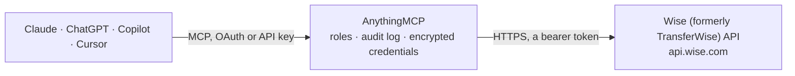

<!-- Generated by scripts/export-github-catalog.mjs in the anythingmcp-website repository. Do not edit by hand. -->

# Wise (formerly TransferWise) MCP connector

Manage international money transfers via the Wise Platform API: list personal and business profiles, view balances, create quotes, list past transfers. The AnythingMCP connector gives Claude, ChatGPT, Microsoft Copilot, Cursor and Gemini 4 MCP tools for Wise (formerly TransferWise): 3 read and 1 can change data.

**Category:** [Banking](../banking.md) · **Tools:** 4 · **Setup guide:** [anythingmcp.com](https://anythingmcp.com/guides/wise-to-mcp) · [Deutsch](https://anythingmcp.com/de/guides/wise-to-mcp) · [Italiano](https://anythingmcp.com/it/guides/wise-to-mcp) · [Español](https://anythingmcp.com/es/guides/wise-to-mcp) · [日本語](https://anythingmcp.com/ja/guides/wise-to-mcp) · [Русский](https://anythingmcp.com/ru/guides/wise-to-mcp) · [中文](https://anythingmcp.com/zh/guides/wise-to-mcp)

## Start without code

No installation and no terminal: AnythingMCP Cloud runs the Wise (formerly TransferWise) connector for you, operated by helpcode.ai in Frankfurt, Germany.

1. **Click the button above** and create an account or sign in. The Wise (formerly TransferWise) connector opens, ready to install.
2. **Paste the API key or token from your Wise (formerly TransferWise) account.** Every click is in the [step-by-step guide](https://anythingmcp.com/guides/wise-to-mcp).
3. **Click Install.** AnythingMCP shows the address of your MCP server.
4. **Add that address to your assistant:** [Claude](https://anythingmcp.com/guides/connect-wise-to-claude) · [ChatGPT](https://anythingmcp.com/guides/connect-wise-to-chatgpt) · [Microsoft Copilot](https://anythingmcp.com/guides/connect-wise-to-copilot) · [Cursor](https://anythingmcp.com/guides/connect-wise-to-cursor) · [Gemini CLI](https://anythingmcp.com/guides/connect-wise-to-gemini) · [Meta Muse](https://anythingmcp.com/guides/connect-wise-to-muse).
5. **Ask your first question**, for example: *Show balances for business profile Nordic Solar Ltd in GBP and EUR for funding reconciliation.*

Prefer help with the setup? [Talk to us](https://anythingmcp.com/contact).

## How it works

- **The AI client** speaks MCP (Streamable HTTP) to AnythingMCP and only sees tool names, descriptions and results. It never gets the Wise (formerly TransferWise) credentials.
- **AnythingMCP** checks the client's role, builds the call from the tool definition, adds the credentials (a bearer token), calls Wise (formerly TransferWise), logs the call and returns the result.
- **Wise (formerly TransferWise)** sees an ordinary API client with the rights of the account the credentials belong to.

## Tools

| Tool | What it does | Access |
|---|---|---|
| [`wise_list_profiles`](#wise_list_profiles) | List all personal and business profiles linked to the API token. | read |
| [`wise_get_balances`](#wise_get_balances) | Get all balances for a profile (one balance per currency held). | read |
| [`wise_create_quote`](#wise_create_quote) | Create a Wise quote for an international transfer. | write |
| [`wise_list_transfers`](#wise_list_transfers) | List past transfers for a profile, with optional filters by status (incoming_payment_waiting, processing, funds_converted, outgoing_payment_sent, cancelled,… | read |

## Tool reference

Every parameter as the AI client sees it in `tools/list`. Source: [`packages/backend/src/adapters/gb/wise.json`](../../../packages/backend/src/adapters/gb/wise.json).

### `wise_list_profiles`

List all personal and business profiles linked to the API token. Returns profile id, type (personal/business), full name or business name, and details object. The profile id is needed for every other Wise tool.

**Access:** read · **Call:** `GET /v2/profiles`

No parameters.

### `wise_get_balances`

Get all balances for a profile (one balance per currency held). Returns balance id, currency, available amount, reserved amount, and the linked bank-details record if any.

**Access:** read · **Call:** `GET /v4/profiles/{profileId}/balances`

| Parameter | Type | Required | Description |
|---|---|---|---|
| `profileId` | string | yes | Wise profile id from wise_list_profiles. |
| `types` | string | no | Comma-separated balance types to include: 'STANDARD' (default), 'SAVINGS'. |

### `wise_create_quote`

Create a Wise quote for an international transfer. Quotes are valid for 30 minutes and contain the live FX rate, fees, and arrival estimate. Specify exactly one of sourceAmount or targetAmount — Wise calculates the other side.

**Access:** write · **Call:** `POST /v3/profiles/{profileId}/quotes`

| Parameter | Type | Required | Description |
|---|---|---|---|
| `profileId` | string | yes | Wise profile id from wise_list_profiles. |
| `sourceCurrency` | string | yes | ISO-4217 source currency code (e.g. 'GBP'). |
| `targetCurrency` | string | yes | ISO-4217 target currency code (e.g. 'EUR'). |
| `sourceAmount` | number | no | Amount to send in source currency. Set EITHER sourceAmount OR targetAmount, not both. |
| `targetAmount` | number | no | Amount to receive in target currency. Set EITHER sourceAmount OR targetAmount, not both. |
| `idempotencyKey` | string | yes | Unique UUID per logical request — Wise uses this to dedupe retries. Required. |

### `wise_list_transfers`

List past transfers for a profile, with optional filters by status (incoming_payment_waiting, processing, funds_converted, outgoing_payment_sent, cancelled, …), creation date range, and source/target currency.

**Access:** read · **Call:** `GET /v1/transfers`

| Parameter | Type | Required | Description |
|---|---|---|---|
| `profile` | string | yes | Wise profile id from wise_list_profiles. |
| `status` | string | no | Filter by transfer status. |
| `sourceCurrency` | string | no | ISO-4217 source currency code. |
| `targetCurrency` | string | no | ISO-4217 target currency code. |
| `createdDateStart` | string | no | ISO-8601 start date (e.g. '2026-01-01T00:00:00.000Z'). |
| `createdDateEnd` | string | no | ISO-8601 end date. |
| `limit` | number | no | Max results (default 100). |

## Run it yourself

AnythingMCP is open source (AGPL-3.0). [Run it with Docker](../../../README.md#run-it-yourself), open **Connectors → Store**, pick **Wise (formerly TransferWise)** and enter `WISE_API_TOKEN`, then add your MCP server URL to the AI client.

[← Banking connectors](../banking.md) · [All categories](../README.md)
