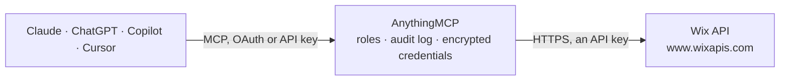

<!-- Generated by scripts/export-github-catalog.mjs in the anythingmcp-website repository. Do not edit by hand. -->

# Wix MCP connector

Wix website and online business: site details, Wix Stores products, eCommerce orders, contacts, Wix Bookings appointments and services, and blog posts. The AnythingMCP connector gives Claude, ChatGPT, Microsoft Copilot, Cursor and Gemini 16 MCP tools for Wix: 15 read and 1 can change data.

**Category:** [E-commerce](../e-commerce.md) · **Tools:** 16 · **Setup guide:** [anythingmcp.com](https://anythingmcp.com/guides/wix-to-mcp) · [Deutsch](https://anythingmcp.com/de/guides/wix-to-mcp) · [Italiano](https://anythingmcp.com/it/guides/wix-to-mcp) · [Español](https://anythingmcp.com/es/guides/wix-to-mcp) · [日本語](https://anythingmcp.com/ja/guides/wix-to-mcp) · [Русский](https://anythingmcp.com/ru/guides/wix-to-mcp) · [中文](https://anythingmcp.com/zh/guides/wix-to-mcp)

## Start without code

No installation and no terminal: AnythingMCP Cloud runs the Wix connector for you, operated by helpcode.ai in Frankfurt, Germany.

1. **Click the button above** and create an account or sign in. The Wix connector opens, ready to install.
2. **Paste the API key or token from your Wix account.** Every click is in the [step-by-step guide](https://anythingmcp.com/guides/wix-to-mcp).
3. **Click Install.** AnythingMCP shows the address of your MCP server.
4. **Add that address to your assistant:** [Claude](https://anythingmcp.com/guides/connect-wix-to-claude) · [ChatGPT](https://anythingmcp.com/guides/connect-wix-to-chatgpt) · [Microsoft Copilot](https://anythingmcp.com/guides/connect-wix-to-copilot) · [Cursor](https://anythingmcp.com/guides/connect-wix-to-cursor) · [Gemini CLI](https://anythingmcp.com/guides/connect-wix-to-gemini) · [Meta Muse](https://anythingmcp.com/guides/connect-wix-to-muse).
5. **Ask your first question**, for example: *What's the status and buyer for order number ORD-2026-3942, and is it ready to ship?*

Prefer help with the setup? [Talk to us](https://anythingmcp.com/contact).

## How it works

- **The AI client** speaks MCP (Streamable HTTP) to AnythingMCP and only sees tool names, descriptions and results. It never gets the Wix credentials.
- **AnythingMCP** checks the client's role, builds the call from the tool definition, adds the credentials (an API key), calls Wix, logs the call and returns the result.
- **Wix** sees an ordinary API client with the rights of the account the credentials belong to.

## Tools

| Tool | What it does | Access |
|---|---|---|
| [`wix_get_site_properties`](#wix_get_site_properties) | Get the site's business information: business and display name, description, email, phone, address, logo, locale, language, currency, time zone, opening… | read |
| [`wix_list_site_urls`](#wix_list_site_urls) | List the site's published URLs, marking the primary domain and any language subdomains. | read |
| [`wix_get_catalog_version`](#wix_get_catalog_version) | Tell which Wix Stores catalog the site runs: V3_CATALOG (use wix_search_products and wix_get_product), V1_CATALOG (use wix_query_products_v1 and… | read |
| [`wix_search_products`](#wix_search_products) | Search the products of a Wix Stores catalog V3 site by free text (name, description, SKU...) and filters such as visibility, product type, brand, category,… | read |
| [`wix_get_product`](#wix_get_product) | Get one product of a Wix Stores catalog V3 site with its options, variants (SKU, price, stock status), media and inventory, by product id. | read |
| [`wix_query_products_v1`](#wix_query_products_v1) | List products of a site still on Wix Stores catalog V1, with paging, filtering and sorting; optionally with variants and hidden products. | read |
| [`wix_get_product_v1`](#wix_get_product_v1) | Get one product of a site on Wix Stores catalog V1 by id: name, price, SKU, stock, options, variants, media and collections. | read |
| [`wix_search_orders`](#wix_search_orders) | Search eCommerce orders of the site (Stores, Bookings, Events and other Wix apps), newest first by default, with filters such as status, payment or… | read |
| [`wix_get_order`](#wix_get_order) | Get one eCommerce order by id: number, status, payment and fulfillment status, line items, buyer and contact details, billing and shipping info, price… | read |
| [`wix_query_contacts`](#wix_query_contacts) | List the contacts of the site (customers, members, form leads) with filters on name, email, phone, company, labels or dates, sorted and paged. | read |
| [`wix_get_contact`](#wix_get_contact) | Get one contact by id with names, emails, phones, addresses, company, labels, source and last activity. | read |
| [`wix_create_contact`](#wix_create_contact) | Create a contact in the site's contact list. | write |
| [`wix_query_bookings`](#wix_query_bookings) | List Wix Bookings appointments and class bookings with the booked service, session time, contact details, number of participants, status and payment status. | read |
| [`wix_query_booking_services`](#wix_query_booking_services) | List the services offered with Wix Bookings (appointments, classes, courses) with name, type, description, price and payment options, staff, locations,… | read |
| [`wix_query_blog_posts`](#wix_query_blog_posts) | List published Wix Blog posts, newest first with pinned posts on top, filtered by title, slug, category, tag, hashtag, featured flag, language or date. | read |
| [`wix_get_blog_post`](#wix_get_blog_post) | Get one published blog post by id with title, excerpt, author, categories, tags and dates; add field sets for the URL, full text, SEO data or metrics. | read |

## Tool reference

Every parameter as the AI client sees it in `tools/list`. Source: [`packages/backend/src/adapters/intl/wix.json`](../../../packages/backend/src/adapters/intl/wix.json).

### `wix_get_site_properties`

Get the site's business information: business and display name, description, email, phone, address, logo, locale, language, currency, time zone, opening hours, categories and the business type (store, restaurant, blog, events...).

**Access:** read · **Call:** `GET /site-properties/v4/properties`

No parameters.

### `wix_list_site_urls`

List the site's published URLs, marking the primary domain and any language subdomains. Empty when the site is not published.

**Access:** read · **Call:** `GET /urls-server/v2/published-site-urls`

No parameters.

### `wix_get_catalog_version`

Tell which Wix Stores catalog the site runs: V3_CATALOG (use wix_search_products and wix_get_product), V1_CATALOG (use wix_query_products_v1 and wix_get_product_v1) or STORES_NOT_INSTALLED. The two catalog APIs do not work on each other's sites.

**Access:** read · **Call:** `GET /stores/v3/provision/version`

No parameters.

### `wix_search_products`

Search the products of a Wix Stores catalog V3 site by free text (name, description, SKU...) and filters such as visibility, product type, brand, category, inventory status or price range. Returns up to 100 products per page without variant details; use wix_get_product for variants.

**Access:** read · **Call:** `POST /stores/v3/products/search`

| Parameter | Type | Required | Description |
|---|---|---|---|
| `search_text` | string | no | Free text to look for. Needs search_fields. |
| `search_fields` | string[] | no | Fields the text is searched in, required with search_text: name, description, minVariantPriceInfo.sku, variantsInfo.variants.sku, variantsInfo.variants.barcode. |
| `filter` | object | no | Filter in the Wix API query language, e.g. {"field": "value"} or {"field": {"$gte": "..."}}; combine with $and / $or. Filterable fields: id, slug, handle, visible, visibleInPos, productType (PHYSICAL, DIGITAL), brand.name, ribbon.name, inventory.availabilityStatus, allCategoriesInfo.categories, actualPriceRange.minValue.amount, actualPriceRange.maxValue.amount, createdDate, updatedDate. |
| `sort` | object[] | no | Sort order, e.g. [{"fieldName": "name", "order": "ASC"}]. Sortable: name, createdDate, updatedDate, actualPriceRange.minValue.amount, actualPriceRange.maxValue.amount. |
| `fields` | `URL` \| `CURRENCY` \| `PLAIN_DESCRIPTION` \| `THUMBNAIL` \| `MEDIA_ITEMS_INFO` \| `BREADCRUMBS_INFO` \| `DIRECT_CATEGORIES_INFO` \| `ALL_CATEGORIES_INFO` \| `INFO_SECTION` \| `MERCHANT_DATA` \| `WEIGHT_MEASUREMENT_UNIT_INFO` \| `MIN_PRICE_VARIANT` \| `DISCOUNT_INFO`[] | no | Extra fields to include, e.g. URL, CURRENCY, PLAIN_DESCRIPTION. MERCHANT_DATA (cost and margin) needs the admin product scope. |
| `limit` | integer | no | Items per page, at most 100. |
| `cursor` | string | no | pagingMetadata.cursors.next from the previous answer, to read the next page. When set, send no filter or sort. |

### `wix_get_product`

Get one product of a Wix Stores catalog V3 site with its options, variants (SKU, price, stock status), media and inventory, by product id.

**Access:** read · **Call:** `GET /stores/v3/products/{product_id}`

| Parameter | Type | Required | Description |
|---|---|---|---|
| `product_id` | string | yes | Product id (UUID) from wix_search_products. |
| `fields` | `URL` \| `CURRENCY` \| `PLAIN_DESCRIPTION` \| `DESCRIPTION` \| `THUMBNAIL` \| `MEDIA_ITEMS_INFO` \| `BREADCRUMBS_INFO` \| `DIRECT_CATEGORIES_INFO` \| `ALL_CATEGORIES_INFO` \| `INFO_SECTION` \| `INFO_SECTION_PLAIN_DESCRIPTION` \| `MERCHANT_DATA` \| `VARIANT_OPTION_CHOICE_NAMES` \| `WEIGHT_MEASUREMENT_UNIT_INFO` \| `SUBSCRIPTION_PRICES_INFO`[] | no | Extra fields to include, e.g. VARIANT_OPTION_CHOICE_NAMES, PLAIN_DESCRIPTION, URL, CURRENCY. |

### `wix_query_products_v1`

List products of a site still on Wix Stores catalog V1, with paging, filtering and sorting; optionally with variants and hidden products. Only for sites where wix_get_catalog_version answers V1_CATALOG.

**Access:** read · **Call:** `POST /stores-reader/v1/products/query`

| Parameter | Type | Required | Description |
|---|---|---|---|
| `filter` | string | no | Filter as a JSON string, e.g. "{\"name\": {\"$startsWith\": \"Mug\"}}" or "{\"collections.id\": {\"$hasSome\": [\"<collection id>\"]}}". |
| `sort` | string | no | Sort as a JSON string, e.g. "[{\"price\": \"desc\"}]". |
| `limit` | integer | no | Items per page, at most 100. |
| `offset` | integer | no | Products to skip, for paging. |
| `include_variants` | boolean | no | Include variants in the answer. |
| `include_hidden_products` | boolean | no | Include hidden and draft products, which are left out silently otherwise. |

### `wix_get_product_v1`

Get one product of a site on Wix Stores catalog V1 by id: name, price, SKU, stock, options, variants, media and collections.

**Access:** read · **Call:** `GET /stores-reader/v1/products/{product_id}`

| Parameter | Type | Required | Description |
|---|---|---|---|
| `product_id` | string | yes | Product id from wix_query_products_v1. |
| `include_merchant_specific_data` | boolean | no | Include cost and profit data. |

### `wix_search_orders`

Search eCommerce orders of the site (Stores, Bookings, Events and other Wix apps), newest first by default, with filters such as status, payment or fulfillment status, buyer email, order number, total or date. Returns full orders with line items, buyer, addresses and totals.

**Access:** read · **Call:** `POST /ecom/v1/orders/search`

| Parameter | Type | Required | Description |
|---|---|---|---|
| `filter` | object | no | Filter in the Wix API query language, e.g. {"field": "value"} or {"field": {"$gte": "..."}}; combine with $and / $or. Filterable fields: status (APPROVED, CANCELED, PENDING, REJECTED), paymentStatus (NOT_PAID, PAID, PARTIALLY_REFUNDED, FULLY_REFUNDED, PENDING...), fulfillmentStatus (NOT_FULFILLED, FULFILLED, PARTIALLY_FULFILLED), number, buyerInfo.email, buyerInfo.contactId, createdDate, updatedDate, purchasedDate, priceSummary.total.amount, archived, channelInfo.type, lineItems.productName.original ($hasSome). |
| `sort` | object[] | no | Sort order, default [{"fieldName": "createdDate", "order": "DESC"}]. Also sortable: number, purchasedDate, updatedDate, status. |
| `limit` | integer | no | Items per page, at most 100. |
| `cursor` | string | no | pagingMetadata.cursors.next from the previous answer, to read the next page. When set, send no filter or sort. |

### `wix_get_order`

Get one eCommerce order by id: number, status, payment and fulfillment status, line items, buyer and contact details, billing and shipping info, price summary, applied discounts and activity history.

**Access:** read · **Call:** `GET /ecom/v1/orders/{order_id}`

| Parameter | Type | Required | Description |
|---|---|---|---|
| `order_id` | string | yes | Order id (UUID) from wix_search_orders, not the order number. |

### `wix_query_contacts`

List the contacts of the site (customers, members, form leads) with filters on name, email, phone, company, labels or dates, sorted and paged. Returns up to 1,000 contacts per page.

**Access:** read · **Call:** `POST /contacts/v4/contacts/query`

| Parameter | Type | Required | Description |
|---|---|---|---|
| `filter` | object | no | Filter in the Wix API query language, e.g. {"field": "value"} or {"field": {"$gte": "..."}}; combine with $and / $or. Filterable fields: info.name.first, info.name.last, primaryInfo.email, primaryInfo.phone, info.company, info.jobTitle, info.labelKeys ($hasSome), info.emails.email, info.locale, createdDate, updatedDate, lastActivity.activityDate. Text fields also take $startsWith. |
| `sort` | object[] | no | One sort object. Sortable: createdDate, lastActivity.activityDate, primaryInfo.email, info.name.first, info.name.last, info.company, info.jobTitle, info.birthdate. |
| `fieldsets` | `BASIC` \| `COMMUNICATION_DETAILS` \| `EXTENDED` \| `FULL`[] | no | BASIC (name, primary email and phone), COMMUNICATION_DETAILS (all emails, phones, addresses), EXTENDED (adds extended fields such as amount spent), FULL. |
| `limit` | integer | no | Contacts per page, default 50, max 1000. |
| `offset` | integer | no | Contacts to skip, for paging. |

### `wix_get_contact`

Get one contact by id with names, emails, phones, addresses, company, labels, source and last activity.

**Access:** read · **Call:** `GET /contacts/v4/contacts/{contact_id}`

| Parameter | Type | Required | Description |
|---|---|---|---|
| `contact_id` | string | yes | Contact id (UUID) from wix_query_contacts or an order or booking. |
| `fieldsets` | `BASIC` \| `COMMUNICATION_DETAILS` \| `EXTENDED` \| `FULL`[] | no | Field sets to return; FULL by default. |

### `wix_create_contact`

Create a contact in the site's contact list. info needs at least a name, an email or a phone. By default the call fails when the email or phone already belongs to another contact.

**Access:** write · **Call:** `POST /contacts/v4/contacts`

| Parameter | Type | Required | Description |
|---|---|---|---|
| `info` | object | yes | Contact details. |
| `allow_duplicates` | boolean | no | Create the contact even if the email or phone is already used by another contact. |

### `wix_query_bookings`

List Wix Bookings appointments and class bookings with the booked service, session time, contact details, number of participants, status and payment status. Filter by start or end date (UTC), service, contact, status or payment status.

**Access:** read · **Call:** `POST /bookings/bookings-reader/v2/extended-bookings/query`

| Parameter | Type | Required | Description |
|---|---|---|---|
| `filter` | object | no | Filter in the Wix API query language, e.g. {"field": "value"} or {"field": {"$gte": "..."}}; combine with $and / $or. Filterable fields: startDate, endDate, createdDate (all UTC, $gte/$lt...), status (CREATED, CONFIRMED, CANCELED, PENDING, DECLINED, WAITING_LIST), paymentStatus, contactDetails.contactId, contactDetails.email, bookedEntity.item.slot.serviceId, bookedEntity.item.schedule.serviceId, bookedEntity.item.slot.sessionId. Include startDate for fast answers. |
| `sort` | object[] | no | Sort order, e.g. [{"fieldName": "createdDate", "order": "DESC"}]. |
| `limit` | integer | no | Items per page, at most 100. |
| `cursor` | string | no | pagingMetadata.cursors.next from the previous answer, to read the next page. When set, send no filter or sort. |

### `wix_query_booking_services`

List the services offered with Wix Bookings (appointments, classes, courses) with name, type, description, price and payment options, staff, locations, category and whether online booking is on.

**Access:** read · **Call:** `POST /bookings/v2/services/query`

| Parameter | Type | Required | Description |
|---|---|---|---|
| `filter` | object | no | Filter in the Wix API query language, e.g. {"field": "value"} or {"field": {"$gte": "..."}}; combine with $and / $or. Filterable fields: name, type (APPOINTMENT, CLASS, COURSE), hidden, category.name, category.id, staffMemberIds ($hasSome), onlineBooking.enabled, payment.options.online, locations.business.id. |
| `sort` | object[] | no | Sort order, e.g. [{"fieldName": "createdDate", "order": "DESC"}]. |
| `limit` | integer | no | Items per page, at most 100. |
| `offset` | integer | no | Services to skip, for paging. |

### `wix_query_blog_posts`

List published Wix Blog posts, newest first with pinned posts on top, filtered by title, slug, category, tag, hashtag, featured flag, language or date. Optional field sets add the post URL, plain text content, SEO data or view, like and comment counts.

**Access:** read · **Call:** `POST /blog/v3/posts/query`

| Parameter | Type | Required | Description |
|---|---|---|---|
| `filter` | object | no | Filter in the Wix API query language, e.g. {"field": "value"} or {"field": {"$gte": "..."}}; combine with $and / $or. Filterable fields: title ($startsWith), slug, firstPublishedDate, lastPublishedDate, featured, pinned, categoryIds ($hasSome), tagIds ($hasSome), hashtags ($hasSome), memberId, language, metrics.views, metrics.likes, metrics.comments. |
| `sort` | object[] | no | Sort order, e.g. [{"fieldName": "metrics.views", "order": "DESC"}]. Sortable: title, firstPublishedDate, lastPublishedDate, featured, pinned, metrics.views, metrics.likes, metrics.comments. |
| `fieldsets` | `URL` \| `CONTENT_TEXT` \| `METRICS` \| `SEO` \| `CONTACT_ID` \| `RICH_CONTENT` \| `REFERENCE_ID`[] | no | Extra fields to include, e.g. URL, METRICS, CONTENT_TEXT. |
| `limit` | integer | no | Items per page, at most 100. |
| `cursor` | string | no | pagingMetadata.cursors.next from the previous answer, to read the next page. When set, send no filter or sort. |

### `wix_get_blog_post`

Get one published blog post by id with title, excerpt, author, categories, tags and dates; add field sets for the URL, full text, SEO data or metrics.

**Access:** read · **Call:** `GET /blog/v3/posts/{post_id}`

| Parameter | Type | Required | Description |
|---|---|---|---|
| `post_id` | string | yes | Post id from wix_query_blog_posts. |
| `fieldsets` | `URL` \| `CONTENT_TEXT` \| `METRICS` \| `SEO` \| `CONTACT_ID` \| `RICH_CONTENT` \| `REFERENCE_ID`[] | no | Extra fields to include. |

## Run it yourself

AnythingMCP is open source (AGPL-3.0). [Run it with Docker](../../../README.md#run-it-yourself), open **Connectors → Store**, pick **Wix** and enter `WIX_API_KEY`, `WIX_SITE_ID`, then add your MCP server URL to the AI client.

[← E-commerce connectors](../e-commerce.md) · [All categories](../README.md)
