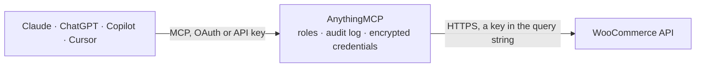

<!-- Generated by scripts/export-github-catalog.mjs in the anythingmcp-website repository. Do not edit by hand. -->

# WooCommerce MCP connector

AI-native commerce operations for any WooCommerce store. The AnythingMCP connector gives Claude, ChatGPT, Microsoft Copilot, Cursor and Gemini 49 MCP tools for WooCommerce: 30 read and 19 can change data.

**Category:** [E-commerce](../e-commerce.md) · **Tools:** 49 · **Setup guide:** [anythingmcp.com](https://anythingmcp.com/guides/woocommerce-to-mcp) · [Deutsch](https://anythingmcp.com/de/guides/woocommerce-to-mcp) · [Italiano](https://anythingmcp.com/it/guides/woocommerce-to-mcp) · [Español](https://anythingmcp.com/es/guides/woocommerce-to-mcp) · [日本語](https://anythingmcp.com/ja/guides/woocommerce-to-mcp) · [Русский](https://anythingmcp.com/ru/guides/woocommerce-to-mcp) · [中文](https://anythingmcp.com/zh/guides/woocommerce-to-mcp)

## Start without code

No installation and no terminal: AnythingMCP Cloud runs the WooCommerce connector for you, operated by helpcode.ai in Frankfurt, Germany.

1. **Click the button above** and create an account or sign in. The WooCommerce connector opens, ready to install.
2. **Paste the API key or token from your WooCommerce account.** Every click is in the [step-by-step guide](https://anythingmcp.com/guides/woocommerce-to-mcp).
3. **Click Install.** AnythingMCP shows the address of your MCP server.
4. **Add that address to your assistant:** [Claude](https://anythingmcp.com/guides/connect-woocommerce-to-claude) · [ChatGPT](https://anythingmcp.com/guides/connect-woocommerce-to-chatgpt) · [Microsoft Copilot](https://anythingmcp.com/guides/connect-woocommerce-to-copilot) · [Cursor](https://anythingmcp.com/guides/connect-woocommerce-to-cursor) · [Gemini CLI](https://anythingmcp.com/guides/connect-woocommerce-to-gemini) · [Meta Muse](https://anythingmcp.com/guides/connect-woocommerce-to-muse).
5. **Ask your first question**, for example: *What is the status, date and total for order WC-2026-417? I need the invoice details for month-end.*

Prefer help with the setup? [Talk to us](https://anythingmcp.com/contact).

## How it works

- **The AI client** speaks MCP (Streamable HTTP) to AnythingMCP and only sees tool names, descriptions and results. It never gets the WooCommerce credentials.
- **AnythingMCP** checks the client's role, builds the call from the tool definition, adds the credentials (a key in the query string), calls WooCommerce, logs the call and returns the result.
- **WooCommerce** sees an ordinary API client with the rights of the account the credentials belong to.

## Tools

| Tool | What it does | Access |
|---|---|---|
| [`woocommerce_search_products`](#woocommerce_search_products) | Search/list products with rich filters — keyword (`search`), SKU, status, type (simple/variable/grouped/external), stock_status, on_sale, price range,… | read |
| [`woocommerce_get_product`](#woocommerce_get_product) | Get a single product by id, including all fields: name, slug, description, short_description, sku, price/regular_price/sale_price, stock_quantity,… | read |
| [`woocommerce_create_product`](#woocommerce_create_product) | Create a product. | write |
| [`woocommerce_update_product`](#woocommerce_update_product) | Partial-update a product by id. | write |
| [`woocommerce_delete_product`](#woocommerce_delete_product) | Move a product to trash, or pass `force=true` to delete permanently (cannot be undone). | write |
| [`woocommerce_batch_update_products`](#woocommerce_batch_update_products) | Bulk create / update / delete products in a single call. | write |
| [`woocommerce_list_product_variations`](#woocommerce_list_product_variations) | List variations for a variable product. | read |
| [`woocommerce_update_product_variation`](#woocommerce_update_product_variation) | Update a single variation of a variable product — price, SKU, stock, attributes. | write |
| [`woocommerce_list_product_categories`](#woocommerce_list_product_categories) | List product categories. | read |
| [`woocommerce_create_product_category`](#woocommerce_create_product_category) | Create a product category. | write |
| [`woocommerce_list_product_tags`](#woocommerce_list_product_tags) | List product tags. | read |
| [`woocommerce_list_product_attributes`](#woocommerce_list_product_attributes) | List the global attribute definitions configured for the store (e.g. Size, Colour). | read |
| [`woocommerce_find_low_stock`](#woocommerce_find_low_stock) | Find products that are out of stock OR have `manage_stock=true` with `stock_quantity` at/below `threshold`. | read |
| [`woocommerce_update_stock`](#woocommerce_update_stock) | Convenience wrapper over `update_product`: enables stock management and sets quantity + status in one call. | write |
| [`woocommerce_list_orders`](#woocommerce_list_orders) | List orders with status, date, customer, and product filters. | read |
| [`woocommerce_get_order`](#woocommerce_get_order) | Get a single order by id — full payload incl. | read |
| [`woocommerce_update_order_status`](#woocommerce_update_order_status) | Set an order's status (e.g. processing → completed, on-hold → cancelled). | write |
| [`woocommerce_add_order_note`](#woocommerce_add_order_note) | Add a note to an order. | write |
| [`woocommerce_list_refunds`](#woocommerce_list_refunds) | List refunds attached to an order. | read |
| [`woocommerce_create_refund`](#woocommerce_create_refund) | Create a refund against an order. | write |
| [`woocommerce_list_customers`](#woocommerce_list_customers) | List customers. | read |
| [`woocommerce_get_customer`](#woocommerce_get_customer) | Get a customer by id (includes billing/shipping addresses, order count, total spent, last_order info). | read |
| [`woocommerce_sales_report`](#woocommerce_sales_report) | Sales report for a date window or named period. | read |
| [`woocommerce_top_sellers_report`](#woocommerce_top_sellers_report) | Top-selling products for a date window or named period. | read |
| [`woocommerce_coupons_totals_report`](#woocommerce_coupons_totals_report) | Coupon counts grouped by discount type (percent \| fixed_cart \| fixed_product). | read |
| [`woocommerce_orders_totals_report`](#woocommerce_orders_totals_report) | Counts of orders grouped by status (pending, processing, completed, ...). | read |
| [`woocommerce_update_customer`](#woocommerce_update_customer) | Partial-update a customer by id. | write |
| [`woocommerce_delete_customer`](#woocommerce_delete_customer) | Permanently delete a customer. | write |
| [`woocommerce_create_customer`](#woocommerce_create_customer) | Create a customer account. | write |
| [`woocommerce_create_order`](#woocommerce_create_order) | Create an order. | write |
| [`woocommerce_delete_order`](#woocommerce_delete_order) | Move an order to trash, or pass `force=true` to delete permanently. | write |
| [`woocommerce_list_order_notes`](#woocommerce_list_order_notes) | List notes attached to an order (both internal admin notes and customer-visible notes). | read |
| [`woocommerce_get_order_note`](#woocommerce_get_order_note) | Retrieve a single order note by id. | read |
| [`woocommerce_delete_order_note`](#woocommerce_delete_order_note) | Delete an order note. | write |
| [`woocommerce_list_coupons`](#woocommerce_list_coupons) | List discount coupons in the store. | read |
| [`woocommerce_create_coupon`](#woocommerce_create_coupon) | Create a discount coupon. | write |
| [`woocommerce_get_coupon`](#woocommerce_get_coupon) | Get a single coupon by id, including full usage stats (`usage_count`, `used_by` array). | read |
| [`woocommerce_update_coupon`](#woocommerce_update_coupon) | Partial-update a coupon. | write |
| [`woocommerce_delete_coupon`](#woocommerce_delete_coupon) | Move a coupon to trash, or pass `force=true` to delete permanently. | write |
| [`woocommerce_list_order_status_options`](#woocommerce_list_order_status_options) | Reference card: valid order status slugs. | read |
| [`woocommerce_list_product_type_options`](#woocommerce_list_product_type_options) | Reference card: valid `type` values for `woocommerce_create_product` / `woocommerce_update_product` and product type filter on search. | read |
| [`woocommerce_list_stock_status_options`](#woocommerce_list_stock_status_options) | Reference card: valid `stock_status` values for product create/update + list filter. | read |
| [`woocommerce_list_report_period_options`](#woocommerce_list_report_period_options) | Reference card: valid `period` values for `woocommerce_sales_report` and `woocommerce_top_sellers_report`. | read |
| [`woocommerce_skill_inventory_optimization`](#woocommerce_skill_inventory_optimization) | Skill recipe: find out-of-stock and low-stock products, cross-reference with demand (top sellers), and bulk-bump stock via batch update. | read |
| [`woocommerce_skill_product_seo_optimization`](#woocommerce_skill_product_seo_optimization) | Skill recipe: optimise a product's name, description, slug, and Yoast/Rank Math SEO meta. | read |
| [`woocommerce_skill_upsell_cross_sell`](#woocommerce_skill_upsell_cross_sell) | Skill recipe: build upsell + cross-sell relationships for a product based on category, price tier, and tags. | read |
| [`woocommerce_skill_low_conversion_analysis`](#woocommerce_skill_low_conversion_analysis) | Skill recipe: identify products visible in the catalogue but not selling, with an honest framing of what WooCommerce REST can and cannot measure. | read |
| [`woocommerce_skill_abandoned_order_triage`](#woocommerce_skill_abandoned_order_triage) | Skill recipe: process stuck orders (pending / on-hold / failed) — chase or cancel based on age and reason. | read |
| [`woocommerce_skill_revenue_kpi_snapshot`](#woocommerce_skill_revenue_kpi_snapshot) | Skill recipe: build a one-page KPI snapshot — revenue, AOV, top sellers, pipeline state, coupon mix. | read |

## Tool reference

Every parameter as the AI client sees it in `tools/list`. Source: [`packages/backend/src/adapters/intl/woocommerce.json`](../../../packages/backend/src/adapters/intl/woocommerce.json).

### `woocommerce_search_products`

Search/list products with rich filters — keyword (`search`), SKU, status, type (simple/variable/grouped/external), stock_status, on_sale, price range, category, tag, featured. Paginate with `page` + `per_page` (max 100).

**Access:** read · **Call:** `GET /products`

| Parameter | Type | Required | Description |
|---|---|---|---|
| `page` | integer | no | 1-based page. |
| `per_page` | integer | no | 1-100. |
| `search` | string | no | Free-text search across product name/description/SKU. |
| `sku` | string | no | Filter by exact SKU. |
| `slug` | string | no | Filter by exact slug. |
| `status` | string | no | any \| draft \| pending \| private \| publish. Default: publish. |
| `type` | string | no | simple \| grouped \| external \| variable. |
| `category` | string | no | Category term id. |
| `tag` | string | no | Tag term id. |
| `stock_status` | string | no | instock \| outofstock \| onbackorder. |
| `on_sale` | boolean | no |  |
| `featured` | boolean | no |  |
| `min_price` | string | no | Decimal as string. |
| `max_price` | string | no | Decimal as string. |
| `orderby` | string | no | date \| id \| include \| title \| slug \| price \| popularity \| rating \| menu_order. |
| `order` | string | no | asc \| desc. |

### `woocommerce_get_product`

Get a single product by id, including all fields: name, slug, description, short_description, sku, price/regular_price/sale_price, stock_quantity, stock_status, categories, tags, images, attributes, variations array (for variable products), upsell_ids, cross_sell_ids, meta_data.

**Access:** read · **Call:** `GET /products/{productId}`

| Parameter | Type | Required | Description |
|---|---|---|---|
| `productId` | integer | yes | Product id. |

### `woocommerce_create_product`

Create a product. Minimal required: `name`. For variable products set `type=variable` and add variations via `woocommerce_create_product_variation` after creation. Pass `meta_data` array for Yoast / Rank Math SEO keys.

**Access:** write · **Call:** `POST /products`

| Parameter | Type | Required | Description |
|---|---|---|---|
| `name` | string | yes |  |
| `slug` | string | no |  |
| `type` | string | no | simple \| grouped \| external \| variable. Default: simple. |
| `status` | string | no | publish \| draft \| pending \| private. |
| `featured` | boolean | no |  |
| `catalog_visibility` | string | no | visible \| catalog \| search \| hidden. |
| `description` | string | no | Long description (HTML). |
| `short_description` | string | no | Short description (HTML). |
| `sku` | string | no |  |
| `regular_price` | string | no | Decimal as string. |
| `sale_price` | string | no |  |
| `manage_stock` | boolean | no |  |
| `stock_quantity` | integer | no |  |
| `stock_status` | string | no | instock \| outofstock \| onbackorder. |
| `backorders` | string | no | no \| notify \| yes. |
| `weight` | string | no |  |
| `dimensions` | object | no | { length, width, height } — strings (cm or per store unit). |
| `categories` | object[] | no | Array of { id }. |
| `tags` | object[] | no | Array of { id }. |
| `images` | object[] | no | Array of { id } (existing media) or { src } (URL — WC will sideload). First image = featured. |
| `attributes` | object[] | no | Product attributes — see WC REST docs. |
| `upsell_ids` | integer[] | no | Product IDs to show as upsells. |
| `cross_sell_ids` | integer[] | no | Product IDs to show as cross-sells. |
| `meta_data` | object[] | no | Array of { key, value } — for Yoast/Rank Math SEO keys. |

### `woocommerce_update_product`

Partial-update a product by id. Only fields you pass are touched. Use for single-product edits; for bulk use `woocommerce_batch_update_products`.

**Access:** write · **Call:** `PUT /products/{productId}`

| Parameter | Type | Required | Description |
|---|---|---|---|
| `productId` | integer | yes |  |
| `name` | string | no |  |
| `slug` | string | no |  |
| `type` | string | no | simple \| grouped \| external \| variable. |
| `status` | string | no |  |
| `featured` | boolean | no |  |
| `catalog_visibility` | string | no | visible \| catalog \| search \| hidden. |
| `description` | string | no |  |
| `short_description` | string | no |  |
| `sku` | string | no |  |
| `regular_price` | string | no |  |
| `sale_price` | string | no |  |
| `manage_stock` | boolean | no |  |
| `stock_quantity` | integer | no |  |
| `stock_status` | string | no |  |
| `backorders` | string | no |  |
| `weight` | string | no |  |
| `dimensions` | object | no | { length, width, height } — strings (cm or per store unit). |
| `categories` | object[] | no |  |
| `tags` | object[] | no |  |
| `images` | object[] | no |  |
| `attributes` | object[] | no |  |
| `upsell_ids` | integer[] | no |  |
| `cross_sell_ids` | integer[] | no |  |
| `meta_data` | object[] | no |  |

### `woocommerce_delete_product`

Move a product to trash, or pass `force=true` to delete permanently (cannot be undone).

**Access:** write · **Call:** `DELETE /products/{productId}`

| Parameter | Type | Required | Description |
|---|---|---|---|
| `productId` | integer | yes |  |
| `force` | boolean | no | true = permanent delete; false (default) = move to trash. |

### `woocommerce_batch_update_products`

Bulk create / update / delete products in a single call. WooCommerce allows up to 100 entries per array. Best primitive for inventory bumps, SEO refresh waves, or category re-tags.

**Access:** write · **Call:** `POST /products/batch`

| Parameter | Type | Required | Description |
|---|---|---|---|
| `create` | object[] | no | Array of product objects to create. |
| `update` | object[] | no | Array of product objects — each MUST include an `id` field. |
| `delete` | integer[] | no | Array of product IDs to delete. |

### `woocommerce_list_product_variations`

List variations for a variable product. Returns id, sku, price, stock_quantity, attributes per variation.

**Access:** read · **Call:** `GET /products/{productId}/variations`

| Parameter | Type | Required | Description |
|---|---|---|---|
| `productId` | integer | yes | Parent (variable) product id. |
| `page` | integer | no |  |
| `per_page` | integer | no |  |
| `search` | string | no |  |
| `stock_status` | string | no |  |
| `on_sale` | boolean | no |  |

### `woocommerce_update_product_variation`

Update a single variation of a variable product — price, SKU, stock, attributes.

**Access:** write · **Call:** `PUT /products/{productId}/variations/{variationId}`

| Parameter | Type | Required | Description |
|---|---|---|---|
| `productId` | integer | yes | Parent product id. |
| `variationId` | integer | yes | Variation id. |
| `sku` | string | no |  |
| `regular_price` | string | no |  |
| `sale_price` | string | no |  |
| `manage_stock` | boolean | no |  |
| `stock_quantity` | integer | no |  |
| `stock_status` | string | no |  |
| `weight` | string | no |  |
| `meta_data` | object[] | no |  |

### `woocommerce_list_product_categories`

List product categories. Returns id, name, slug, parent, count.

**Access:** read · **Call:** `GET /products/categories`

| Parameter | Type | Required | Description |
|---|---|---|---|
| `page` | integer | no |  |
| `per_page` | integer | no |  |
| `search` | string | no |  |
| `parent` | integer | no |  |
| `hide_empty` | boolean | no |  |
| `orderby` | string | no |  |
| `order` | string | no |  |

### `woocommerce_create_product_category`

Create a product category.

**Access:** write · **Call:** `POST /products/categories`

| Parameter | Type | Required | Description |
|---|---|---|---|
| `name` | string | yes |  |
| `slug` | string | no |  |
| `parent` | integer | no |  |
| `description` | string | no |  |
| `display` | string | no | default \| products \| subcategories \| both. |
| `image` | object | no | { id } or { src } for the category image. |

### `woocommerce_list_product_tags`

List product tags.

**Access:** read · **Call:** `GET /products/tags`

| Parameter | Type | Required | Description |
|---|---|---|---|
| `page` | integer | no |  |
| `per_page` | integer | no |  |
| `search` | string | no |  |
| `hide_empty` | boolean | no |  |
| `orderby` | string | no |  |
| `order` | string | no |  |

### `woocommerce_list_product_attributes`

List the global attribute definitions configured for the store (e.g. Size, Colour). Needed when building variable products.

**Access:** read · **Call:** `GET /products/attributes`

No parameters.

### `woocommerce_find_low_stock`

Find products that are out of stock OR have `manage_stock=true` with `stock_quantity` at/below `threshold`. Pages through the catalog using `per_page` (max 100) and the supplied `page`. Returns the raw `/products` page filtered by stock status — combine with the agent's own threshold check on `stock_quantity` if needed. For the simple case, set `stock_status=outofstock` or `stock_status=onbackorder`.

**Access:** read · **Call:** `GET /products`

| Parameter | Type | Required | Description |
|---|---|---|---|
| `stock_status` | string | no | outofstock \| onbackorder \| instock. Default: outofstock. |
| `page` | integer | no |  |
| `per_page` | integer | no | Max 100. |
| `category` | string | no | Restrict to a category id. |
| `orderby` | string | no | Default: date. |

### `woocommerce_update_stock`

Convenience wrapper over `update_product`: enables stock management and sets quantity + status in one call. Use for single-product stock bumps; for bulk use `batch_update_products`.

**Access:** write · **Call:** `PUT /products/{productId}`

| Parameter | Type | Required | Description |
|---|---|---|---|
| `productId` | integer | yes |  |
| `stock_quantity` | integer | yes | New on-hand quantity. |
| `stock_status` | string | no | instock \| outofstock \| onbackorder. Default: instock. |
| `manage_stock` | boolean | no | Default: true (enables WooCommerce stock management). |

### `woocommerce_list_orders`

List orders with status, date, customer, and product filters. For abandoned-order triage use status=pending,on-hold,failed with a recent `after`.

**Access:** read · **Call:** `GET /orders`

| Parameter | Type | Required | Description |
|---|---|---|---|
| `page` | integer | no |  |
| `per_page` | integer | no |  |
| `search` | string | no |  |
| `status` | string | no | Comma-separated: any \| pending \| processing \| on-hold \| completed \| cancelled \| refunded \| failed \| trash. |
| `customer` | integer | no | Customer user id. |
| `product` | integer | no | Filter to orders that include this product id. |
| `after` | string | no | ISO 8601. |
| `before` | string | no | ISO 8601. |
| `orderby` | string | no | date \| id \| include \| title \| slug. |
| `order` | string | no |  |

### `woocommerce_get_order`

Get a single order by id — full payload incl. line_items, billing, shipping, customer_id, totals, payment, refunds.

**Access:** read · **Call:** `GET /orders/{orderId}`

| Parameter | Type | Required | Description |
|---|---|---|---|
| `orderId` | integer | yes |  |

### `woocommerce_update_order_status`

Set an order's status (e.g. processing → completed, on-hold → cancelled). Triggers WooCommerce's email + stock side-effects associated with the new status.

**Access:** write · **Call:** `PUT /orders/{orderId}`

| Parameter | Type | Required | Description |
|---|---|---|---|
| `orderId` | integer | yes |  |
| `status` | string | yes | pending \| processing \| on-hold \| completed \| cancelled \| refunded \| failed. |

### `woocommerce_add_order_note`

Add a note to an order. Customer-visible notes trigger an email; private notes are admin-only (audit trail).

**Access:** write · **Call:** `POST /orders/{orderId}/notes`

| Parameter | Type | Required | Description |
|---|---|---|---|
| `orderId` | integer | yes |  |
| `note` | string | yes | Note body (plain text). |
| `customer_note` | boolean | no | true = customer-visible + emailed; false (default) = private admin note. |

### `woocommerce_list_refunds`

List refunds attached to an order.

**Access:** read · **Call:** `GET /orders/{orderId}/refunds`

| Parameter | Type | Required | Description |
|---|---|---|---|
| `orderId` | integer | yes |  |

### `woocommerce_create_refund`

Create a refund against an order. Pass an `amount` for a partial refund, or `api_refund=true` to also trigger refund via the payment gateway (Stripe, PayPal, etc.) when supported. Pass `line_items` to refund specific line items with their quantities.

**Access:** write · **Call:** `POST /orders/{orderId}/refunds`

| Parameter | Type | Required | Description |
|---|---|---|---|
| `orderId` | integer | yes |  |
| `amount` | string | no | Decimal as string. Omit for full refund. |
| `reason` | string | no | Internal reason (admin-visible). |
| `refunded_by` | integer | no | User id performing the refund. |
| `api_refund` | boolean | no | When true (WC default), also refund via the payment gateway API (Stripe, PayPal, ...) where supported. Pass false to record the refund in WC only — useful for manual / bank-transfer flows. |
| `line_items` | object[] | no | Array of { id, quantity, refund_total, refund_tax }. |

### `woocommerce_list_customers`

List customers. Filter by email, role, or registration date.

**Access:** read · **Call:** `GET /customers`

| Parameter | Type | Required | Description |
|---|---|---|---|
| `page` | integer | no |  |
| `per_page` | integer | no |  |
| `search` | string | no | Match against email / first/last name. |
| `email` | string | no | Exact email match. |
| `role` | string | no | Default: customer. |
| `orderby` | string | no | id \| include \| name \| registered_date. |
| `order` | string | no |  |

### `woocommerce_get_customer`

Get a customer by id (includes billing/shipping addresses, order count, total spent, last_order info).

**Access:** read · **Call:** `GET /customers/{customerId}`

| Parameter | Type | Required | Description |
|---|---|---|---|
| `customerId` | integer | yes |  |

### `woocommerce_sales_report`

Sales report for a date window or named period. Returns total_sales, net_sales, average_sales, total_orders, total_items, total_tax, total_shipping, total_refunds, total_discount.

**Access:** read · **Call:** `GET /reports/sales`

| Parameter | Type | Required | Description |
|---|---|---|---|
| `period` | string | no | week \| month \| last_month \| year. Mutually exclusive with date_min/date_max. |
| `date_min` | string | no | YYYY-MM-DD. |
| `date_max` | string | no | YYYY-MM-DD. |

### `woocommerce_top_sellers_report`

Top-selling products for a date window or named period. Returns array of { title, product_id, quantity }.

**Access:** read · **Call:** `GET /reports/top_sellers`

| Parameter | Type | Required | Description |
|---|---|---|---|
| `period` | string | no | week \| month \| last_month \| year. |
| `date_min` | string | no |  |
| `date_max` | string | no |  |

### `woocommerce_coupons_totals_report`

Coupon counts grouped by discount type (percent | fixed_cart | fixed_product). NOTE: this endpoint accepts NO query params — it returns store-wide totals, not a usage-over-time window. For per-coupon usage history pair this with `woocommerce_list_orders` filtered to a date window and aggregate over `coupon_lines` client-side.

**Access:** read · **Call:** `GET /reports/coupons/totals`

No parameters.

### `woocommerce_orders_totals_report`

Counts of orders grouped by status (pending, processing, completed, ...). Lightweight KPI snapshot of pipeline state.

**Access:** read · **Call:** `GET /reports/orders/totals`

No parameters.

### `woocommerce_update_customer`

Partial-update a customer by id. Only fields you pass are touched. Use for fixing email, billing/shipping addresses, or password resets.

**Access:** write · **Call:** `PUT /customers/{customerId}`

| Parameter | Type | Required | Description |
|---|---|---|---|
| `customerId` | integer | yes |  |
| `email` | string | no |  |
| `first_name` | string | no |  |
| `last_name` | string | no |  |
| `username` | string | no | WC may reject username changes after creation depending on store settings. |
| `password` | string | no | Set a new password. |
| `billing` | object | no |  |
| `shipping` | object | no |  |
| `meta_data` | object[] | no |  |

### `woocommerce_delete_customer`

Permanently delete a customer. WC does NOT trash customers — deletion is always permanent. `force=true` is mandatory. Optionally pass `reassign` to transfer the deleted customer's orders to another user id.

**Access:** write · **Call:** `DELETE /customers/{customerId}`

| Parameter | Type | Required | Description |
|---|---|---|---|
| `customerId` | integer | yes |  |
| `force` | boolean | yes | Must be true. WC REST refuses customer delete without it. |
| `reassign` | integer | no | User id to reassign orders/content to. Omit to keep the data orphaned. |

### `woocommerce_create_customer`

Create a customer account. Email + at least one identifying field required. WC will hash the password and email a welcome message (unless suppressed by the store config).

**Access:** write · **Call:** `POST /customers`

| Parameter | Type | Required | Description |
|---|---|---|---|
| `email` | string | yes |  |
| `first_name` | string | no |  |
| `last_name` | string | no |  |
| `username` | string | no | Leave empty to let WC derive from email. |
| `password` | string | no | Initial password. Omit to let WC auto-generate and email. |
| `billing` | object | no | { first_name, last_name, company, address_1, address_2, city, state, postcode, country, email, phone }. |
| `shipping` | object | no | { first_name, last_name, company, address_1, address_2, city, state, postcode, country }. |
| `meta_data` | object[] | no |  |

### `woocommerce_create_order`

Create an order. Useful for manual order creation, B2B quote-to-order flows, or migrating data from another system. Pass `line_items` as array of `{ product_id, quantity, variation_id?, total? }`. Defaults to `status=pending` — use `status=processing` to skip the pending step.

**Access:** write · **Call:** `POST /orders`

| Parameter | Type | Required | Description |
|---|---|---|---|
| `status` | string | no | pending \| processing \| on-hold \| completed. Default pending. |
| `customer_id` | integer | no | Existing customer id, or 0 for guest order. |
| `currency` | string | no | ISO 4217. Defaults to store currency. |
| `customer_note` | string | no |  |
| `billing` | object | no |  |
| `shipping` | object | no |  |
| `line_items` | object[] | yes | Array of { product_id, quantity, variation_id?, subtotal?, total? }. |
| `shipping_lines` | object[] | no | Array of { method_id, method_title, total }. |
| `fee_lines` | object[] | no |  |
| `coupon_lines` | object[] | no | Array of { code }. |
| `payment_method` | string | no | Slug, e.g. `bacs`, `cheque`, `cod`, `stripe`. |
| `payment_method_title` | string | no |  |
| `set_paid` | boolean | no | If true, mark order as paid immediately (sets `date_paid`). |
| `meta_data` | object[] | no |  |

### `woocommerce_delete_order`

Move an order to trash, or pass `force=true` to delete permanently. Permanent delete is irreversible and unlinks all order notes / refunds.

**Access:** write · **Call:** `DELETE /orders/{orderId}`

| Parameter | Type | Required | Description |
|---|---|---|---|
| `orderId` | integer | yes |  |
| `force` | boolean | no | true = permanent delete; false (default) = trash. |

### `woocommerce_list_order_notes`

List notes attached to an order (both internal admin notes and customer-visible notes). Used for audit trails and to read the message history attached to an order.

**Access:** read · **Call:** `GET /orders/{orderId}/notes`

| Parameter | Type | Required | Description |
|---|---|---|---|
| `orderId` | integer | yes |  |
| `type` | string | no | Filter: `any` (default) \| `internal` \| `customer`. |

### `woocommerce_get_order_note`

Retrieve a single order note by id.

**Access:** read · **Call:** `GET /orders/{orderId}/notes/{noteId}`

| Parameter | Type | Required | Description |
|---|---|---|---|
| `orderId` | integer | yes |  |
| `noteId` | integer | yes |  |

### `woocommerce_delete_order_note`

Delete an order note. Always permanent — order notes do not support trash.

**Access:** write · **Call:** `DELETE /orders/{orderId}/notes/{noteId}`

| Parameter | Type | Required | Description |
|---|---|---|---|
| `orderId` | integer | yes |  |
| `noteId` | integer | yes |  |
| `force` | boolean | no | Must be true for WC to allow deletion of an order note. |

### `woocommerce_list_coupons`

List discount coupons in the store. Filter by code or product.

**Access:** read · **Call:** `GET /coupons`

| Parameter | Type | Required | Description |
|---|---|---|---|
| `page` | integer | no |  |
| `per_page` | integer | no |  |
| `search` | string | no | Match against coupon code. |
| `code` | string | no | Exact code match. |
| `after` | string | no | ISO 8601 — created after. |
| `before` | string | no | ISO 8601 — created before. |
| `orderby` | string | no |  |
| `order` | string | no |  |

### `woocommerce_create_coupon`

Create a discount coupon. Use for marketing campaigns, recovery emails, or B2B negotiated discounts.

**Access:** write · **Call:** `POST /coupons`

| Parameter | Type | Required | Description |
|---|---|---|---|
| `code` | string | yes | Coupon code (case-insensitive). |
| `discount_type` | string | yes | percent \| fixed_cart \| fixed_product. Default: fixed_cart. |
| `amount` | string | yes | Decimal as string. For percent: a number like '10' = 10%. |
| `description` | string | no |  |
| `date_expires` | string | no | ISO 8601 (in site timezone). |
| `individual_use` | boolean | no | If true, can't be combined with other coupons. |
| `product_ids` | integer[] | no | Restrict to these products. |
| `excluded_product_ids` | integer[] | no |  |
| `usage_limit` | integer | no | Max total usages across all customers. |
| `usage_limit_per_user` | integer | no |  |
| `limit_usage_to_x_items` | integer | no | Max number of items the discount applies to. |
| `free_shipping` | boolean | no |  |
| `product_categories` | integer[] | no |  |
| `excluded_product_categories` | integer[] | no |  |
| `exclude_sale_items` | boolean | no |  |
| `minimum_amount` | string | no | Min cart total to qualify. |
| `maximum_amount` | string | no |  |
| `email_restrictions` | string[] | no | Whitelist of customer emails (supports wildcards: `*@example.com`). |

### `woocommerce_get_coupon`

Get a single coupon by id, including full usage stats (`usage_count`, `used_by` array).

**Access:** read · **Call:** `GET /coupons/{couponId}`

| Parameter | Type | Required | Description |
|---|---|---|---|
| `couponId` | integer | yes |  |

### `woocommerce_update_coupon`

Partial-update a coupon. Common use: extend expiry, change amount, raise usage limit, restrict to additional products.

**Access:** write · **Call:** `PUT /coupons/{couponId}`

| Parameter | Type | Required | Description |
|---|---|---|---|
| `couponId` | integer | yes |  |
| `code` | string | no | WC allows code rename but it's risky for existing campaigns. |
| `discount_type` | string | no |  |
| `amount` | string | no |  |
| `description` | string | no |  |
| `date_expires` | string | no |  |
| `individual_use` | boolean | no |  |
| `product_ids` | integer[] | no |  |
| `excluded_product_ids` | integer[] | no |  |
| `usage_limit` | integer | no |  |
| `usage_limit_per_user` | integer | no |  |
| `limit_usage_to_x_items` | integer | no |  |
| `free_shipping` | boolean | no |  |
| `product_categories` | integer[] | no |  |
| `excluded_product_categories` | integer[] | no |  |
| `exclude_sale_items` | boolean | no |  |
| `minimum_amount` | string | no |  |
| `maximum_amount` | string | no |  |
| `email_restrictions` | string[] | no |  |

### `woocommerce_delete_coupon`

Move a coupon to trash, or pass `force=true` to delete permanently.

**Access:** write · **Call:** `DELETE /coupons/{couponId}`

| Parameter | Type | Required | Description |
|---|---|---|---|
| `couponId` | integer | yes |  |
| `force` | boolean | no | true = permanent; false (default) = trash. |

### `woocommerce_list_order_status_options`

Reference card: valid order status slugs. Use when calling `woocommerce_list_orders` (filter), `woocommerce_create_order` / `woocommerce_update_order_status`.

**Access:** read

No parameters.

### `woocommerce_list_product_type_options`

Reference card: valid `type` values for `woocommerce_create_product` / `woocommerce_update_product` and product type filter on search.

**Access:** read

No parameters.

### `woocommerce_list_stock_status_options`

Reference card: valid `stock_status` values for product create/update + list filter.

**Access:** read

No parameters.

### `woocommerce_list_report_period_options`

Reference card: valid `period` values for `woocommerce_sales_report` and `woocommerce_top_sellers_report`. Plus the alternative date-range syntax.

**Access:** read

No parameters.

### `woocommerce_skill_inventory_optimization`

Skill recipe: find out-of-stock and low-stock products, cross-reference with demand (top sellers), and bulk-bump stock via batch update.

**Access:** read

No parameters.

### `woocommerce_skill_product_seo_optimization`

Skill recipe: optimise a product's name, description, slug, and Yoast/Rank Math SEO meta.

**Access:** read

No parameters.

### `woocommerce_skill_upsell_cross_sell`

Skill recipe: build upsell + cross-sell relationships for a product based on category, price tier, and tags.

**Access:** read

No parameters.

### `woocommerce_skill_low_conversion_analysis`

Skill recipe: identify products visible in the catalogue but not selling, with an honest framing of what WooCommerce REST can and cannot measure.

**Access:** read

No parameters.

### `woocommerce_skill_abandoned_order_triage`

Skill recipe: process stuck orders (pending / on-hold / failed) — chase or cancel based on age and reason.

**Access:** read

No parameters.

### `woocommerce_skill_revenue_kpi_snapshot`

Skill recipe: build a one-page KPI snapshot — revenue, AOV, top sellers, pipeline state, coupon mix.

**Access:** read

No parameters.

## Run it yourself

AnythingMCP is open source (AGPL-3.0). [Run it with Docker](../../../README.md#run-it-yourself), open **Connectors → Store**, pick **WooCommerce** and enter `WOOCOMMERCE_URL`, `WOOCOMMERCE_CONSUMER_KEY`, `WOOCOMMERCE_CONSUMER_SECRET`, then add your MCP server URL to the AI client.

[← E-commerce connectors](../e-commerce.md) · [All categories](../README.md)
