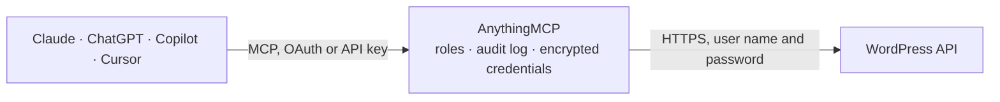

<!-- Generated by scripts/export-github-catalog.mjs in the anythingmcp-website repository. Do not edit by hand. -->

# WordPress MCP connector

AI-native publishing and content operations for any self-hosted WordPress site. The AnythingMCP connector gives Claude, ChatGPT, Microsoft Copilot, Cursor and Gemini 38 MCP tools for WordPress: 24 read and 14 can change data.

**Category:** [CMS](../cms.md) · **Tools:** 38 · **Setup guide:** [anythingmcp.com](https://anythingmcp.com/guides/wordpress-to-mcp) · [Deutsch](https://anythingmcp.com/de/guides/wordpress-to-mcp) · [Italiano](https://anythingmcp.com/it/guides/wordpress-to-mcp) · [Español](https://anythingmcp.com/es/guides/wordpress-to-mcp) · [日本語](https://anythingmcp.com/ja/guides/wordpress-to-mcp) · [Русский](https://anythingmcp.com/ru/guides/wordpress-to-mcp) · [中文](https://anythingmcp.com/zh/guides/wordpress-to-mcp)

## Start without code

No installation and no terminal: AnythingMCP Cloud runs the WordPress connector for you, operated by helpcode.ai in Frankfurt, Germany.

1. **Click the button above** and create an account or sign in. The WordPress connector opens, ready to install.
2. **Paste the API key or token from your WordPress account.** Every click is in the [step-by-step guide](https://anythingmcp.com/guides/wordpress-to-mcp).
3. **Click Install.** AnythingMCP shows the address of your MCP server.
4. **Add that address to your assistant:** [Claude](https://anythingmcp.com/guides/connect-wordpress-to-claude) · [ChatGPT](https://anythingmcp.com/guides/connect-wordpress-to-chatgpt) · [Microsoft Copilot](https://anythingmcp.com/guides/connect-wordpress-to-copilot) · [Cursor](https://anythingmcp.com/guides/connect-wordpress-to-cursor) · [Gemini CLI](https://anythingmcp.com/guides/connect-wordpress-to-gemini) · [Meta Muse](https://anythingmcp.com/guides/connect-wordpress-to-muse).
5. **Ask your first question**, for example: *What's the latest published post about VoltDrive Pro and who published it, give date and post id?*

Prefer help with the setup? [Talk to us](https://anythingmcp.com/contact).

## How it works

- **The AI client** speaks MCP (Streamable HTTP) to AnythingMCP and only sees tool names, descriptions and results. It never gets the WordPress credentials.
- **AnythingMCP** checks the client's role, builds the call from the tool definition, adds the credentials (user name and password), calls WordPress, logs the call and returns the result.
- **WordPress** sees an ordinary API client with the rights of the account the credentials belong to.

## Tools

| Tool | What it does | Access |
|---|---|---|
| [`wordpress_list_posts`](#wordpress_list_posts) | List posts with rich filtering — status, author, search term, taxonomy (categories/tags), date range, ordering. | read |
| [`wordpress_get_post`](#wordpress_get_post) | Get a single post by id. | read |
| [`wordpress_create_post`](#wordpress_create_post) | Create a post. | write |
| [`wordpress_update_post`](#wordpress_update_post) | Partial-update a post by id. | write |
| [`wordpress_delete_post`](#wordpress_delete_post) | Move a post to trash, or pass `force=true` to delete permanently. | write |
| [`wordpress_list_pages`](#wordpress_list_pages) | List static pages. | read |
| [`wordpress_get_page`](#wordpress_get_page) | Get a single page by id. | read |
| [`wordpress_create_page`](#wordpress_create_page) | Create a static page (`/wp/v2/pages`). | write |
| [`wordpress_update_page`](#wordpress_update_page) | Partial-update a page by id. | write |
| [`wordpress_list_categories`](#wordpress_list_categories) | List post categories. | read |
| [`wordpress_create_category`](#wordpress_create_category) | Create a category term. | write |
| [`wordpress_list_tags`](#wordpress_list_tags) | List post tags. | read |
| [`wordpress_create_tag`](#wordpress_create_tag) | Create a tag term. | write |
| [`wordpress_list_media`](#wordpress_list_media) | List media-library items. | read |
| [`wordpress_get_media`](#wordpress_get_media) | Get a single media-library item by id. | read |
| [`wordpress_update_media`](#wordpress_update_media) | Update metadata on an existing media item — alt text (accessibility + SEO), caption, description, title. | write |
| [`wordpress_set_featured_image`](#wordpress_set_featured_image) | Convenience tool: attach an existing media-library item as the featured image of a post or page. | write |
| [`wordpress_list_users`](#wordpress_list_users) | List users. | read |
| [`wordpress_list_comments`](#wordpress_list_comments) | List comments across all posts, with status filter for moderation workflows. | read |
| [`wordpress_moderate_comment`](#wordpress_moderate_comment) | Change a comment's moderation status — approve, hold, spam, or trash. | write |
| [`wordpress_search`](#wordpress_search) | Cross-post-type full-text search via `/wp/v2/search`. | read |
| [`wordpress_update_post_meta`](#wordpress_update_post_meta) | Overwrite REST-exposed meta keys on a post — typically Yoast (`_yoast_wpseo_title`, `_yoast_wpseo_metadesc`, `_yoast_wpseo_focuskw`) or Rank Math… | write |
| [`wordpress_site_health_status`](#wordpress_site_health_status) | Run one of WordPress's built-in Site Health checks. | read |
| [`wordpress_get_settings`](#wordpress_get_settings) | Read site-level settings (title, description, url, timezone_string, date_format, posts_per_page, default_category, etc.). | read |
| [`wordpress_get_user`](#wordpress_get_user) | Get a single user by id. | read |
| [`wordpress_create_user`](#wordpress_create_user) | Create a user account. | write |
| [`wordpress_update_user`](#wordpress_update_user) | Partial-update an existing user. | write |
| [`wordpress_delete_user`](#wordpress_delete_user) | Permanently delete a user. | write |
| [`wordpress_list_post_status_options`](#wordpress_list_post_status_options) | Reference card: the valid `status` values you can pass to `wordpress_create_post` / `wordpress_update_post`. | read |
| [`wordpress_list_comment_status_options`](#wordpress_list_comment_status_options) | Reference card: valid `status` values for `wordpress_moderate_comment` and `wordpress_list_comments` filtering. | read |
| [`wordpress_list_user_role_options`](#wordpress_list_user_role_options) | Reference card: built-in WordPress user roles and their core capabilities. | read |
| [`wordpress_list_site_health_test_slugs`](#wordpress_list_site_health_test_slugs) | Reference card: the exact slugs you can pass to `wordpress_site_health_status`. | read |
| [`wordpress_list_seo_meta_keys`](#wordpress_list_seo_meta_keys) | Reference card: the most useful Yoast SEO and Rank Math meta keys for use with `wordpress_update_post_meta` or `meta` in `wordpress_create_post` /… | read |
| [`wordpress_skill_seo_content_pipeline`](#wordpress_skill_seo_content_pipeline) | Skill recipe: improve the SEO of an existing post on a target keyword. | read |
| [`wordpress_skill_content_refresh`](#wordpress_skill_content_refresh) | Skill recipe: find stale posts and refresh them. | read |
| [`wordpress_skill_scheduled_publishing`](#wordpress_skill_scheduled_publishing) | Skill recipe: publish a post at a future date with categories, tags, and featured image. | read |
| [`wordpress_skill_internal_linking`](#wordpress_skill_internal_linking) | Skill recipe: add internal links to an existing post by finding anchor candidates via wordpress_search. | read |
| [`wordpress_skill_media_optimization`](#wordpress_skill_media_optimization) | Skill recipe: bulk-fix missing alt text and captions on media library items for accessibility + SEO. | read |

## Tool reference

Every parameter as the AI client sees it in `tools/list`. Source: [`packages/backend/src/adapters/intl/wordpress.json`](../../../packages/backend/src/adapters/intl/wordpress.json).

### `wordpress_list_posts`

List posts with rich filtering — status, author, search term, taxonomy (categories/tags), date range, ordering. Use `_fields` to trim the response (recommended: `id,title,status,date,modified,slug,link,author`). Default order is newest-first; pass `orderby=modified&order=asc` to find stalest content for refresh workflows.

**Access:** read · **Call:** `GET /wp/v2/posts`

| Parameter | Type | Required | Description |
|---|---|---|---|
| `page` | integer | no | 1-based page number. |
| `per_page` | integer | no | Results per page (1-100, default 10). |
| `search` | string | no | Full-text search across title/content. |
| `status` | string | no | Comma-separated: publish, future, draft, pending, private, trash, auto-draft. Default: publish. |
| `author` | string | no | Comma-separated author user IDs. |
| `categories` | string | no | Comma-separated category term IDs. |
| `tags` | string | no | Comma-separated tag term IDs. |
| `after` | string | no | ISO 8601 — return posts published after this date. |
| `before` | string | no | ISO 8601 — return posts published before this date. |
| `orderby` | string | no | date \| modified \| title \| slug \| id \| include \| author. Default date. |
| `order` | string | no | asc \| desc. Default desc. |
| `_fields` | string | no | Comma-separated allowlist of top-level fields to return — keeps payloads small. |

### `wordpress_get_post`

Get a single post by id. Returns full content (rendered + raw blocks if available), title, status, author, categories, tags, featured_media id, and any REST-exposed meta keys. Pass `_fields` to trim.

**Access:** read · **Call:** `GET /wp/v2/posts/{postId}`

| Parameter | Type | Required | Description |
|---|---|---|---|
| `postId` | integer | yes | Post ID. |
| `context` | string | no | view \| embed \| edit. Use `edit` to get raw block content for refresh workflows (requires edit_posts capability). |
| `_fields` | string | no | Comma-separated field allowlist. |

### `wordpress_create_post`

Create a post. For drafts pass `status: draft`; to schedule pass `status: future` plus an ISO `date` (site timezone). Content accepts HTML or Gutenberg block markup. Categories/tags are term IDs (use `wordpress_list_categories` / `wordpress_list_tags` first).

**Access:** write · **Call:** `POST /wp/v2/posts`

| Parameter | Type | Required | Description |
|---|---|---|---|
| `title` | string | yes | Post title (plain text or HTML). |
| `content` | string | no | Post body — HTML or Gutenberg blocks. |
| `excerpt` | string | no | Optional excerpt. |
| `status` | string | no | publish \| future \| draft \| pending \| private. Default: draft. |
| `date` | string | no | ISO 8601 publish date (site timezone). Required when status=future. |
| `slug` | string | no | URL slug. Omit to let WordPress derive from title. |
| `author` | integer | no | Author user id. |
| `categories` | integer[] | no | Array of category term IDs. |
| `tags` | integer[] | no | Array of tag term IDs. |
| `featured_media` | integer | no | Media library id for the featured image. |
| `meta` | object | no | Map of REST-exposed meta keys (e.g. Yoast/Rank Math fields). |
| `comment_status` | string | no | open \| closed. |
| `ping_status` | string | no | open \| closed. |
| `sticky` | boolean | no | Whether to pin to the front page. |

### `wordpress_update_post`

Partial-update a post by id. Only fields you pass are touched — omit `content` to keep the body, etc. `modified` is bumped automatically by WordPress. Use for the content-refresh recipe.

**Access:** write · **Call:** `POST /wp/v2/posts/{postId}`

| Parameter | Type | Required | Description |
|---|---|---|---|
| `postId` | integer | yes | Post id to update. |
| `title` | string | no | New title. |
| `content` | string | no | New body — HTML or Gutenberg blocks. |
| `excerpt` | string | no | New excerpt. |
| `status` | string | no | publish \| future \| draft \| pending \| private \| trash. |
| `date` | string | no | ISO 8601 publish date. |
| `slug` | string | no | New slug. |
| `categories` | integer[] | no | Replacement array of category term IDs. |
| `tags` | integer[] | no | Replacement array of tag term IDs. |
| `featured_media` | integer | no | Featured media id (0 to clear). |
| `meta` | object | no | Map of REST-exposed meta keys to overwrite. |
| `comment_status` | string | no | open \| closed. |
| `sticky` | boolean | no | Pin to front page. |

### `wordpress_delete_post`

Move a post to trash, or pass `force=true` to delete permanently. Trash is reversible from the admin UI.

**Access:** write · **Call:** `DELETE /wp/v2/posts/{postId}`

| Parameter | Type | Required | Description |
|---|---|---|---|
| `postId` | integer | yes | Post id. |
| `force` | boolean | no | true = permanent delete; false (default) = move to trash. |

### `wordpress_list_pages`

List static pages. Same filter/order semantics as posts. Pages support hierarchy via `parent`.

**Access:** read · **Call:** `GET /wp/v2/pages`

| Parameter | Type | Required | Description |
|---|---|---|---|
| `page` | integer | no |  |
| `per_page` | integer | no |  |
| `search` | string | no |  |
| `status` | string | no | Comma-separated statuses. |
| `parent` | string | no | Comma-separated parent IDs (0 = top-level). |
| `orderby` | string | no | date \| modified \| title \| menu_order \| slug \| id. |
| `order` | string | no | asc \| desc. |
| `_fields` | string | no |  |

### `wordpress_get_page`

Get a single page by id.

**Access:** read · **Call:** `GET /wp/v2/pages/{pageId}`

| Parameter | Type | Required | Description |
|---|---|---|---|
| `pageId` | integer | yes | Page id. |
| `context` | string | no | view \| embed \| edit. |
| `_fields` | string | no |  |

### `wordpress_create_page`

Create a static page (`/wp/v2/pages`). Supports `parent` for hierarchy and `menu_order` for sorting.

**Access:** write · **Call:** `POST /wp/v2/pages`

| Parameter | Type | Required | Description |
|---|---|---|---|
| `title` | string | yes |  |
| `content` | string | no |  |
| `excerpt` | string | no |  |
| `status` | string | no | publish \| future \| draft \| pending \| private. |
| `date` | string | no |  |
| `slug` | string | no |  |
| `parent` | integer | no | Parent page id (0 = top-level). |
| `menu_order` | integer | no | Sort order within siblings. |
| `featured_media` | integer | no |  |
| `meta` | object | no |  |
| `template` | string | no | Theme template slug (when the theme registers page templates). |

### `wordpress_update_page`

Partial-update a page by id.

**Access:** write · **Call:** `POST /wp/v2/pages/{pageId}`

| Parameter | Type | Required | Description |
|---|---|---|---|
| `pageId` | integer | yes |  |
| `title` | string | no |  |
| `content` | string | no |  |
| `excerpt` | string | no |  |
| `status` | string | no |  |
| `slug` | string | no |  |
| `parent` | integer | no |  |
| `menu_order` | integer | no |  |
| `featured_media` | integer | no |  |
| `meta` | object | no |  |
| `template` | string | no |  |

### `wordpress_list_categories`

List post categories. Returns id, name, slug, parent, count, description.

**Access:** read · **Call:** `GET /wp/v2/categories`

| Parameter | Type | Required | Description |
|---|---|---|---|
| `page` | integer | no |  |
| `per_page` | integer | no |  |
| `search` | string | no |  |
| `parent` | integer | no | Filter to children of this parent term id. |
| `hide_empty` | boolean | no | Hide categories with no posts. |
| `orderby` | string | no | id \| include \| name \| slug \| count \| term_group. |
| `order` | string | no | asc \| desc. |
| `_fields` | string | no |  |

### `wordpress_create_category`

Create a category term.

**Access:** write · **Call:** `POST /wp/v2/categories`

| Parameter | Type | Required | Description |
|---|---|---|---|
| `name` | string | yes | Display name. |
| `slug` | string | no | URL slug (defaults to derived from name). |
| `description` | string | no |  |
| `parent` | integer | no | Parent term id (0 = top-level). |

### `wordpress_list_tags`

List post tags. Returns id, name, slug, count, description.

**Access:** read · **Call:** `GET /wp/v2/tags`

| Parameter | Type | Required | Description |
|---|---|---|---|
| `page` | integer | no |  |
| `per_page` | integer | no |  |
| `search` | string | no |  |
| `hide_empty` | boolean | no |  |
| `orderby` | string | no |  |
| `order` | string | no |  |
| `_fields` | string | no |  |

### `wordpress_create_tag`

Create a tag term.

**Access:** write · **Call:** `POST /wp/v2/tags`

| Parameter | Type | Required | Description |
|---|---|---|---|
| `name` | string | yes |  |
| `slug` | string | no |  |
| `description` | string | no |  |

### `wordpress_list_media`

List media-library items. Filter by `media_type` (image | video | audio | application) and `mime_type` (e.g. image/jpeg). Use `_fields=id,alt_text,caption,media_details,source_url` to keep the payload small for the media-optimisation recipe.

**Access:** read · **Call:** `GET /wp/v2/media`

| Parameter | Type | Required | Description |
|---|---|---|---|
| `page` | integer | no |  |
| `per_page` | integer | no |  |
| `search` | string | no |  |
| `media_type` | string | no | image \| video \| audio \| application \| text. |
| `mime_type` | string | no | Specific MIME, e.g. image/png. |
| `author` | string | no | Comma-separated author IDs. |
| `after` | string | no |  |
| `before` | string | no |  |
| `orderby` | string | no |  |
| `order` | string | no |  |
| `_fields` | string | no |  |

### `wordpress_get_media`

Get a single media-library item by id. Use for inspecting `alt_text`, `caption`, image sizes, EXIF.

**Access:** read · **Call:** `GET /wp/v2/media/{mediaId}`

| Parameter | Type | Required | Description |
|---|---|---|---|
| `mediaId` | integer | yes |  |
| `_fields` | string | no |  |

### `wordpress_update_media`

Update metadata on an existing media item — alt text (accessibility + SEO), caption, description, title. Does NOT replace the binary; v1 does not support binary upload (see connector instructions).

**Access:** write · **Call:** `POST /wp/v2/media/{mediaId}`

| Parameter | Type | Required | Description |
|---|---|---|---|
| `mediaId` | integer | yes |  |
| `alt_text` | string | no | Image alt text. Empty string clears it. |
| `caption` | string | no | Caption (shown below image in some themes). |
| `description` | string | no | Long description (shown on the attachment page). |
| `title` | string | no | Media library title. |
| `post` | integer | no | Attach to a specific parent post id (0 to detach). |

### `wordpress_set_featured_image`

Convenience tool: attach an existing media-library item as the featured image of a post or page. Equivalent to `wordpress_update_post` / `wordpress_update_page` with `featured_media: <mediaId>`, but explicit about intent. Pass `mediaId=0` to clear.

**Access:** write · **Call:** `POST /wp/v2/{postType}/{postId}`

| Parameter | Type | Required | Description |
|---|---|---|---|
| `postType` | string | yes | REST base for the target object — typically `posts` or `pages`. For a custom post type pass its `rest_base`. |
| `postId` | integer | yes | Target post or page id. |
| `mediaId` | integer | yes | Media-library id (0 to clear). |

### `wordpress_list_users`

List users. Requires Administrator for full visibility; lower roles see only public author info. Use for finding author IDs when creating/assigning posts.

**Access:** read · **Call:** `GET /wp/v2/users`

| Parameter | Type | Required | Description |
|---|---|---|---|
| `page` | integer | no |  |
| `per_page` | integer | no |  |
| `search` | string | no |  |
| `roles` | string | no | Comma-separated role slugs: administrator, editor, author, contributor, subscriber. |
| `orderby` | string | no | id \| include \| name \| registered_date \| slug \| email \| url. |
| `order` | string | no |  |
| `_fields` | string | no |  |

### `wordpress_list_comments`

List comments across all posts, with status filter for moderation workflows.

**Access:** read · **Call:** `GET /wp/v2/comments`

| Parameter | Type | Required | Description |
|---|---|---|---|
| `page` | integer | no |  |
| `per_page` | integer | no |  |
| `search` | string | no |  |
| `post` | string | no | Comma-separated post IDs to filter to. |
| `status` | string | no | approve \| hold \| spam \| trash. Default: approve. |
| `author_email` | string | no |  |
| `after` | string | no |  |
| `before` | string | no |  |
| `_fields` | string | no |  |

### `wordpress_moderate_comment`

Change a comment's moderation status — approve, hold, spam, or trash. To delete permanently use status=trash plus a follow-up DELETE (not exposed in v1).

**Access:** write · **Call:** `POST /wp/v2/comments/{commentId}`

| Parameter | Type | Required | Description |
|---|---|---|---|
| `commentId` | integer | yes |  |
| `status` | string | yes | approve \| hold \| spam \| trash. |

### `wordpress_search`

Cross-post-type full-text search via `/wp/v2/search`. Returns lightweight hits ({id, title, url, type, subtype}) — use this when you don't know whether the match is a post or a page. Pair with `wordpress_get_post` / `wordpress_get_page` to fetch full content.

**Access:** read · **Call:** `GET /wp/v2/search`

| Parameter | Type | Required | Description |
|---|---|---|---|
| `search` | string | yes | Search term. |
| `type` | string | no | post \| term \| post-format. Default: post. |
| `subtype` | string | no | Restrict to a specific post type slug (e.g. `post`, `page`, or a custom post type). Default: any. |
| `page` | integer | no |  |
| `per_page` | integer | no |  |

### `wordpress_update_post_meta`

Overwrite REST-exposed meta keys on a post — typically Yoast (`_yoast_wpseo_title`, `_yoast_wpseo_metadesc`, `_yoast_wpseo_focuskw`) or Rank Math (`rank_math_title`, `rank_math_description`, `rank_math_focus_keyword`). Pass any subset of keys; only those keys are written. Returns the updated post.

**Access:** write · **Call:** `POST /wp/v2/posts/{postId}`

| Parameter | Type | Required | Description |
|---|---|---|---|
| `postId` | integer | yes |  |
| `meta` | object | yes | Map of meta key → value. Keys must be registered with `show_in_rest: true` (Yoast/Rank Math do this by default). |

### `wordpress_site_health_status`

Run one of WordPress's built-in Site Health checks. Wraps `/wp-site-health/v1/tests/{test}` (core since WP 5.5) — requires Administrator. Useful for an agent triaging deploy / hosting issues. Call once per test slug. NOTE: test slugs use hyphens, not underscores.

**Access:** read · **Call:** `GET /wp-site-health/v1/tests/{test}`

| Parameter | Type | Required | Description |
|---|---|---|---|
| `test` | string | yes | Test slug (hyphenated): background-updates \| loopback-requests \| https-status \| dotorg-communication \| authorization-header \| page-cache. |

### `wordpress_get_settings`

Read site-level settings (title, description, url, timezone_string, date_format, posts_per_page, default_category, etc.). Requires Administrator.

**Access:** read · **Call:** `GET /wp/v2/settings`

No parameters.

### `wordpress_get_user`

Get a single user by id. Public fields for any role; private fields (email, registration date, capabilities) require Administrator. Use to resolve an author id when creating/assigning posts.

**Access:** read · **Call:** `GET /wp/v2/users/{userId}`

| Parameter | Type | Required | Description |
|---|---|---|---|
| `userId` | integer | yes | User id. Pass `0` and use `me=true` to read the authenticated user. |
| `context` | string | no | view \| embed \| edit. `edit` returns email / registered_date / capabilities (Admin only). |
| `_fields` | string | no | Comma-separated field allowlist. |

### `wordpress_create_user`

Create a user account. Requires Administrator. Returns the full user object including id.

**Access:** write · **Call:** `POST /wp/v2/users`

| Parameter | Type | Required | Description |
|---|---|---|---|
| `username` | string | yes | Login (lowercase, no spaces). |
| `email` | string | yes |  |
| `password` | string | yes | Initial password. The user can change it after login. |
| `first_name` | string | no |  |
| `last_name` | string | no |  |
| `name` | string | no | Display name (defaults to username). |
| `nickname` | string | no |  |
| `url` | string | no | Author URL. |
| `description` | string | no | Biographical info. |
| `roles` | string[] | no | Array of role slugs. Common: subscriber, contributor, author, editor, administrator. |
| `locale` | string | no | e.g. `en_US`, `it_IT`. |

### `wordpress_update_user`

Partial-update an existing user. Only fields you pass are touched. Requires Administrator (or the user updating their own profile).

**Access:** write · **Call:** `POST /wp/v2/users/{userId}`

| Parameter | Type | Required | Description |
|---|---|---|---|
| `userId` | integer | yes |  |
| `email` | string | no |  |
| `password` | string | no | Set a new password. |
| `first_name` | string | no |  |
| `last_name` | string | no |  |
| `name` | string | no |  |
| `nickname` | string | no |  |
| `url` | string | no |  |
| `description` | string | no |  |
| `roles` | string[] | no |  |
| `locale` | string | no |  |

### `wordpress_delete_user`

Permanently delete a user. WordPress does NOT trash users — deletion is always permanent. `reassign` is required: pass the user id that should inherit the deleted user's posts (or `0` to delete the posts too). Requires Administrator.

**Access:** write · **Call:** `DELETE /wp/v2/users/{userId}`

| Parameter | Type | Required | Description |
|---|---|---|---|
| `userId` | integer | yes |  |
| `reassign` | integer | yes | User id to reassign content to. Pass 0 to delete the user's posts and links as well. |
| `force` | boolean | yes | Must be true — WP REST refuses user delete without it. |

### `wordpress_list_post_status_options`

Reference card: the valid `status` values you can pass to `wordpress_create_post` / `wordpress_update_post`. Call this on-demand instead of guessing.

**Access:** read

No parameters.

### `wordpress_list_comment_status_options`

Reference card: valid `status` values for `wordpress_moderate_comment` and `wordpress_list_comments` filtering.

**Access:** read

No parameters.

### `wordpress_list_user_role_options`

Reference card: built-in WordPress user roles and their core capabilities. Use when calling `wordpress_create_user` or `wordpress_update_user` with the `roles` array.

**Access:** read

No parameters.

### `wordpress_list_site_health_test_slugs`

Reference card: the exact slugs you can pass to `wordpress_site_health_status`. They use HYPHENS, not underscores — a very common gotcha.

**Access:** read

No parameters.

### `wordpress_list_seo_meta_keys`

Reference card: the most useful Yoast SEO and Rank Math meta keys for use with `wordpress_update_post_meta` or `meta` in `wordpress_create_post` / `wordpress_update_post`.

**Access:** read

No parameters.

### `wordpress_skill_seo_content_pipeline`

Skill recipe: improve the SEO of an existing post on a target keyword. Returns the exact step-by-step tool chain (search → get → rewrite → update post → update meta).

**Access:** read

No parameters.

### `wordpress_skill_content_refresh`

Skill recipe: find stale posts and refresh them. Returns the playbook for finding oldest-by-modified, reviewing, and persisting updates.

**Access:** read

No parameters.

### `wordpress_skill_scheduled_publishing`

Skill recipe: publish a post at a future date with categories, tags, and featured image.

**Access:** read

No parameters.

### `wordpress_skill_internal_linking`

Skill recipe: add internal links to an existing post by finding anchor candidates via wordpress_search.

**Access:** read

No parameters.

### `wordpress_skill_media_optimization`

Skill recipe: bulk-fix missing alt text and captions on media library items for accessibility + SEO.

**Access:** read

No parameters.

## Run it yourself

AnythingMCP is open source (AGPL-3.0). [Run it with Docker](../../../README.md#run-it-yourself), open **Connectors → Store**, pick **WordPress** and enter `WORDPRESS_URL`, `WORDPRESS_USERNAME`, `WORDPRESS_APP_PASSWORD`, then add your MCP server URL to the AI client.

[← CMS connectors](../cms.md) · [All categories](../README.md)
