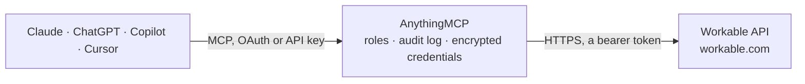

<!-- Generated by scripts/export-github-catalog.mjs in the anythingmcp-website repository. Do not edit by hand. -->

# Workable MCP connector

Manage Workable ATS (candidates, jobs, members, stages, comments) from any AI agent. 9 tools, Bearer token auth. The AnythingMCP connector gives Claude, ChatGPT, Microsoft Copilot, Cursor and Gemini 9 MCP tools for Workable: 6 read and 3 can change data.

**Category:** [HR](../hr.md) · **Tools:** 9 · **Setup guide:** [anythingmcp.com](https://anythingmcp.com/guides/workable-to-mcp) · [Deutsch](https://anythingmcp.com/de/guides/workable-to-mcp) · [Italiano](https://anythingmcp.com/it/guides/workable-to-mcp) · [Español](https://anythingmcp.com/es/guides/workable-to-mcp) · [日本語](https://anythingmcp.com/ja/guides/workable-to-mcp) · [Русский](https://anythingmcp.com/ru/guides/workable-to-mcp) · [中文](https://anythingmcp.com/zh/guides/workable-to-mcp)

## Start without code

No installation and no terminal: AnythingMCP Cloud runs the Workable connector for you, operated by helpcode.ai in Frankfurt, Germany.

1. **Click the button above** and create an account or sign in. The Workable connector opens, ready to install.
2. **Paste the API key or token from your Workable account.** Every click is in the [step-by-step guide](https://anythingmcp.com/guides/workable-to-mcp).
3. **Click Install.** AnythingMCP shows the address of your MCP server.
4. **Add that address to your assistant:** [Claude](https://anythingmcp.com/guides/connect-workable-to-claude) · [ChatGPT](https://anythingmcp.com/guides/connect-workable-to-chatgpt) · [Microsoft Copilot](https://anythingmcp.com/guides/connect-workable-to-copilot) · [Cursor](https://anythingmcp.com/guides/connect-workable-to-cursor) · [Gemini CLI](https://anythingmcp.com/guides/connect-workable-to-gemini) · [Meta Muse](https://anythingmcp.com/guides/connect-workable-to-muse).
5. **Ask your first question**, for example: *Who is candidate 48291 and what email and current stage do we have for them?*

Prefer help with the setup? [Talk to us](https://anythingmcp.com/contact).

## How it works

- **The AI client** speaks MCP (Streamable HTTP) to AnythingMCP and only sees tool names, descriptions and results. It never gets the Workable credentials.
- **AnythingMCP** checks the client's role, builds the call from the tool definition, adds the credentials (a bearer token), calls Workable, logs the call and returns the result.
- **Workable** sees an ordinary API client with the rights of the account the credentials belong to.

## Tools

| Tool | What it does | Access |
|---|---|---|
| [`workable_account_info`](#workable_account_info) | Returns the account info (subdomain, name, summary). | read |
| [`workable_list_jobs`](#workable_list_jobs) | List jobs. | read |
| [`workable_get_job`](#workable_get_job) | Get a single job by shortcode with full description + requirements + benefits. | read |
| [`workable_list_candidates`](#workable_list_candidates) | List candidates for a job. | read |
| [`workable_get_candidate`](#workable_get_candidate) | Get one candidate by ID with full profile + answers to job questions. | read |
| [`workable_create_candidate`](#workable_create_candidate) | Create a candidate on a job (sourced / referral). | write |
| [`workable_move_candidate_stage`](#workable_move_candidate_stage) | Move a candidate to a different pipeline stage. | write |
| [`workable_disqualify_candidate`](#workable_disqualify_candidate) | Disqualify (reject) a candidate with a reason. | write |
| [`workable_list_stages`](#workable_list_stages) | List pipeline stages defined in the account. | read |

## Tool reference

Every parameter as the AI client sees it in `tools/list`. Source: [`packages/backend/src/adapters/intl/workable.json`](../../../packages/backend/src/adapters/intl/workable.json).

### `workable_account_info`

Returns the account info (subdomain, name, summary).

**Access:** read · **Call:** `GET /`

No parameters.

### `workable_list_jobs`

List jobs. Filter by state (published, draft, closed, archived).

**Access:** read · **Call:** `GET /jobs`

| Parameter | Type | Required | Description |
|---|---|---|---|
| `state` | string | no | published, draft, closed, archived. |
| `department` | string | no | Filter by department. |
| `include_fields` | string | no | Comma-separated extras: description, requirements, benefits. |
| `limit` | integer | no | Max per page (100 default). |
| `since_id` | string | no | Cursor — only newer than this job shortcode. |

### `workable_get_job`

Get a single job by shortcode with full description + requirements + benefits.

**Access:** read · **Call:** `GET /jobs/{shortcode}`

| Parameter | Type | Required | Description |
|---|---|---|---|
| `shortcode` | string | yes | Job shortcode (e.g. AC123ABCDE). |

### `workable_list_candidates`

List candidates for a job. Filter by stage, state, created date.

**Access:** read · **Call:** `GET /jobs/{shortcode}/candidates`

| Parameter | Type | Required | Description |
|---|---|---|---|
| `shortcode` | string | yes | Job shortcode. |
| `stage` | string | no | Stage slug to filter (e.g. 'interview'). |
| `state` | string | no | active, hired, disqualified. |
| `limit` | integer | no | Max per page. |
| `since_id` | string | no | Cursor. |

### `workable_get_candidate`

Get one candidate by ID with full profile + answers to job questions.

**Access:** read · **Call:** `GET /candidates/{candidate_id}`

| Parameter | Type | Required | Description |
|---|---|---|---|
| `candidate_id` | string | yes | Candidate ID. |

### `workable_create_candidate`

Create a candidate on a job (sourced / referral). Required: candidate.firstname, candidate.lastname, candidate.email.

**Access:** write · **Call:** `POST /jobs/{shortcode}/candidates`

| Parameter | Type | Required | Description |
|---|---|---|---|
| `shortcode` | string | yes | Job shortcode. |
| `sourced` | boolean | no | If true, marks as sourced; otherwise applied. |
| `candidate` | object | yes | Candidate object {firstname, lastname, email, phone, address, headline, summary, resume_url, ...}. |

### `workable_move_candidate_stage`

Move a candidate to a different pipeline stage.

**Access:** write · **Call:** `POST /candidates/{candidate_id}/move`

| Parameter | Type | Required | Description |
|---|---|---|---|
| `candidate_id` | string | yes | Candidate ID. |
| `target_stage` | string | yes | Target stage slug. |
| `member_id` | string | no | Member performing the move. |

### `workable_disqualify_candidate`

Disqualify (reject) a candidate with a reason.

**Access:** write · **Call:** `POST /candidates/{candidate_id}/disqualify`

| Parameter | Type | Required | Description |
|---|---|---|---|
| `candidate_id` | string | yes | Candidate ID. |
| `disqualification_reason_id` | string | no | Reason ID configured in Workable. |
| `member_id` | string | no | Member performing the disqualification. |

### `workable_list_stages`

List pipeline stages defined in the account.

**Access:** read · **Call:** `GET /stages`

No parameters.

## Run it yourself

AnythingMCP is open source (AGPL-3.0). [Run it with Docker](../../../README.md#run-it-yourself), open **Connectors → Store**, pick **Workable** and enter `WORKABLE_SUBDOMAIN`, `WORKABLE_ACCESS_TOKEN`, then add your MCP server URL to the AI client.

[← HR connectors](../hr.md) · [All categories](../README.md)
