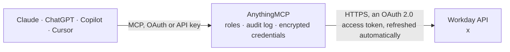

<!-- Generated by scripts/export-github-catalog.mjs in the anythingmcp-website repository. Do not edit by hand. -->

# Workday MCP connector

Give your AI read access to Workday HCM through your own API client: search workers and their staffing, direct reports, supervisory organizations and members, job profiles and positions, time off … The AnythingMCP connector gives Claude, ChatGPT, Microsoft Copilot, Cursor and Gemini 16 MCP tools for Workday, all read-only.

**Category:** [HR](../hr.md) · **Tools:** 16 · **Setup guide:** [anythingmcp.com](https://anythingmcp.com/guides/workday-to-mcp) · [Deutsch](https://anythingmcp.com/de/guides/workday-to-mcp) · [Italiano](https://anythingmcp.com/it/guides/workday-to-mcp) · [Español](https://anythingmcp.com/es/guides/workday-to-mcp) · [日本語](https://anythingmcp.com/ja/guides/workday-to-mcp) · [Русский](https://anythingmcp.com/ru/guides/workday-to-mcp) · [中文](https://anythingmcp.com/zh/guides/workday-to-mcp)

## Start without code

No installation and no terminal: AnythingMCP Cloud runs the Workday connector for you, operated by helpcode.ai in Frankfurt, Germany.

1. **Click the button above** and create an account or sign in. The Workday connector opens, ready to install.
2. **Sign in with your Workday account** when AnythingMCP asks. The first time, an admin creates a small app in the Workday developer console. Every click is in the [step-by-step guide](https://anythingmcp.com/guides/workday-to-mcp).
3. **Click Install.** AnythingMCP shows the address of your MCP server.
4. **Add that address to your assistant:** [Claude](https://anythingmcp.com/guides/connect-workday-to-claude) · [ChatGPT](https://anythingmcp.com/guides/connect-workday-to-chatgpt) · [Microsoft Copilot](https://anythingmcp.com/guides/connect-workday-to-copilot) · [Cursor](https://anythingmcp.com/guides/connect-workday-to-cursor) · [Gemini CLI](https://anythingmcp.com/guides/connect-workday-to-gemini) · [Meta Muse](https://anythingmcp.com/guides/connect-workday-to-muse).
5. **Ask your first question**, for example: *Find worker record for employee ID 21017 and show primary job and work email.*

Prefer help with the setup? [Talk to us](https://anythingmcp.com/contact).

## How it works

- **The AI client** speaks MCP (Streamable HTTP) to AnythingMCP and only sees tool names, descriptions and results. It never gets the Workday credentials.
- **AnythingMCP** checks the client's role, builds the call from the tool definition, adds the credentials (an OAuth 2.0 access token, refreshed automatically), calls Workday, logs the call and returns the result.
- **Workday** sees an ordinary API client with the rights of the account the credentials belong to.

## Tools

| Tool | What it does | Access |
|---|---|---|
| [`workday_search_workers`](#workday_search_workers) | Find workers (employees and contingent workers) in Workday by name, worker ID or work email, or page through everyone the integration user may see. | read |
| [`workday_get_worker`](#workday_get_worker) | Get one worker's current staffing record: name, worker ID, worker type, primary job (business title, job profile, supervisory organization, location, job… | read |
| [`workday_list_direct_reports`](#workday_list_direct_reports) | List the direct reports of a manager: Workday id, name, business title, whether they manage people themselves, supervisory organization, work email and work… | read |
| [`workday_list_supervisory_organizations`](#workday_list_supervisory_organizations) | List supervisory organizations (the teams of the reporting hierarchy): Workday id, name, organization code, whether it is inactive, and its managers. | read |
| [`workday_get_supervisory_organization`](#workday_get_supervisory_organization) | Get one supervisory organization: name, code, whether it is inactive and its managers. | read |
| [`workday_list_organization_members`](#workday_list_organization_members) | List the positions in one supervisory organization and who fills them: position id, business title, worker name and Workday id, job profile, job type and… | read |
| [`workday_list_organization_types`](#workday_list_organization_types) | List the organization types configured in the tenant (for example Company, Cost Center, Region, Supervisory) with their Workday ids. | read |
| [`workday_list_organizations`](#workday_list_organizations) | List the organizations of one type, for example all cost centers or all companies: Workday id and name. | read |
| [`workday_list_job_profiles`](#workday_list_job_profiles) | List job profiles (the generic job definitions positions are based on): Workday id, name and whether it is inactive. | read |
| [`workday_get_job_profile`](#workday_get_job_profile) | Get one job profile: name, default job title, summary and job description, job level, management level, job category, job families, whether it is public or… | read |
| [`workday_list_jobs`](#workday_list_jobs) | List jobs (filled positions) across the tenant: position id, business title, the worker who fills it, job profile, job type, supervisory organization and… | read |
| [`workday_get_time_off_balances`](#workday_get_time_off_balances) | Get a worker's absence balances: per time off plan, absence table or leave type the balance (quantity) and its unit (hours or days), as of today or a given… | read |
| [`workday_list_time_off_entries`](#workday_list_time_off_entries) | List a worker's time off entries (requested and taken days or hours) in a date range: date, time off type, quantity and unit, status (Approved, Submitted,… | read |
| [`workday_list_leaves_of_absence`](#workday_list_leaves_of_absence) | List a worker's leaves of absence: leave type, status, first day of leave, last day of work, estimated and actual last day of leave, and reason. | read |
| [`workday_list_job_postings`](#workday_list_job_postings) | List job postings (open jobs posted from job requisitions): Workday id, title, job site, start and end date, primary location, time type, job type, remote… | read |
| [`workday_get_job_posting`](#workday_get_job_posting) | Get one job posting with its full job description, plus title, job site, dates, locations, time type, job type, remote type and the external URL. | read |

## Tool reference

Every parameter as the AI client sees it in `tools/list`. Source: [`packages/backend/src/adapters/intl/workday.json`](../../../packages/backend/src/adapters/intl/workday.json).

### `workday_search_workers`

Find workers (employees and contingent workers) in Workday by name, worker ID or work email, or page through everyone the integration user may see. Returns total and per worker: Workday id (use it in the other tools), name, employee or contingent worker ID, worker type, business title, job profile, supervisory organization, location, and the public work email and phone. Terminated workers only with include_terminated. Personal HR data: only look people up for a legitimate work reason. Read-only.

**Access:** read · **Call:** `GET /staffing/v7/{{WORKDAY_TENANT}}/workers`

| Parameter | Type | Required | Description |
|---|---|---|---|
| `search` | string | no | Name or worker ID, case-insensitive. Several words separated by spaces match any of them. |
| `email` | string | no | Only the worker with this work email. |
| `include_terminated` | boolean | no | Also return terminated workers. Default false. |
| `limit` | integer | no | Rows per page, 1 to 100. Default 20. |
| `offset` | integer | no | Zero-based index of the first row. Next page: offset + limit, while it is below total. |

### `workday_get_worker`

Get one worker's current staffing record: name, worker ID, worker type, primary job (business title, job profile, supervisory organization, location, job type) and any additional jobs, plus the public work email and phone. No compensation, no home address, no personal identifiers. Read-only.

**Access:** read · **Call:** `GET /staffing/v7/{{WORKDAY_TENANT}}/workers/{worker_id}`

| Parameter | Type | Required | Description |
|---|---|---|---|
| `worker_id` | string | yes | The worker: the 32-character Workday ID (id from workday_search_workers) or a reference such as Employee_ID=21001 or Contingent_Worker_ID=C-100. |

### `workday_list_direct_reports`

List the direct reports of a manager: Workday id, name, business title, whether they manage people themselves, supervisory organization, work email and work phone. Walk an org chart by calling it again for each report who is a manager. Read-only.

**Access:** read · **Call:** `GET /common/v1/{{WORKDAY_TENANT}}/workers/{worker_id}/directReports`

| Parameter | Type | Required | Description |
|---|---|---|---|
| `worker_id` | string | yes | The manager: the Workday ID or a reference such as Employee_ID=21001. |
| `limit` | integer | no | Rows per page, 1 to 100. Default 20. |
| `offset` | integer | no | Zero-based index of the first row. Next page: offset + limit, while it is below total. |

### `workday_list_supervisory_organizations`

List supervisory organizations (the teams of the reporting hierarchy): Workday id, name, organization code, whether it is inactive, and its managers. Read-only.

**Access:** read · **Call:** `GET /staffing/v7/{{WORKDAY_TENANT}}/supervisoryOrganizations`

| Parameter | Type | Required | Description |
|---|---|---|---|
| `include_inactive` | boolean | no | Also return inactive organizations. Default false. |
| `limit` | integer | no | Rows per page, 1 to 100. Default 20. |
| `offset` | integer | no | Zero-based index of the first row. Next page: offset + limit, while it is below total. |

### `workday_get_supervisory_organization`

Get one supervisory organization: name, code, whether it is inactive and its managers. Read-only.

**Access:** read · **Call:** `GET /staffing/v7/{{WORKDAY_TENANT}}/supervisoryOrganizations/{organization_id}`

| Parameter | Type | Required | Description |
|---|---|---|---|
| `organization_id` | string | yes | Workday ID from workday_list_supervisory_organizations, or a reference such as Organization_Reference_ID=SUP_ORG_100. |

### `workday_list_organization_members`

List the positions in one supervisory organization and who fills them: position id, business title, worker name and Workday id, job profile, job type and location. Vacant positions have no worker. Read-only.

**Access:** read · **Call:** `GET /staffing/v7/{{WORKDAY_TENANT}}/supervisoryOrganizations/{organization_id}/members`

| Parameter | Type | Required | Description |
|---|---|---|---|
| `organization_id` | string | yes | Workday ID from workday_list_supervisory_organizations, or a reference such as Organization_Reference_ID=SUP_ORG_100. |
| `limit` | integer | no | Rows per page, 1 to 100. Default 20. |
| `offset` | integer | no | Zero-based index of the first row. Next page: offset + limit, while it is below total. |

### `workday_list_organization_types`

List the organization types configured in the tenant (for example Company, Cost Center, Region, Supervisory) with their Workday ids. Use an id as organization_type in workday_list_organizations. Read-only.

**Access:** read · **Call:** `GET /common/v1/{{WORKDAY_TENANT}}/organizationTypes`

| Parameter | Type | Required | Description |
|---|---|---|---|
| `limit` | integer | no | Rows per page, 1 to 100. Default 20. |
| `offset` | integer | no | Zero-based index of the first row. Next page: offset + limit, while it is below total. |

### `workday_list_organizations`

List the organizations of one type, for example all cost centers or all companies: Workday id and name. Get the type's id from workday_list_organization_types first. Read-only.

**Access:** read · **Call:** `GET /common/v1/{{WORKDAY_TENANT}}/organizations`

| Parameter | Type | Required | Description |
|---|---|---|---|
| `organization_type` | string | yes | Workday ID of the organization type, from workday_list_organization_types. Required by Workday. |
| `limit` | integer | no | Rows per page, 1 to 100. Default 20. |
| `offset` | integer | no | Zero-based index of the first row. Next page: offset + limit, while it is below total. |

### `workday_list_job_profiles`

List job profiles (the generic job definitions positions are based on): Workday id, name and whether it is inactive. Read-only.

**Access:** read · **Call:** `GET /staffing/v7/{{WORKDAY_TENANT}}/jobProfiles`

| Parameter | Type | Required | Description |
|---|---|---|---|
| `include_inactive` | boolean | no | Also return inactive job profiles. Default false. |
| `limit` | integer | no | Rows per page, 1 to 100. Default 20. |
| `offset` | integer | no | Zero-based index of the first row. Next page: offset + limit, while it is below total. |

### `workday_get_job_profile`

Get one job profile: name, default job title, summary and job description, job level, management level, job category, job families, whether it is public or critical, and the countries it is restricted to. Read-only.

**Access:** read · **Call:** `GET /staffing/v7/{{WORKDAY_TENANT}}/jobProfiles/{job_profile_id}`

| Parameter | Type | Required | Description |
|---|---|---|---|
| `job_profile_id` | string | yes | Workday ID from workday_list_job_profiles, or a reference such as Job_Profile_ID=SOFTWARE_ENGINEER. |

### `workday_list_jobs`

List jobs (filled positions) across the tenant: position id, business title, the worker who fills it, job profile, job type, supervisory organization and location. Read-only.

**Access:** read · **Call:** `GET /staffing/v7/{{WORKDAY_TENANT}}/jobs`

| Parameter | Type | Required | Description |
|---|---|---|---|
| `limit` | integer | no | Rows per page, 1 to 100. Default 20. |
| `offset` | integer | no | Zero-based index of the first row. Next page: offset + limit, while it is below total. |

### `workday_get_time_off_balances`

Get a worker's absence balances: per time off plan, absence table or leave type the balance (quantity) and its unit (hours or days), as of today or a given date. Absence data is sensitive personal data: only for the worker themselves, their manager or HR. Read-only.

**Access:** read · **Call:** `GET /absenceManagement/v5/{{WORKDAY_TENANT}}/balances`

| Parameter | Type | Required | Description |
|---|---|---|---|
| `worker_id` | string | yes | The 32-character Workday ID of the worker (id from workday_search_workers). Required. |
| `effective_date` | string | no | Balances as of this date, YYYY-MM-DD. Default today. |
| `category` | string | no | Only this time off plan, leave type or absence table, by Workday ID. |
| `limit` | integer | no | Rows per page, 1 to 100. Default 20. |
| `offset` | integer | no | Zero-based index of the first row. Next page: offset + limit, while it is below total. |

### `workday_list_time_off_entries`

List a worker's time off entries (requested and taken days or hours) in a date range: date, time off type, quantity and unit, status (Approved, Submitted, Not Submitted, Sent Back, Canceled), reason, comment and the ids of the entry and of its time off request. Absence data is sensitive personal data: only for the worker themselves, their manager or HR. Read-only.

**Access:** read · **Call:** `GET /absenceManagement/v5/{{WORKDAY_TENANT}}/workers/{worker_id}/timeOffDetails`

| Parameter | Type | Required | Description |
|---|---|---|---|
| `worker_id` | string | yes | The worker: the 32-character Workday ID (id from workday_search_workers) or a reference such as Employee_ID=21001 or Contingent_Worker_ID=C-100. |
| `from_date` | string | no | Start of the range, YYYY-MM-DD. |
| `to_date` | string | no | End of the range, YYYY-MM-DD. |
| `limit` | integer | no | Rows per page, 1 to 100. Default 20. |
| `offset` | integer | no | Zero-based index of the first row. Next page: offset + limit, while it is below total. |

### `workday_list_leaves_of_absence`

List a worker's leaves of absence: leave type, status, first day of leave, last day of work, estimated and actual last day of leave, and reason. Leave comments and additional fields are left out because they can hold health or family details. Highly sensitive: only for the worker themselves, their manager or HR, and never share it beyond them. Read-only.

**Access:** read · **Call:** `GET /absenceManagement/v5/{{WORKDAY_TENANT}}/workers/{worker_id}/leavesOfAbsence`

| Parameter | Type | Required | Description |
|---|---|---|---|
| `worker_id` | string | yes | The worker: the 32-character Workday ID (id from workday_search_workers) or a reference such as Employee_ID=21001 or Contingent_Worker_ID=C-100. |
| `from_date` | string | no | Start of the range, YYYY-MM-DD. |
| `to_date` | string | no | End of the range, YYYY-MM-DD. |
| `limit` | integer | no | Rows per page, 1 to 100. Default 20. |
| `offset` | integer | no | Zero-based index of the first row. Next page: offset + limit, while it is below total. |

### `workday_list_job_postings`

List job postings (open jobs posted from job requisitions): Workday id, title, job site, start and end date, primary location, time type, job type, remote type, categories and the external URL. Filter by job requisition to see where one requisition is posted. Read-only.

**Access:** read · **Call:** `GET /recruiting/v4/{{WORKDAY_TENANT}}/jobPostings`

| Parameter | Type | Required | Description |
|---|---|---|---|
| `job_requisition` | string | no | Only postings of this job requisition, by Workday ID or a reference such as Job_Requisition_ID=R-100. |
| `job_site` | string | no | Only postings on this job posting site, by Workday ID. |
| `limit` | integer | no | Rows per page, 1 to 100. Default 20. |
| `offset` | integer | no | Zero-based index of the first row. Next page: offset + limit, while it is below total. |

### `workday_get_job_posting`

Get one job posting with its full job description, plus title, job site, dates, locations, time type, job type, remote type and the external URL. Read-only.

**Access:** read · **Call:** `GET /recruiting/v4/{{WORKDAY_TENANT}}/jobPostings/{job_posting_id}`

| Parameter | Type | Required | Description |
|---|---|---|---|
| `job_posting_id` | string | yes | Workday ID from workday_list_job_postings. |

## Run it yourself

AnythingMCP is open source (AGPL-3.0). [Run it with Docker](../../../README.md#run-it-yourself), open **Connectors → Store**, pick **Workday** and enter `WORKDAY_HOST`, `WORKDAY_TENANT`, `WORKDAY_CLIENT_ID`, `WORKDAY_CLIENT_SECRET`, `WORKDAY_REFRESH_TOKEN`, then add your MCP server URL to the AI client.

[← HR connectors](../hr.md) · [All categories](../README.md)
