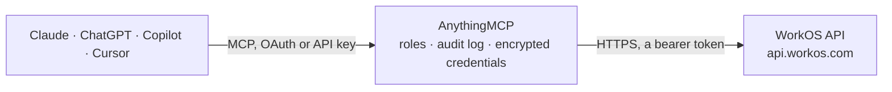

<!-- Generated by scripts/export-github-catalog.mjs in the anythingmcp-website repository. Do not edit by hand. -->

# WorkOS MCP connector

WorkOS API for B2B identity: organizations and their domains, AuthKit users, memberships, invitations and sessions, SSO connections, Directory Sync directories, users and groups, Audit Logs exports, … The AnythingMCP connector gives Claude, ChatGPT, Microsoft Copilot, Cursor and Gemini 51 MCP tools for WorkOS: 31 read and 20 can change data.

**Category:** [Infrastructure](../infrastructure.md) · **Tools:** 51 · **Setup guide:** [anythingmcp.com](https://anythingmcp.com/guides/workos-to-mcp) · [Deutsch](https://anythingmcp.com/de/guides/workos-to-mcp) · [Italiano](https://anythingmcp.com/it/guides/workos-to-mcp) · [Español](https://anythingmcp.com/es/guides/workos-to-mcp) · [日本語](https://anythingmcp.com/ja/guides/workos-to-mcp) · [Русский](https://anythingmcp.com/ru/guides/workos-to-mcp) · [中文](https://anythingmcp.com/zh/guides/workos-to-mcp)

## Start without code

No installation and no terminal: AnythingMCP Cloud runs the WorkOS connector for you, operated by helpcode.ai in Frankfurt, Germany.

1. **Click the button above** and create an account or sign in. The WorkOS connector opens, ready to install.
2. **Paste the API key or token from your WorkOS account.** Every click is in the [step-by-step guide](https://anythingmcp.com/guides/workos-to-mcp).
3. **Click Install.** AnythingMCP shows the address of your MCP server.
4. **Add that address to your assistant:** [Claude](https://anythingmcp.com/guides/connect-workos-to-claude) · [ChatGPT](https://anythingmcp.com/guides/connect-workos-to-chatgpt) · [Microsoft Copilot](https://anythingmcp.com/guides/connect-workos-to-copilot) · [Cursor](https://anythingmcp.com/guides/connect-workos-to-cursor) · [Gemini CLI](https://anythingmcp.com/guides/connect-workos-to-gemini) · [Meta Muse](https://anythingmcp.com/guides/connect-workos-to-muse).
5. **Ask your first question**, for example: *Show organization details for external ID 'LW-CLIENT-019' so I can reconcile Stripe customer ids.*

Prefer help with the setup? [Talk to us](https://anythingmcp.com/contact).

## How it works

- **The AI client** speaks MCP (Streamable HTTP) to AnythingMCP and only sees tool names, descriptions and results. It never gets the WorkOS credentials.
- **AnythingMCP** checks the client's role, builds the call from the tool definition, adds the credentials (a bearer token), calls WorkOS, logs the call and returns the result.
- **WorkOS** sees an ordinary API client with the rights of the account the credentials belong to.

## Tools

| Tool | What it does | Access |
|---|---|---|
| [`workos_list_organizations`](#workos_list_organizations) | List organizations (the customer companies of this WorkOS environment), newest first: id, name, external_id, domains with their verification state,… | read |
| [`workos_get_organization`](#workos_get_organization) | One organization by id: name, domains (each with id, state and verification strategy), external_id, stripe_customer_id, metadata and timestamps. | read |
| [`workos_get_organization_by_external_id`](#workos_get_organization_by_external_id) | One organization by the external_id your own application stored on it. | read |
| [`workos_create_organization`](#workos_create_organization) | Create an organization. | write |
| [`workos_update_organization`](#workos_update_organization) | Update an organization: name, domains (domain_data replaces the whole list), external_id, Stripe customer id, metadata or the outside-profiles setting. | write |
| [`workos_delete_organization`](#workos_delete_organization) | Permanently delete an organization together with its SSO connections and directories. | write |
| [`workos_get_organization_domain`](#workos_get_organization_domain) | One organization domain: domain name, state (pending, verified, failed, legacy_verified), verification strategy (dns or manual), the DNS TXT record to… | read |
| [`workos_create_organization_domain`](#workos_create_organization_domain) | Add a domain to an organization. | write |
| [`workos_verify_organization_domain`](#workos_verify_organization_domain) | Start DNS verification of a pending organization domain after its TXT record was published. | write |
| [`workos_delete_organization_domain`](#workos_delete_organization_domain) | Remove a domain from its organization. | write |
| [`workos_list_users`](#workos_list_users) | List AuthKit users of the environment, newest first: id, email, email_verified, first and last name, profile picture URL, external_id, metadata,… | read |
| [`workos_get_user`](#workos_get_user) | One AuthKit user by id: email, verification state, names, external_id, metadata, locale and last sign-in time. | read |
| [`workos_get_user_by_external_id`](#workos_get_user_by_external_id) | One AuthKit user by the external_id your own application stored on it. | read |
| [`workos_create_user`](#workos_create_user) | Create an AuthKit user without a password; the person signs in with a method enabled in the environment (Magic Auth, social or SSO) or through an invitation. | write |
| [`workos_update_user`](#workos_update_user) | Update an AuthKit user: name, email (resets email_verified to false), email_verified, external_id, metadata or locale. | write |
| [`workos_delete_user`](#workos_delete_user) | Permanently delete an AuthKit user with their memberships, identities and sessions. | write |
| [`workos_list_user_identities`](#workos_list_user_identities) | The sign-in identities linked to a user: provider (e.g. GoogleOAuth, MicrosoftOAuth, GitHubOAuth) and the user's id at that provider. | read |
| [`workos_list_user_sessions`](#workos_list_user_sessions) | A user's AuthKit sessions, newest first: id, status, auth_method, organization_id, ip_address, user_agent, impersonator, expires_at and ended_at. | read |
| [`workos_revoke_session`](#workos_revoke_session) | End one AuthKit session (sign the user out of that device). | write |
| [`workos_list_organization_memberships`](#workos_list_organization_memberships) | List organization memberships (which user belongs to which organization, with role(s) and status active, inactive or pending). | read |
| [`workos_get_organization_membership`](#workos_get_organization_membership) | One organization membership: user, organization, role(s), status, whether a directory manages it, and IdP custom attributes. | read |
| [`workos_create_organization_membership`](#workos_create_organization_membership) | Add an existing AuthKit user to an organization with one role (role_slug) or several (role_slugs). | write |
| [`workos_update_organization_membership`](#workos_update_organization_membership) | Change the role(s) of an organization membership; the new role replaces the current one. | write |
| [`workos_deactivate_organization_membership`](#workos_deactivate_organization_membership) | Deactivate a membership: the user keeps the account and the membership record but can no longer sign in to that organization. | write |
| [`workos_reactivate_organization_membership`](#workos_reactivate_organization_membership) | Reactivate an inactive membership, with its previous role(s). | write |
| [`workos_delete_organization_membership`](#workos_delete_organization_membership) | Permanently remove a user from an organization. | write |
| [`workos_list_invitations`](#workos_list_invitations) | List invitations, newest first: email, state (pending, accepted, expired, revoked), organization, role, inviter, expires_at. | read |
| [`workos_get_invitation`](#workos_get_invitation) | One invitation by id with its state and expiry, without the token and accept link. | read |
| [`workos_send_invitation`](#workos_send_invitation) | Invite someone by email, optionally into an organization with a role. | write |
| [`workos_resend_invitation`](#workos_resend_invitation) | Send the email of a pending invitation again, optionally in another language. | write |
| [`workos_revoke_invitation`](#workos_revoke_invitation) | Revoke a pending invitation so its link stops working. | write |
| [`workos_list_connections`](#workos_list_connections) | List SSO connections, newest first: id, name, organization_id, connection_type (OktaSAML, AzureSAML, GoogleOAuth, GenericOIDC, ...), state (draft, active,… | read |
| [`workos_get_connection`](#workos_get_connection) | One SSO connection by id: connection type, state, organization and domains. | read |
| [`workos_list_directories`](#workos_list_directories) | List Directory Sync directories (SCIM, Entra ID, Google Workspace, Okta, BambooHR, ...), newest first: id, name, type, state (linked, validating,… | read |
| [`workos_get_directory`](#workos_get_directory) | One directory: type, state, organization, domain and user and group counts. | read |
| [`workos_sync_directory`](#workos_sync_directory) | Ask WorkOS to sync a directory from its provider now. | write |
| [`workos_list_directory_users`](#workos_list_directory_users) | List users synced from a directory or a directory group: name, emails, username, job title, state (active, suspended, inactive), role(s) and mapped… | read |
| [`workos_get_directory_user`](#workos_get_directory_user) | One directory user with everything the provider sent, including raw_attributes (can hold phone numbers, manager, department, employee ids). | read |
| [`workos_list_directory_groups`](#workos_list_directory_groups) | List groups synced from a directory, or the groups of one directory user: id, name, idp_id. | read |
| [`workos_get_directory_group`](#workos_get_directory_group) | One directory group by id: name, idp_id, directory, organization and the provider's raw_attributes. | read |
| [`workos_list_audit_log_actions`](#workos_list_audit_log_actions) | List the Audit Logs actions configured in the environment (e.g. user.signed_in, document.updated) with their latest schema. | read |
| [`workos_list_audit_log_schemas`](#workos_list_audit_log_schemas) | List the schema versions of one Audit Logs action: allowed target types and the actor, target and metadata JSON schemas. | read |
| [`workos_create_audit_log_event`](#workos_create_audit_log_event) | Write an event into an organization's audit log. | write |
| [`workos_create_audit_log_export`](#workos_create_audit_log_export) | Start a CSV export of an organization's audit log events for a time range, optionally filtered by actions, actors and target types. | read |
| [`workos_get_audit_log_export`](#workos_get_audit_log_export) | State of an audit log export (pending, ready, error). | read |
| [`workos_get_audit_log_retention`](#workos_get_audit_log_retention) | How many days an organization's audit log events are kept (retention_period_in_days). | read |
| [`workos_list_events`](#workos_list_events) | Read the environment's event stream (what happened in WorkOS and at the connected identity and directory providers): id, event type, created_at and the… | read |
| [`workos_list_roles`](#workos_list_roles) | List the environment roles (RBAC) with slug, name, description, permissions and type, the roles every organization starts with. | read |
| [`workos_get_role`](#workos_get_role) | One environment role by slug: name, description, type and its permission slugs. | read |
| [`workos_list_organization_roles`](#workos_list_organization_roles) | All roles available in one organization: the environment roles plus its own custom roles (slugs starting with org-), with permissions. | read |
| [`workos_list_permissions`](#workos_list_permissions) | List the RBAC permissions defined in the environment: slug, name, description. | read |

## Tool reference

Every parameter as the AI client sees it in `tools/list`. Source: [`packages/backend/src/adapters/intl/workos.json`](../../../packages/backend/src/adapters/intl/workos.json).

### `workos_list_organizations`

List organizations (the customer companies of this WorkOS environment), newest first: id, name, external_id, domains with their verification state, metadata, timestamps. Filter by name text or by domain.

**Access:** read · **Call:** `GET /organizations`

| Parameter | Type | Required | Description |
|---|---|---|---|
| `search` | string | no | Text matched against the organization name. |
| `domains` | string | no | Only organizations with one of these domains, comma-separated, e.g. acme.com,acme.io. |
| `limit` | integer | no | Objects per page, 1 to 100 (default 10). |
| `before` | string | no | Cursor: list_metadata.before of the previous answer, to page back. |
| `after` | string | no | Cursor: list_metadata.after of the previous answer, to fetch the next page. Missing or null there means the last page. |
| `order` | `normal` \| `desc` \| `asc` | no | Sort by creation time: desc (newest first), asc, or normal (default: newest first with before/after reversed). |

### `workos_get_organization`

One organization by id: name, domains (each with id, state and verification strategy), external_id, stripe_customer_id, metadata and timestamps.

**Access:** read · **Call:** `GET /organizations/{organization_id}`

| Parameter | Type | Required | Description |
|---|---|---|---|
| `organization_id` | string | yes | Organization id (org_...), from workos_list_organizations. |

### `workos_get_organization_by_external_id`

One organization by the external_id your own application stored on it.

**Access:** read · **Call:** `GET /organizations/external_id/{external_id}`

| Parameter | Type | Required | Description |
|---|---|---|---|
| `external_id` | string | yes | The external id set on the organization. |

### `workos_create_organization`

Create an organization. Only name is required; add domains, an external_id from your own system and metadata.

**Access:** write · **Call:** `POST /organizations`

| Parameter | Type | Required | Description |
|---|---|---|---|
| `name` | string | yes | Name of the organization; does not need to be unique. |
| `domain_data` | object[] | no | Domains of the organization, each {"domain": "example.com", "state": "pending" or "verified"}. pending domains need DNS verification; mark a domain verified only when you already own it. Replaces the whole list on update. |
| `external_id` | string | no | Your own unique identifier for the organization. |
| `metadata` | object | no | Up to 10 key/value pairs of your own (ASCII string values, keys up to 40 characters, values up to 600 characters; never secrets). On update the object replaces the stored metadata; set a key to null to remove it. |
| `allow_profiles_outside_organization` | boolean | no | true lets SSO profiles whose email domain is not one of the organization's domains sign in. |

### `workos_update_organization`

Update an organization: name, domains (domain_data replaces the whole list), external_id, Stripe customer id, metadata or the outside-profiles setting. Fields left out stay as they are.

**Access:** write · **Call:** `PUT /organizations/{organization_id}`

| Parameter | Type | Required | Description |
|---|---|---|---|
| `organization_id` | string | yes | Organization id (org_...), from workos_list_organizations. |
| `name` | string | no | New name. |
| `domain_data` | object[] | no | Domains of the organization, each {"domain": "example.com", "state": "pending" or "verified"}. pending domains need DNS verification; mark a domain verified only when you already own it. Replaces the whole list on update. |
| `external_id` | string | no | Your own unique identifier for the organization. |
| `stripe_customer_id` | string | no | Stripe customer id (cus_...) linked to the organization. |
| `metadata` | object | no | Up to 10 key/value pairs of your own (ASCII string values, keys up to 40 characters, values up to 600 characters; never secrets). On update the object replaces the stored metadata; set a key to null to remove it. |
| `allow_profiles_outside_organization` | boolean | no | true lets SSO profiles whose email domain is not one of the organization's domains sign in. |

### `workos_delete_organization`

Permanently delete an organization together with its SSO connections and directories. Users stay, their memberships in it are removed. Cannot be undone.

**Access:** write · **Call:** `DELETE /organizations/{organization_id}`

| Parameter | Type | Required | Description |
|---|---|---|---|
| `organization_id` | string | yes | Organization id (org_...), from workos_list_organizations. |

### `workos_get_organization_domain`

One organization domain: domain name, state (pending, verified, failed, legacy_verified), verification strategy (dns or manual), the DNS TXT record to publish (verification_prefix and verification_token) and the reason a verification failed.

**Access:** read · **Call:** `GET /organization_domains/{domain_id}`

| Parameter | Type | Required | Description |
|---|---|---|---|
| `domain_id` | string | yes | Organization domain id (org_domain_...), from the domains array of workos_get_organization. |

### `workos_create_organization_domain`

Add a domain to an organization. It starts as pending with a DNS TXT record (verification_prefix and verification_token) that the domain owner publishes; then call workos_verify_organization_domain.

**Access:** write · **Call:** `POST /organization_domains`

| Parameter | Type | Required | Description |
|---|---|---|---|
| `organization_id` | string | yes | Organization id (org_...), from workos_list_organizations. |
| `domain` | string | yes | Domain name, e.g. acme.com. |

### `workos_verify_organization_domain`

Start DNS verification of a pending organization domain after its TXT record was published. The answer shows the new state; check again later with workos_get_organization_domain.

**Access:** write · **Call:** `POST /organization_domains/{domain_id}/verify`

| Parameter | Type | Required | Description |
|---|---|---|---|
| `domain_id` | string | yes | Organization domain id (org_domain_...), from the domains array of workos_get_organization. |

### `workos_delete_organization_domain`

Remove a domain from its organization. SSO and automatic organization joining by that domain stop. Cannot be undone; add it again to start verification anew.

**Access:** write · **Call:** `DELETE /organization_domains/{domain_id}`

| Parameter | Type | Required | Description |
|---|---|---|---|
| `domain_id` | string | yes | Organization domain id (org_domain_...), from the domains array of workos_get_organization. |

### `workos_list_users`

List AuthKit users of the environment, newest first: id, email, email_verified, first and last name, profile picture URL, external_id, metadata, last_sign_in_at, locale. Filter by email or by organization membership.

**Access:** read · **Call:** `GET /user_management/users`

| Parameter | Type | Required | Description |
|---|---|---|---|
| `email` | string | no | Exact email address. |
| `organization_id` | string | no | Only users who are members of this organization (org_...). |
| `limit` | integer | no | Objects per page, 1 to 100 (default 10). |
| `before` | string | no | Cursor: list_metadata.before of the previous answer, to page back. |
| `after` | string | no | Cursor: list_metadata.after of the previous answer, to fetch the next page. Missing or null there means the last page. |
| `order` | `normal` \| `desc` \| `asc` | no | Sort by creation time: desc (newest first), asc, or normal (default: newest first with before/after reversed). |

### `workos_get_user`

One AuthKit user by id: email, verification state, names, external_id, metadata, locale and last sign-in time.

**Access:** read · **Call:** `GET /user_management/users/{user_id}`

| Parameter | Type | Required | Description |
|---|---|---|---|
| `user_id` | string | yes | User id (user_...), from workos_list_users. |

### `workos_get_user_by_external_id`

One AuthKit user by the external_id your own application stored on it.

**Access:** read · **Call:** `GET /user_management/users/external_id/{external_id}`

| Parameter | Type | Required | Description |
|---|---|---|---|
| `external_id` | string | yes | The external id set on the user. |

### `workos_create_user`

Create an AuthKit user without a password; the person signs in with a method enabled in the environment (Magic Auth, social or SSO) or through an invitation. Email is stored lower-case.

**Access:** write · **Call:** `POST /user_management/users`

| Parameter | Type | Required | Description |
|---|---|---|---|
| `email` | string | yes | Email address. |
| `first_name` | string | no | First name. |
| `last_name` | string | no | Last name. |
| `email_verified` | boolean | no | true only when the address was already verified elsewhere; normally leave it out. |
| `external_id` | string | no | Your own unique identifier for the user. |
| `metadata` | object | no | Up to 10 key/value pairs of your own (ASCII string values, keys up to 40 characters, values up to 600 characters; never secrets). On update the object replaces the stored metadata; set a key to null to remove it. |

### `workos_update_user`

Update an AuthKit user: name, email (resets email_verified to false), email_verified, external_id, metadata or locale. Fields left out stay as they are. Passwords cannot be set here.

**Access:** write · **Call:** `PUT /user_management/users/{user_id}`

| Parameter | Type | Required | Description |
|---|---|---|---|
| `user_id` | string | yes | User id (user_...), from workos_list_users. |
| `email` | string | no | New email address. |
| `first_name` | string | no | First name. |
| `last_name` | string | no | Last name. |
| `email_verified` | boolean | no | Mark the email as verified or not. |
| `external_id` | string | no | Your own unique identifier for the user. |
| `metadata` | object | no | Up to 10 key/value pairs of your own (ASCII string values, keys up to 40 characters, values up to 600 characters; never secrets). On update the object replaces the stored metadata; set a key to null to remove it. |
| `locale` | string | no | Preferred locale, e.g. en, de, fr-CA. |

### `workos_delete_user`

Permanently delete an AuthKit user with their memberships, identities and sessions. Cannot be undone.

**Access:** write · **Call:** `DELETE /user_management/users/{user_id}`

| Parameter | Type | Required | Description |
|---|---|---|---|
| `user_id` | string | yes | User id (user_...), from workos_list_users. |

### `workos_list_user_identities`

The sign-in identities linked to a user: provider (e.g. GoogleOAuth, MicrosoftOAuth, GitHubOAuth) and the user's id at that provider.

**Access:** read · **Call:** `GET /user_management/users/{user_id}/identities`

| Parameter | Type | Required | Description |
|---|---|---|---|
| `user_id` | string | yes | User id (user_...), from workos_list_users. |

### `workos_list_user_sessions`

A user's AuthKit sessions, newest first: id, status, auth_method, organization_id, ip_address, user_agent, impersonator, expires_at and ended_at.

**Access:** read · **Call:** `GET /user_management/users/{user_id}/sessions`

| Parameter | Type | Required | Description |
|---|---|---|---|
| `user_id` | string | yes | User id (user_...), from workos_list_users. |
| `limit` | integer | no | Objects per page, 1 to 100 (default 10). |
| `before` | string | no | Cursor: list_metadata.before of the previous answer, to page back. |
| `after` | string | no | Cursor: list_metadata.after of the previous answer, to fetch the next page. Missing or null there means the last page. |
| `order` | `normal` \| `desc` \| `asc` | no | Sort by creation time: desc (newest first), asc, or normal (default: newest first with before/after reversed). |

### `workos_revoke_session`

End one AuthKit session (sign the user out of that device). Cannot be undone; the user has to sign in again.

**Access:** write · **Call:** `POST /user_management/sessions/revoke`

| Parameter | Type | Required | Description |
|---|---|---|---|
| `session_id` | string | yes | Session id (session_...), from workos_list_user_sessions. |

### `workos_list_organization_memberships`

List organization memberships (which user belongs to which organization, with role(s) and status active, inactive or pending). Give organization_id, user_id or both.

**Access:** read · **Call:** `GET /user_management/organization_memberships`

| Parameter | Type | Required | Description |
|---|---|---|---|
| `organization_id` | string | no | Only memberships in this organization (org_...). |
| `user_id` | string | no | Only memberships of this user (user_...). |
| `statuses` | string | no | Only these statuses, comma-separated: active, inactive, pending. |
| `limit` | integer | no | Objects per page, 1 to 100 (default 10). |
| `before` | string | no | Cursor: list_metadata.before of the previous answer, to page back. |
| `after` | string | no | Cursor: list_metadata.after of the previous answer, to fetch the next page. Missing or null there means the last page. |
| `order` | `normal` \| `desc` \| `asc` | no | Sort by creation time: desc (newest first), asc, or normal (default: newest first with before/after reversed). |

### `workos_get_organization_membership`

One organization membership: user, organization, role(s), status, whether a directory manages it, and IdP custom attributes.

**Access:** read · **Call:** `GET /user_management/organization_memberships/{membership_id}`

| Parameter | Type | Required | Description |
|---|---|---|---|
| `membership_id` | string | yes | Organization membership id (om_...), from workos_list_organization_memberships. |

### `workos_create_organization_membership`

Add an existing AuthKit user to an organization with one role (role_slug) or several (role_slugs).

**Access:** write · **Call:** `POST /user_management/organization_memberships`

| Parameter | Type | Required | Description |
|---|---|---|---|
| `user_id` | string | yes | User id (user_...), from workos_list_users. |
| `organization_id` | string | yes | Organization id (org_...), from workos_list_organizations. |
| `role_slug` | string | no | Role slug from workos_list_roles or workos_list_organization_roles, e.g. member or admin. Defaults to the environment's default role. |
| `role_slugs` | string[] | no | Several role slugs, when Multiple Roles is enabled in the environment. Use either role_slug or role_slugs. |

### `workos_update_organization_membership`

Change the role(s) of an organization membership; the new role replaces the current one.

**Access:** write · **Call:** `PUT /user_management/organization_memberships/{membership_id}`

| Parameter | Type | Required | Description |
|---|---|---|---|
| `membership_id` | string | yes | Organization membership id (om_...), from workos_list_organization_memberships. |
| `role_slug` | string | no | Role slug from workos_list_roles or workos_list_organization_roles, e.g. member or admin. Defaults to the environment's default role. |
| `role_slugs` | string[] | no | Several role slugs, when Multiple Roles is enabled in the environment. Use either role_slug or role_slugs. |

### `workos_deactivate_organization_membership`

Deactivate a membership: the user keeps the account and the membership record but can no longer sign in to that organization. Undo with workos_reactivate_organization_membership.

**Access:** write · **Call:** `PUT /user_management/organization_memberships/{membership_id}/deactivate`

| Parameter | Type | Required | Description |
|---|---|---|---|
| `membership_id` | string | yes | Organization membership id (om_...), from workos_list_organization_memberships. |

### `workos_reactivate_organization_membership`

Reactivate an inactive membership, with its previous role(s).

**Access:** write · **Call:** `PUT /user_management/organization_memberships/{membership_id}/reactivate`

| Parameter | Type | Required | Description |
|---|---|---|---|
| `membership_id` | string | yes | Organization membership id (om_...), from workos_list_organization_memberships. |

### `workos_delete_organization_membership`

Permanently remove a user from an organization. Cannot be undone; prefer workos_deactivate_organization_membership.

**Access:** write · **Call:** `DELETE /user_management/organization_memberships/{membership_id}`

| Parameter | Type | Required | Description |
|---|---|---|---|
| `membership_id` | string | yes | Organization membership id (om_...), from workos_list_organization_memberships. |

### `workos_list_invitations`

List invitations, newest first: email, state (pending, accepted, expired, revoked), organization, role, inviter, expires_at. The invitation token and accept link are removed from the answer.

**Access:** read · **Call:** `GET /user_management/invitations`

| Parameter | Type | Required | Description |
|---|---|---|---|
| `organization_id` | string | no | Only invitations to this organization (org_...). |
| `email` | string | no | Only invitations sent to this email address. |
| `limit` | integer | no | Objects per page, 1 to 100 (default 10). |
| `before` | string | no | Cursor: list_metadata.before of the previous answer, to page back. |
| `after` | string | no | Cursor: list_metadata.after of the previous answer, to fetch the next page. Missing or null there means the last page. |
| `order` | `normal` \| `desc` \| `asc` | no | Sort by creation time: desc (newest first), asc, or normal (default: newest first with before/after reversed). |

### `workos_get_invitation`

One invitation by id with its state and expiry, without the token and accept link.

**Access:** read · **Call:** `GET /user_management/invitations/{invitation_id}`

| Parameter | Type | Required | Description |
|---|---|---|---|
| `invitation_id` | string | yes | Invitation id (invitation_...), from workos_list_invitations. |

### `workos_send_invitation`

Invite someone by email, optionally into an organization with a role. WorkOS sends the email itself (counts toward its email sending limits). The answer leaves out the token and accept link.

**Access:** write · **Call:** `POST /user_management/invitations`

| Parameter | Type | Required | Description |
|---|---|---|---|
| `email` | string | yes | Recipient email address. |
| `organization_id` | string | no | Organization the person joins (org_...). Leave out for an environment-level invitation. |
| `role_slug` | string | no | Role slug from workos_list_roles or workos_list_organization_roles, e.g. member or admin. Defaults to the environment's default role. |
| `expires_in_days` | integer | no | Days the invitation stays valid, 1 to 30 (default 7). |
| `inviter_user_id` | string | no | User id (user_...) named as the inviter in the email. |
| `locale` | string | no | Language of the invitation email, e.g. en, de, fr. Defaults to the environment's locale. |

### `workos_resend_invitation`

Send the email of a pending invitation again, optionally in another language.

**Access:** write · **Call:** `POST /user_management/invitations/{invitation_id}/resend`

| Parameter | Type | Required | Description |
|---|---|---|---|
| `invitation_id` | string | yes | Invitation id (invitation_...), from workos_list_invitations. |
| `locale` | string | no | Language of the invitation email, e.g. en, de, fr. Defaults to the environment's locale. |

### `workos_revoke_invitation`

Revoke a pending invitation so its link stops working. Cannot be undone; send a new invitation instead.

**Access:** write · **Call:** `POST /user_management/invitations/{invitation_id}/revoke`

| Parameter | Type | Required | Description |
|---|---|---|---|
| `invitation_id` | string | yes | Invitation id (invitation_...), from workos_list_invitations. |

### `workos_list_connections`

List SSO connections, newest first: id, name, organization_id, connection_type (OktaSAML, AzureSAML, GoogleOAuth, GenericOIDC, ...), state (draft, active, inactive, validating) and domains.

**Access:** read · **Call:** `GET /connections`

| Parameter | Type | Required | Description |
|---|---|---|---|
| `organization_id` | string | no | Only connections of this organization (org_...). |
| `connection_type` | string | no | Only this connection type, e.g. OktaSAML, AzureSAML, GenericOIDC, GoogleOAuth. |
| `domain` | string | no | Only connections with this domain. |
| `search` | string | no | Text matched against connection names. |
| `limit` | integer | no | Objects per page, 1 to 100 (default 10). |
| `before` | string | no | Cursor: list_metadata.before of the previous answer, to page back. |
| `after` | string | no | Cursor: list_metadata.after of the previous answer, to fetch the next page. Missing or null there means the last page. |
| `order` | `normal` \| `desc` \| `asc` | no | Sort by creation time: desc (newest first), asc, or normal (default: newest first with before/after reversed). |

### `workos_get_connection`

One SSO connection by id: connection type, state, organization and domains.

**Access:** read · **Call:** `GET /connections/{connection_id}`

| Parameter | Type | Required | Description |
|---|---|---|---|
| `connection_id` | string | yes | SSO connection id (conn_...), from workos_list_connections. |

### `workos_list_directories`

List Directory Sync directories (SCIM, Entra ID, Google Workspace, Okta, BambooHR, ...), newest first: id, name, type, state (linked, validating, invalid_credentials, unlinked), organization, domain and user and group counts.

**Access:** read · **Call:** `GET /directories`

| Parameter | Type | Required | Description |
|---|---|---|---|
| `organization_id` | string | no | Only directories of this organization (org_...). |
| `search` | string | no | Text matched against directory names. |
| `domain` | string | no | Only directories with this domain. |
| `limit` | integer | no | Objects per page, 1 to 100 (default 10). |
| `before` | string | no | Cursor: list_metadata.before of the previous answer, to page back. |
| `after` | string | no | Cursor: list_metadata.after of the previous answer, to fetch the next page. Missing or null there means the last page. |
| `order` | `normal` \| `desc` \| `asc` | no | Sort by creation time: desc (newest first), asc, or normal (default: newest first with before/after reversed). |

### `workos_get_directory`

One directory: type, state, organization, domain and user and group counts.

**Access:** read · **Call:** `GET /directories/{directory_id}`

| Parameter | Type | Required | Description |
|---|---|---|---|
| `directory_id` | string | yes | Directory id (directory_...), from workos_list_directories. |

### `workos_sync_directory`

Ask WorkOS to sync a directory from its provider now. The answer only says the sync was queued; read the directory again later for its state.

**Access:** write · **Call:** `POST /directories/{directory_id}/sync`

| Parameter | Type | Required | Description |
|---|---|---|---|
| `directory_id` | string | yes | Directory id (directory_...), from workos_list_directories. |

### `workos_list_directory_users`

List users synced from a directory or a directory group: name, emails, username, job title, state (active, suspended, inactive), role(s) and mapped custom_attributes. The provider's raw_attributes are left out here (see workos_get_directory_user). Needs directory or group.

**Access:** read · **Call:** `GET /directory_users`

| Parameter | Type | Required | Description |
|---|---|---|---|
| `directory` | string | no | Directory id (directory_...). |
| `group` | string | no | Directory group id (directory_group_...); lists that group's members. |
| `email` | string | no | Primary email; needs directory too. |
| `idp_id` | string | no | The user's id at the identity provider; needs directory too. |
| `limit` | integer | no | Objects per page, 1 to 100 (default 10). |
| `before` | string | no | Cursor: list_metadata.before of the previous answer, to page back. |
| `after` | string | no | Cursor: list_metadata.after of the previous answer, to fetch the next page. Missing or null there means the last page. |
| `order` | `normal` \| `desc` \| `asc` | no | Sort by creation time: desc (newest first), asc, or normal (default: newest first with before/after reversed). |

### `workos_get_directory_user`

One directory user with everything the provider sent, including raw_attributes (can hold phone numbers, manager, department, employee ids).

**Access:** read · **Call:** `GET /directory_users/{directory_user_id}`

| Parameter | Type | Required | Description |
|---|---|---|---|
| `directory_user_id` | string | yes | Directory user id (directory_user_...), from workos_list_directory_users. |

### `workos_list_directory_groups`

List groups synced from a directory, or the groups of one directory user: id, name, idp_id. raw_attributes are left out. Needs directory or user.

**Access:** read · **Call:** `GET /directory_groups`

| Parameter | Type | Required | Description |
|---|---|---|---|
| `directory` | string | no | Directory id (directory_...). |
| `user` | string | no | Directory user id (directory_user_...); lists that user's groups. |
| `limit` | integer | no | Objects per page, 1 to 100 (default 10). |
| `before` | string | no | Cursor: list_metadata.before of the previous answer, to page back. |
| `after` | string | no | Cursor: list_metadata.after of the previous answer, to fetch the next page. Missing or null there means the last page. |
| `order` | `normal` \| `desc` \| `asc` | no | Sort by creation time: desc (newest first), asc, or normal (default: newest first with before/after reversed). |

### `workos_get_directory_group`

One directory group by id: name, idp_id, directory, organization and the provider's raw_attributes.

**Access:** read · **Call:** `GET /directory_groups/{directory_group_id}`

| Parameter | Type | Required | Description |
|---|---|---|---|
| `directory_group_id` | string | yes | Directory group id (directory_group_...), from workos_list_directory_groups. |

### `workos_list_audit_log_actions`

List the Audit Logs actions configured in the environment (e.g. user.signed_in, document.updated) with their latest schema.

**Access:** read · **Call:** `GET /audit_logs/actions`

| Parameter | Type | Required | Description |
|---|---|---|---|
| `limit` | integer | no | Objects per page, 1 to 100 (default 10). |
| `before` | string | no | Cursor: list_metadata.before of the previous answer, to page back. |
| `after` | string | no | Cursor: list_metadata.after of the previous answer, to fetch the next page. Missing or null there means the last page. |
| `order` | `normal` \| `desc` \| `asc` | no | Sort by creation time: desc (newest first), asc, or normal (default: newest first with before/after reversed). |

### `workos_list_audit_log_schemas`

List the schema versions of one Audit Logs action: allowed target types and the actor, target and metadata JSON schemas.

**Access:** read · **Call:** `GET /audit_logs/actions/{action_name}/schemas`

| Parameter | Type | Required | Description |
|---|---|---|---|
| `action_name` | string | yes | Action name from workos_list_audit_log_actions, e.g. user.signed_in. |
| `limit` | integer | no | Objects per page, 1 to 100 (default 10). |
| `before` | string | no | Cursor: list_metadata.before of the previous answer, to page back. |
| `after` | string | no | Cursor: list_metadata.after of the previous answer, to fetch the next page. Missing or null there means the last page. |
| `order` | `normal` \| `desc` \| `asc` | no | Sort by creation time: desc (newest first), asc, or normal (default: newest first with before/after reversed). |

### `workos_create_audit_log_event`

Write an event into an organization's audit log. Audit log events cannot be edited or deleted, so this cannot be undone. The event must match a configured action schema.

**Access:** write · **Call:** `POST /audit_logs/events`

| Parameter | Type | Required | Description |
|---|---|---|---|
| `organization_id` | string | yes | Organization id (org_...), from workos_list_organizations. |
| `event` | object | yes | The event: {"action": "user.signed_in", "occurred_at": "2026-10-30T09:00:00.000Z", "version": 1, "actor": {"type": "user", "id": "user_123", "name": "..."}, "targets": [{"type": "team", "id": "team_1"}], "context": {"location": "203.0.113.7", "user_agent": "..."}, "metadata": {}}. action, occurred_at, actor, targets and context are required. |
| `idempotency_key` | string | no | A unique string (a UUID) so that retrying the same call does not write the event twice. |

### `workos_create_audit_log_export`

Start a CSV export of an organization's audit log events for a time range, optionally filtered by actions, actors and target types. Read-only: it creates an export job, not events. Poll workos_get_audit_log_export until state is ready.

**Access:** read · **Call:** `POST /audit_logs/exports`

| Parameter | Type | Required | Description |
|---|---|---|---|
| `organization_id` | string | yes | Organization id (org_...), from workos_list_organizations. |
| `range_start` | string | yes | Start of the range, ISO 8601, e.g. 2026-10-01T00:00:00Z. |
| `range_end` | string | yes | End of the range, ISO 8601. |
| `actions` | string[] | no | Only these action names, e.g. ["user.signed_in"]. |
| `actor_names` | string[] | no | Only events by actors with these names. |
| `actor_ids` | string[] | no | Only events by these actor ids. |
| `targets` | string[] | no | Only events with these target types, e.g. ["team"]. |

### `workos_get_audit_log_export`

State of an audit log export (pending, ready, error). When ready, url is a short-lived download link of the CSV file.

**Access:** read · **Call:** `GET /audit_logs/exports/{export_id}`

| Parameter | Type | Required | Description |
|---|---|---|---|
| `export_id` | string | yes | Export id (audit_log_export_...), from workos_create_audit_log_export. |

### `workos_get_audit_log_retention`

How many days an organization's audit log events are kept (retention_period_in_days).

**Access:** read · **Call:** `GET /organizations/{organization_id}/audit_logs_retention`

| Parameter | Type | Required | Description |
|---|---|---|---|
| `organization_id` | string | yes | Organization id (org_...), from workos_list_organizations. |

### `workos_list_events`

Read the environment's event stream (what happened in WorkOS and at the connected identity and directory providers): id, event type, created_at and the changed object in data. Events up to 90 days old; one call covers at most 30 days. Pass order asc to read them in the order they happened.

**Access:** read · **Call:** `GET /events`

| Parameter | Type | Required | Description |
|---|---|---|---|
| `events` | string | yes | Event types to return, comma-separated, e.g. user.created,organization_membership.updated,dsync.user.created,connection.activated,session.created,invitation.accepted. |
| `organization_id` | string | no | Only events of this organization (org_...). Environment-wide user events are not tied to an organization. |
| `range_start` | string | no | Start of the time range, ISO 8601 UTC with Z, e.g. 2026-10-01T00:00:00Z. Cannot be combined with after. |
| `range_end` | string | no | End of the time range, ISO 8601 UTC with Z. |
| `after` | string | no | Cursor: list_metadata.after of the previous answer (an event id). Cannot be combined with range_start. |
| `before` | string | no | Cursor: list_metadata.before of the previous answer, to page back. |
| `limit` | integer | no | Events per page, 1 to 100 (default 10). |
| `order` | `normal` \| `desc` \| `asc` | no | Sort by creation time: desc (newest first), asc, or normal (default: newest first with before/after reversed). |

### `workos_list_roles`

List the environment roles (RBAC) with slug, name, description, permissions and type, the roles every organization starts with.

**Access:** read · **Call:** `GET /authorization/roles`

No parameters.

### `workos_get_role`

One environment role by slug: name, description, type and its permission slugs.

**Access:** read · **Call:** `GET /authorization/roles/{role_slug}`

| Parameter | Type | Required | Description |
|---|---|---|---|
| `role_slug` | string | yes | Role slug, e.g. admin or member. |

### `workos_list_organization_roles`

All roles available in one organization: the environment roles plus its own custom roles (slugs starting with org-), with permissions.

**Access:** read · **Call:** `GET /authorization/organizations/{organization_id}/roles`

| Parameter | Type | Required | Description |
|---|---|---|---|
| `organization_id` | string | yes | Organization id (org_...), from workos_list_organizations. |

### `workos_list_permissions`

List the RBAC permissions defined in the environment: slug, name, description.

**Access:** read · **Call:** `GET /authorization/permissions`

| Parameter | Type | Required | Description |
|---|---|---|---|
| `limit` | integer | no | Objects per page, 1 to 100 (default 10). |
| `before` | string | no | Cursor: list_metadata.before of the previous answer, to page back. |
| `after` | string | no | Cursor: list_metadata.after of the previous answer, to fetch the next page. Missing or null there means the last page. |
| `order` | `normal` \| `desc` \| `asc` | no | Sort by creation time: desc (newest first), asc, or normal (default: newest first with before/after reversed). |

## Run it yourself

AnythingMCP is open source (AGPL-3.0). [Run it with Docker](../../../README.md#run-it-yourself), open **Connectors → Store**, pick **WorkOS** and enter `WORKOS_API_KEY`, then add your MCP server URL to the AI client.

[← Infrastructure connectors](../infrastructure.md) · [All categories](../README.md)
