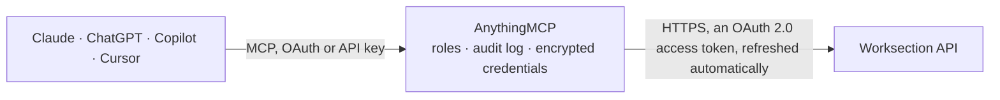

<!-- Generated by scripts/export-github-catalog.mjs in the anythingmcp-website repository. Do not edit by hand. -->

# Worksection MCP connector

Worksection project management: projects, tasks and subtasks, comments, time and money costs, timers, files, tags, users and contacts, plus creating and updating tasks, comments and time entries. The AnythingMCP connector gives Claude, ChatGPT, Microsoft Copilot, Cursor and Gemini 33 MCP tools for Worksection: 24 read and 9 can change data.

**Category:** [Project Management](../project-management.md) · **Tools:** 33 · **Setup guide:** [anythingmcp.com](https://anythingmcp.com/guides/worksection-to-mcp) · [Deutsch](https://anythingmcp.com/de/guides/worksection-to-mcp) · [Italiano](https://anythingmcp.com/it/guides/worksection-to-mcp) · [Español](https://anythingmcp.com/es/guides/worksection-to-mcp) · [日本語](https://anythingmcp.com/ja/guides/worksection-to-mcp) · [Русский](https://anythingmcp.com/ru/guides/worksection-to-mcp) · [中文](https://anythingmcp.com/zh/guides/worksection-to-mcp)

## Start without code

No installation and no terminal: AnythingMCP Cloud runs the Worksection connector for you, operated by helpcode.ai in Frankfurt, Germany.

1. **Click the button above** and create an account or sign in. The Worksection connector opens, ready to install.
2. **Sign in with your Worksection account** when AnythingMCP asks. The first time, an admin creates a small app in the Worksection developer console. Every click is in the [step-by-step guide](https://anythingmcp.com/guides/worksection-to-mcp).
3. **Click Install.** AnythingMCP shows the address of your MCP server.
4. **Add that address to your assistant:** [Claude](https://anythingmcp.com/guides/connect-worksection-to-claude) · [ChatGPT](https://anythingmcp.com/guides/connect-worksection-to-chatgpt) · [Microsoft Copilot](https://anythingmcp.com/guides/connect-worksection-to-copilot) · [Cursor](https://anythingmcp.com/guides/connect-worksection-to-cursor) · [Gemini CLI](https://anythingmcp.com/guides/connect-worksection-to-gemini) · [Meta Muse](https://anythingmcp.com/guides/connect-worksection-to-muse).
5. **Ask your first question**, for example: *What's the status and assignee of task 'INV-2026-045: Prepare billing pack' in project 'Vento Energies OÜ'?*

Prefer help with the setup? [Talk to us](https://anythingmcp.com/contact).

## How it works

- **The AI client** speaks MCP (Streamable HTTP) to AnythingMCP and only sees tool names, descriptions and results. It never gets the Worksection credentials.
- **AnythingMCP** checks the client's role, builds the call from the tool definition, adds the credentials (an OAuth 2.0 access token, refreshed automatically), calls Worksection, logs the call and returns the result.
- **Worksection** sees an ordinary API client with the rights of the account the credentials belong to.

## Tools

| Tool | What it does | Access |
|---|---|---|
| [`worksection_get_me`](#worksection_get_me) | Return the Worksection user the access token belongs to: id, name, e-mail and role. | read |
| [`worksection_list_projects`](#worksection_list_projects) | List the account's projects with id, name, status, folder, author, manager, dates and estimates. | read |
| [`worksection_get_project`](#worksection_get_project) | Return one project by id with name, status, folder, author, manager, dates, estimates and tags; add extra=text,users for description and team. | read |
| [`worksection_list_project_folders`](#worksection_list_project_folders) | List the project folders of the account (user folders and team folders) with id, name and type. | read |
| [`worksection_list_tasks`](#worksection_list_tasks) | List the tasks of one project, open and closed, with name, status, priority, author, assignee, dates, estimates and tags. | read |
| [`worksection_list_all_tasks`](#worksection_list_all_tasks) | List the tasks of all projects in the account. | read |
| [`worksection_get_task`](#worksection_get_task) | Return one task or subtask by id with status, priority, author, assignee, dates, estimates, tags and, with extra, description, files, comments and subtasks. | read |
| [`worksection_search_tasks`](#worksection_search_tasks) | Search tasks with a query on name and dates, by project, author or assignee. | read |
| [`worksection_list_comments`](#worksection_list_comments) | List the comments of one task with text, author name and e-mail and date; add extra=files for attachments. | read |
| [`worksection_list_users`](#worksection_list_users) | List the account's users with id, name, e-mail, position, team, role and status. | read |
| [`worksection_list_user_teams`](#worksection_list_user_teams) | List the user teams of the account (your company teams and external client teams). | read |
| [`worksection_list_contacts`](#worksection_list_contacts) | List the account's contacts (people without a login) with name, e-mail, phone numbers, position and folder. | read |
| [`worksection_list_contact_folders`](#worksection_list_contact_folders) | List the contact folders of the account with id and name, used to group contacts. | read |
| [`worksection_list_costs`](#worksection_list_costs) | List individual time and money entries (cost lines) for the account, one project or one task, with user, date, time, money and comment. | read |
| [`worksection_get_costs_total`](#worksection_get_costs_total) | Return total time and money spent for all projects, selected projects or one task in a date range; with extra=projects also per project and month. | read |
| [`worksection_list_timers`](#worksection_list_timers) | List the timers running right now in the account, with task, user, start time and current value. | read |
| [`worksection_get_my_timer`](#worksection_get_my_timer) | Return the running timer of the connected user, if any, with its task and current value. | read |
| [`worksection_list_files`](#worksection_list_files) | List the files of one project or task: attachments of descriptions and comments and the project's Files section, with id, name and size. | read |
| [`worksection_list_events`](#worksection_list_events) | Return the change history of all or one project for a recent period: who created, updated, closed or reopened which project, task or comment. | read |
| [`worksection_list_task_tags`](#worksection_list_task_tags) | List the task tags (statuses and labels) of all or one group, with id, name and group. | read |
| [`worksection_list_task_tag_groups`](#worksection_list_task_tag_groups) | List the task tag groups (sets of statuses or labels) with id, name, type and visibility. | read |
| [`worksection_list_project_tags`](#worksection_list_project_tags) | List the project tags of all or one group, with id, name and group. | read |
| [`worksection_list_project_tag_groups`](#worksection_list_project_tag_groups) | List the project tag groups with id, name, type and visibility. | read |
| [`worksection_get_users_schedule`](#worksection_get_users_schedule) | Return users' vacations, sick leave, unpaid leave and weekend work days in a date range, from each user's Schedule. | read |
| [`worksection_create_task`](#worksection_create_task) | Create a task or subtask in a project, with assignee, priority, description, dates, estimates, tags and subscribers. | write |
| [`worksection_update_task`](#worksection_update_task) | Change a task's name, assignee, priority, dates, estimates or tags. | write |
| [`worksection_complete_task`](#worksection_complete_task) | Mark a task or subtask as done. | write |
| [`worksection_reopen_task`](#worksection_reopen_task) | Reopen a completed task or subtask so it shows as active again. | write |
| [`worksection_update_task_tags`](#worksection_update_task_tags) | Add and remove single tags on a task without touching the others. | write |
| [`worksection_create_comment`](#worksection_create_comment) | Post a comment on a task as the connected user. | write |
| [`worksection_add_costs`](#worksection_add_costs) | Log time or money on a task for the connected user, e.g. 1:30 hours with a comment and date. | write |
| [`worksection_start_my_timer`](#worksection_start_my_timer) | Start the connected user's timer on a task. | write |
| [`worksection_stop_my_timer`](#worksection_stop_my_timer) | Stop the connected user's running timer and save the time as a cost entry, with an optional comment. | write |

## Tool reference

Every parameter as the AI client sees it in `tools/list`. Source: [`packages/backend/src/adapters/intl/worksection.json`](../../../packages/backend/src/adapters/intl/worksection.json).

### `worksection_get_me`

Return the Worksection user the access token belongs to: id, name, e-mail and role. Use it to check the connection.

**Access:** read · **Call:** `GET /api/oauth2`

No parameters.

### `worksection_list_projects`

List the account's projects with id, name, status, folder, author, manager, dates and estimates. Start here to get project ids.

**Access:** read · **Call:** `GET /api/oauth2`

| Parameter | Type | Required | Description |
|---|---|---|---|
| `filter` | `active` \| `pending` \| `archived` | no | Only projects in this state: active, pending or archived. |
| `extra` | string | no | Extra data, comma-separated: text or html (description), options (restrictions), users (team members). |

### `worksection_get_project`

Return one project by id with name, status, folder, author, manager, dates, estimates and tags; add extra=text,users for description and team.

**Access:** read · **Call:** `GET /api/oauth2`

| Parameter | Type | Required | Description |
|---|---|---|---|
| `id_project` | integer | yes | Project id, from worksection_list_projects. |
| `extra` | string | no | Extra data, comma-separated: text or html, options, users. |

### `worksection_list_project_folders`

List the project folders of the account (user folders and team folders) with id, name and type.

**Access:** read · **Call:** `GET /api/oauth2`

No parameters.

### `worksection_list_tasks`

List the tasks of one project, open and closed, with name, status, priority, author, assignee, dates, estimates and tags. Add extra=subtasks for subtasks.

**Access:** read · **Call:** `GET /api/oauth2`

| Parameter | Type | Required | Description |
|---|---|---|---|
| `id_project` | integer | yes | Project id, from worksection_list_projects. |
| `extra` | string | no | Extra data, comma-separated: text or html (description), files, todos, comments (last five), relations, subtasks, subscribers. |
| `filter` | `active` | no | active to return only incomplete tasks. Completed tasks cannot be filtered on their own. |

### `worksection_list_all_tasks`

List the tasks of all projects in the account. Large accounts can exceed the API's 10,000-record limit; prefer worksection_search_tasks or worksection_list_tasks.

**Access:** read · **Call:** `GET /api/oauth2`

| Parameter | Type | Required | Description |
|---|---|---|---|
| `extra` | string | no | Extra data, comma-separated: text or html, files, todos, comments, relations, subtasks, archive (include archived projects). |
| `filter` | `active` | no | active to return only incomplete tasks. Completed tasks cannot be filtered on their own. |

### `worksection_get_task`

Return one task or subtask by id with status, priority, author, assignee, dates, estimates, tags and, with extra, description, files, comments and subtasks.

**Access:** read · **Call:** `GET /api/oauth2`

| Parameter | Type | Required | Description |
|---|---|---|---|
| `id_task` | integer | yes | Task id, from worksection_list_tasks or worksection_search_tasks. |
| `extra` | string | no | Extra data, comma-separated: text or html (description), files, todos, comments (last five), relations, subtasks, subscribers. |
| `filter` | `active` | no | With extra=subtasks: active to return only incomplete subtasks. |

### `worksection_search_tasks`

Search tasks with a query on name and dates, by project, author or assignee. Give at least one of id_project, id_task, email_user_from, email_user_to or query.

**Access:** read · **Call:** `GET /api/oauth2`

| Parameter | Type | Required | Description |
|---|---|---|---|
| `id_project` | integer | no | Project id, from worksection_list_projects. |
| `id_task` | integer | no | Return the subtasks of this task. |
| `email_user_from` | string | no | Only tasks created by this user's e-mail. |
| `email_user_to` | string | no | Only tasks assigned to this user's e-mail. |
| `query` | string | no | Search expression, e.g. (name has 'Report' or name has 'Approval') and dateend<'31.10.2026'. Fields: id, project, parent, name (=, has), dateadd, datestart, dateend, dateclose (DD.MM.YYYY with >, <, >=, <=, !=, =). Combine with and / or in lowercase. |
| `status` | `active` \| `done` | no | active for open tasks, done for completed ones. |
| `extra` | string | no | Extra data, comma-separated: text or html, files, todos. |

### `worksection_list_comments`

List the comments of one task with text, author name and e-mail and date; add extra=files for attachments.

**Access:** read · **Call:** `GET /api/oauth2`

| Parameter | Type | Required | Description |
|---|---|---|---|
| `id_task` | integer | yes | Task id, from worksection_list_tasks or worksection_search_tasks. |
| `extra` | `files` | no | files to include attachment info. |

### `worksection_list_users`

List the account's users with id, name, e-mail, position, team, role and status. Use the e-mail to assign tasks.

**Access:** read · **Call:** `GET /api/oauth2`

No parameters.

### `worksection_list_user_teams`

List the user teams of the account (your company teams and external client teams).

**Access:** read · **Call:** `GET /api/oauth2`

No parameters.

### `worksection_list_contacts`

List the account's contacts (people without a login) with name, e-mail, phone numbers, position and folder.

**Access:** read · **Call:** `GET /api/oauth2`

No parameters.

### `worksection_list_contact_folders`

List the contact folders of the account with id and name, used to group contacts.

**Access:** read · **Call:** `GET /api/oauth2`

No parameters.

### `worksection_list_costs`

List individual time and money entries (cost lines) for the account, one project or one task, with user, date, time, money and comment.

**Access:** read · **Call:** `GET /api/oauth2`

| Parameter | Type | Required | Description |
|---|---|---|---|
| `id_project` | integer | no | Project id, from worksection_list_projects. |
| `id_task` | integer | no | Task id, from worksection_list_tasks or worksection_search_tasks. |
| `datestart` | string | no | Start of the range (inclusive) in DD.MM.YYYY format, e.g. 31.10.2026. |
| `dateend` | string | no | End of the range (inclusive) in DD.MM.YYYY format, e.g. 31.10.2026. |
| `is_timer` | `0` \| `1` | no | 1 for time from the timer only, 0 for manually entered time only. |
| `query` | string | no | Extra filter, e.g. project in (2456, 2470) and comment has 'review'. Fields: id, project, comment, dateadd. |

### `worksection_get_costs_total`

Return total time and money spent for all projects, selected projects or one task in a date range; with extra=projects also per project and month.

**Access:** read · **Call:** `GET /api/oauth2`

| Parameter | Type | Required | Description |
|---|---|---|---|
| `id_project` | integer | no | Project id, from worksection_list_projects. |
| `id_task` | integer | no | Task id, from worksection_list_tasks or worksection_search_tasks. |
| `datestart` | string | no | Start of the range (inclusive) in DD.MM.YYYY format, e.g. 31.10.2026. |
| `dateend` | string | no | End of the range (inclusive) in DD.MM.YYYY format, e.g. 31.10.2026. |
| `is_timer` | `0` \| `1` | no | 1 for time from the timer only, 0 for manually entered time only. |
| `query` | string | no | Project filter, e.g. project in (1234, 1240). |
| `extra` | string | no | projects for totals per project and month; add tasks or tasks_top_level for totals per task. |

### `worksection_list_timers`

List the timers running right now in the account, with task, user, start time and current value.

**Access:** read · **Call:** `GET /api/oauth2`

No parameters.

### `worksection_get_my_timer`

Return the running timer of the connected user, if any, with its task and current value.

**Access:** read · **Call:** `GET /api/oauth2`

No parameters.

### `worksection_list_files`

List the files of one project or task: attachments of descriptions and comments and the project's Files section, with id, name and size.

**Access:** read · **Call:** `GET /api/oauth2`

| Parameter | Type | Required | Description |
|---|---|---|---|
| `id_project` | integer | no | Project id. Required unless id_task is given. |
| `id_task` | integer | no | Task id, for the files of one task. |

### `worksection_list_events`

Return the change history of all or one project for a recent period: who created, updated, closed or reopened which project, task or comment.

**Access:** read · **Call:** `GET /api/oauth2`

| Parameter | Type | Required | Description |
|---|---|---|---|
| `period` | string | yes | Period back from now: 1m to 360m minutes, 1h to 72h hours, or 1d to 30d days, e.g. 3d. |
| `id_project` | integer | no | Project id, from worksection_list_projects. |

### `worksection_list_task_tags`

List the task tags (statuses and labels) of all or one group, with id, name and group. Use the names or ids when tagging tasks.

**Access:** read · **Call:** `GET /api/oauth2`

| Parameter | Type | Required | Description |
|---|---|---|---|
| `type` | `status` \| `label` | no | status or label groups only. |
| `access` | `public` \| `private` | no | public (visible to client teams too) or private groups only. |
| `group` | string | no | Tag group name or id. |

### `worksection_list_task_tag_groups`

List the task tag groups (sets of statuses or labels) with id, name, type and visibility.

**Access:** read · **Call:** `GET /api/oauth2`

| Parameter | Type | Required | Description |
|---|---|---|---|
| `type` | `status` \| `label` | no | status or label groups only. |
| `access` | `public` \| `private` | no | public (visible to client teams too) or private groups only. |

### `worksection_list_project_tags`

List the project tags of all or one group, with id, name and group.

**Access:** read · **Call:** `GET /api/oauth2`

| Parameter | Type | Required | Description |
|---|---|---|---|
| `type` | `status` \| `label` | no | status or label groups only. |
| `access` | `public` \| `private` | no | public (visible to client teams too) or private groups only. |
| `group` | string | no | Tag group name or id. |

### `worksection_list_project_tag_groups`

List the project tag groups with id, name, type and visibility.

**Access:** read · **Call:** `GET /api/oauth2`

| Parameter | Type | Required | Description |
|---|---|---|---|
| `type` | `status` \| `label` | no | status or label groups only. |
| `access` | `public` \| `private` | no | public (visible to client teams too) or private groups only. |

### `worksection_get_users_schedule`

Return users' vacations, sick leave, unpaid leave and weekend work days in a date range, from each user's Schedule.

**Access:** read · **Call:** `GET /api/oauth2`

| Parameter | Type | Required | Description |
|---|---|---|---|
| `users` | string | no | Comma-separated user e-mails or ids; all users when empty. |
| `datestart` | string | no | Start of the range (inclusive) in DD.MM.YYYY format, e.g. 31.10.2026. |
| `dateend` | string | no | End of the range (inclusive) in DD.MM.YYYY format, e.g. 31.10.2026. |

### `worksection_create_task`

Create a task or subtask in a project, with assignee, priority, description, dates, estimates, tags and subscribers. The author is the connected user.

**Access:** write · **Call:** `POST /api/oauth2`

| Parameter | Type | Required | Description |
|---|---|---|---|
| `id_project` | integer | yes | Project id, from worksection_list_projects. |
| `title` | string | yes | Task name. |
| `id_parent` | integer | no | Parent task id, to create a subtask. |
| `email_user_to` | string | no | Assignee e-mail, or ANY for anyone, NOONE for unassigned. |
| `priority` | integer | no | Priority 0 to 10. |
| `text` | string | no | Task description. |
| `datestart` | string | no | Start date in DD.MM.YYYY format, e.g. 31.10.2026. |
| `dateend` | string | no | Due date in DD.MM.YYYY format, e.g. 31.10.2026. |
| `subscribe` | string | no | Comma-separated e-mails of users to subscribe. |
| `mention` | string | no | Comma-separated e-mails of users to mention at the end of the description. |
| `max_time` | number | no | Time estimate in hours. |
| `max_money` | number | no | Money estimate in the account currency. |
| `tags` | string | no | Comma-separated tag names or ids; only tags from sets added to the project. |

### `worksection_update_task`

Change a task's name, assignee, priority, dates, estimates or tags. Tags given here replace the current ones; the description cannot be changed through the API.

**Access:** write · **Call:** `POST /api/oauth2`

| Parameter | Type | Required | Description |
|---|---|---|---|
| `id_task` | integer | yes | Task id, from worksection_list_tasks or worksection_search_tasks. |
| `title` | string | no | New task name. |
| `email_user_to` | string | no | New assignee e-mail, or ANY, or NOONE. |
| `priority` | integer | no | Priority 0 to 10. |
| `datestart` | string | no | Start date in DD.MM.YYYY format, e.g. 31.10.2026. |
| `dateend` | string | no | Due date in DD.MM.YYYY format, e.g. 31.10.2026. |
| `dateclosed` | string | no | Closing date in DD.MM.YYYY format, e.g. 31.10.2026. |
| `max_time` | number | no | Time estimate in hours. |
| `max_money` | number | no | Money estimate. |
| `tags` | string | no | Comma-separated tag names or ids; replaces all current tags. Use worksection_update_task_tags to add or remove single tags. |

### `worksection_complete_task`

Mark a task or subtask as done. Reopen it with worksection_reopen_task.

**Access:** write · **Call:** `POST /api/oauth2`

| Parameter | Type | Required | Description |
|---|---|---|---|
| `id_task` | integer | yes | Task id, from worksection_list_tasks or worksection_search_tasks. |

### `worksection_reopen_task`

Reopen a completed task or subtask so it shows as active again.

**Access:** write · **Call:** `POST /api/oauth2`

| Parameter | Type | Required | Description |
|---|---|---|---|
| `id_task` | integer | yes | Task id, from worksection_list_tasks or worksection_search_tasks. |

### `worksection_update_task_tags`

Add and remove single tags on a task without touching the others. Tags are given by exact name or id.

**Access:** write · **Call:** `POST /api/oauth2`

| Parameter | Type | Required | Description |
|---|---|---|---|
| `id_task` | integer | yes | Task id, from worksection_list_tasks or worksection_search_tasks. |
| `plus` | string | no | Comma-separated tags to add. |
| `minus` | string | no | Comma-separated tags to remove. |

### `worksection_create_comment`

Post a comment on a task as the connected user. Subscribers of the task are notified.

**Access:** write · **Call:** `POST /api/oauth2`

| Parameter | Type | Required | Description |
|---|---|---|---|
| `id_task` | integer | yes | Task id, from worksection_list_tasks or worksection_search_tasks. |
| `text` | string | yes | Comment text. |
| `mention` | string | no | Comma-separated e-mails of users to mention. |
| `hidden` | string | no | Comma-separated e-mails of the only users who may see this comment. |

### `worksection_add_costs`

Log time or money on a task for the connected user, e.g. 1:30 hours with a comment and date.

**Access:** write · **Call:** `POST /api/oauth2`

| Parameter | Type | Required | Description |
|---|---|---|---|
| `id_task` | integer | yes | Task id, from worksection_list_tasks or worksection_search_tasks. |
| `time` | string | no | Time spent: 1.5, 1,5 or 1:30. |
| `money` | number | no | Money spent in the account currency, when not derived from an hourly rate. |
| `is_rate` | `1` | no | 1 to calculate money from the user's hourly rate (money is then ignored). |
| `comment` | string | no | Comment for the entry. |
| `date` | string | no | Date of the entry in DD.MM.YYYY format, e.g. 31.10.2026. |

### `worksection_start_my_timer`

Start the connected user's timer on a task. Stop it with worksection_stop_my_timer to save the time as a cost entry.

**Access:** write · **Call:** `POST /api/oauth2`

| Parameter | Type | Required | Description |
|---|---|---|---|
| `id_task` | integer | yes | Task id, from worksection_list_tasks or worksection_search_tasks. |

### `worksection_stop_my_timer`

Stop the connected user's running timer and save the time as a cost entry, with an optional comment.

**Access:** write · **Call:** `POST /api/oauth2`

| Parameter | Type | Required | Description |
|---|---|---|---|
| `comment` | string | no | Comment saved with the time entry. |

## Run it yourself

AnythingMCP is open source (AGPL-3.0). [Run it with Docker](../../../README.md#run-it-yourself), open **Connectors → Store**, pick **Worksection** and enter `WORKSECTION_URL`, `WORKSECTION_CLIENT_ID`, `WORKSECTION_CLIENT_SECRET`, then add your MCP server URL to the AI client.

[← Project Management connectors](../project-management.md) · [All categories](../README.md)
