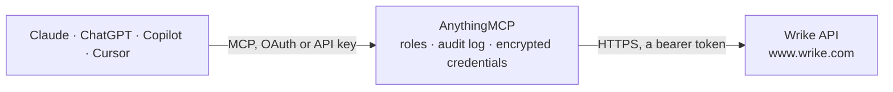

<!-- Generated by scripts/export-github-catalog.mjs in the anythingmcp-website repository. Do not edit by hand. -->

# Wrike MCP connector

Manage Wrike (work management: tasks, folders, projects, comments, timelogs, attachments) from any AI agent. 10 tools, Bearer token. The AnythingMCP connector gives Claude, ChatGPT, Microsoft Copilot, Cursor and Gemini 10 MCP tools for Wrike: 6 read and 4 can change data.

**Category:** [Project Management](../project-management.md) · **Tools:** 10 · **Setup guide:** [anythingmcp.com](https://anythingmcp.com/guides/wrike-to-mcp) · [Deutsch](https://anythingmcp.com/de/guides/wrike-to-mcp) · [Italiano](https://anythingmcp.com/it/guides/wrike-to-mcp) · [Español](https://anythingmcp.com/es/guides/wrike-to-mcp) · [日本語](https://anythingmcp.com/ja/guides/wrike-to-mcp) · [Русский](https://anythingmcp.com/ru/guides/wrike-to-mcp) · [中文](https://anythingmcp.com/zh/guides/wrike-to-mcp)

## Start without code

No installation and no terminal: AnythingMCP Cloud runs the Wrike connector for you, operated by helpcode.ai in Frankfurt, Germany.

1. **Click the button above** and create an account or sign in. The Wrike connector opens, ready to install.
2. **Paste the API key or token from your Wrike account.** Every click is in the [step-by-step guide](https://anythingmcp.com/guides/wrike-to-mcp).
3. **Click Install.** AnythingMCP shows the address of your MCP server.
4. **Add that address to your assistant:** [Claude](https://anythingmcp.com/guides/connect-wrike-to-claude) · [ChatGPT](https://anythingmcp.com/guides/connect-wrike-to-chatgpt) · [Microsoft Copilot](https://anythingmcp.com/guides/connect-wrike-to-copilot) · [Cursor](https://anythingmcp.com/guides/connect-wrike-to-cursor) · [Gemini CLI](https://anythingmcp.com/guides/connect-wrike-to-gemini) · [Meta Muse](https://anythingmcp.com/guides/connect-wrike-to-muse).
5. **Ask your first question**, for example: *Find the task for vendor invoice INV-2026-045 in Projects/Accounts Payable and show status, assignee and due date.*

Prefer help with the setup? [Talk to us](https://anythingmcp.com/contact).

## How it works

- **The AI client** speaks MCP (Streamable HTTP) to AnythingMCP and only sees tool names, descriptions and results. It never gets the Wrike credentials.
- **AnythingMCP** checks the client's role, builds the call from the tool definition, adds the credentials (a bearer token), calls Wrike, logs the call and returns the result.
- **Wrike** sees an ordinary API client with the rights of the account the credentials belong to.

## Tools

| Tool | What it does | Access |
|---|---|---|
| [`wrike_get_account`](#wrike_get_account) | Return account info. | read |
| [`wrike_list_folders`](#wrike_list_folders) | List all top-level folders + projects in the account. | read |
| [`wrike_get_folder`](#wrike_get_folder) | Get a folder/project by ID with details. | read |
| [`wrike_create_folder`](#wrike_create_folder) | Create a folder or project inside a parent folder. | write |
| [`wrike_list_tasks`](#wrike_list_tasks) | List tasks. | read |
| [`wrike_get_task`](#wrike_get_task) | Get one task with full custom fields, dates, parents, shareds. | read |
| [`wrike_create_task`](#wrike_create_task) | Create a task in a folder. | write |
| [`wrike_update_task`](#wrike_update_task) | Update task fields. | write |
| [`wrike_add_comment`](#wrike_add_comment) | Add a comment to a task. | write |
| [`wrike_list_contacts`](#wrike_list_contacts) | List users (Wrike calls them 'contacts'). | read |

## Tool reference

Every parameter as the AI client sees it in `tools/list`. Source: [`packages/backend/src/adapters/intl/wrike.json`](../../../packages/backend/src/adapters/intl/wrike.json).

### `wrike_get_account`

Return account info.

**Access:** read · **Call:** `GET /account`

No parameters.

### `wrike_list_folders`

List all top-level folders + projects in the account.

**Access:** read · **Call:** `GET /folders`

| Parameter | Type | Required | Description |
|---|---|---|---|
| `permalink` | string | no | Direct lookup by full Wrike URL. |
| `descendants` | boolean | no | If true include descendants tree. |
| `metadata` | string | no | JSON-encoded metadata filter. |
| `fields` | string | no | Optional fields: ['parentIds','childIds','customFields','project']. |

### `wrike_get_folder`

Get a folder/project by ID with details.

**Access:** read · **Call:** `GET /folders/{folder_id}`

| Parameter | Type | Required | Description |
|---|---|---|---|
| `folder_id` | string | yes | Folder ID. |

### `wrike_create_folder`

Create a folder or project inside a parent folder.

**Access:** write · **Call:** `POST /folders/{parent_folder_id}/folders`

| Parameter | Type | Required | Description |
|---|---|---|---|
| `parent_folder_id` | string | yes | Parent folder ID. |
| `title` | string | yes | Folder/project title. |
| `description` | string | no | Description. |
| `shareds` | any[] | no | Array of user IDs to share with. |
| `project` | object | no | If present, makes it a project: {ownerIds, status, startDate, endDate}. |

### `wrike_list_tasks`

List tasks. Filter by folder, status, assignee, completed/scheduled date range.

**Access:** read · **Call:** `GET /tasks`

| Parameter | Type | Required | Description |
|---|---|---|---|
| `folder_id` | string | no | Filter to folder's tasks. |
| `status` | string | no | Active, Completed, Deferred, Cancelled. |
| `responsibles` | string | no | JSON array of user IDs. |
| `scheduledDate` | string | no | JSON {start, end} window. |
| `fields` | string | no | Optional fields list. |
| `nextPageToken` | string | no | Pagination cursor. |

### `wrike_get_task`

Get one task with full custom fields, dates, parents, shareds.

**Access:** read · **Call:** `GET /tasks/{task_id}`

| Parameter | Type | Required | Description |
|---|---|---|---|
| `task_id` | string | yes | Task ID. |

### `wrike_create_task`

Create a task in a folder.

**Access:** write · **Call:** `POST /folders/{folder_id}/tasks`

| Parameter | Type | Required | Description |
|---|---|---|---|
| `folder_id` | string | yes | Parent folder ID. |
| `title` | string | yes | Task title. |
| `description` | string | no | Description (HTML allowed). |
| `responsibles` | any[] | no | Array of user IDs to assign. |
| `status` | string | no | Active, Completed, Deferred, Cancelled. |
| `importance` | string | no | Low, Normal, High. |
| `dates` | object | no | {type:'Backlog'\|'Milestone'\|'Planned', start:'YYYY-MM-DD', due:'YYYY-MM-DD', duration: <minutes>}. |

### `wrike_update_task`

Update task fields.

**Access:** write · **Call:** `PUT /tasks/{task_id}`

| Parameter | Type | Required | Description |
|---|---|---|---|
| `task_id` | string | yes | Task ID. |
| `title` | string | no | New title. |
| `description` | string | no | New description. |
| `status` | string | no | New status. |
| `addResponsibles` | any[] | no | User IDs to add. |
| `removeResponsibles` | any[] | no | User IDs to remove. |
| `dates` | object | no | Dates structure. |

### `wrike_add_comment`

Add a comment to a task.

**Access:** write · **Call:** `POST /tasks/{task_id}/comments`

| Parameter | Type | Required | Description |
|---|---|---|---|
| `task_id` | string | yes | Task ID. |
| `text` | string | yes | Comment body (Markdown supported). |
| `plain_text` | boolean | no | If true, render as plain text. |

### `wrike_list_contacts`

List users (Wrike calls them 'contacts').

**Access:** read · **Call:** `GET /contacts`

| Parameter | Type | Required | Description |
|---|---|---|---|
| `me` | boolean | no | If true, only the authenticated user. |
| `metadata` | string | no | JSON-encoded metadata filter. |

## Run it yourself

AnythingMCP is open source (AGPL-3.0). [Run it with Docker](../../../README.md#run-it-yourself), open **Connectors → Store**, pick **Wrike** and enter `WRIKE_ACCESS_TOKEN`, then add your MCP server URL to the AI client.

[← Project Management connectors](../project-management.md) · [All categories](../README.md)
