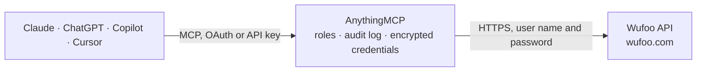

<!-- Generated by scripts/export-github-catalog.mjs in the anythingmcp-website repository. Do not edit by hand. -->

# Wufoo MCP connector

Read Wufoo (SurveyMonkey-owned classic form builder) submissions and form definitions from any AI agent. 6 tools, Basic auth, subdomain-templated URL. The AnythingMCP connector gives Claude, ChatGPT, Microsoft Copilot, Cursor and Gemini 6 MCP tools for Wufoo: 5 read and 1 can change data.

**Category:** [Forms & Surveys](../forms.md) · **Tools:** 6 · **Setup guide:** [anythingmcp.com](https://anythingmcp.com/guides/wufoo-to-mcp) · [Deutsch](https://anythingmcp.com/de/guides/wufoo-to-mcp) · [Italiano](https://anythingmcp.com/it/guides/wufoo-to-mcp) · [Español](https://anythingmcp.com/es/guides/wufoo-to-mcp) · [日本語](https://anythingmcp.com/ja/guides/wufoo-to-mcp) · [Русский](https://anythingmcp.com/ru/guides/wufoo-to-mcp) · [中文](https://anythingmcp.com/zh/guides/wufoo-to-mcp)

## Start without code

No installation and no terminal: AnythingMCP Cloud runs the Wufoo connector for you, operated by helpcode.ai in Frankfurt, Germany.

1. **Click the button above** and create an account or sign in. The Wufoo connector opens, ready to install.
2. **Paste the API key or token from your Wufoo account.** Every click is in the [step-by-step guide](https://anythingmcp.com/guides/wufoo-to-mcp).
3. **Click Install.** AnythingMCP shows the address of your MCP server.
4. **Add that address to your assistant:** [Claude](https://anythingmcp.com/guides/connect-wufoo-to-claude) · [ChatGPT](https://anythingmcp.com/guides/connect-wufoo-to-chatgpt) · [Microsoft Copilot](https://anythingmcp.com/guides/connect-wufoo-to-copilot) · [Cursor](https://anythingmcp.com/guides/connect-wufoo-to-cursor) · [Gemini CLI](https://anythingmcp.com/guides/connect-wufoo-to-gemini) · [Meta Muse](https://anythingmcp.com/guides/connect-wufoo-to-muse).
5. **Ask your first question**, for example: *Show submissions for the 'New Client Intake' form for client 'Nordic Solar OÜ' from 2026-10-01 to 2026-10-15.*

Prefer help with the setup? [Talk to us](https://anythingmcp.com/contact).

## How it works

- **The AI client** speaks MCP (Streamable HTTP) to AnythingMCP and only sees tool names, descriptions and results. It never gets the Wufoo credentials.
- **AnythingMCP** checks the client's role, builds the call from the tool definition, adds the credentials (user name and password), calls Wufoo, logs the call and returns the result.
- **Wufoo** sees an ordinary API client with the rights of the account the credentials belong to.

## Tools

| Tool | What it does | Access |
|---|---|---|
| [`wufoo_list_forms`](#wufoo_list_forms) | List all forms on the account. | read |
| [`wufoo_get_form`](#wufoo_get_form) | Fetch a single form's metadata by its Hash. | read |
| [`wufoo_get_form_fields`](#wufoo_get_form_fields) | Get a form's fields (the questions). | read |
| [`wufoo_list_form_entries`](#wufoo_list_form_entries) | List submissions (entries) for a form. | read |
| [`wufoo_count_form_entries`](#wufoo_count_form_entries) | Return just the entry count for a form (cheap — no entry payload). | read |
| [`wufoo_create_form_entry`](#wufoo_create_form_entry) | Submit a new entry to a form (programmatic submission). | write |

## Tool reference

Every parameter as the AI client sees it in `tools/list`. Source: [`packages/backend/src/adapters/intl/wufoo.json`](../../../packages/backend/src/adapters/intl/wufoo.json).

### `wufoo_list_forms`

List all forms on the account. Each form has Hash, Name, Description, EntryCount, DateCreated, DateUpdated, Url, IsPublic.

**Access:** read · **Call:** `GET /forms.json`

| Parameter | Type | Required | Description |
|---|---|---|---|
| `pretty` | boolean | no | Pretty-print JSON. |
| `includeTodayCount` | boolean | no | Include today's entry count per form. |

### `wufoo_get_form`

Fetch a single form's metadata by its Hash.

**Access:** read · **Call:** `GET /forms/{formIdentifier}.json`

| Parameter | Type | Required | Description |
|---|---|---|---|
| `formIdentifier` | string | yes | Form Hash (e.g. 'x7w1q1') or URL slug. |

### `wufoo_get_form_fields`

Get a form's fields (the questions). Returns Title, Type, ID (e.g. 'Field1'), IsRequired, Choices (for picker fields), DefaultVal.

**Access:** read · **Call:** `GET /forms/{formIdentifier}/fields.json`

| Parameter | Type | Required | Description |
|---|---|---|---|
| `formIdentifier` | string | yes | Form Hash. |
| `system` | boolean | no | If true, also return system fields (e.g. EntryId, DateCreated). |

### `wufoo_list_form_entries`

List submissions (entries) for a form. Each entry is a row with Field1/Field2/.../EntryId/DateCreated/IP keys.

**Access:** read · **Call:** `GET /forms/{formIdentifier}/entries.json`

| Parameter | Type | Required | Description |
|---|---|---|---|
| `formIdentifier` | string | yes | Form Hash. |
| `pageStart` | integer | no | 0-based offset. |
| `pageSize` | integer | no | Per page (max 100). |
| `sort` | string | no | Field ID to sort by. |
| `sortDirection` | string | no | ASC or DESC. |
| `system` | boolean | no | Include system fields. |
| `Filter1` | string | no | Filter expression: 'Field1+Is_equal_to+ACME'. |
| `match` | string | no | AND or OR (for multiple filters). |

### `wufoo_count_form_entries`

Return just the entry count for a form (cheap — no entry payload).

**Access:** read · **Call:** `GET /forms/{formIdentifier}/entries/count.json`

| Parameter | Type | Required | Description |
|---|---|---|---|
| `formIdentifier` | string | yes | Form Hash. |

### `wufoo_create_form_entry`

Submit a new entry to a form (programmatic submission). Body is keyed by Field ID strings: {Field1:'value', Field2:'value', ...}. Get field IDs from wufoo_get_form_fields.

**Access:** write · **Call:** `POST /forms/{formIdentifier}/entries.json`

| Parameter | Type | Required | Description |
|---|---|---|---|
| `formIdentifier` | string | yes | Form Hash. |
| `fields` | object | yes | Map of {Field1: value, Field2: value, ...}. |

## Run it yourself

AnythingMCP is open source (AGPL-3.0). [Run it with Docker](../../../README.md#run-it-yourself), open **Connectors → Store**, pick **Wufoo** and enter `WUFOO_SUBDOMAIN`, `WUFOO_API_KEY`, then add your MCP server URL to the AI client.

[← Forms & Surveys connectors](../forms.md) · [All categories](../README.md)
